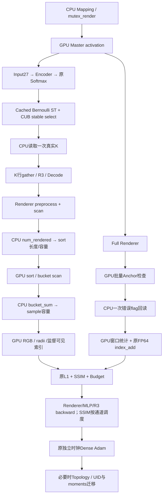

# mycartgs 第二阶段 CUDA 性能优化报告

> 部署状态更新（2026-10-23）：按用户要求，七项 CUDA 优化现已默认启用，配置文件、Mapper 成员初值及配置缺省值同步为开启。每项显式设为 `0` 仍可回退 Legacy。以下正文保留本次性能验收时的历史状态；“默认关闭”不再代表当前配置。此变更不构成新的性能或正确性验收，FP64 pruning 临界值、长期逐元素一致性及 workspace 收益的已知限制保持原记录。源码 manifest 对应默认值变更前的受测版本。

日期：2026-10-23。源 HEAD：`4269d7e3bad6cf5af7e1df1763634b61e98e0b51`；实际运行包含上轮及本轮未提交修改，以[源码manifest](<H:/AIProjects/cartgs优化更细致版/mycartgs/tests/diagnostics/anchor_selector_r3_cuda_phase2_20261023/final_source_manifest.json>)和[服务器SHA核对](<H:/AIProjects/cartgs优化更细致版/mycartgs/tests/diagnostics/anchor_selector_r3_cuda_phase2_20261023/evidence_final/source_verification.json>)为准。没有 stage、commit、push。

## 1. 结论与验收边界

本轮实现了 Anchor 校验/窗口统计融合、Cached Bernoulli ST 与稳定压缩、可安全保留Backward上下文的workspace池、SSIM通道分块Backward，以及两个范围严格的Topology快路。生产C++/CUDA编译成功，保留所有Legacy分支和上一轮三个开关。

- Full阶段Anchor统计：**56 → 8 次CUDA launch**；错误检查回读从8次变为1次。
- Selector Sampling/Budget/Compaction：18 → 7次launch。完整LoD从上轮177 → 166；完全Legacy为418。
- 固定地图、相机、Cached uniform与K下，六个实现的PSNR/SSIM/LPIPS/photo一致；原生身份、选中集合、窗口访问计数和正常prune mask exact。
- **不宣称所有正确性Gate通过。** FP64人工ULP阈值存在Legacy自身不确定性；连续训练中的少量初步梯度差异会被eps=1e-15的Adam放大。差异未抹去、未扩大统一容差。Workspace没有稳定端到端收益。
- **全部七个开关仍默认0。** 可选实现保留用于复现，不宣称已完成生产默认部署或独占GPU下稳定加速认证。

## 2. 真实架构与运行配置

同一fr1_xyz源checkpoint：15,891 Gaussian / 6,121 Anchor，Variable Anchor 1～10成员，L0/L1/L2，Feature16、Input27、Encoder27→32、Selector32→32→2、原补偿头32→32→14。

实际K与可见性如下；radii正值表示preprocess可见/有效半径，不冒充逐像素贡献数量：

| 档位 | N | K | radii正值 |
| --- | --- | --- | --- |
| Full | 15891 | 15891 | 8574 |
| lod_0.010000 | 15891 | 156 | 137 |
| lod_0.050000 | 15891 | 799 | 575 |
| lod_0.100000 | 15891 | 1582 | 1040 |
| lod_0.150000 | 15891 | 2368 | 1447 |


R3是生产C++/LibTorch路径，四张独立[N,14]表：`delta=stopgrad(C(h))+residual_ratio[ids]`。C冻结/detach；R3维持Dense Adam，其他ratio的grad=None与独立step不变，未选行的历史moment仍更新。训练ratio仍1%/5%/10%/15%；未见ratio维持原始raw-ratio线性插值与端点。TF、ChangeDistill、SI/GI状态未改。本轮不增加Loss或网络。

Online LoD仍半分辨率，Tail仍原分辨率；自然停止、Full/LoD实际顺序和Mapping预算配置保持原样。没有把Mapping强改为10000。

## 3. 实施位置与接口

| 模块 | 实际源码 | 计算与反向 |
| --- | --- | --- |
| Anchor校验 | [src/anchor_stats_cuda.cu:49](<H:/AIProjects/cartgs优化更细致版/mycartgs/src/anchor_stats_cuda.cu:49>) | 计数/非法owner标记/成员排序/容量、层级、finite、scale检查；6个错误类别统一回读48字节，报告最小出错row或Anchor |
| Full统计 | [src/anchor_stats_cuda.cu:63](<H:/AIProjects/cartgs优化更细致版/mycartgs/src/anchor_stats_cuda.cu:63>) | visibility按owner置位，每Anchor访问只加1；成员slot统计FP64；恢复逻辑保持原float cutoff；总opacity保留原FP64 index_add_ |
| 生产统计入口 | [src/gaussian_model.cpp:159](<H:/AIProjects/cartgs优化更细致版/mycartgs/src/gaussian_model.cpp:159>) | no-grad路径，不新增反向或Loss；仍调用assertBlocks |
| Owner检查入口 | [improvements/selector/explicit_anchor_blocks.h:20](<H:/AIProjects/cartgs优化更细致版/mycartgs/improvements/selector/explicit_anchor_blocks.h:20>) | 不支持的dtype/layout维持Legacy；没有降低频率 |
| Sampling/压缩 | [src/selector_sampling_cuda.cu:20](<H:/AIProjects/cartgs优化更细致版/mycartgs/src/selector_sampling_cuda.cu:20>) | 保留Softmax，支持stride=2；CUB Flagged稳定压缩；逻辑shape为真实K，容量N，不向Renderer padding |
| ST VJP | [src/selector_sampling_cuda.cpp:4](<H:/AIProjects/cartgs优化更细致版/mycartgs/src/selector_sampling_cuda.cpp:4>) | `dp=(grad_mask+grad_probability)*eligible`；uniform、bool gate不产生梯度；Budget仍原sum/abs/div |
| 生产LoD入口 | [src/gaussian_mapper.cpp:3362](<H:/AIProjects/cartgs优化更细致版/mycartgs/src/gaussian_mapper.cpp:3362>) | 与原Gaussian gather、R3、14D decode衔接；不改参数注册与梯度路由 |
| Workspace池 | [cuda_rasterizer/rasterize_points.cu:55](<H:/AIProjects/cartgs优化更细致版/mycartgs/cuda_rasterizer/rasterize_points.cu:55>) | 每线程最多4组；只在Tensor/Storage均无外部持有且default stream时复用；不足容量扩容，不覆盖live context |
| Saved State | [src/gaussian_rasterizer.cpp:60](<H:/AIProjects/cartgs优化更细致版/mycartgs/src/gaussian_rasterizer.cpp:60>) | 各次Forward的geom/binning/image/sample仍由对应Autograd context持有 |
| SSIM通道并行 | [cuda_rasterizer/conv.cu:1008](<H:/AIProjects/cartgs优化更细致版/mycartgs/cuda_rasterizer/conv.cu:1008>) | 原32×32 tile、halo、11×11权重与计算顺序；grid.z按通道独立写回，无新atomic |
| SSIM线程路由 | [include/loss_utils.h:178](<H:/AIProjects/cartgs优化更细致版/mycartgs/include/loss_utils.h:178>) | Forward保存后端选择，Backward在LibTorch工作线程中按context恢复；不能只依赖Mapping线程TLS |
| Topology无候选快路 | [src/gaussian_model.cpp:1175](<H:/AIProjects/cartgs优化更细致版/mycartgs/src/gaussian_model.cpp:1175>) | 仅在无有限梯度达阈值时跳过4个人口拷贝与CPU排序；不跳最终检查/窗口清理/拓扑时钟 |
| 部分prune快路 | [improvements/selector/variable_anchor_blocks.h:112](<H:/AIProjects/cartgs优化更细致版/mycartgs/improvements/selector/variable_anchor_blocks.h:112>) | Anchor行/key/level均没变才跳空间桶重建；所有Gaussian/R3/moment迁移仍执行 |

### Tensor契约

- owner `[N] int64 CUDA`；member_counts/level `[A] int64`；center `[A,3] FP32`；参考尺度`[A,1] FP32`；成员工作表`[A,10] int64`。
- Anchor O为`[A] FP64`、访问次数`[A] int64`；slot O为`[N] FP64`、两个低opacity计数为`[N] int64`。统计分母仍是Anchor可见访问次数，不把未观察当作opacity=0。
- probability/uniform为`[N] FP32`，probability常见stride=2；eligible与flags为`[N] bool`；输出IDs为`[K] int64`连续view，底层容量N。u==p不选择。
- 不对Offset做clamp，不跨训练step缓存可变XYZ、Feature或属性。R3/UID、Feature维度与checkpoint schema未改。

## 4. CPU/GPU执行依赖与同步



Sampling仍有一次动态K同步。Renderer仍有真实依赖的instance/bucket计数，以及radii nonzero产生的监督索引；后者被updateElasticSupervision消费，不能直接删掉。生产还保留finite-loss等检查。Native重放不包含全部Mapper控制/日志，因此不能把其core latency直接等同完整在线Mapping。

未引入多ratio并发Backward、Full/LoD并行step、异步拓扑写或跨streamRenderer；mutex_render和既有同步没有删除。安全并行的实际实现是SSIM通道的独立block调度。

## 5. 性能协议

RTX3090 24GB、CUDA11.8、LibTorch2.3.1 ABI1、g++9、sm86。Python指标环境独立ABI0。新Anchor/Selector CUDA沿用--fmad=false；SSIM/Rasterizer沿用原编译选项，不静默改变精度。

| 版本 | 开启内容 |
| --- | --- |
| A | 完全Legacy |
| B | 上轮Adam、Decode、Input27 |
| C | B + Anchor统计/校验/安全Topology快路 |
| D | C + Sampling/ST/Stable Compaction |
| E_workspace | D + workspace池 |
| E | E_workspace + SSIM通道Backward |

每种分辨率两轮，第二轮顺序反转；每case 10次warmup、60次replay，rep0用于完整fixture，剩余59次/轮进入计时。下面表格是**两轮p50的均值**，单位ms；逐轮mean/p50/p95/p99与CPU提交/CUDA Event分开保留在CSV。

GPU存在其他任务，采用成对交替而非杀进程；负载、功率、显存记录见gpu_load.csv。Nsight只用于launch、kernel和API分析，独立于正式计时。共享GPU与非独占驱动分配使某些档位/Topology结果波动，不能承诺统一倍率。

预处理边界：瞬时半分辨率微基准使用uint8 OpenCV resize，再转FP32；连续半分辨率重放与真实在线使用FP32 bilinear缓存。候选之间输入一致，但这两套协议的绝对质量不能混用；原生640×480 fixture不受该量化差异影响。没有将微基准当作完整Mapper或改变真实在线GT路径。

## 6. 固定checkpoint的核心Mapping时延


图中误差线仅表示两次运行p50的范围，不是置信区间；原始逐轮p95/p99另见CSV。

| 范围 | 档位 | A | B | C | D | E_workspace | E | 相对B |
| --- | --- | --- | --- | --- | --- | --- | --- | --- |
| Online半分辨率 | lod_0.010000 | 5.312 | 3.035 | 3.041 | 2.951 | 2.942 | 2.942 | +3.1% |
| Online半分辨率 | lod_0.050000 | 5.463 | 3.091 | 3.091 | 2.928 | 2.890 | 2.964 | +4.1% |
| Online半分辨率 | lod_0.100000 | 5.401 | 3.015 | 3.082 | 2.967 | 2.946 | 3.050 | -1.2% |
| Online半分辨率 | lod_0.150000 | 5.421 | 3.088 | 3.103 | 3.003 | 3.009 | 2.987 | +3.3% |
| Full 原分辨率 | Full | 3.983 | 3.646 | 3.226 | 3.233 | 3.149 | 2.949 | +19.1% |
| Tail原分辨率 | lod_0.010000 | 5.503 | 3.509 | 3.654 | 3.528 | 3.483 | 3.618 | -3.1% |
| Tail原分辨率 | lod_0.050000 | 5.473 | 3.552 | 3.578 | 3.582 | 3.486 | 3.545 | +0.2% |
| Tail原分辨率 | lod_0.100000 | 5.454 | 3.612 | 3.656 | 3.636 | 3.514 | 3.543 | +1.9% |
| Tail原分辨率 | lod_0.150000 | 5.494 | 3.587 | 3.634 | 3.678 | 3.392 | 3.484 | +2.9% |


Full半分辨率只是额外诊断，不当作真实Full训练路径列入上表。Online的Full实际仍原分辨率，LoD半分辨率。

### Kernel launch

| 档位 | A | B | C | D | E | 本轮减少 |
| --- | --- | --- | --- | --- | --- | --- |
| Full | 199 | 152 | 104 | 104 | 104 | 48 |
| lod_0.010000 | 418 | 177 | 177 | 166 | 166 | 11 |
| lod_0.050000 | 418 | 177 | 177 | 166 | 166 | 11 |
| lod_0.100000 | 418 | 177 | 177 | 166 | 166 | 11 |
| lod_0.150000 | 418 | 177 | 177 | 166 | 166 | 11 |


原生Full统计包含真正的GaussianModel调用，最终是56→8，不是将独立微基准估算成在线次数。R3 lookup、MLP结构和上一轮kernel未变；LoD减少的11个launch来自sampling/compaction。Workspace和SSIM调度不减少launch数量。

### 必要同步

| 版本 | 阶段 | API | 每步次数 |
| --- | --- | --- | --- |
| B | full/anchor_statistics | cudaMemcpyAsync_v3020 | 8.0 |
| B | full/anchor_statistics | cudaStreamSynchronize_v3020 | 8.0 |
| B | sample_budget_compact | cudaMemcpyAsync_v3020 | 1.0 |
| B | sample_budget_compact | cudaStreamSynchronize_v3020 | 1.0 |
| B | renderer_forward | cudaMemcpyAsync_v3020 | 1.0 |
| B | renderer_forward | cudaMemcpy_v3020 | 3.0 |
| B | renderer_forward | cudaStreamSynchronize_v3020 | 1.0 |
| C | full/anchor_statistics | cudaMemcpyAsync_v3020 | 1.0 |
| C | full/anchor_statistics | cudaStreamSynchronize_v3020 | 1.0 |
| C | sample_budget_compact | cudaMemcpyAsync_v3020 | 1.0 |
| C | sample_budget_compact | cudaStreamSynchronize_v3020 | 1.0 |
| C | renderer_forward | cudaMemcpyAsync_v3020 | 1.0 |
| C | renderer_forward | cudaMemcpy_v3020 | 3.0 |
| C | renderer_forward | cudaStreamSynchronize_v3020 | 1.0 |
| D | full/anchor_statistics | cudaMemcpyAsync_v3020 | 1.0 |
| D | full/anchor_statistics | cudaStreamSynchronize_v3020 | 1.0 |
| D | sample_budget_compact | cudaMemcpyAsync_v3020 | 1.0 |
| D | sample_budget_compact | cudaStreamSynchronize_v3020 | 1.0 |
| D | renderer_forward | cudaMemcpyAsync_v3020 | 1.0 |
| D | renderer_forward | cudaMemcpy_v3020 | 3.0 |
| D | renderer_forward | cudaStreamSynchronize_v3020 | 1.0 |
| E | full/anchor_statistics | cudaMemcpyAsync_v3020 | 1.0 |
| E | full/anchor_statistics | cudaStreamSynchronize_v3020 | 1.0 |
| E | sample_budget_compact | cudaMemcpyAsync_v3020 | 1.0 |
| E | sample_budget_compact | cudaStreamSynchronize_v3020 | 1.0 |
| E | renderer_forward | cudaMemcpyAsync_v3020 | 1.0 |
| E | renderer_forward | cudaMemcpy_v3020 | 3.0 |
| E | renderer_forward | cudaStreamSynchronize_v3020 | 1.0 |


API耗时另见CSV：Memcpy/同步等待可能包含之前排队的GPU工作，不能把API等待、queue与kernel时间简单相加。没有声称消除了所有GPU→CPU同步。

## 7. Anchor统计、pruning与Topology验证

独立1000步窗口覆盖重复visible IDs、空可见集合、1～10成员、opacity变化、slot恢复/失活、所有原始检查类别；正常窗口prune mask exact。真实checkpoint受控事件的owner、UID、counts、level、key、R3表及两套Adam状态逐项一致，topology fixture超阈值元素总计0。

**严格阈值补测的结论不能省略：** 最初确定性逐Anchor求和，在80轮ULP probe中有1次prune差异，同批Legacy自身有1次。最终保留原FP64 index_add_之后，probe仍有7次跨运行差异，Legacy自身有4次，均属于人工设置的严格阈值邻接。CSV逐例保留。**原子加法本身不确定，不能承诺任意ULP边界的run-to-run prune exact；没有调阈值、改删除规则或放宽FP64容差。** 因此这项全域exact Gate不标绿，默认仍关闭。

最终没有融合决定pruning的总opacity归约，避免主动引入另一种求和顺序；只融合观测/slot处理与校验。初版结果、失败probe和最终结果分别保存，不择优丢弃。

### Topology时延

| 运行 | 事件 | 版本 | N | A | p50 | p95 |
| --- | --- | --- | --- | --- | --- | --- |
| -1 | anchor_growth | legacy | 15891→15892 | 6121→6122 | 12.961 | 24.452 |
| -1 | anchor_growth | fused | 15891→15892 | 6121→6122 | 9.125 | 29.573 |
| -1 | anchor_prune | legacy | 15891→15886 | 6121→6120 | 8.975 | 21.707 |
| -1 | anchor_prune | fused | 15891→15886 | 6121→6120 | 8.213 | 20.064 |
| -1 | gaussian_density | legacy | 15891→15907 | 6121→6121 | 22.028 | 26.698 |
| -1 | gaussian_density | fused | 15891→15907 | 6121→6121 | 9.091 | 36.336 |
| -1 | noop_gaussian | legacy | 15891→15891 | 6121→6121 | 1.884 | 8.369 |
| -1 | noop_gaussian | fused | 15891→15891 | 6121→6121 | 0.935 | 1.224 |
| 1 | anchor_growth | legacy | 15891→15892 | 6121→6122 | 16.415 | 27.205 |
| 1 | anchor_growth | fused | 15891→15892 | 6121→6122 | 9.604 | 23.053 |
| 1 | anchor_prune | legacy | 15891→15886 | 6121→6120 | 8.818 | 14.960 |
| 1 | anchor_prune | fused | 15891→15886 | 6121→6120 | 8.730 | 21.013 |
| 1 | gaussian_density | legacy | 15891→15907 | 6121→6121 | 13.566 | 26.224 |
| 1 | gaussian_density | fused | 15891→15907 | 6121→6121 | 9.089 | 32.873 |
| 1 | noop_gaussian | legacy | 15891→15891 | 6121→6121 | 2.212 | 12.589 |
| 1 | noop_gaussian | fused | 15891→15891 | 6121→6121 | 0.516 | 1.688 |


这是实际checkpoint上的**人工梯度/窗口/birth clock事件**，不是在线自然事件分布。若存在重复运行，其差异全部保留。无候选快路稳定减少拷贝/排序；其它事件受emptyCache/驱动释放与外部负载影响，不能只取有利的一轮。子阶段NVTX与cudaFree计数见topology_substage_profile.csv；嵌套inclusive范围不能相加当成总耗时。

没有给整个prunePoints增加mask全false就return：该函数仍替换叶子、迁移优化器别名并清理旧grad；直接返回会改变现有训练行为。没有重写空间Hash或改变CPU stable_sort/负坐标量化。

## 8. Selector与R3正确性

Cached Bernoulli仍严格u<p。Inactive gate、全人口Budget分母、原Softmax、零budget邻接与stable row顺序不变。独立318项Forward/ST/Budget/IDs测试误差为0，覆盖stride2、K0/1/N、u==p、cutoff相等、100K规模。当前ratio R3梯度、其他ratio grad=None、UID与leaf clock在原生fixture中保持相同。

固定梯度Dense Adam重复验证13640项记录max error=0，包括tiny gradient、旧moment、独立LR/step和fallback；本轮未修改Adam。

## 9. Workspace与SSIM

Workspace按线程/device管理，default stream才允许命中。引用计数同时检查TensorImpl与Storage，四组上限，所有live Forward/retained graph继续持有自己的byte Tensor。第二次Forward不会覆盖第一次Backward上下文；覆盖K0/1、Full、四档LoD、importance输出和反向。

正常photo量级VJP通过；大幅随机VJP压力测试有少量超过三次Legacy逐元素包络的结果，原始失败文件保留，不宣称任意反向探针均严格通过。Workspace端到端收益弱，内存成本明显，不建议默认使用。

| 阶段 | 版本 | allocated_MiB | peak_MiB | Tensor分配请求 | 设备分配 |
| --- | --- | --- | --- | --- | --- |
| Full | B | 46.52 | 96.64 | 123 | 0 |
| Full | C | 46.99 | 97.10 | 82 | 0 |
| Full | D | 46.99 | 97.10 | 82 | 0 |
| Full | E_workspace | 81.79 | 95.79 | 78 | 0 |
| Full | E | 81.79 | 95.79 | 78 | 0 |
| lod_0.050000 | B | 65.41 | 101.12 | 165 | 0 |
| lod_0.050000 | C | 65.87 | 101.59 | 165 | 0 |
| lod_0.050000 | D | 65.99 | 101.66 | 158 | 0 |
| lod_0.050000 | E_workspace | 99.95 | 114.96 | 154 | 0 |
| lod_0.050000 | E | 99.95 | 114.96 | 154 | 0 |


steady-state物理设备分配原本就是0，workspace主要少4个Tensor/Storage分配请求，不能说避免了4次cudaMalloc。容量只增长，活跃context多时缓存显存上升；clearIdle只清理无持有项。

SSIM原loss保持`0.8*L1+0.2*(1-fast_ssim)`。5种尺寸的独立VJP逐元素误差0，Autograd context保存后端选择测试通过；Nsight确认优化版本实际执行bool=1实例。寄存器46→40，shared memory14112B不变，每SM resident block仍1；不能据此声称occupancy提高。

| 尺寸 | Legacy | CUDA | 减少 |
| --- | --- | --- | --- |
| 1×1 | 0.1034 | 0.0440 | 57.4% |
| 31×17 | 0.1101 | 0.0471 | 57.2% |
| 83×61 | 0.1075 | 0.0461 | 57.1% |
| 320×240 | 0.3041 | 0.2427 | 20.2% |
| 640×480 | 0.8934 | 0.8428 | 5.7% |


Nsight Compute实际返回ERR_NVGPUCTRPERM，保留日志。没有硬件计数器依据将SSIM定性为显存带宽瓶颈，也没有改窗口、近似Loss或盲目搜tile配置。

## 10. 固定渲染与连续训练Gate

下表是相同K/图像的各指标相对B的**最大绝对差**；PSNR按clamp[0,1]标准图像，另存unclamped PSNR；photo使用原始渲染值。标准SSIM与Loss中的fast_ssim分开存储。

| 版本 | psnr | ssim | lpips | photo | l1 | loss_ssim | budget |
| --- | --- | --- | --- | --- | --- | --- | --- |
| A | 0 | 2.38e-07 | 1.19e-06 | 2.98e-08 | 3.73e-09 | 1.79e-07 | 0 |
| C | 0 | 0 | 0 | 0 | 0 | 0 | 0 |
| D | 0 | 0 | 0 | 0 | 0 | 0 | 0 |
| E_workspace | 0 | 0 | 0 | 0 | 0 | 0 | 0 |
| E | 0 | 0 | 0 | 0 | 0 | 0 | 0 |


固定fixture精确项异常0项，shape/grad=None一致。前向和梯度按预注册FP32 atol2e-5/rtol2e-4检验；固定梯度Adam单独采用2e-7/2e-6。FP64采用atol1e-12/rtol2e-14，未变更。

固定Backward之后仍有23组parameter-after超普通浮点门槛；包括B自身重复，不把这些覆盖为通过。最坏元素、Gaussian UID/owner与输入在worst_error_locations.csv及完整fixture中。初始render、selector、loss一致不等于所有Adam后参数一致。

连续控制：原分辨率50轮Full→轮转LoD，半分辨率LoD另30轮；两次B、两次E，固定地图/相机/缓存uniform/拓扑，使用相同fresh Adam初始化，**没有冒充PLY恢复了完整在线优化器状态**。快照0/9/24/49或29保存全部梯度、参数、moments、step；严格差异仍记录。

| 运行 | Full_photo | LoD_photo |
| --- | --- | --- |
| continuous_B_a | 0.03509860 | 0.06842220 |
| continuous_B_b | 0.03509480 | 0.06842190 |
| continuous_C | 0.03509660 | 0.06842170 |
| continuous_D | 0.03509570 | 0.06842260 |
| continuous_E_a | 0.03509160 | 0.06842200 |
| continuous_E_b | 0.03509640 | 0.06842190 |
| continuous_online_B_a | 0.04096970 | 0.06823270 |
| continuous_online_B_b | 0.04096910 | 0.06823270 |
| continuous_online_E_a | 0.04096970 | 0.06823330 |
| continuous_online_E_b | 0.04097630 | 0.06823270 |


这些是固定单视图短程验证，不是独立场景质量实验。后期RGB和参数逐元素差异会累积，B自身也发生漂移；候选个别重复超过基线包络。因此不标记长期逐元素Parity为通过，也不以loss接近替代梯度正确性。

## 11. 完整在线fr1_xyz运行

两次完整轨迹均正常退出，非串行joint，Loss/调度/分辨率/自然停止配置未改。以下是**真实异步系统**的观测，不是同地图/同训练预算的因果加速实验。

| 版本 | 阶段 | 样本 | mean | p50 | p95 | p99 |
| --- | --- | --- | --- | --- | --- | --- |
| B | online | 5344 | 5.959 | 4.058 | 14.791 | 30.562 |
| B | tail | 556 | 11.475 | 9.062 | 20.570 | 20.973 |
| E | online | 5458 | 5.608 | 3.771 | 14.108 | 29.488 |
| E | tail | 442 | 10.260 | 7.862 | 18.996 | 19.510 |


| 版本 | Gaussian | Anchor | Online_steps | Tail_steps | Online_topology | Tail_topology | R3_Adam_steps |
| --- | --- | --- | --- | --- | --- | --- | --- |
| B | 13512 | 5072 | 5344 | 556 | 9 | 1 | 608/608/608/608 |
| E | 13458 | 5189 | 5458 | 442 | 9 | 1 | 603/602/602/602 |


最终checkpoint检查owner范围、1～10成员、member_counts、L0～L2、UID唯一性、四张R3表[N,14]全部通过；LoD nonfinite计数为0。未保存在线完整Master Adam的既有导出限制没有被假装消除，moment迁移依靠受控fixture验证。

在线步数/Topology/最终N不同，不能由这里的最终地图质量差异判定CUDA错误，也不能将该时延差全部归因kernel优化。本轮按要求不继续研究历史在线质量差异。完整进程总时长见suite_commands.json；输入时间推进及自然停止使更快Mapping通常体现为更多迭代，不能等同轨迹吞吐提升。

## 12. 规模扩展与剩余瓶颈

人工N=50K/100K分别保存Anchor、Sampling Forward/Backward计时；原始分布和真实地图明确区分。Anchor人工压力为满10成员布局，Selector为人工同ratio概率/固定uniform，不能当成100K真实SLAM端到端测量。

| 范围 | N | CUDA | 阶段 | p50 | p95 |
| --- | --- | --- | --- | --- | --- |
| Anchor人工满10成员 | 15891 | 0 | stats_only | 0.1489 | 0.2345 |
| Anchor人工满10成员 | 15891 | 0 | validate | 0.3501 | 1.1639 |
| Anchor人工满10成员 | 15891 | 1 | stats_only | 0.0333 | 0.1898 |
| Anchor人工满10成员 | 15891 | 1 | validate | 0.0346 | 0.0554 |
| Anchor人工满10成员 | 50000 | 0 | stats_only | 0.1452 | 0.2126 |
| Anchor人工满10成员 | 50000 | 0 | validate | 0.3645 | 1.2639 |
| Anchor人工满10成员 | 50000 | 1 | stats_only | 0.0352 | 0.1796 |
| Anchor人工满10成员 | 50000 | 1 | validate | 0.0356 | 0.0543 |
| Anchor人工满10成员 | 100000 | 0 | stats_only | 0.1528 | 0.3037 |
| Anchor人工满10成员 | 100000 | 0 | validate | 0.3964 | 1.7987 |
| Anchor人工满10成员 | 100000 | 1 | stats_only | 0.0432 | 0.1888 |
| Anchor人工满10成员 | 100000 | 1 | validate | 0.0382 | 0.0689 |
| Selector人工概率 | 15891 | 0 | backward | 0.2294 | 0.4958 |
| Selector人工概率 | 15891 | 0 | forward | 0.2048 | 0.6401 |
| Selector人工概率 | 15891 | 1 | backward | 0.2243 | 0.4863 |
| Selector人工概率 | 15891 | 1 | forward | 0.1178 | 0.2583 |
| Selector人工概率 | 50000 | 0 | backward | 0.2294 | 0.2855 |
| Selector人工概率 | 50000 | 0 | forward | 0.2068 | 0.4653 |
| Selector人工概率 | 50000 | 1 | backward | 0.2284 | 0.4006 |
| Selector人工概率 | 50000 | 1 | forward | 0.1162 | 0.2807 |
| Selector人工概率 | 100000 | 0 | backward | 0.2299 | 0.3919 |
| Selector人工概率 | 100000 | 0 | forward | 0.2094 | 0.5081 |
| Selector人工概率 | 100000 | 1 | backward | 0.2263 | 0.3983 |
| Selector人工概率 | 100000 | 1 | forward | 0.1147 | 0.2753 |


### 剩余热点优先级

以下是实测归属开销，不是承诺可全部回收的加速空间。RTX3090 由其他任务共享；当前全部新开关默认关闭。

1. **P0：SSIM / Renderer Backward。** 5% LoD Nsight 中，Backward 为 1.629 ms，占所计 kernel 时间 52.9%；Renderer Forward 为 0.605 ms。先研究 SSIM 前向统计复用与 Renderer Backward 的真实热点，保留 11×11、原公式和VJP。NCU仍无计数器权限，不能断言属于DRAM瓶颈。
2. **P1：Renderer动态计数与CPU边界。** `num_rendered` 控制CUB sort长度与binning容量，`bucket_sum`控制sample容量；另有radii的nonzero用于监督索引。这些读取有真实消费者。下一步需设备计数接口和容量策略的独立设计；不能删除同步或以padding Gaussian代替真实K。
3. **P1：Topology批量迁移。** 可研究同一survivor permutation同时迁移Master/R3/Adam，必须保留叶子替换、grad=None、别名与clock。emptyCache与驱动释放开销在共享GPU上波动很大，不能以单轮事件结果宣称稳定加速。
4. **P1：MLP输入与Encoder前向融合微基准。** 先比较真实N/K下cuBLAS和自定义融合；不自动重写GEMM、不启用不同精度。Budget继续原ATen归约，不为多省几个launch改变零点附近的符号。
5. **P2：额外Anchor哈希/R3 lookup/workspace复杂化。** Full统计已减少到 8 次launch/1次错误回读，R3仍只gather K行；GPU hash低频且涉及FP64负坐标量化。Workspace只少4个分配请求，steady-state物理设备分配原本就是0，常驻显存反而增加。

边界：人工ULP prune probe连Legacy自身也发生翻转。最终总opacity仍调用原FP64 index_add_；不得以调阈值、扩大容差或取消检查宣称全域exact。长期连续训练存在Renderer atomic和tiny-gradient Adam敏感性，严格差异文件保留，不能改epsilon以通过Gate。


## 13. 开关与复现

```yaml
CUDA.fused_dense_adam: 0
CUDA.fused_compensation_decode: 0
CUDA.fused_anchor_input_pack: 0
CUDA.fused_anchor_full_stats: 0
CUDA.fused_selector_compaction: 0
CUDA.reuse_renderer_workspace: 0
CUDA.optimized_ssim_backward: 0
```

独立变更位置、接口和源码SHA均在本报告及manifest；脚本与完整命令见本目录README、run_suite.py、suite_commands.json。最终结果目录为服务器`anchor-selector-r3-cuda-phase2-20261023/final_legacy_reduction`；初版确定性归约保留在独立证据中，不与最终速度混算。

本地完整Tensor与失败证据已提取到[证据目录](<H:/AIProjects/cartgs优化更细致版/mycartgs/tests/diagnostics/anchor_selector_r3_cuda_phase2_20261023/evidence_archive>)/results；包括B/E四ratio+Full的Forward/VJP/Adam fixture、连续训练快照与Topology迁移fixture。328个文件逐项SHA已验证，45个源码文件与服务器一致；检查结果见[delivery_checks.json](<H:/AIProjects/cartgs优化更细致版/mycartgs/tests/diagnostics/anchor_selector_r3_cuda_phase2_20261023/delivery_checks.json>)。原始未选入压缩包的重放和完整在线模型仍保留在服务器实验目录。

交付CSV均为实测数据。未完成：独占GPU认证、任意ULP prune exact、长期逐元素一致性认证、Renderer设备端动态长度接口、跨stream训练、SSIM硬件计数器。没有为通过测试修改epsilon、阈值、Loss、网络或采样。

**下一步优先SSIM/Renderer Backward；Anchor高频校验和Selector压缩已明显缩小。R3 gather与更复杂workspace池不是当前优先项。生产默认保持Legacy，后续按本轮失败/未确定Gate逐项放行。**
