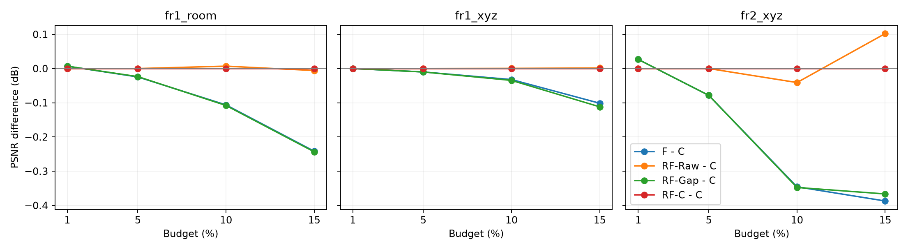
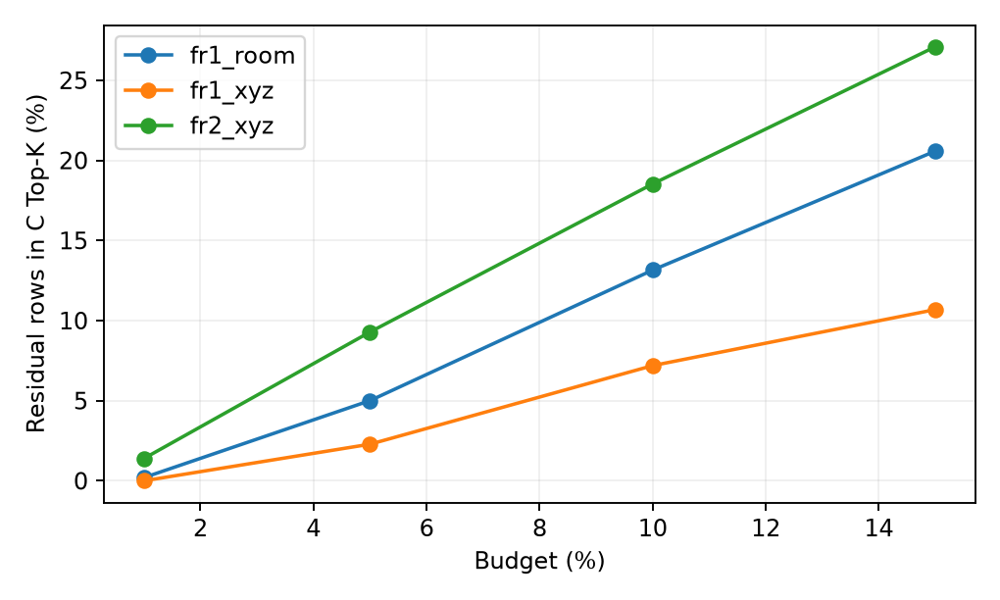

# Final Representatives + Residual Fallback Audit

## 结论

**REPRESENTATIVE + COMPACT RESIDUAL FALLBACK SUPPORTED**

只补入完整candidate的1.60%-4.06%作为residual detail，就能在保留全部Final reps的基础上，精确恢复当前1%-15%范围的C行为；候选保留比例为30.34%-47.66%。这支持candidate compression结构，不等于新的重要性定义或生产速度结论。Raw-only candidate proxy恢复大部分render质量，但高ratio不能保证C identity或所有scene质量一致；Gap-only不足。

RAW proxy：MIXED，有较强近似质量证据但不保证高ratio稳定恢复；GEOMETRY-GAP proxy：NOT SUPPORTED；RESIDUAL SCORE REQUIRED仅限本轮等数量pool对Current C selected-set exact completeness，不是GT重建最优的必要性证明。

| 问题 | 回答 |
| --- | --- |
| Q1 | 见12-case representative/residual数量表；residual比例随ratio在三个scene均增长。 |
| Q2 | 支持到15%，在保留全部Final reps前提下，最少补入fr1_room 1554、fr1_xyz 379、fr2_xyz 1750个Current-C residual。 |
| Q3 | P15保留完整population的30.34% / 47.66% / 30.65%；候选规模压缩比3.30x / 2.10x / 3.26x，不是速度提升。 |
| Q4 | YES：四ratio order/selected sets exact，真实render四指标per-view及aggregate差全部为0。 |
| Q5 | MIXED：Raw proxy三scene 1/5% exact；高ratio整体接近但fr2_xyz 10% PSNR下降0.040940 dB、15%提高0.102123 dB，不能称统一稳定恢复。 |
| Q6 | NO：Gap proxy 15% residual recall仅1.87% / 3.43% / 2.17%，高ratio明显不能恢复。 |
| Q7 | BOTH：Raw importance是主要区分信号，geometry gap修正Current-C residual身份。精确恢复C需要联合信息；不能推出真实重建质量必须采用同一乘积公式。 |
| Q8 | YES（限本轮冻结1%-15%）：Final Representative Core + residual detail获得明确结构支持，未支持多层precedence。 |
| Q9 | DESIGN CHEAP RESIDUAL FALLBACK，作为下一轮研究建议；暂保留FULL CURRENT C，不直接训练Selector，本轮不实现。 |

## 1. 冻结协议与Baseline reproduction

三个scene完全复用既有final Master、拓扑/xyz/activated scale/opacity/SH、TF/AABB、Raw contribution/Bank/Raw SI、valid AND observed、target-2048 tree/final leaves、B/C ranking、相机/GT/renderer/四指标；maturity=1。禁止的Progressive、多层union、d50x32、新训练或新proxy均未加入。evaluation views为fixed non-Bank archived evaluation views，参与过原SLAM，不称unseen或独立test-only。

HEAD=`3cfccc4a92c8e1ec6c3d491dac1c9efbf151daeb`，branch=`redundancy-aware-si`；production tracked源码/index未修改。预注册SHA256：`935726c91e454928bff9a2ea29c37f34630566dc11654d7f7224a567b7262953`，在baseline/新render前固定且结束复核。所有selected集合在新render前保存SHA，结束未变。

| scene | checkpoint | candidate N | Bank/eval | K 1/5/10/15% |
| --- | --- | --- | --- | --- |
| fr1_room | 16900_shutdown | 50330 | 69/161 | 503/2517/5033/7550 |
| fr1_xyz | 9900_shutdown | 23643 | 18/54 | 236/1182/2364/3546 |
| fr2_xyz | 37900_shutdown | 43059 | 14/39 | 431/2153/4306/6459 |

A/B/C/F完整ranking、selected rows、C binary/tree均exact；F对应上一轮F-C。逐ratio/view重渲染，PSNR/SSIM/LPIPS/photo逐view及aggregate最大差全部0。全部scene通过后才构造新fallback。Master/TF worker结束前tensor检查未变。

| scene | baseline renders | 逐view四指标最大差 | aggregate最大差 |
| --- | --- | --- | --- |
| fr1_room | 2576 | 0/0/0/0 | 0/0/0/0 |
| fr1_xyz | 864 | 0/0/0/0 | 0/0/0/0 |
| fr2_xyz | 624 | 0/0/0/0 | 0/0/0/0 |

### Frozen SHA

| scene | 文件 | SHA256 |
| --- | --- | --- |
| fr1_room | master | 73f23088aab5c39c9864cf3a0b0fb1fab6384ae162bc848dadeefec5f0b1c4bb |
| fr1_room | tf | a01c7b908dee8a9fd29603babe49fb5a2c99e8e0010072d8ef13b85429cfa4bd |
| fr1_room | cameras | 90e74ad824dddcdd2a740d004082d747f170ce912aaaff07e99f6c1c9e5caabf |
| fr1_room | hierarchy_input.bin | e54e055fd9be3a211ba87cf6997fd088960659ff3f415d2affeebc7636d09a55 |
| fr1_room | ranking_inputs.npz | c89a9e157e3dde1eaca80a17153f68821e5e7ae7a71d7383304ef608dafaece4 |
| fr1_room | old_tree/hierarchy_tree.csv | 0c675a7bf1d21079dbef56bc301388fa38be30ed6c1183aae5365ec0daad6ac7 |
| fr1_room | exact_residual.npz | 0b92945605724eb153c548871ad177a6896249a4555ff0ed566c00d4e436b6fd |
| fr1_xyz | master | a8abd19e63cc3079d4efd07947856e7d8e1f5e959e17142b62aa659b0faebb10 |
| fr1_xyz | tf | bba18765352bced0e8359a5bae8501e7293cb4f907e7760a01e12b5b2f4f0384 |
| fr1_xyz | cameras | 684882bed264ddfc1dfdaca74eab0168f9b7d255e120e3d18aa2d3cdfb5fc074 |
| fr1_xyz | hierarchy_input.bin | 9518c1b79e2bd00f499fcbb81244c7a82be9cc10c3f0610ed745695a99a67fac |
| fr1_xyz | ranking_inputs.npz | 86a06e6b9d7f7cdce27a07ff30c8ce46e645a4ad9ebe725d5760c43005029602 |
| fr1_xyz | old_tree/hierarchy_tree.csv | 7a296f65a278cdd202b67a0bae8a9c679f69989a4cb62f05b92ad2633c2a34eb |
| fr1_xyz | exact_residual.npz | c6d741876e08c1b0ab4672b887c3e376196e8bb0d21d26454ef1a092849950d1 |
| fr2_xyz | master | f2a83521139547736804bf5be56e334c11ee51ec0dd5f3741f5c5116a83b9ac8 |
| fr2_xyz | tf | 050069eb1a664db8a77ccb0d15e0e0fb86add45162df3e55c14deb6a8eef9eca |
| fr2_xyz | cameras | e145e03f8c787663df2a17418240c8262696ffab6beb19e50ac0639d0c98057e |
| fr2_xyz | hierarchy_input.bin | e782809b8e6395ef2357ee58745ffc1763f76f3cf540d875daca5b5bd78bbada |
| fr2_xyz | ranking_inputs.npz | c8dc3c1bb52afe73fecebf56e70a8e8e723efddbb21ae12af63f4352d268e96c |
| fr2_xyz | old_tree/hierarchy_tree.csv | af4cd411a4bc42a38bd59392c8b33743c01632cd641f694e3c0d21582f3107c7 |
| fr2_xyz | exact_residual.npz | e82f737cb467ff8afb5533ad2aaf5061507976954277f8ced18d9327b55c36d6 |

全部原数据/GT、上一轮artifacts和隔离runtime库SHA通过；完整路径/哈希见`prior_checks.json`。XYZ沿用原指定TUM_RGBD图像及实际KF IDs；旧Bank文字scene标签过期的已知限制保持记录，未改变Bank。

## 2. Final Core、精确Residual与静态Pool

F=所有final-leaf structural reps的unique rows，U=Candidate\F，不加入pure internal-only reps。对U：cover_i=max_{final rep s}κ_si，gap_i=1−cover_i，R_i=Raw_i×gap_i。Raw为原Bank contribution mean。

为满足逐row exact，新增隔离`coverage_fixture.cpp`链接旧冻结`libhierarchy.a`，对冻结final-leaf membership直接调用原`selectCell`，导出原CUDA FP64 cover/gap/R。每leaf rep ID和Delta与冻结tree exact，重建完整C输出也exact；CPU NumPy对导出cover计算Raw×(1−cover)与C nonrep score逐row exact。没有用近似容差代替此gate，也没有由C score反解cover。production源码未改动。

D_r=C TopK_r∩U。对每ratio，D_r与U中按R descending/source-row ascending的前m_r rows exact，且四D集合nested。D15_RES=D15 exact。

RF-C=F∪D15_RES；RF-Raw=F∪同数量Raw Top residual；RF-Gap=F∪同数量gap Top residual。三pool大小exact一致、与ratio无关，所有最终排序统一C score descending/source-row ascending。不用Raw/gap作最终scorer，不按不同ratio重建pool。15%只是原实验范围最大值，无数量或ratio调参。

## 3. Budget-dependent residual需求（Q1）

| scene | ratio | K | representative rows | residual rows | residual/K | residual/N | hit residual leaves |
| --- | --- | --- | --- | --- | --- | --- | --- |
| fr1_room | 1% | 503 | 502 | 1 | 0.20% | 0.00% | 1 |
| fr1_room | 5% | 2517 | 2391 | 126 | 5.01% | 0.25% | 62 |
| fr1_room | 10% | 5033 | 4371 | 662 | 13.15% | 1.32% | 256 |
| fr1_room | 15% | 7550 | 5996 | 1554 | 20.58% | 3.09% | 492 |
| fr1_xyz | 1% | 236 | 236 | 0 | 0.00% | 0.00% | 0 |
| fr1_xyz | 5% | 1182 | 1155 | 27 | 2.28% | 0.11% | 17 |
| fr1_xyz | 10% | 2364 | 2194 | 170 | 7.19% | 0.72% | 76 |
| fr1_xyz | 15% | 3546 | 3167 | 379 | 10.69% | 1.60% | 150 |
| fr2_xyz | 1% | 431 | 425 | 6 | 1.39% | 0.01% | 5 |
| fr2_xyz | 5% | 2153 | 1953 | 200 | 9.29% | 0.46% | 73 |
| fr2_xyz | 10% | 4306 | 3508 | 798 | 18.53% | 1.85% | 251 |
| fr2_xyz | 15% | 6459 | 4709 | 1750 | 27.09% | 4.06% | 435 |

三个scene的residual数量与比例都随这四档ratio增长，支持本fixture下“low budget代表core，高budget加入detail”的观察；比例单调并非一般理论保证。fr1_xyz 1%没有reference residual，其residual recall为未定义（表中—），不把空集合当作proxy效果。

## 4. 支持到15%的最小新增Residual与候选压缩（Q2/Q3）

| scene | full N | Final reps | Added residual | total candidate | retained | CR |
| --- | --- | --- | --- | --- | --- | --- |
| fr1_room | 50330 | 13715 | 1554 | 15269 | 30.34% | 3.296221 |
| fr1_xyz | 23643 | 10889 | 379 | 11268 | 47.66% | 2.098243 |
| fr2_xyz | 43059 | 11448 | 1750 | 13198 | 30.65% | 3.262540 |

这里的“最少”有明确条件：固定保留全部F、保持C selected identity到K15。由于较小K是C15的prefix，包含C15即包含所有D；缺少任一D15 row就无法selected-set exact。因此m15为该条件下的必要且充分新增数。它不是任意相同重建质量的全局最小pool；也不声称所有F rows都是15%必需。

P15是Current-C-complete reference pool，不能称GT oracle或真实重建最优。CR只是候选规模，不是speedup。

## 5. Residual recall、total recall与公平性

| scene | ratio | proxy | reference residual N | proxy residual N | recalled N | residual recall |
| --- | --- | --- | --- | --- | --- | --- |
| fr1_room | 1% | RES | 1 | 1554 | 1 | 100.00% |
| fr1_room | 1% | RAW | 1 | 1554 | 1 | 100.00% |
| fr1_room | 1% | GAP | 1 | 1554 | 0 | 0.00% |
| fr1_room | 5% | RES | 126 | 1554 | 126 | 100.00% |
| fr1_room | 5% | RAW | 126 | 1554 | 126 | 100.00% |
| fr1_room | 5% | GAP | 126 | 1554 | 4 | 3.17% |
| fr1_room | 10% | RES | 662 | 1554 | 662 | 100.00% |
| fr1_room | 10% | RAW | 662 | 1554 | 473 | 71.45% |
| fr1_room | 10% | GAP | 662 | 1554 | 9 | 1.36% |
| fr1_room | 15% | RES | 1554 | 1554 | 1554 | 100.00% |
| fr1_room | 15% | RAW | 1554 | 1554 | 698 | 44.92% |
| fr1_room | 15% | GAP | 1554 | 1554 | 29 | 1.87% |
| fr1_xyz | 1% | RES | 0 | 379 | 0 | — |
| fr1_xyz | 1% | RAW | 0 | 379 | 0 | — |
| fr1_xyz | 1% | GAP | 0 | 379 | 0 | — |
| fr1_xyz | 5% | RES | 27 | 379 | 27 | 100.00% |
| fr1_xyz | 5% | RAW | 27 | 379 | 27 | 100.00% |
| fr1_xyz | 5% | GAP | 27 | 379 | 0 | 0.00% |
| fr1_xyz | 10% | RES | 170 | 379 | 170 | 100.00% |
| fr1_xyz | 10% | RAW | 170 | 379 | 121 | 71.18% |
| fr1_xyz | 10% | GAP | 170 | 379 | 3 | 1.76% |
| fr1_xyz | 15% | RES | 379 | 379 | 379 | 100.00% |
| fr1_xyz | 15% | RAW | 379 | 379 | 181 | 47.76% |
| fr1_xyz | 15% | GAP | 379 | 379 | 13 | 3.43% |
| fr2_xyz | 1% | RES | 6 | 1750 | 6 | 100.00% |
| fr2_xyz | 1% | RAW | 6 | 1750 | 6 | 100.00% |
| fr2_xyz | 1% | GAP | 6 | 1750 | 0 | 0.00% |
| fr2_xyz | 5% | RES | 200 | 1750 | 200 | 100.00% |
| fr2_xyz | 5% | RAW | 200 | 1750 | 200 | 100.00% |
| fr2_xyz | 5% | GAP | 200 | 1750 | 0 | 0.00% |
| fr2_xyz | 10% | RES | 798 | 1750 | 798 | 100.00% |
| fr2_xyz | 10% | RAW | 798 | 1750 | 684 | 85.71% |
| fr2_xyz | 10% | GAP | 798 | 1750 | 7 | 0.88% |
| fr2_xyz | 15% | RES | 1750 | 1750 | 1750 | 100.00% |
| fr2_xyz | 15% | RAW | 1750 | 1750 | 951 | 54.34% |
| fr2_xyz | 15% | GAP | 1750 | 1750 | 38 | 2.17% |

| scene | ratio | pool | pool size | C total recall | C rep recall | C residual recall |
| --- | --- | --- | --- | --- | --- | --- |
| fr1_room | 1% | F | 13715 | 99.80% | 100.00% | 0.00% |
| fr1_room | 1% | RF-C | 15269 | 100.00% | 100.00% | 100.00% |
| fr1_room | 1% | RF-Raw | 15269 | 100.00% | 100.00% | 100.00% |
| fr1_room | 1% | RF-Gap | 15269 | 99.80% | 100.00% | 0.00% |
| fr1_room | 5% | F | 13715 | 94.99% | 100.00% | 0.00% |
| fr1_room | 5% | RF-C | 15269 | 100.00% | 100.00% | 100.00% |
| fr1_room | 5% | RF-Raw | 15269 | 100.00% | 100.00% | 100.00% |
| fr1_room | 5% | RF-Gap | 15269 | 95.15% | 100.00% | 3.17% |
| fr1_room | 10% | F | 13715 | 86.85% | 100.00% | 0.00% |
| fr1_room | 10% | RF-C | 15269 | 100.00% | 100.00% | 100.00% |
| fr1_room | 10% | RF-Raw | 15269 | 96.24% | 100.00% | 71.45% |
| fr1_room | 10% | RF-Gap | 15269 | 87.03% | 100.00% | 1.36% |
| fr1_room | 15% | F | 13715 | 79.42% | 100.00% | 0.00% |
| fr1_room | 15% | RF-C | 15269 | 100.00% | 100.00% | 100.00% |
| fr1_room | 15% | RF-Raw | 15269 | 88.66% | 100.00% | 44.92% |
| fr1_room | 15% | RF-Gap | 15269 | 79.80% | 100.00% | 1.87% |
| fr1_xyz | 1% | F | 10889 | 100.00% | 100.00% | — |
| fr1_xyz | 1% | RF-C | 11268 | 100.00% | 100.00% | — |
| fr1_xyz | 1% | RF-Raw | 11268 | 100.00% | 100.00% | — |
| fr1_xyz | 1% | RF-Gap | 11268 | 100.00% | 100.00% | — |
| fr1_xyz | 5% | F | 10889 | 97.72% | 100.00% | 0.00% |
| fr1_xyz | 5% | RF-C | 11268 | 100.00% | 100.00% | 100.00% |
| fr1_xyz | 5% | RF-Raw | 11268 | 100.00% | 100.00% | 100.00% |
| fr1_xyz | 5% | RF-Gap | 11268 | 97.72% | 100.00% | 0.00% |
| fr1_xyz | 10% | F | 10889 | 92.81% | 100.00% | 0.00% |
| fr1_xyz | 10% | RF-C | 11268 | 100.00% | 100.00% | 100.00% |
| fr1_xyz | 10% | RF-Raw | 11268 | 97.93% | 100.00% | 71.18% |
| fr1_xyz | 10% | RF-Gap | 11268 | 92.94% | 100.00% | 1.76% |
| fr1_xyz | 15% | F | 10889 | 89.31% | 100.00% | 0.00% |
| fr1_xyz | 15% | RF-C | 11268 | 100.00% | 100.00% | 100.00% |
| fr1_xyz | 15% | RF-Raw | 11268 | 94.42% | 100.00% | 47.76% |
| fr1_xyz | 15% | RF-Gap | 11268 | 89.68% | 100.00% | 3.43% |
| fr2_xyz | 1% | F | 11448 | 98.61% | 100.00% | 0.00% |
| fr2_xyz | 1% | RF-C | 13198 | 100.00% | 100.00% | 100.00% |
| fr2_xyz | 1% | RF-Raw | 13198 | 100.00% | 100.00% | 100.00% |
| fr2_xyz | 1% | RF-Gap | 13198 | 98.61% | 100.00% | 0.00% |
| fr2_xyz | 5% | F | 11448 | 90.71% | 100.00% | 0.00% |
| fr2_xyz | 5% | RF-C | 13198 | 100.00% | 100.00% | 100.00% |
| fr2_xyz | 5% | RF-Raw | 13198 | 100.00% | 100.00% | 100.00% |
| fr2_xyz | 5% | RF-Gap | 13198 | 90.71% | 100.00% | 0.00% |
| fr2_xyz | 10% | F | 11448 | 81.47% | 100.00% | 0.00% |
| fr2_xyz | 10% | RF-C | 13198 | 100.00% | 100.00% | 100.00% |
| fr2_xyz | 10% | RF-Raw | 13198 | 97.35% | 100.00% | 85.71% |
| fr2_xyz | 10% | RF-Gap | 13198 | 81.63% | 100.00% | 0.88% |
| fr2_xyz | 15% | F | 11448 | 72.91% | 100.00% | 0.00% |
| fr2_xyz | 15% | RF-C | 13198 | 100.00% | 100.00% | 100.00% |
| fr2_xyz | 15% | RF-Raw | 13198 | 87.63% | 100.00% | 54.34% |
| fr2_xyz | 15% | RF-Gap | 13198 | 73.49% | 100.00% | 2.17% |

Raw proxy只保留D15参考residual的44.92% / 47.76% / 54.34%，但所有scene的D1和D5均被完整保留（fr1_xyz D1为空）；因此1/5%的完整selected set和render exact。10/15%仍恢复代表-only的大部分损失，说明C中具体residual身份并非渲染quality oracle。fr2_xyz 10% RF-Raw相对C PSNR下降0.040940 dB，只有5.13%的view改善，属于真实且一致的PSNR回退；不过SSIM/LPIPS/photo都改善，不能称四指标统一退化。15%反而四指标都改善，PSNR提高0.102123 dB，87.18%的view改善。综合给Raw proxy MIXED，不发明新dB等价阈值，也不将高ratio改好的一档用来覆盖另一档损失。

## 6. Primary Quality Table

PSNR/SSIM越高越好，LPIPS/photo越低越好。photo沿用production .8L1+.2(1−fast_ssim)，评价SSIM沿用历史TorchMetrics；全部arm同Master/TF/requested-ratio consumer/camera/GT/renderer，只改变selected rows。

### PSNR

| scene | ratio | A | B | C | F | RF-C | RF-Raw | RF-Gap |
| --- | --- | --- | --- | --- | --- | --- | --- | --- |
| fr1_room | 1% | 12.988268 | 13.882451 | 13.834515 | 13.841405 | 13.834515 | 13.834515 | 13.841405 |
| fr1_room | 5% | 16.653142 | 16.980360 | 17.046943 | 17.022405 | 17.046943 | 17.046943 | 17.023388 |
| fr1_room | 10% | 17.680354 | 17.802212 | 17.760086 | 17.653783 | 17.760086 | 17.767043 | 17.652130 |
| fr1_room | 15% | 18.054710 | 18.225545 | 18.180123 | 17.938483 | 18.180123 | 18.174337 | 17.936722 |
| fr1_xyz | 1% | 13.020670 | 14.584813 | 14.206011 | 14.206011 | 14.206011 | 14.206011 | 14.206011 |
| fr1_xyz | 5% | 17.814622 | 18.777373 | 18.822068 | 18.812056 | 18.822068 | 18.822068 | 18.812056 |
| fr1_xyz | 10% | 19.812102 | 20.261198 | 20.301973 | 20.269806 | 20.301973 | 20.302494 | 20.267331 |
| fr1_xyz | 15% | 20.890139 | 20.817547 | 20.900224 | 20.798812 | 20.900224 | 20.901761 | 20.788307 |
| fr2_xyz | 1% | 16.234008 | 16.329698 | 16.726775 | 16.753436 | 16.726775 | 16.726775 | 16.753436 |
| fr2_xyz | 5% | 19.883452 | 20.254137 | 20.232834 | 20.154389 | 20.232834 | 20.232834 | 20.154389 |
| fr2_xyz | 10% | 21.238710 | 21.032306 | 21.065654 | 20.719950 | 21.065654 | 21.024713 | 20.718066 |
| fr2_xyz | 15% | 21.479951 | 21.452410 | 21.406546 | 21.019363 | 21.406546 | 21.508669 | 21.040016 |

### SSIM

| scene | ratio | A | B | C | F | RF-C | RF-Raw | RF-Gap |
| --- | --- | --- | --- | --- | --- | --- | --- | --- |
| fr1_room | 1% | 0.552427 | 0.562086 | 0.561118 | 0.561142 | 0.561118 | 0.561118 | 0.561142 |
| fr1_room | 5% | 0.616889 | 0.618974 | 0.619452 | 0.618945 | 0.619452 | 0.619452 | 0.619012 |
| fr1_room | 10% | 0.640308 | 0.637135 | 0.637632 | 0.634278 | 0.637632 | 0.637906 | 0.634247 |
| fr1_room | 15% | 0.649803 | 0.648584 | 0.648521 | 0.642224 | 0.648521 | 0.648591 | 0.642296 |
| fr1_xyz | 1% | 0.569450 | 0.582761 | 0.584646 | 0.584646 | 0.584646 | 0.584646 | 0.584646 |
| fr1_xyz | 5% | 0.656955 | 0.670624 | 0.671249 | 0.670816 | 0.671249 | 0.671249 | 0.670816 |
| fr1_xyz | 10% | 0.705598 | 0.706185 | 0.707379 | 0.705656 | 0.707379 | 0.707185 | 0.705611 |
| fr1_xyz | 15% | 0.725542 | 0.723764 | 0.724697 | 0.721160 | 0.724697 | 0.724423 | 0.721027 |
| fr2_xyz | 1% | 0.591295 | 0.589100 | 0.593566 | 0.594219 | 0.593566 | 0.593566 | 0.594219 |
| fr2_xyz | 5% | 0.657687 | 0.665472 | 0.665330 | 0.665885 | 0.665330 | 0.665330 | 0.665885 |
| fr2_xyz | 10% | 0.699281 | 0.695580 | 0.695924 | 0.689622 | 0.695924 | 0.696277 | 0.689393 |
| fr2_xyz | 15% | 0.711983 | 0.709923 | 0.709145 | 0.702135 | 0.709145 | 0.711874 | 0.702436 |

### LPIPS

| scene | ratio | A | B | C | F | RF-C | RF-Raw | RF-Gap |
| --- | --- | --- | --- | --- | --- | --- | --- | --- |
| fr1_room | 1% | 0.752445 | 0.736327 | 0.738927 | 0.738983 | 0.738927 | 0.738927 | 0.738983 |
| fr1_room | 5% | 0.648476 | 0.630773 | 0.631498 | 0.631178 | 0.631498 | 0.631498 | 0.631229 |
| fr1_room | 10% | 0.599721 | 0.576634 | 0.576373 | 0.575343 | 0.576373 | 0.575620 | 0.575425 |
| fr1_room | 15% | 0.571317 | 0.542243 | 0.544375 | 0.543729 | 0.544375 | 0.542236 | 0.543741 |
| fr1_xyz | 1% | 0.704868 | 0.663592 | 0.669723 | 0.669723 | 0.669723 | 0.669723 | 0.669723 |
| fr1_xyz | 5% | 0.545347 | 0.490062 | 0.491978 | 0.489851 | 0.491978 | 0.491978 | 0.489851 |
| fr1_xyz | 10% | 0.442491 | 0.402928 | 0.405309 | 0.399097 | 0.405309 | 0.403824 | 0.399174 |
| fr1_xyz | 15% | 0.391351 | 0.361789 | 0.362828 | 0.355857 | 0.362828 | 0.359304 | 0.356785 |
| fr2_xyz | 1% | 0.722452 | 0.670712 | 0.669190 | 0.661161 | 0.669190 | 0.669190 | 0.661161 |
| fr2_xyz | 5% | 0.506864 | 0.469105 | 0.461077 | 0.457555 | 0.461077 | 0.461077 | 0.457555 |
| fr2_xyz | 10% | 0.406361 | 0.385843 | 0.378207 | 0.373781 | 0.378207 | 0.377188 | 0.374450 |
| fr2_xyz | 15% | 0.363814 | 0.343629 | 0.345040 | 0.340087 | 0.345040 | 0.337530 | 0.339916 |

### PHOTO

| scene | ratio | A | B | C | F | RF-C | RF-Raw | RF-Gap |
| --- | --- | --- | --- | --- | --- | --- | --- | --- |
| fr1_room | 1% | 0.219589 | 0.203461 | 0.204326 | 0.204271 | 0.204326 | 0.204326 | 0.204271 |
| fr1_room | 5% | 0.153112 | 0.150699 | 0.150241 | 0.150824 | 0.150241 | 0.150241 | 0.150790 |
| fr1_room | 10% | 0.137312 | 0.138246 | 0.138309 | 0.140540 | 0.138309 | 0.138196 | 0.140548 |
| fr1_room | 15% | 0.131872 | 0.131947 | 0.132179 | 0.136282 | 0.132179 | 0.132121 | 0.136233 |
| fr1_xyz | 1% | 0.197714 | 0.178564 | 0.179248 | 0.179248 | 0.179248 | 0.179248 | 0.179248 |
| fr1_xyz | 5% | 0.126302 | 0.119236 | 0.118568 | 0.118809 | 0.118568 | 0.118568 | 0.118809 |
| fr1_xyz | 10% | 0.103354 | 0.102742 | 0.102281 | 0.103267 | 0.102281 | 0.102340 | 0.103294 |
| fr1_xyz | 15% | 0.095069 | 0.096261 | 0.095808 | 0.097590 | 0.095808 | 0.095905 | 0.097656 |
| fr2_xyz | 1% | 0.159823 | 0.160234 | 0.156128 | 0.156136 | 0.156128 | 0.156128 | 0.156136 |
| fr2_xyz | 5% | 0.114430 | 0.111829 | 0.111950 | 0.113048 | 0.111950 | 0.111950 | 0.113048 |
| fr2_xyz | 10% | 0.099144 | 0.100980 | 0.101006 | 0.104992 | 0.101006 | 0.100966 | 0.105053 |
| fr2_xyz | 15% | 0.095278 | 0.096358 | 0.096823 | 0.101134 | 0.096823 | 0.095872 | 0.101007 |

## 7. 关键四指标差值

| scene | ratio | 比较 | ΔPSNR | ΔSSIM | ΔLPIPS | Δphoto |
| --- | --- | --- | --- | --- | --- | --- |
| fr1_room | 1% | RF-C−C | +0.000000 | +0.000000 | +0.000000 | +0.000000 |
| fr1_room | 1% | F−C | +0.006891 | +0.000024 | +0.000056 | -0.000055 |
| fr1_room | 1% | RF-Raw−C | +0.000000 | +0.000000 | +0.000000 | +0.000000 |
| fr1_room | 1% | RF-Gap−C | +0.006891 | +0.000024 | +0.000056 | -0.000055 |
| fr1_room | 1% | RF-Raw−F | -0.006891 | -0.000024 | -0.000056 | +0.000055 |
| fr1_room | 1% | RF-Gap−F | +0.000000 | +0.000000 | +0.000000 | +0.000000 |
| fr1_room | 5% | RF-C−C | +0.000000 | +0.000000 | +0.000000 | +0.000000 |
| fr1_room | 5% | F−C | -0.024537 | -0.000507 | -0.000321 | +0.000583 |
| fr1_room | 5% | RF-Raw−C | +0.000000 | +0.000000 | +0.000000 | +0.000000 |
| fr1_room | 5% | RF-Gap−C | -0.023554 | -0.000440 | -0.000269 | +0.000549 |
| fr1_room | 5% | RF-Raw−F | +0.024537 | +0.000507 | +0.000321 | -0.000583 |
| fr1_room | 5% | RF-Gap−F | +0.000983 | +0.000067 | +0.000051 | -0.000034 |
| fr1_room | 10% | RF-C−C | +0.000000 | +0.000000 | +0.000000 | +0.000000 |
| fr1_room | 10% | F−C | -0.106304 | -0.003353 | -0.001030 | +0.002231 |
| fr1_room | 10% | RF-Raw−C | +0.006957 | +0.000274 | -0.000753 | -0.000113 |
| fr1_room | 10% | RF-Gap−C | -0.107956 | -0.003385 | -0.000948 | +0.002239 |
| fr1_room | 10% | RF-Raw−F | +0.113260 | +0.003627 | +0.000277 | -0.002344 |
| fr1_room | 10% | RF-Gap−F | -0.001653 | -0.000031 | +0.000082 | +0.000008 |
| fr1_room | 15% | RF-C−C | +0.000000 | +0.000000 | +0.000000 | +0.000000 |
| fr1_room | 15% | F−C | -0.241640 | -0.006297 | -0.000646 | +0.004103 |
| fr1_room | 15% | RF-Raw−C | -0.005786 | +0.000070 | -0.002139 | -0.000058 |
| fr1_room | 15% | RF-Gap−C | -0.243401 | -0.006226 | -0.000635 | +0.004054 |
| fr1_room | 15% | RF-Raw−F | +0.235854 | +0.006367 | -0.001493 | -0.004161 |
| fr1_room | 15% | RF-Gap−F | -0.001761 | +0.000072 | +0.000011 | -0.000048 |
| fr1_xyz | 1% | RF-C−C | +0.000000 | +0.000000 | +0.000000 | +0.000000 |
| fr1_xyz | 1% | F−C | +0.000000 | +0.000000 | +0.000000 | +0.000000 |
| fr1_xyz | 1% | RF-Raw−C | +0.000000 | +0.000000 | +0.000000 | +0.000000 |
| fr1_xyz | 1% | RF-Gap−C | +0.000000 | +0.000000 | +0.000000 | +0.000000 |
| fr1_xyz | 1% | RF-Raw−F | +0.000000 | +0.000000 | +0.000000 | +0.000000 |
| fr1_xyz | 1% | RF-Gap−F | +0.000000 | +0.000000 | +0.000000 | +0.000000 |
| fr1_xyz | 5% | RF-C−C | +0.000000 | +0.000000 | +0.000000 | +0.000000 |
| fr1_xyz | 5% | F−C | -0.010012 | -0.000433 | -0.002127 | +0.000241 |
| fr1_xyz | 5% | RF-Raw−C | +0.000000 | +0.000000 | +0.000000 | +0.000000 |
| fr1_xyz | 5% | RF-Gap−C | -0.010012 | -0.000433 | -0.002127 | +0.000241 |
| fr1_xyz | 5% | RF-Raw−F | +0.010012 | +0.000433 | +0.002127 | -0.000241 |
| fr1_xyz | 5% | RF-Gap−F | +0.000000 | +0.000000 | +0.000000 | +0.000000 |
| fr1_xyz | 10% | RF-C−C | +0.000000 | +0.000000 | +0.000000 | +0.000000 |
| fr1_xyz | 10% | F−C | -0.032168 | -0.001722 | -0.006212 | +0.000986 |
| fr1_xyz | 10% | RF-Raw−C | +0.000520 | -0.000194 | -0.001485 | +0.000059 |
| fr1_xyz | 10% | RF-Gap−C | -0.034643 | -0.001768 | -0.006134 | +0.001013 |
| fr1_xyz | 10% | RF-Raw−F | +0.032688 | +0.001528 | +0.004727 | -0.000927 |
| fr1_xyz | 10% | RF-Gap−F | -0.002475 | -0.000046 | +0.000077 | +0.000027 |
| fr1_xyz | 15% | RF-C−C | +0.000000 | +0.000000 | +0.000000 | +0.000000 |
| fr1_xyz | 15% | F−C | -0.101413 | -0.003538 | -0.006971 | +0.001783 |
| fr1_xyz | 15% | RF-Raw−C | +0.001537 | -0.000274 | -0.003525 | +0.000098 |
| fr1_xyz | 15% | RF-Gap−C | -0.111918 | -0.003671 | -0.006044 | +0.001848 |
| fr1_xyz | 15% | RF-Raw−F | +0.102949 | +0.003264 | +0.003446 | -0.001685 |
| fr1_xyz | 15% | RF-Gap−F | -0.010505 | -0.000133 | +0.000927 | +0.000065 |
| fr2_xyz | 1% | RF-C−C | +0.000000 | +0.000000 | +0.000000 | +0.000000 |
| fr2_xyz | 1% | F−C | +0.026660 | +0.000653 | -0.008029 | +0.000008 |
| fr2_xyz | 1% | RF-Raw−C | +0.000000 | +0.000000 | +0.000000 | +0.000000 |
| fr2_xyz | 1% | RF-Gap−C | +0.026660 | +0.000653 | -0.008029 | +0.000008 |
| fr2_xyz | 1% | RF-Raw−F | -0.026660 | -0.000653 | +0.008029 | -0.000008 |
| fr2_xyz | 1% | RF-Gap−F | +0.000000 | +0.000000 | +0.000000 | +0.000000 |
| fr2_xyz | 5% | RF-C−C | +0.000000 | +0.000000 | +0.000000 | +0.000000 |
| fr2_xyz | 5% | F−C | -0.078446 | +0.000555 | -0.003522 | +0.001098 |
| fr2_xyz | 5% | RF-Raw−C | +0.000000 | +0.000000 | +0.000000 | +0.000000 |
| fr2_xyz | 5% | RF-Gap−C | -0.078446 | +0.000555 | -0.003522 | +0.001098 |
| fr2_xyz | 5% | RF-Raw−F | +0.078446 | -0.000555 | +0.003522 | -0.001098 |
| fr2_xyz | 5% | RF-Gap−F | +0.000000 | +0.000000 | +0.000000 | +0.000000 |
| fr2_xyz | 10% | RF-C−C | +0.000000 | +0.000000 | +0.000000 | +0.000000 |
| fr2_xyz | 10% | F−C | -0.345704 | -0.006302 | -0.004426 | +0.003986 |
| fr2_xyz | 10% | RF-Raw−C | -0.040940 | +0.000353 | -0.001020 | -0.000040 |
| fr2_xyz | 10% | RF-Gap−C | -0.347588 | -0.006531 | -0.003757 | +0.004047 |
| fr2_xyz | 10% | RF-Raw−F | +0.304764 | +0.006655 | +0.003407 | -0.004027 |
| fr2_xyz | 10% | RF-Gap−F | -0.001884 | -0.000229 | +0.000669 | +0.000061 |
| fr2_xyz | 15% | RF-C−C | +0.000000 | +0.000000 | +0.000000 | +0.000000 |
| fr2_xyz | 15% | F−C | -0.387183 | -0.007010 | -0.004953 | +0.004312 |
| fr2_xyz | 15% | RF-Raw−C | +0.102123 | +0.002730 | -0.007510 | -0.000951 |
| fr2_xyz | 15% | RF-Gap−C | -0.366530 | -0.006708 | -0.005124 | +0.004185 |
| fr2_xyz | 15% | RF-Raw−F | +0.489306 | +0.009739 | -0.002556 | -0.005262 |
| fr2_xyz | 15% | RF-Gap−F | +0.020653 | +0.000301 | -0.000171 | -0.000127 |

RF-C相对C的四指标per-view和aggregate都exact 0；真实render验证了same-K/compaction/TF consumer一致性，而非发现一个新重建质量提升。RF-Raw/GAP即使某档优于C，也不能将C当GT oracle，更不能据此调pool数量。

## 8. Paired per-view

完整四指标mean/median/p10/p90/improved fraction保存在CSV，下面展示PSNR。原符号delta=arm−baseline；LPIPS/photo改善按下降定义。相关归档views不能作为独立scene统计显著性样本。

| scene | ratio | 比较 | mean | median | p10 | p90 | 改善view比例 |
| --- | --- | --- | --- | --- | --- | --- | --- |
| fr1_room | 1% | RF-C−C | +0.000000 | +0.000000 | +0.000000 | +0.000000 | 0.00% |
| fr1_room | 1% | F−C | +0.006891 | +0.000000 | +0.000000 | +0.005198 | 11.80% |
| fr1_room | 1% | RF-Raw−C | +0.000000 | +0.000000 | +0.000000 | +0.000000 | 0.00% |
| fr1_room | 1% | RF-Gap−C | +0.006891 | +0.000000 | +0.000000 | +0.005198 | 11.80% |
| fr1_room | 5% | RF-C−C | +0.000000 | +0.000000 | +0.000000 | +0.000000 | 0.00% |
| fr1_room | 5% | F−C | -0.024537 | -0.007467 | -0.162748 | +0.109282 | 44.10% |
| fr1_room | 5% | RF-Raw−C | +0.000000 | +0.000000 | +0.000000 | +0.000000 | 0.00% |
| fr1_room | 5% | RF-Gap−C | -0.023554 | -0.004892 | -0.141542 | +0.103912 | 47.20% |
| fr1_room | 10% | RF-C−C | +0.000000 | +0.000000 | +0.000000 | +0.000000 | 0.00% |
| fr1_room | 10% | F−C | -0.106304 | -0.080572 | -0.393398 | +0.176411 | 29.81% |
| fr1_room | 10% | RF-Raw−C | +0.006957 | +0.011497 | -0.081264 | +0.102158 | 59.63% |
| fr1_room | 10% | RF-Gap−C | -0.107956 | -0.092934 | -0.389446 | +0.153324 | 29.81% |
| fr1_room | 15% | RF-C−C | +0.000000 | +0.000000 | +0.000000 | +0.000000 | 0.00% |
| fr1_room | 15% | F−C | -0.241640 | -0.231781 | -0.679726 | +0.209106 | 28.57% |
| fr1_room | 15% | RF-Raw−C | -0.005786 | +0.006573 | -0.193045 | +0.173624 | 51.55% |
| fr1_room | 15% | RF-Gap−C | -0.243401 | -0.241079 | -0.639902 | +0.191353 | 26.71% |
| fr1_xyz | 1% | RF-C−C | +0.000000 | +0.000000 | +0.000000 | +0.000000 | 0.00% |
| fr1_xyz | 1% | F−C | +0.000000 | +0.000000 | +0.000000 | +0.000000 | 0.00% |
| fr1_xyz | 1% | RF-Raw−C | +0.000000 | +0.000000 | +0.000000 | +0.000000 | 0.00% |
| fr1_xyz | 1% | RF-Gap−C | +0.000000 | +0.000000 | +0.000000 | +0.000000 | 0.00% |
| fr1_xyz | 5% | RF-C−C | +0.000000 | +0.000000 | +0.000000 | +0.000000 | 0.00% |
| fr1_xyz | 5% | F−C | -0.010012 | -0.022638 | -0.054282 | +0.040814 | 31.48% |
| fr1_xyz | 5% | RF-Raw−C | +0.000000 | +0.000000 | +0.000000 | +0.000000 | 0.00% |
| fr1_xyz | 5% | RF-Gap−C | -0.010012 | -0.022638 | -0.054282 | +0.040814 | 31.48% |
| fr1_xyz | 10% | RF-C−C | +0.000000 | +0.000000 | +0.000000 | +0.000000 | 0.00% |
| fr1_xyz | 10% | F−C | -0.032168 | -0.014903 | -0.166715 | +0.090679 | 42.59% |
| fr1_xyz | 10% | RF-Raw−C | +0.000520 | -0.001954 | -0.026976 | +0.028617 | 48.15% |
| fr1_xyz | 10% | RF-Gap−C | -0.034643 | -0.013370 | -0.166741 | +0.090425 | 40.74% |
| fr1_xyz | 15% | RF-C−C | +0.000000 | +0.000000 | +0.000000 | +0.000000 | 0.00% |
| fr1_xyz | 15% | F−C | -0.101413 | -0.076465 | -0.235180 | +0.027422 | 29.63% |
| fr1_xyz | 15% | RF-Raw−C | +0.001537 | +0.006800 | -0.056356 | +0.054351 | 53.70% |
| fr1_xyz | 15% | RF-Gap−C | -0.111918 | -0.083627 | -0.250004 | +0.030416 | 22.22% |
| fr2_xyz | 1% | RF-C−C | +0.000000 | +0.000000 | +0.000000 | +0.000000 | 0.00% |
| fr2_xyz | 1% | F−C | +0.026660 | +0.023934 | -0.014279 | +0.076447 | 76.92% |
| fr2_xyz | 1% | RF-Raw−C | +0.000000 | +0.000000 | +0.000000 | +0.000000 | 0.00% |
| fr2_xyz | 1% | RF-Gap−C | +0.026660 | +0.023934 | -0.014279 | +0.076447 | 76.92% |
| fr2_xyz | 5% | RF-C−C | +0.000000 | +0.000000 | +0.000000 | +0.000000 | 0.00% |
| fr2_xyz | 5% | F−C | -0.078446 | -0.073603 | -0.276247 | +0.092522 | 30.77% |
| fr2_xyz | 5% | RF-Raw−C | +0.000000 | +0.000000 | +0.000000 | +0.000000 | 0.00% |
| fr2_xyz | 5% | RF-Gap−C | -0.078446 | -0.073603 | -0.276247 | +0.092522 | 30.77% |
| fr2_xyz | 10% | RF-C−C | +0.000000 | +0.000000 | +0.000000 | +0.000000 | 0.00% |
| fr2_xyz | 10% | F−C | -0.345704 | -0.323816 | -0.731155 | +0.046788 | 15.38% |
| fr2_xyz | 10% | RF-Raw−C | -0.040940 | -0.035318 | -0.079681 | -0.011837 | 5.13% |
| fr2_xyz | 10% | RF-Gap−C | -0.347588 | -0.327360 | -0.735761 | +0.043508 | 12.82% |
| fr2_xyz | 15% | RF-C−C | +0.000000 | +0.000000 | +0.000000 | +0.000000 | 0.00% |
| fr2_xyz | 15% | F−C | -0.387183 | -0.377262 | -0.956944 | +0.125835 | 20.51% |
| fr2_xyz | 15% | RF-Raw−C | +0.102123 | +0.088453 | -0.008099 | +0.225572 | 87.18% |
| fr2_xyz | 15% | RF-Gap−C | -0.366530 | -0.363449 | -0.895082 | +0.128842 | 23.08% |

exact相同的case改善比例为0，因为严格使用>或<；并不表示变差。RF-Raw在fr2_xyz 10%的PSNR p90仍为−0.011837 dB，显示平均损失不是单一view离群造成；15%则多数view正向。

## 9. Residual在leaf中的集中程度

| scene | ratio | residual N | 有选中residual的leaves | 全部leaves | leaf比例 | 覆盖50%所需leaf数 | 覆盖90%所需leaf数 |
| --- | --- | --- | --- | --- | --- | --- | --- |
| fr1_room | 1% | 1 | 1 | 5601 | 0.02% | 1 | 1 |
| fr1_room | 5% | 126 | 62 | 5601 | 1.11% | 13 | 50 |
| fr1_room | 10% | 662 | 256 | 5601 | 4.57% | 53 | 190 |
| fr1_room | 15% | 1554 | 492 | 5601 | 8.78% | 92 | 337 |
| fr1_xyz | 1% | 0 | 0 | 4889 | 0.00% | 0 | 0 |
| fr1_xyz | 5% | 27 | 17 | 4889 | 0.35% | 6 | 15 |
| fr1_xyz | 10% | 170 | 76 | 4889 | 1.55% | 16 | 59 |
| fr1_xyz | 15% | 379 | 150 | 4889 | 3.07% | 34 | 113 |
| fr2_xyz | 1% | 6 | 5 | 5090 | 0.10% | 2 | 5 |
| fr2_xyz | 5% | 200 | 73 | 5090 | 1.43% | 15 | 53 |
| fr2_xyz | 10% | 798 | 251 | 5090 | 4.93% | 43 | 172 |
| fr2_xyz | 15% | 1750 | 435 | 5090 | 8.55% | 78 | 276 |

D15 residual仅分布于492/5601、150/4889、435/5090个final leaves，即8.78% / 3.07% / 8.55%；达到一半residual数量分别只需92/34/78个leaf。说明detail需求集中在少量leaf，而不是所有leaf平均需要fallback。Q分组仅作诊断，不能据此改变Q或建立新的局部quota。

`leaf_residual_statistics.csv`包含每个final leaf的occupancy/Q/rep count/Raw mass以及四ratio residual数量、Raw mass、score mass；该完整统计未用于选择fallback。

## 10. Residual与Q

Q bins只作diagnostic，>=.8包含未split的final leaves。selected fraction分别按该bin residual population和全D_r定义，原始两种分母均在CSV；此表显示该bin中被选中的比例。

| scene | ratio | leaf Q bin | residual candidate N | selected residual N | selected/bin | selected score mass |
| --- | --- | --- | --- | --- | --- | --- |
| fr1_room | 1% | <.25 | 277 | 0 | 0.00% | 0.000000 |
| fr1_room | 1% | .25-.50 | 2881 | 0 | 0.00% | 0.000000 |
| fr1_room | 1% | .50-.65 | 3957 | 0 | 0.00% | 0.000000 |
| fr1_room | 1% | .65-.80 | 5586 | 1 | 0.02% | 1128.770788 |
| fr1_room | 1% | >=.80 | 23914 | 0 | 0.00% | 0.000000 |
| fr1_room | 5% | <.25 | 277 | 0 | 0.00% | 0.000000 |
| fr1_room | 5% | .25-.50 | 2881 | 24 | 0.83% | 8317.405878 |
| fr1_room | 5% | .50-.65 | 3957 | 14 | 0.35% | 4227.941029 |
| fr1_room | 5% | .65-.80 | 5586 | 30 | 0.54% | 11156.604998 |
| fr1_room | 5% | >=.80 | 23914 | 58 | 0.24% | 19195.976622 |
| fr1_room | 10% | <.25 | 277 | 0 | 0.00% | 0.000000 |
| fr1_room | 10% | .25-.50 | 2881 | 59 | 2.05% | 13438.205488 |
| fr1_room | 10% | .50-.65 | 3957 | 51 | 1.29% | 8523.807881 |
| fr1_room | 10% | .65-.80 | 5586 | 178 | 3.19% | 29302.682410 |
| fr1_room | 10% | >=.80 | 23914 | 374 | 1.56% | 57105.220670 |
| fr1_room | 15% | <.25 | 277 | 0 | 0.00% | 0.000000 |
| fr1_room | 15% | .25-.50 | 2881 | 142 | 4.93% | 17726.441858 |
| fr1_room | 15% | .50-.65 | 3957 | 162 | 4.09% | 14219.799211 |
| fr1_room | 15% | .65-.80 | 5586 | 375 | 6.71% | 39941.134865 |
| fr1_room | 15% | >=.80 | 23914 | 875 | 3.66% | 84356.717721 |
| fr1_xyz | 1% | <.25 | 0 | 0 | 0.00% | 0.000000 |
| fr1_xyz | 1% | .25-.50 | 219 | 0 | 0.00% | 0.000000 |
| fr1_xyz | 1% | .50-.65 | 549 | 0 | 0.00% | 0.000000 |
| fr1_xyz | 1% | .65-.80 | 1248 | 0 | 0.00% | 0.000000 |
| fr1_xyz | 1% | >=.80 | 10738 | 0 | 0.00% | 0.000000 |
| fr1_xyz | 5% | <.25 | 0 | 0 | 0.00% | 0.000000 |
| fr1_xyz | 5% | .25-.50 | 219 | 0 | 0.00% | 0.000000 |
| fr1_xyz | 5% | .50-.65 | 549 | 0 | 0.00% | 0.000000 |
| fr1_xyz | 5% | .65-.80 | 1248 | 0 | 0.00% | 0.000000 |
| fr1_xyz | 5% | >=.80 | 10738 | 27 | 0.25% | 13853.443004 |
| fr1_xyz | 10% | <.25 | 0 | 0 | 0.00% | 0.000000 |
| fr1_xyz | 10% | .25-.50 | 219 | 2 | 0.91% | 408.647660 |
| fr1_xyz | 10% | .50-.65 | 549 | 6 | 1.09% | 1168.610239 |
| fr1_xyz | 10% | .65-.80 | 1248 | 5 | 0.40% | 719.478627 |
| fr1_xyz | 10% | >=.80 | 10738 | 157 | 1.46% | 38995.748546 |
| fr1_xyz | 15% | <.25 | 0 | 0 | 0.00% | 0.000000 |
| fr1_xyz | 15% | .25-.50 | 219 | 5 | 2.28% | 661.202547 |
| fr1_xyz | 15% | .50-.65 | 549 | 23 | 4.19% | 2599.086408 |
| fr1_xyz | 15% | .65-.80 | 1248 | 20 | 1.60% | 2186.985049 |
| fr1_xyz | 15% | >=.80 | 10738 | 331 | 3.08% | 55102.615234 |
| fr2_xyz | 1% | <.25 | 485 | 0 | 0.00% | 0.000000 |
| fr2_xyz | 1% | .25-.50 | 5773 | 0 | 0.00% | 0.000000 |
| fr2_xyz | 1% | .50-.65 | 5169 | 0 | 0.00% | 0.000000 |
| fr2_xyz | 1% | .65-.80 | 5976 | 0 | 0.00% | 0.000000 |
| fr2_xyz | 1% | >=.80 | 14208 | 6 | 0.04% | 10082.399697 |
| fr2_xyz | 5% | <.25 | 485 | 0 | 0.00% | 0.000000 |
| fr2_xyz | 5% | .25-.50 | 5773 | 13 | 0.23% | 4612.102135 |
| fr2_xyz | 5% | .50-.65 | 5169 | 16 | 0.31% | 5656.449165 |
| fr2_xyz | 5% | .65-.80 | 5976 | 8 | 0.13% | 2178.458359 |
| fr2_xyz | 5% | >=.80 | 14208 | 163 | 1.15% | 69755.008388 |
| fr2_xyz | 10% | <.25 | 485 | 10 | 2.06% | 857.617879 |
| fr2_xyz | 10% | .25-.50 | 5773 | 80 | 1.39% | 10981.393696 |
| fr2_xyz | 10% | .50-.65 | 5169 | 124 | 2.40% | 15929.528296 |
| fr2_xyz | 10% | .65-.80 | 5976 | 116 | 1.94% | 12611.035299 |
| fr2_xyz | 10% | >=.80 | 14208 | 468 | 3.29% | 100725.421763 |
| fr2_xyz | 15% | <.25 | 485 | 31 | 6.39% | 1705.242858 |
| fr2_xyz | 15% | .25-.50 | 5773 | 301 | 5.21% | 20508.951939 |
| fr2_xyz | 15% | .50-.65 | 5169 | 319 | 6.17% | 24428.441659 |
| fr2_xyz | 15% | .65-.80 | 5976 | 288 | 4.82% | 20156.092216 |
| fr2_xyz | 15% | >=.80 | 14208 | 811 | 5.71% | 115959.734467 |

不能把Q分组解释成新split阈值或未来fallback quota，本轮没有基于Q筛选。

## 11. Coverage、Raw SI与高价值Residual

完整selected/nonselected×四ratio×cover/gap/Raw/R/Raw rank percentile分布在`coverage_residual_statistics.csv`，逐row完整值在`residual_pool_rows.csv`。Raw rank percentile=1-based rank/N，越小越重要，另保存U内部rank percentile。

| scene | ratio | population | metric | N | mean | median | p10 | p90 |
| --- | --- | --- | --- | --- | --- | --- | --- | --- |
| fr1_room | 1% | selected | cover | 1 | 0.000286 | 0.000286 | 0.000286 | 0.000286 |
| fr1_room | 1% | selected | gap | 1 | 0.999714 | 0.999714 | 0.999714 | 0.999714 |
| fr1_room | 1% | selected | Raw_SI | 1 | 1129.093467 | 1129.093467 | 1129.093467 | 1129.093467 |
| fr1_room | 1% | nonselected | cover | 36614 | 0.438393 | 0.377246 | 0.000000 | 0.980074 |
| fr1_room | 1% | nonselected | gap | 36614 | 0.561607 | 0.622754 | 0.019926 | 1.000000 |
| fr1_room | 1% | nonselected | Raw_SI | 36614 | 30.756448 | 6.262193 | 0.158484 | 60.868757 |
| fr1_room | 5% | selected | cover | 126 | 0.266345 | 0.224469 | 0.000000 | 0.621197 |
| fr1_room | 5% | selected | gap | 126 | 0.733655 | 0.775531 | 0.378803 | 1.000000 |
| fr1_room | 5% | selected | Raw_SI | 126 | 548.982739 | 417.138668 | 278.324208 | 949.565344 |
| fr1_room | 5% | nonselected | cover | 36489 | 0.438975 | 0.378767 | 0.000000 | 0.980169 |
| fr1_room | 5% | nonselected | gap | 36489 | 0.561025 | 0.621233 | 0.019831 | 1.000000 |
| fr1_room | 5% | nonselected | Raw_SI | 36489 | 28.997064 | 6.196110 | 0.157312 | 58.914531 |
| fr1_room | 10% | selected | cover | 662 | 0.362157 | 0.329570 | 0.000003 | 0.789967 |
| fr1_room | 10% | selected | gap | 662 | 0.637843 | 0.670430 | 0.210033 | 0.999997 |
| fr1_room | 10% | selected | Raw_SI | 662 | 353.718532 | 262.145757 | 99.532430 | 715.909708 |
| fr1_room | 10% | nonselected | cover | 35953 | 0.439785 | 0.379716 | 0.000000 | 0.980643 |
| fr1_room | 10% | nonselected | gap | 35953 | 0.560215 | 0.620284 | 0.019357 | 1.000000 |
| fr1_room | 10% | nonselected | Raw_SI | 35953 | 24.840320 | 5.956152 | 0.153075 | 51.793182 |
| fr1_room | 15% | selected | cover | 1554 | 0.350094 | 0.287125 | 0.000000 | 0.833838 |
| fr1_room | 15% | selected | gap | 1554 | 0.649906 | 0.712875 | 0.166162 | 1.000000 |
| fr1_room | 15% | selected | Raw_SI | 1554 | 240.172882 | 135.916310 | 48.854801 | 537.877426 |
| fr1_room | 15% | nonselected | cover | 35061 | 0.442294 | 0.386407 | 0.000000 | 0.981453 |
| fr1_room | 15% | nonselected | gap | 35061 | 0.557706 | 0.613593 | 0.018547 | 1.000000 |
| fr1_room | 15% | nonselected | Raw_SI | 35061 | 21.505862 | 5.588351 | 0.145726 | 43.758881 |
| fr1_xyz | 1% | selected | cover | 0 | — | — | — | — |
| fr1_xyz | 1% | selected | gap | 0 | — | — | — | — |
| fr1_xyz | 1% | selected | Raw_SI | 0 | — | — | — | — |
| fr1_xyz | 1% | nonselected | cover | 12754 | 0.443182 | 0.434375 | 0.000001 | 0.959798 |
| fr1_xyz | 1% | nonselected | gap | 12754 | 0.556818 | 0.565625 | 0.040202 | 0.999999 |
| fr1_xyz | 1% | nonselected | Raw_SI | 12754 | 48.493680 | 8.144217 | 0.230419 | 87.181457 |
| fr1_xyz | 5% | selected | cover | 27 | 0.484109 | 0.469017 | 0.166596 | 0.829055 |
| fr1_xyz | 5% | selected | gap | 27 | 0.515891 | 0.530983 | 0.170945 | 0.833404 |
| fr1_xyz | 5% | selected | Raw_SI | 27 | 1495.013083 | 876.082886 | 527.968118 | 3254.266091 |
| fr1_xyz | 5% | nonselected | cover | 12727 | 0.443096 | 0.433599 | 0.000001 | 0.959842 |
| fr1_xyz | 5% | nonselected | gap | 12727 | 0.556904 | 0.566401 | 0.040158 | 0.999999 |
| fr1_xyz | 5% | nonselected | Raw_SI | 12727 | 45.424927 | 8.103895 | 0.229087 | 84.804143 |
| fr1_xyz | 10% | selected | cover | 170 | 0.511100 | 0.558917 | 0.024204 | 0.869559 |
| fr1_xyz | 10% | selected | gap | 170 | 0.488900 | 0.441083 | 0.130441 | 0.975796 |
| fr1_xyz | 10% | selected | Raw_SI | 170 | 888.124999 | 494.511666 | 194.876582 | 1912.675064 |
| fr1_xyz | 10% | nonselected | cover | 12584 | 0.442265 | 0.429804 | 0.000001 | 0.960629 |
| fr1_xyz | 10% | nonselected | gap | 12584 | 0.557735 | 0.570196 | 0.039371 | 0.999999 |
| fr1_xyz | 10% | nonselected | Raw_SI | 12584 | 37.150917 | 7.860007 | 0.225001 | 74.839085 |
| fr1_xyz | 15% | selected | cover | 379 | 0.469468 | 0.486583 | 0.006135 | 0.865102 |
| fr1_xyz | 15% | selected | gap | 379 | 0.530532 | 0.513417 | 0.134898 | 0.993865 |
| fr1_xyz | 15% | selected | Raw_SI | 379 | 574.097668 | 308.878381 | 97.446168 | 1265.119110 |
| fr1_xyz | 15% | nonselected | cover | 12375 | 0.442377 | 0.429591 | 0.000001 | 0.961564 |
| fr1_xyz | 15% | nonselected | gap | 12375 | 0.557623 | 0.570409 | 0.038436 | 0.999999 |
| fr1_xyz | 15% | nonselected | Raw_SI | 12375 | 32.396394 | 7.524379 | 0.218770 | 65.531383 |
| fr2_xyz | 1% | selected | cover | 6 | 0.347166 | 0.334956 | 0.160074 | 0.546468 |
| fr2_xyz | 1% | selected | gap | 6 | 0.652834 | 0.665044 | 0.453532 | 0.839926 |
| fr2_xyz | 1% | selected | Raw_SI | 6 | 2845.841324 | 2476.836087 | 1845.783560 | 4214.904324 |
| fr2_xyz | 1% | nonselected | cover | 31605 | 0.325297 | 0.116204 | 0.000000 | 0.927748 |
| fr2_xyz | 1% | nonselected | gap | 31605 | 0.674703 | 0.883796 | 0.072252 | 1.000000 |
| fr2_xyz | 1% | nonselected | Raw_SI | 31605 | 29.971197 | 5.032518 | 0.215050 | 41.406474 |
| fr2_xyz | 5% | selected | cover | 200 | 0.428908 | 0.451816 | 0.008351 | 0.844635 |
| fr2_xyz | 5% | selected | gap | 200 | 0.571092 | 0.548184 | 0.155365 | 0.991649 |
| fr2_xyz | 5% | selected | Raw_SI | 200 | 1114.262095 | 637.037507 | 263.599549 | 2833.565356 |
| fr2_xyz | 5% | nonselected | cover | 31411 | 0.324641 | 0.114103 | 0.000000 | 0.928424 |
| fr2_xyz | 5% | nonselected | gap | 31411 | 0.675359 | 0.885897 | 0.071576 | 1.000000 |
| fr2_xyz | 5% | nonselected | Raw_SI | 31411 | 23.605180 | 4.958228 | 0.212824 | 38.981869 |
| fr2_xyz | 10% | selected | cover | 798 | 0.371586 | 0.340579 | 0.000001 | 0.832129 |
| fr2_xyz | 10% | selected | gap | 798 | 0.628414 | 0.659421 | 0.167871 | 0.999999 |
| fr2_xyz | 10% | selected | Raw_SI | 798 | 489.056353 | 203.641857 | 75.279194 | 1149.110250 |
| fr2_xyz | 10% | nonselected | cover | 30813 | 0.324102 | 0.109358 | 0.000000 | 0.930410 |
| fr2_xyz | 10% | nonselected | gap | 30813 | 0.675898 | 0.890642 | 0.069590 | 1.000000 |
| fr2_xyz | 10% | nonselected | Raw_SI | 30813 | 18.630051 | 4.740743 | 0.205525 | 33.682093 |
| fr2_xyz | 15% | selected | cover | 1750 | 0.313697 | 0.193072 | 0.000000 | 0.817516 |
| fr2_xyz | 15% | selected | gap | 1750 | 0.686303 | 0.806928 | 0.182484 | 1.000000 |
| fr2_xyz | 15% | selected | Raw_SI | 1750 | 285.868245 | 96.674048 | 39.012345 | 655.811772 |
| fr2_xyz | 15% | nonselected | cover | 29861 | 0.325981 | 0.110565 | 0.000000 | 0.932874 |
| fr2_xyz | 15% | nonselected | gap | 29861 | 0.674019 | 0.889435 | 0.067126 | 1.000000 |
| fr2_xyz | 15% | nonselected | Raw_SI | 29861 | 15.540179 | 4.410429 | 0.192209 | 27.684235 |

高价值residual不是简单地cover越低越好：15% selected/nonselected的gap median为fr1_room 0.7129/0.6136、fr1_xyz 0.5134/0.5704、fr2_xyz 0.8069/0.8894，后两scene的未选点反而gap更大。Raw median selected/nonselected则为135.92/5.59、308.88/7.52、96.67/4.41，区分更强。这解释Raw proxy比Gap强；但Raw遗漏较大gap的中等importance点，所以不能精确恢复R-prefix。

## 12. Proxy FN/FP机制

FN/FP相对D15 reference定义，不是GT错误标签。每个错误row保存xyz/Raw/cover/gap/R/C rank/B rank/leaf/Q；完整分布在`proxy_error_statistics.csv`。

| scene | proxy | 类型 | metric | N | mean | median | p10 | p90 |
| --- | --- | --- | --- | --- | --- | --- | --- | --- |
| fr1_room | RAW | FN | Raw_SI | 856 | 80.457862 | 71.442945 | 45.121916 | 134.021403 |
| fr1_room | RAW | FN | gap | 856 | 0.835010 | 0.930142 | 0.496092 | 1.000000 |
| fr1_room | RAW | FN | residual_score | 856 | 63.212911 | 54.970266 | 43.225480 | 95.453325 |
| fr1_room | GAP | FN | Raw_SI | 1525 | 242.491941 | 137.484406 | 49.458418 | 542.490789 |
| fr1_room | GAP | FN | gap | 1525 | 0.643249 | 0.697019 | 0.164797 | 0.999995 |
| fr1_room | GAP | FN | residual_score | 1525 | 100.206981 | 66.384452 | 44.331184 | 198.105606 |
| fr1_room | RAW | FP | Raw_SI | 856 | 317.943121 | 247.634529 | 167.350321 | 541.867256 |
| fr1_room | RAW | FP | gap | 856 | 0.053803 | 0.036386 | 0.004661 | 0.130548 |
| fr1_room | RAW | FP | residual_score | 856 | 13.995241 | 11.038375 | 1.228431 | 31.969817 |
| fr1_room | GAP | FP | Raw_SI | 1525 | 4.758730 | 1.792165 | 0.104160 | 14.417227 |
| fr1_room | GAP | FP | gap | 1525 | 1.000000 | 1.000000 | 1.000000 | 1.000000 |
| fr1_room | GAP | FP | residual_score | 1525 | 4.758730 | 1.792165 | 0.104160 | 14.417227 |
| fr1_xyz | RAW | FN | Raw_SI | 198 | 162.185977 | 141.033940 | 84.026571 | 274.448832 |
| fr1_xyz | RAW | FN | gap | 198 | 0.743343 | 0.762344 | 0.419046 | 1.000000 |
| fr1_xyz | RAW | FN | residual_score | 198 | 109.972289 | 96.275264 | 71.242919 | 160.992948 |
| fr1_xyz | GAP | FN | Raw_SI | 366 | 590.541591 | 319.079719 | 103.419299 | 1274.688740 |
| fr1_xyz | GAP | FN | gap | 366 | 0.513856 | 0.488516 | 0.130482 | 0.988045 |
| fr1_xyz | GAP | FN | residual_score | 366 | 161.489332 | 122.037573 | 74.221635 | 274.390800 |
| fr1_xyz | RAW | FP | Raw_SI | 198 | 665.016125 | 475.695029 | 349.498777 | 1070.951634 |
| fr1_xyz | RAW | FP | gap | 198 | 0.052816 | 0.037318 | 0.006828 | 0.126016 |
| fr1_xyz | RAW | FP | residual_score | 198 | 27.761106 | 24.247616 | 3.938020 | 57.308733 |
| fr1_xyz | GAP | FP | Raw_SI | 366 | 7.799983 | 1.662725 | 0.085794 | 26.945832 |
| fr1_xyz | GAP | FP | gap | 366 | 1.000000 | 1.000000 | 1.000000 | 1.000000 |
| fr1_xyz | GAP | FP | residual_score | 366 | 7.799983 | 1.662725 | 0.085794 | 26.945832 |
| fr2_xyz | RAW | FN | Raw_SI | 799 | 51.632048 | 48.501553 | 35.683287 | 73.456684 |
| fr2_xyz | RAW | FN | gap | 799 | 0.922161 | 0.995876 | 0.727299 | 1.000000 |
| fr2_xyz | RAW | FN | residual_score | 799 | 46.799005 | 43.781823 | 34.929932 | 63.777065 |
| fr2_xyz | GAP | FN | Raw_SI | 1712 | 291.125099 | 100.241887 | 39.384263 | 668.851117 |
| fr2_xyz | GAP | FN | gap | 1712 | 0.679340 | 0.784734 | 0.180123 | 1.000000 |
| fr2_xyz | GAP | FN | residual_score | 1712 | 105.663086 | 57.102082 | 36.006863 | 210.404869 |
| fr2_xyz | RAW | FP | Raw_SI | 799 | 258.487263 | 153.843004 | 92.701869 | 466.732189 |
| fr2_xyz | RAW | FP | gap | 799 | 0.072663 | 0.043197 | 0.004125 | 0.190279 |
| fr2_xyz | RAW | FP | residual_score | 799 | 11.574486 | 8.826650 | 0.811731 | 27.458775 |
| fr2_xyz | GAP | FP | Raw_SI | 1712 | 4.790644 | 2.813203 | 0.267402 | 12.231386 |
| fr2_xyz | GAP | FP | gap | 1712 | 1.000000 | 1.000000 | 1.000000 | 1.000000 |
| fr2_xyz | GAP | FP | residual_score | 1712 | 4.790644 | 2.813203 | 0.267402 | 12.231386 |

Raw proxy的FP是Raw很高但gap很小、已高度被覆盖的rows；FN是Raw不够靠前但gap较大的detail。三个scene Raw FP的gap median约0.0364/0.0373/0.0432，而FN约0.9301/0.7623/0.9959。Gap proxy的FP几乎都gap=1，但Raw很低；FP Raw median约1.79/1.66/2.81，漏掉的参考detail Raw median约137.48/319.08/100.24。Gap在浮点饱和为1的点上大量tie，按source row稳定选择；没有根据质量打破tie。

## 13. Spatial coverage与统一redundancy

| scene | ratio | arm | hit roots | hit leaves | root Raw mass | leaf Raw mass |
| --- | --- | --- | --- | --- | --- | --- |
| fr1_room | 1% | C | 331 | 459 | 73.70% | 54.59% |
| fr1_room | 5% | C | 882 | 1669 | 95.58% | 88.15% |
| fr1_room | 10% | C | 1201 | 2668 | 98.93% | 95.91% |
| fr1_room | 15% | C | 1367 | 3355 | 99.54% | 98.24% |
| fr1_room | 1% | F | 331 | 459 | 73.70% | 54.59% |
| fr1_room | 5% | F | 914 | 1743 | 96.12% | 88.99% |
| fr1_room | 10% | F | 1280 | 2967 | 99.25% | 97.10% |
| fr1_room | 15% | F | 1524 | 3946 | 99.80% | 99.26% |
| fr1_room | 1% | RF-C | 331 | 459 | 73.70% | 54.59% |
| fr1_room | 5% | RF-C | 882 | 1669 | 95.58% | 88.15% |
| fr1_room | 10% | RF-C | 1201 | 2668 | 98.93% | 95.91% |
| fr1_room | 15% | RF-C | 1367 | 3355 | 99.54% | 98.24% |
| fr1_room | 1% | RF-Raw | 331 | 459 | 73.70% | 54.59% |
| fr1_room | 5% | RF-Raw | 882 | 1669 | 95.58% | 88.15% |
| fr1_room | 10% | RF-Raw | 1224 | 2746 | 99.04% | 96.22% |
| fr1_room | 15% | RF-Raw | 1435 | 3640 | 99.68% | 98.81% |
| fr1_room | 1% | RF-Gap | 331 | 459 | 73.70% | 54.59% |
| fr1_room | 5% | RF-Gap | 913 | 1740 | 96.11% | 88.96% |
| fr1_room | 10% | RF-Gap | 1277 | 2962 | 99.24% | 97.08% |
| fr1_room | 15% | RF-Gap | 1517 | 3916 | 99.79% | 99.22% |
| fr1_xyz | 1% | C | 206 | 215 | 61.79% | 55.63% |
| fr1_xyz | 5% | C | 665 | 910 | 91.92% | 85.15% |
| fr1_xyz | 10% | C | 978 | 1559 | 97.08% | 92.95% |
| fr1_xyz | 15% | C | 1181 | 2131 | 98.63% | 96.21% |
| fr1_xyz | 1% | F | 206 | 215 | 61.79% | 55.63% |
| fr1_xyz | 5% | F | 672 | 924 | 92.03% | 85.39% |
| fr1_xyz | 10% | F | 1019 | 1657 | 97.47% | 93.62% |
| fr1_xyz | 15% | F | 1272 | 2339 | 99.02% | 97.00% |
| fr1_xyz | 1% | RF-C | 206 | 215 | 61.79% | 55.63% |
| fr1_xyz | 5% | RF-C | 665 | 910 | 91.92% | 85.15% |
| fr1_xyz | 10% | RF-C | 978 | 1559 | 97.08% | 92.95% |
| fr1_xyz | 15% | RF-C | 1181 | 2131 | 98.63% | 96.21% |
| fr1_xyz | 1% | RF-Raw | 206 | 215 | 61.79% | 55.63% |
| fr1_xyz | 5% | RF-Raw | 665 | 910 | 91.92% | 85.15% |
| fr1_xyz | 10% | RF-Raw | 993 | 1589 | 97.18% | 93.17% |
| fr1_xyz | 15% | RF-Raw | 1231 | 2244 | 98.85% | 96.67% |
| fr1_xyz | 1% | RF-Gap | 206 | 215 | 61.79% | 55.63% |
| fr1_xyz | 5% | RF-Gap | 672 | 924 | 92.03% | 85.39% |
| fr1_xyz | 10% | RF-Gap | 1019 | 1656 | 97.47% | 93.62% |
| fr1_xyz | 15% | RF-Gap | 1268 | 2329 | 99.01% | 96.97% |
| fr2_xyz | 1% | C | 258 | 349 | 79.32% | 67.57% |
| fr2_xyz | 5% | C | 735 | 1374 | 97.29% | 91.86% |
| fr2_xyz | 10% | C | 1023 | 2169 | 99.24% | 96.97% |
| fr2_xyz | 15% | C | 1171 | 2747 | 99.63% | 98.56% |
| fr2_xyz | 1% | F | 260 | 354 | 79.40% | 67.88% |
| fr2_xyz | 5% | F | 774 | 1494 | 97.66% | 93.00% |
| fr2_xyz | 10% | F | 1128 | 2556 | 99.54% | 98.11% |
| fr2_xyz | 15% | F | 1364 | 3465 | 99.83% | 99.53% |
| fr2_xyz | 1% | RF-C | 258 | 349 | 79.32% | 67.57% |
| fr2_xyz | 5% | RF-C | 735 | 1374 | 97.29% | 91.86% |
| fr2_xyz | 10% | RF-C | 1023 | 2169 | 99.24% | 96.97% |
| fr2_xyz | 15% | RF-C | 1171 | 2747 | 99.63% | 98.56% |
| fr2_xyz | 1% | RF-Raw | 258 | 349 | 79.32% | 67.57% |
| fr2_xyz | 5% | RF-Raw | 735 | 1374 | 97.29% | 91.86% |
| fr2_xyz | 10% | RF-Raw | 1037 | 2219 | 99.30% | 97.17% |
| fr2_xyz | 15% | RF-Raw | 1244 | 3046 | 99.72% | 99.06% |
| fr2_xyz | 1% | RF-Gap | 260 | 354 | 79.40% | 67.88% |
| fr2_xyz | 5% | RF-Gap | 774 | 1494 | 97.66% | 93.00% |
| fr2_xyz | 10% | RF-Gap | 1128 | 2544 | 99.54% | 98.08% |
| fr2_xyz | 15% | RF-Gap | 1348 | 3417 | 99.82% | 99.49% |

统一沿用历史Fixed-h8 cell metric：每selected row取同h8 cell内其它selected rows的max geometry κ，singleton=0；再计算mean/median/p90及unordered pair阈值。不是用hierarchy cell评价，不检查cross-h8边界，保持历史语义。C/F数值与上一轮exact。

| scene | ratio | arm | mean | median | p90 | κ>.8 | κ>.9 | κ>.95 |
| --- | --- | --- | --- | --- | --- | --- | --- | --- |
| fr1_room | 1% | C | 0.056587 | 0.000000 | 0.176776 | 5 | 2 | 2 |
| fr1_room | 5% | C | 0.145934 | 0.000000 | 0.607335 | 67 | 29 | 16 |
| fr1_room | 10% | C | 0.209354 | 0.000592 | 0.758143 | 243 | 97 | 48 |
| fr1_room | 15% | C | 0.246278 | 0.016273 | 0.829476 | 601 | 278 | 133 |
| fr1_room | 1% | F | 0.059447 | 0.000000 | 0.217848 | 5 | 2 | 2 |
| fr1_room | 5% | F | 0.141805 | 0.000000 | 0.603886 | 69 | 28 | 14 |
| fr1_room | 10% | F | 0.167812 | 0.000001 | 0.674967 | 163 | 65 | 25 |
| fr1_room | 15% | F | 0.175255 | 0.000222 | 0.699180 | 266 | 111 | 41 |
| fr1_room | 1% | RF-C | 0.056587 | 0.000000 | 0.176776 | 5 | 2 | 2 |
| fr1_room | 5% | RF-C | 0.145934 | 0.000000 | 0.607335 | 67 | 29 | 16 |
| fr1_room | 10% | RF-C | 0.209354 | 0.000592 | 0.758143 | 243 | 97 | 48 |
| fr1_room | 15% | RF-C | 0.246278 | 0.016273 | 0.829476 | 601 | 278 | 133 |
| fr1_room | 1% | RF-Raw | 0.056587 | 0.000000 | 0.176776 | 5 | 2 | 2 |
| fr1_room | 5% | RF-Raw | 0.145934 | 0.000000 | 0.607335 | 67 | 29 | 16 |
| fr1_room | 10% | RF-Raw | 0.207874 | 0.000349 | 0.758268 | 248 | 94 | 43 |
| fr1_room | 15% | RF-Raw | 0.235221 | 0.003671 | 0.833943 | 657 | 288 | 123 |
| fr1_room | 1% | RF-Gap | 0.059447 | 0.000000 | 0.217848 | 5 | 2 | 2 |
| fr1_room | 5% | RF-Gap | 0.141500 | 0.000000 | 0.600215 | 69 | 28 | 14 |
| fr1_room | 10% | RF-Gap | 0.168135 | 0.000001 | 0.674967 | 163 | 65 | 25 |
| fr1_room | 15% | RF-Gap | 0.174317 | 0.000207 | 0.697229 | 266 | 111 | 41 |
| fr1_xyz | 1% | C | 0.134665 | 0.000000 | 0.630343 | 10 | 4 | 1 |
| fr1_xyz | 5% | C | 0.226700 | 0.006920 | 0.737619 | 49 | 18 | 10 |
| fr1_xyz | 10% | C | 0.280846 | 0.091284 | 0.820299 | 169 | 64 | 31 |
| fr1_xyz | 15% | C | 0.296314 | 0.140379 | 0.822272 | 267 | 104 | 51 |
| fr1_xyz | 1% | F | 0.134665 | 0.000000 | 0.630343 | 10 | 4 | 1 |
| fr1_xyz | 5% | F | 0.221691 | 0.004227 | 0.746237 | 49 | 17 | 10 |
| fr1_xyz | 10% | F | 0.253718 | 0.058249 | 0.770560 | 116 | 45 | 21 |
| fr1_xyz | 15% | F | 0.258202 | 0.076737 | 0.780156 | 181 | 72 | 36 |
| fr1_xyz | 1% | RF-C | 0.134665 | 0.000000 | 0.630343 | 10 | 4 | 1 |
| fr1_xyz | 5% | RF-C | 0.226700 | 0.006920 | 0.737619 | 49 | 18 | 10 |
| fr1_xyz | 10% | RF-C | 0.280846 | 0.091284 | 0.820299 | 169 | 64 | 31 |
| fr1_xyz | 15% | RF-C | 0.296314 | 0.140379 | 0.822272 | 267 | 104 | 51 |
| fr1_xyz | 1% | RF-Raw | 0.134665 | 0.000000 | 0.630343 | 10 | 4 | 1 |
| fr1_xyz | 5% | RF-Raw | 0.226700 | 0.006920 | 0.737619 | 49 | 18 | 10 |
| fr1_xyz | 10% | RF-Raw | 0.278988 | 0.092421 | 0.817809 | 166 | 61 | 30 |
| fr1_xyz | 15% | RF-Raw | 0.289020 | 0.114022 | 0.827154 | 277 | 106 | 52 |
| fr1_xyz | 1% | RF-Gap | 0.134665 | 0.000000 | 0.630343 | 10 | 4 | 1 |
| fr1_xyz | 5% | RF-Gap | 0.221691 | 0.004227 | 0.746237 | 49 | 17 | 10 |
| fr1_xyz | 10% | RF-Gap | 0.253613 | 0.056684 | 0.770560 | 116 | 45 | 21 |
| fr1_xyz | 15% | RF-Gap | 0.258107 | 0.074502 | 0.781014 | 182 | 72 | 36 |
| fr2_xyz | 1% | C | 0.010920 | 0.000000 | 0.000000 | 1 | 0 | 0 |
| fr2_xyz | 5% | C | 0.080929 | 0.000000 | 0.361809 | 50 | 26 | 18 |
| fr2_xyz | 10% | C | 0.129833 | 0.000000 | 0.660157 | 164 | 91 | 57 |
| fr2_xyz | 15% | C | 0.159680 | 0.000000 | 0.748998 | 363 | 194 | 111 |
| fr2_xyz | 1% | F | 0.010920 | 0.000000 | 0.000000 | 1 | 0 | 0 |
| fr2_xyz | 5% | F | 0.060899 | 0.000000 | 0.148786 | 23 | 12 | 7 |
| fr2_xyz | 10% | F | 0.082857 | 0.000000 | 0.383494 | 78 | 42 | 19 |
| fr2_xyz | 15% | F | 0.082072 | 0.000000 | 0.372174 | 122 | 61 | 29 |
| fr2_xyz | 1% | RF-C | 0.010920 | 0.000000 | 0.000000 | 1 | 0 | 0 |
| fr2_xyz | 5% | RF-C | 0.080929 | 0.000000 | 0.361809 | 50 | 26 | 18 |
| fr2_xyz | 10% | RF-C | 0.129833 | 0.000000 | 0.660157 | 164 | 91 | 57 |
| fr2_xyz | 15% | RF-C | 0.159680 | 0.000000 | 0.748998 | 363 | 194 | 111 |
| fr2_xyz | 1% | RF-Raw | 0.010920 | 0.000000 | 0.000000 | 1 | 0 | 0 |
| fr2_xyz | 5% | RF-Raw | 0.080929 | 0.000000 | 0.361809 | 50 | 26 | 18 |
| fr2_xyz | 10% | RF-Raw | 0.134297 | 0.000000 | 0.682542 | 175 | 97 | 59 |
| fr2_xyz | 15% | RF-Raw | 0.163695 | 0.000000 | 0.774735 | 411 | 217 | 124 |
| fr2_xyz | 1% | RF-Gap | 0.010920 | 0.000000 | 0.000000 | 1 | 0 | 0 |
| fr2_xyz | 5% | RF-Gap | 0.060899 | 0.000000 | 0.148786 | 23 | 12 | 7 |
| fr2_xyz | 10% | RF-Gap | 0.082633 | 0.000000 | 0.379681 | 78 | 42 | 19 |
| fr2_xyz | 15% | RF-Gap | 0.081144 | 0.000000 | 0.361227 | 122 | 61 | 29 |

空间覆盖和redundancy均未用作fallback筛选或质量gate；所有四指标仍单独报告。

## 14. Correctness验收

- F与冻结tree final reps及final rep mask exact，U为candidate补集，无pure internal-only union。
- 原LibTorch selectCell导出coverage，final representative IDs/Delta、重建全部C score exact；每个U row的Raw×gap与C score exact。
- D1⊆D5⊆D10⊆D15，且每D exact等于R prefix；D15_RES与D15 order exact。
- RF-C全部四ratio完整prefix及selected set与C exact；真实render四指标per-view/aggregate exact。
- 三proxy candidate数相同，全部候选来自同population，selected size=K，无duplicate，所有ratio同一static pool、nested order。
- 重复构造exact；独立Python source-ID sort/set实现复核全部proxy pool、prefix、same-K。Synthetic覆盖已知prefix、equal score tie和固定pool。
- fallback构造模块不读GT/render/quality，集合在新render前保存SHA，结束不变；基线和新render均使用冻结runtime/consumer。
- runtime仅记录，不做性能优化或claim。没有改production源码、stage、commit、push。

## 15. 结论边界与下一步

RF-C是Current-C-complete reference pool，不是GT oracle；其exact性质来自包含C15及nested顺序，真实render用于检查实现/consumer一致性，不是独立发现新quality提升。m15是固定Final core下为恢复当前selected identity所需的最小新增residual数，不是任意重建同质量的全局最小候选数。15%只是原审计上限，不得外推更高ratio。所有proxy最终仍用含coverage的C score，因此Raw候选选择效果好并不证明完整pipeline可以删除geometry或已经便宜。

下一步仅建议研究可低成本实现且保持candidate completeness的residual fallback，保留Raw作为强proxy对照；不直接训练Global Ratio-aware Selector。当前production实现继续FULL CURRENT C，本轮不增加proxy、不增加fallback数量、不改变ratio、tree或参数，不接online。

实验在本报告交付后停止。

