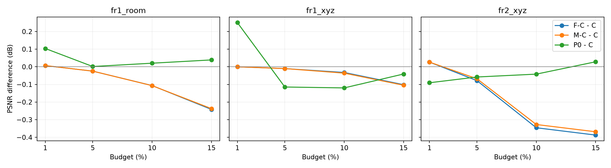

# Hierarchy-Only Candidate Pool Audit

## 结论

**PARTIAL**

Hierarchy representative pool在低budget保留了大部分C高rank点，但不能作为1/5/10/15%通用的无损candidate过滤器。M-C只在3/12个case的PSNR高于P0，恢复fr1_xyz 5/10%和fr2_xyz 1%的失败，却损害两个原本成功的1% case；高budget因遗漏residual而系统性损失PSNR/SSIM/photo。Multi-level union只比Final-only多74/42/46个unique rows，对C recall扩充很小。当前保留完整Current C，不支持直接以representatives-only pool替换它。

| 问题 | 回答 |
| --- | --- |
| Q1 | F/M占比：fr1_room 27.25%/27.40%；fr1_xyz 46.06%/46.23%；fr2_xyz 26.59%/26.69%。 |
| Q2 | M对C的recall 1/5/10/15%：fr1_room 99.80/94.99/86.97/79.55%；fr1_xyz 100.00/97.72/92.89/89.37%；fr2_xyz 98.61/90.94/81.63/73.12%。 |
| Q3 | NO：C recall增加0至0.232个百分点，低budget多数完全不变；不足以弥补高budget缺口。 |
| Q4 | MIXED：仅3/12 case的PSNR高于P0，不构成稳定优于。 |
| Q5 | 见12-case差值表；M-C−C在15%为−0.237206/−0.104441/−0.368400 dB。 |
| Q6 | BOTH（须区分）：P0 ordering相关失败有局部恢复证据；新representatives-only pool另有明确的高budget不完整性，不能倒推P0原完整population本身漏点。无法唯一认定P0主因。 |
| Q7 | EVIDENCE INCONCLUSIVE：低budget candidate compression有证据，但不支持当前rep-only pool成为通用candidate generator，也未支持P0成为稳定ranking mechanism。 |
| Q8 | 暂不直接推进Global Ratio-aware Selector训练；仅在candidate completeness问题获得独立验证后，再考虑该研究方向。本轮不实现。 |

## 1. 研究问题与冻结协议

只检验将结构hierarchy作为candidate generator，再用统一Raw/C scorer全局排序是否比P0稳定。target-2048 SparseHash、origin=(0,0,0)、原h搜索、3rep/node、Q<.80、L3、scalar-radius geometry κ、valid AND observed、maturity=1、Raw SI/贡献矩阵/Bank、Master/TF/AABB、renderer、evaluation cameras与四指标均冻结。不使用d50x32，不训练、不改Selector、不新增Progressive或residual fallback。

HEAD=`3cfccc4a92c8e1ec6c3d491dac1c9efbf151daeb`；branch=`redundancy-aware-si`。本轮只新增离线诊断/报告/证据，production tracked源码和index未改动。预注册SHA256：`f846a15aed770f01378d3ed68a52d50ae235d4a150b93dcfb5e799c79c1350ac`。判定规则在新render前写入，结束再次核对；不使用新的任意dB gate。

| scene | checkpoint | candidate N | Bank / eval | K 1/5/10/15% |
| --- | --- | --- | --- | --- |
| fr1_room | 16900_shutdown | 50330 | 69 / 161 | 503/2517/5033/7550 |
| fr1_xyz | 9900_shutdown | 23643 | 18 / 54 | 236/1182/2364/3546 |
| fr2_xyz | 37900_shutdown | 43059 | 14 / 39 | 431/2153/4306/6459 |

evaluation views为参与过原SLAM的fixed non-Bank archived evaluation views，不是unseen/test-only/独立novel views。XYZ使用原指定TUM_RGBD GT。Bank归档过期scene标签沿用历史审计说明，以实际checkpoint/KF IDs/相机图像路径确认，未重选Bank。

### Frozen SHA

| scene | 输入 | SHA256 |
| --- | --- | --- |
| fr1_room | master | 73f23088aab5c39c9864cf3a0b0fb1fab6384ae162bc848dadeefec5f0b1c4bb |
| fr1_room | tf | a01c7b908dee8a9fd29603babe49fb5a2c99e8e0010072d8ef13b85429cfa4bd |
| fr1_room | cameras | 90e74ad824dddcdd2a740d004082d747f170ce912aaaff07e99f6c1c9e5caabf |
| fr1_room | hierarchy_input.bin | e54e055fd9be3a211ba87cf6997fd088960659ff3f415d2affeebc7636d09a55 |
| fr1_room | ranking_inputs.npz | c89a9e157e3dde1eaca80a17153f68821e5e7ae7a71d7383304ef608dafaece4 |
| fr1_room | old_tree/hierarchy_tree.csv | 0c675a7bf1d21079dbef56bc301388fa38be30ed6c1183aae5365ec0daad6ac7 |
| fr1_xyz | master | a8abd19e63cc3079d4efd07947856e7d8e1f5e959e17142b62aa659b0faebb10 |
| fr1_xyz | tf | bba18765352bced0e8359a5bae8501e7293cb4f907e7760a01e12b5b2f4f0384 |
| fr1_xyz | cameras | 684882bed264ddfc1dfdaca74eab0168f9b7d255e120e3d18aa2d3cdfb5fc074 |
| fr1_xyz | hierarchy_input.bin | 9518c1b79e2bd00f499fcbb81244c7a82be9cc10c3f0610ed745695a99a67fac |
| fr1_xyz | ranking_inputs.npz | 86a06e6b9d7f7cdce27a07ff30c8ce46e645a4ad9ebe725d5760c43005029602 |
| fr1_xyz | old_tree/hierarchy_tree.csv | 7a296f65a278cdd202b67a0bae8a9c679f69989a4cb62f05b92ad2633c2a34eb |
| fr2_xyz | master | f2a83521139547736804bf5be56e334c11ee51ec0dd5f3741f5c5116a83b9ac8 |
| fr2_xyz | tf | 050069eb1a664db8a77ccb0d15e0e0fb86add45162df3e55c14deb6a8eef9eca |
| fr2_xyz | cameras | e145e03f8c787663df2a17418240c8262696ffab6beb19e50ac0639d0c98057e |
| fr2_xyz | hierarchy_input.bin | e782809b8e6395ef2357ee58745ffc1763f76f3cf540d875daca5b5bd78bbada |
| fr2_xyz | ranking_inputs.npz | c8dc3c1bb52afe73fecebf56e70a8e8e723efddbb21ae12af63f4352d268e96c |
| fr2_xyz | old_tree/hierarchy_tree.csv | af4cd411a4bc42a38bd59392c8b33743c01632cd641f694e3c0d21582f3107c7 |

原Master/TF/相机/GT、归档contribution+Raw+geometry/masks以及tree/ranking/质量文件SHA均通过；隔离renderer库与历史SHA一致，实际worker maps指向本轮runtime。完整文件路径和冻结SHA见各scene `prior_checks.json`。没有新GI contribution render。

## 2. Baseline reproduction gate

A/B/C/P0完整order、same-K selected sets exact；C output binary/tree逐字一致；P0使用原F2定义重新生成order和emit-time priority，均exact。所有baseline ratio/view重新真实render后，PSNR/SSIM/LPIPS/photo逐view和aggregate最大差均为0。三个scene全部通过才生成并渲染新pool arms。

| scene | baseline renders | ranking/C tree/P0 gain | 逐view四指标最大差 | aggregate最大差 |
| --- | --- | --- | --- | --- |
| fr1_room | 2576 | EXACT | 0 / 0 / 0 / 0 | 0 / 0 / 0 / 0 |
| fr1_xyz | 864 | EXACT | 0 / 0 / 0 / 0 | 0 / 0 / 0 / 0 |
| fr2_xyz | 624 | EXACT | 0 / 0 / 0 / 0 | 0 / 0 / 0 / 0 |

## 3. Structural pool与全局scorer

F=冻结tree所有final leaf structural reps的source-row union；M=全部L1/L2/L3 node structural reps的union。包括internal reps，但不使用P0 ranking-time ancestor-conditioned重新greedy的代表。每row去重，F⊆M exact。

F-Raw/M-Raw按Raw SI descending；F-C/M-C按已有C score descending；全部tie按source row ascending。C score仍来自完整candidate的final-leaf Delta或independent residual，没有新score。

新pool/ranking代码不调用parent-before-child、frontier、unlock或priority heap。每arm只有一条完整pool permutation，所有ratio是该顺序的prefix。若pool<K，只标CAPACITY INSUFFICIENT并跳过render，禁止任何refill。

`candidate_pool_rows.csv`保留每row的多层multi-hot、r1/r2/r3位置、逐node出现列表、出现次数、最浅/最深层、所属final leaf/Q/occupancy、Raw/C score与Raw/B/C rank。一个row可同时具有多个level身份，统计不可相加成互斥emit depth。

## 4. Pool规模、压缩比与level overlap（Q1）

| scene | pool | N | pool rows | 占完整candidate | CR=N/pool | node-rep occurrences | 重复occurrence比例 |
| --- | --- | --- | --- | --- | --- | --- | --- |
| fr1_room | F | 50330 | 13715 | 27.25% | 3.669705 | 13715 | 0.00% |
| fr1_room | M | 50330 | 13789 | 27.40% | 3.650011 | 16769 | 17.77% |
| fr1_xyz | F | 23643 | 10889 | 46.06% | 2.171274 | 10889 | 0.00% |
| fr1_xyz | M | 23643 | 10931 | 46.23% | 2.162931 | 13055 | 16.27% |
| fr2_xyz | F | 43059 | 11448 | 26.59% | 3.761268 | 11448 | 0.00% |
| fr2_xyz | M | 43059 | 11494 | 26.69% | 3.746215 | 14232 | 19.24% |

重复occurrence比例=(该pool的node-rep occurrences−unique source rows)/occurrences；F统计final nodes，M统计全部nodes。这是同row跨层重复，不是geometry重复度。CR只表示候选规模压缩，不表示速度提升；C scorer仍在完整population上构建，未实现production candidate Selector。

| scene | unique L1 | unique L2 | unique L3 | unique final | L1∩L2 | L1∩L3 | L2∩L3 | L1∩L2∩L3 |
| --- | --- | --- | --- | --- | --- | --- | --- | --- |
| fr1_room | 4797 | 5902 | 6070 | 13715 | 1371 | 489 | 1601 | 481 |
| fr1_xyz | 4464 | 4281 | 4310 | 10889 | 1019 | 334 | 1098 | 327 |
| fr2_xyz | 4124 | 4083 | 6025 | 11448 | 1071 | 527 | 1661 | 521 |

## 5. Candidate recall与容量（Q2/Q3）

Recall_X(P,K)=|P∩X TopK|/K。C/B/Raw均不是GT reconstruction oracle；高recall不能直接当quality GO，必须与真实render联合解释。

| scene | ratio | pool | C recall | B recall | Raw recall |
| --- | --- | --- | --- | --- | --- |
| fr1_room | 1% | F | 99.80% | 86.88% | 82.31% |
| fr1_room | 1% | M | 99.80% | 88.27% | 82.31% |
| fr1_room | 5% | F | 94.99% | 84.11% | 67.54% |
| fr1_room | 5% | M | 94.99% | 85.30% | 68.14% |
| fr1_room | 10% | F | 86.85% | 77.71% | 60.36% |
| fr1_room | 10% | M | 86.97% | 78.52% | 61.04% |
| fr1_room | 15% | F | 79.42% | 72.72% | 55.66% |
| fr1_room | 15% | M | 79.55% | 73.36% | 56.17% |
| fr1_xyz | 1% | F | 100.00% | 88.14% | 86.86% |
| fr1_xyz | 1% | M | 100.00% | 88.98% | 86.86% |
| fr1_xyz | 5% | F | 97.72% | 87.31% | 76.14% |
| fr1_xyz | 5% | M | 97.72% | 88.24% | 76.65% |
| fr1_xyz | 10% | F | 92.81% | 85.28% | 72.00% |
| fr1_xyz | 10% | M | 92.89% | 85.96% | 72.67% |
| fr1_xyz | 15% | F | 89.31% | 82.57% | 69.18% |
| fr1_xyz | 15% | M | 89.37% | 83.16% | 69.68% |
| fr2_xyz | 1% | F | 98.61% | 82.60% | 80.74% |
| fr2_xyz | 1% | M | 98.61% | 83.06% | 81.44% |
| fr2_xyz | 5% | F | 90.71% | 78.40% | 68.51% |
| fr2_xyz | 5% | M | 90.94% | 79.10% | 69.02% |
| fr2_xyz | 10% | F | 81.47% | 73.01% | 62.73% |
| fr2_xyz | 10% | M | 81.63% | 73.46% | 63.31% |
| fr2_xyz | 15% | F | 72.91% | 67.15% | 57.33% |
| fr2_xyz | 15% | M | 73.12% | 67.50% | 57.75% |

容量检查：三个scene的F和M在四档K均足够，48个新arm-ratio集合均same-K；无capacity skip，无refill。K始终由完整N计算，而不是按pool size缩小；全部新arm nested prefixes，未发生ratio-specific候选生成或排序。

## 6. 主质量表

PSNR/SSIM越高越好，LPIPS/photo越低越好。photo沿用production .8 L1 + .2(1−production fast_ssim)；评价SSIM沿用原TorchMetrics实现。除selected rows外，Master/TF、camera、renderer、GT均相同。

### PSNR

| scene | ratio | A | B | C | P0 | F-Raw | F-C | M-Raw | M-C |
| --- | --- | --- | --- | --- | --- | --- | --- | --- | --- |
| fr1_room | 1% | 12.988268 | 13.882451 | 13.834515 | 13.938402 | 13.288246 | 13.841405 | 13.288246 | 13.841405 |
| fr1_room | 5% | 16.653142 | 16.980360 | 17.046943 | 17.048579 | 16.967855 | 17.022405 | 16.957877 | 17.022405 |
| fr1_room | 10% | 17.680354 | 17.802212 | 17.760086 | 17.780563 | 17.492437 | 17.653783 | 17.495211 | 17.653297 |
| fr1_room | 15% | 18.054710 | 18.225545 | 18.180123 | 18.219173 | 17.828327 | 17.938483 | 17.836196 | 17.942917 |
| fr1_xyz | 1% | 13.020670 | 14.584813 | 14.206011 | 14.456831 | 13.394876 | 14.206011 | 13.394876 | 14.206011 |
| fr1_xyz | 5% | 17.814622 | 18.777373 | 18.822068 | 18.707482 | 18.358443 | 18.812056 | 18.383103 | 18.812056 |
| fr1_xyz | 10% | 19.812102 | 20.261198 | 20.301973 | 20.182299 | 20.229693 | 20.269806 | 20.233639 | 20.266110 |
| fr1_xyz | 15% | 20.890139 | 20.817547 | 20.900224 | 20.859292 | 20.714342 | 20.798812 | 20.723614 | 20.795783 |
| fr2_xyz | 1% | 16.234008 | 16.329698 | 16.726775 | 16.636306 | 16.262556 | 16.753436 | 16.279130 | 16.753436 |
| fr2_xyz | 5% | 19.883452 | 20.254137 | 20.232834 | 20.175046 | 20.120796 | 20.154389 | 20.142794 | 20.165084 |
| fr2_xyz | 10% | 21.238710 | 21.032306 | 21.065654 | 21.024125 | 20.769320 | 20.719950 | 20.796613 | 20.738416 |
| fr2_xyz | 15% | 21.479951 | 21.452410 | 21.406546 | 21.434978 | 21.020811 | 21.019363 | 21.046016 | 21.038146 |

### SSIM

| scene | ratio | A | B | C | P0 | F-Raw | F-C | M-Raw | M-C |
| --- | --- | --- | --- | --- | --- | --- | --- | --- | --- |
| fr1_room | 1% | 0.552427 | 0.562086 | 0.561118 | 0.561671 | 0.557150 | 0.561142 | 0.557150 | 0.561142 |
| fr1_room | 5% | 0.616889 | 0.618974 | 0.619452 | 0.619184 | 0.620390 | 0.618945 | 0.620119 | 0.618945 |
| fr1_room | 10% | 0.640308 | 0.637135 | 0.637632 | 0.637775 | 0.634231 | 0.634278 | 0.634384 | 0.634319 |
| fr1_room | 15% | 0.649803 | 0.648584 | 0.648521 | 0.649051 | 0.641500 | 0.642224 | 0.641673 | 0.642409 |
| fr1_xyz | 1% | 0.569450 | 0.582761 | 0.584646 | 0.584532 | 0.573658 | 0.584646 | 0.573658 | 0.584646 |
| fr1_xyz | 5% | 0.656955 | 0.670624 | 0.671249 | 0.669681 | 0.667695 | 0.670816 | 0.667935 | 0.670816 |
| fr1_xyz | 10% | 0.705598 | 0.706185 | 0.707379 | 0.706284 | 0.705927 | 0.705656 | 0.705994 | 0.705622 |
| fr1_xyz | 15% | 0.725542 | 0.723764 | 0.724697 | 0.724299 | 0.720035 | 0.721160 | 0.720366 | 0.721135 |
| fr2_xyz | 1% | 0.591295 | 0.589100 | 0.593566 | 0.591907 | 0.589359 | 0.594219 | 0.589721 | 0.594219 |
| fr2_xyz | 5% | 0.657687 | 0.665472 | 0.665330 | 0.663740 | 0.666291 | 0.665885 | 0.666585 | 0.666102 |
| fr2_xyz | 10% | 0.699281 | 0.695580 | 0.695924 | 0.696008 | 0.691802 | 0.689622 | 0.692202 | 0.689922 |
| fr2_xyz | 15% | 0.711983 | 0.709923 | 0.709145 | 0.709547 | 0.701794 | 0.702135 | 0.702276 | 0.702414 |

### LPIPS

| scene | ratio | A | B | C | P0 | F-Raw | F-C | M-Raw | M-C |
| --- | --- | --- | --- | --- | --- | --- | --- | --- | --- |
| fr1_room | 1% | 0.752445 | 0.736327 | 0.738927 | 0.739092 | 0.747565 | 0.738983 | 0.747565 | 0.738983 |
| fr1_room | 5% | 0.648476 | 0.630773 | 0.631498 | 0.632291 | 0.638257 | 0.631178 | 0.638339 | 0.631178 |
| fr1_room | 10% | 0.599721 | 0.576634 | 0.576373 | 0.574194 | 0.589692 | 0.575343 | 0.590175 | 0.575377 |
| fr1_room | 15% | 0.571317 | 0.542243 | 0.544375 | 0.542950 | 0.553345 | 0.543729 | 0.553545 | 0.543668 |
| fr1_xyz | 1% | 0.704868 | 0.663592 | 0.669723 | 0.667035 | 0.695964 | 0.669723 | 0.695964 | 0.669723 |
| fr1_xyz | 5% | 0.545347 | 0.490062 | 0.491978 | 0.490596 | 0.511713 | 0.489851 | 0.511759 | 0.489851 |
| fr1_xyz | 10% | 0.442491 | 0.402928 | 0.405309 | 0.404914 | 0.413781 | 0.399097 | 0.414405 | 0.399232 |
| fr1_xyz | 15% | 0.391351 | 0.361789 | 0.362828 | 0.360197 | 0.367166 | 0.355857 | 0.367030 | 0.356045 |
| fr2_xyz | 1% | 0.722452 | 0.670712 | 0.669190 | 0.669760 | 0.718062 | 0.661161 | 0.717523 | 0.661161 |
| fr2_xyz | 5% | 0.506864 | 0.469105 | 0.461077 | 0.462943 | 0.469853 | 0.457555 | 0.470256 | 0.457098 |
| fr2_xyz | 10% | 0.406361 | 0.385843 | 0.378207 | 0.377872 | 0.377914 | 0.373781 | 0.377536 | 0.373739 |
| fr2_xyz | 15% | 0.363814 | 0.343629 | 0.345040 | 0.343565 | 0.343155 | 0.340087 | 0.342588 | 0.339545 |

### PHOTO

| scene | ratio | A | B | C | P0 | F-Raw | F-C | M-Raw | M-C |
| --- | --- | --- | --- | --- | --- | --- | --- | --- | --- |
| fr1_room | 1% | 0.219589 | 0.203461 | 0.204326 | 0.203464 | 0.214119 | 0.204271 | 0.214119 | 0.204271 |
| fr1_room | 5% | 0.153112 | 0.150699 | 0.150241 | 0.150243 | 0.150165 | 0.150824 | 0.150331 | 0.150824 |
| fr1_room | 10% | 0.137312 | 0.138246 | 0.138309 | 0.138138 | 0.141197 | 0.140540 | 0.141133 | 0.140524 |
| fr1_room | 15% | 0.131872 | 0.131947 | 0.132179 | 0.131801 | 0.136804 | 0.136282 | 0.136687 | 0.136193 |
| fr1_xyz | 1% | 0.197714 | 0.178564 | 0.179248 | 0.177929 | 0.189925 | 0.179248 | 0.189925 | 0.179248 |
| fr1_xyz | 5% | 0.126302 | 0.119236 | 0.118568 | 0.119321 | 0.120826 | 0.118809 | 0.120625 | 0.118809 |
| fr1_xyz | 10% | 0.103354 | 0.102742 | 0.102281 | 0.102968 | 0.103090 | 0.103267 | 0.103042 | 0.103288 |
| fr1_xyz | 15% | 0.095069 | 0.096261 | 0.095808 | 0.096021 | 0.097885 | 0.097590 | 0.097781 | 0.097599 |
| fr2_xyz | 1% | 0.159823 | 0.160234 | 0.156128 | 0.157493 | 0.160630 | 0.156136 | 0.160306 | 0.156136 |
| fr2_xyz | 5% | 0.114430 | 0.111829 | 0.111950 | 0.112541 | 0.112872 | 0.113048 | 0.112698 | 0.112869 |
| fr2_xyz | 10% | 0.099144 | 0.100980 | 0.101006 | 0.101117 | 0.104170 | 0.104992 | 0.103920 | 0.104792 |
| fr2_xyz | 15% | 0.095278 | 0.096358 | 0.096823 | 0.096693 | 0.101071 | 0.101134 | 0.100804 | 0.100940 |

## 7. 五组核心比较与Q5

| scene | ratio | M-C−P0 | M-C−C | M-C−F-C | M-Raw−F-Raw | M-C−M-Raw |
| --- | --- | --- | --- | --- | --- | --- |
| fr1_room | 1% | -0.096997 | +0.006891 | +0.000000 | +0.000000 | +0.553160 |
| fr1_room | 5% | -0.026174 | -0.024537 | +0.000000 | -0.009978 | +0.064528 |
| fr1_room | 10% | -0.127266 | -0.106789 | -0.000486 | +0.002773 | +0.158086 |
| fr1_room | 15% | -0.276256 | -0.237206 | +0.004434 | +0.007869 | +0.106721 |
| fr1_xyz | 1% | -0.250820 | +0.000000 | +0.000000 | +0.000000 | +0.811135 |
| fr1_xyz | 5% | +0.104573 | -0.010012 | +0.000000 | +0.024659 | +0.428953 |
| fr1_xyz | 10% | +0.083811 | -0.035863 | -0.003696 | +0.003945 | +0.032472 |
| fr1_xyz | 15% | -0.063509 | -0.104441 | -0.003029 | +0.009272 | +0.072169 |
| fr2_xyz | 1% | +0.117130 | +0.026660 | +0.000000 | +0.016573 | +0.474306 |
| fr2_xyz | 5% | -0.009962 | -0.067751 | +0.010695 | +0.021997 | +0.022290 |
| fr2_xyz | 10% | -0.285709 | -0.327238 | +0.018466 | +0.027294 | -0.058197 |
| fr2_xyz | 15% | -0.396832 | -0.368400 | +0.018783 | +0.025204 | -0.007869 |

完整四指标差值：

| scene | ratio | 比较 | ΔPSNR | ΔSSIM | ΔLPIPS | Δphoto |
| --- | --- | --- | --- | --- | --- | --- |
| fr1_room | 1% | M-C−P0 | -0.096997 | -0.000529 | -0.000109 | +0.000807 |
| fr1_room | 1% | M-C−C | +0.006891 | +0.000024 | +0.000056 | -0.000055 |
| fr1_room | 1% | M-C−F-C | +0.000000 | +0.000000 | +0.000000 | +0.000000 |
| fr1_room | 1% | M-Raw−F-Raw | +0.000000 | +0.000000 | +0.000000 | +0.000000 |
| fr1_room | 1% | M-C−M-Raw | +0.553160 | +0.003992 | -0.008582 | -0.009847 |
| fr1_room | 5% | M-C−P0 | -0.026174 | -0.000239 | -0.001113 | +0.000581 |
| fr1_room | 5% | M-C−C | -0.024537 | -0.000507 | -0.000321 | +0.000583 |
| fr1_room | 5% | M-C−F-C | +0.000000 | +0.000000 | +0.000000 | +0.000000 |
| fr1_room | 5% | M-Raw−F-Raw | -0.009978 | -0.000272 | +0.000082 | +0.000165 |
| fr1_room | 5% | M-C−M-Raw | +0.064528 | -0.001174 | -0.007161 | +0.000493 |
| fr1_room | 10% | M-C−P0 | -0.127266 | -0.003456 | +0.001183 | +0.002387 |
| fr1_room | 10% | M-C−C | -0.106789 | -0.003313 | -0.000996 | +0.002216 |
| fr1_room | 10% | M-C−F-C | -0.000486 | +0.000040 | +0.000035 | -0.000015 |
| fr1_room | 10% | M-Raw−F-Raw | +0.002773 | +0.000153 | +0.000483 | -0.000063 |
| fr1_room | 10% | M-C−M-Raw | +0.158086 | -0.000065 | -0.014798 | -0.000609 |
| fr1_room | 15% | M-C−P0 | -0.276256 | -0.006642 | +0.000718 | +0.004392 |
| fr1_room | 15% | M-C−C | -0.237206 | -0.006112 | -0.000707 | +0.004014 |
| fr1_room | 15% | M-C−F-C | +0.004434 | +0.000185 | -0.000061 | -0.000088 |
| fr1_room | 15% | M-Raw−F-Raw | +0.007869 | +0.000173 | +0.000200 | -0.000117 |
| fr1_room | 15% | M-C−M-Raw | +0.106721 | +0.000736 | -0.009877 | -0.000494 |
| fr1_xyz | 1% | M-C−P0 | -0.250820 | +0.000114 | +0.002688 | +0.001319 |
| fr1_xyz | 1% | M-C−C | +0.000000 | +0.000000 | +0.000000 | +0.000000 |
| fr1_xyz | 1% | M-C−F-C | +0.000000 | +0.000000 | +0.000000 | +0.000000 |
| fr1_xyz | 1% | M-Raw−F-Raw | +0.000000 | +0.000000 | +0.000000 | +0.000000 |
| fr1_xyz | 1% | M-C−M-Raw | +0.811135 | +0.010988 | -0.026241 | -0.010677 |
| fr1_xyz | 5% | M-C−P0 | +0.104573 | +0.001135 | -0.000745 | -0.000512 |
| fr1_xyz | 5% | M-C−C | -0.010012 | -0.000433 | -0.002127 | +0.000241 |
| fr1_xyz | 5% | M-C−F-C | +0.000000 | +0.000000 | +0.000000 | +0.000000 |
| fr1_xyz | 5% | M-Raw−F-Raw | +0.024659 | +0.000241 | +0.000046 | -0.000200 |
| fr1_xyz | 5% | M-C−M-Raw | +0.428953 | +0.002880 | -0.021908 | -0.001816 |
| fr1_xyz | 10% | M-C−P0 | +0.083811 | -0.000662 | -0.005682 | +0.000320 |
| fr1_xyz | 10% | M-C−C | -0.035863 | -0.001757 | -0.006077 | +0.001007 |
| fr1_xyz | 10% | M-C−F-C | -0.003696 | -0.000035 | +0.000135 | +0.000021 |
| fr1_xyz | 10% | M-Raw−F-Raw | +0.003945 | +0.000067 | +0.000624 | -0.000048 |
| fr1_xyz | 10% | M-C−M-Raw | +0.032472 | -0.000372 | -0.015173 | +0.000246 |
| fr1_xyz | 15% | M-C−P0 | -0.063509 | -0.003164 | -0.004152 | +0.001579 |
| fr1_xyz | 15% | M-C−C | -0.104441 | -0.003563 | -0.006783 | +0.001791 |
| fr1_xyz | 15% | M-C−F-C | -0.003029 | -0.000025 | +0.000187 | +0.000009 |
| fr1_xyz | 15% | M-Raw−F-Raw | +0.009272 | +0.000331 | -0.000136 | -0.000104 |
| fr1_xyz | 15% | M-C−M-Raw | +0.072169 | +0.000769 | -0.010985 | -0.000182 |
| fr2_xyz | 1% | M-C−P0 | +0.117130 | +0.002312 | -0.008600 | -0.001357 |
| fr2_xyz | 1% | M-C−C | +0.026660 | +0.000653 | -0.008029 | +0.000008 |
| fr2_xyz | 1% | M-C−F-C | +0.000000 | +0.000000 | +0.000000 | +0.000000 |
| fr2_xyz | 1% | M-Raw−F-Raw | +0.016573 | +0.000362 | -0.000539 | -0.000324 |
| fr2_xyz | 1% | M-C−M-Raw | +0.474306 | +0.004498 | -0.056362 | -0.004171 |
| fr2_xyz | 5% | M-C−P0 | -0.009962 | +0.002361 | -0.005845 | +0.000328 |
| fr2_xyz | 5% | M-C−C | -0.067751 | +0.000771 | -0.003979 | +0.000919 |
| fr2_xyz | 5% | M-C−F-C | +0.010695 | +0.000217 | -0.000457 | -0.000178 |
| fr2_xyz | 5% | M-Raw−F-Raw | +0.021997 | +0.000294 | +0.000403 | -0.000174 |
| fr2_xyz | 5% | M-C−M-Raw | +0.022290 | -0.000483 | -0.013158 | +0.000171 |
| fr2_xyz | 10% | M-C−P0 | -0.285709 | -0.006085 | -0.004133 | +0.003675 |
| fr2_xyz | 10% | M-C−C | -0.327238 | -0.006001 | -0.004469 | +0.003786 |
| fr2_xyz | 10% | M-C−F-C | +0.018466 | +0.000300 | -0.000042 | -0.000200 |
| fr2_xyz | 10% | M-Raw−F-Raw | +0.027294 | +0.000400 | -0.000378 | -0.000249 |
| fr2_xyz | 10% | M-C−M-Raw | -0.058197 | -0.002280 | -0.003797 | +0.000872 |
| fr2_xyz | 15% | M-C−P0 | -0.396832 | -0.007132 | -0.004021 | +0.004247 |
| fr2_xyz | 15% | M-C−C | -0.368400 | -0.006730 | -0.005495 | +0.004117 |
| fr2_xyz | 15% | M-C−F-C | +0.018783 | +0.000279 | -0.000542 | -0.000194 |
| fr2_xyz | 15% | M-Raw−F-Raw | +0.025204 | +0.000482 | -0.000567 | -0.000267 |
| fr2_xyz | 15% | M-C−M-Raw | -0.007869 | +0.000138 | -0.003044 | +0.000136 |

## 8. 成功/失败case逐项解释

成功case：fr1_room 1%的P0/C/M-C为13.938402/13.834515/13.841405 dB，取消precedence后损失P0的0.096997 dB；fr1_xyz 1%为14.456831/14.206011/14.206011，M-C与C selected set及四指标exact相同，却丢失P0的0.250820 dB优势。

失败case：fr1_xyz 5%为P0 18.707482、C 18.822068、M-C 18.812056，恢复大部分差距但仍低C 0.010012；10%为20.182299/20.301973/20.266110，恢复0.083811但仍低C 0.035863。fr2_xyz 1%为16.636306/16.726775/16.753436，M-C超过P0与C；5%为20.175046/20.232834/20.165084，M-C没有恢复P0失败；10%为21.024125/21.065654/20.738416，反而显著扩大损失。

上述结果只能支持局部解除P0约束有帮助，不能支持其跨scene稳定成立。M-C相对M-Raw在三scene的1%提高0.553160/0.811135/0.474306 dB，远大于这些case的M-vs-F增量；说明低budget主要证据来自C scorer，而非加入multi-level内部候选。fr2_xyz 10/15%的C scorer对M-Raw也不占优。

## 9. Recall与真实质量联合分析

| scene | ratio | F C-recall | M C-recall | F-C PSNR | M-C PSNR | C PSNR |
| --- | --- | --- | --- | --- | --- | --- |
| fr1_room | 1% | 99.80% | 99.80% | 13.841405 | 13.841405 | 13.834515 |
| fr1_room | 5% | 94.99% | 94.99% | 17.022405 | 17.022405 | 17.046943 |
| fr1_room | 10% | 86.85% | 86.97% | 17.653783 | 17.653297 | 17.760086 |
| fr1_room | 15% | 79.42% | 79.55% | 17.938483 | 17.942917 | 18.180123 |
| fr1_xyz | 1% | 100.00% | 100.00% | 14.206011 | 14.206011 | 14.206011 |
| fr1_xyz | 5% | 97.72% | 97.72% | 18.812056 | 18.812056 | 18.822068 |
| fr1_xyz | 10% | 92.81% | 92.89% | 20.269806 | 20.266110 | 20.301973 |
| fr1_xyz | 15% | 89.31% | 89.37% | 20.798812 | 20.795783 | 20.900224 |
| fr2_xyz | 1% | 98.61% | 98.61% | 16.753436 | 16.753436 | 16.726775 |
| fr2_xyz | 5% | 90.71% | 90.94% | 20.154389 | 20.165084 | 20.232834 |
| fr2_xyz | 10% | 81.47% | 81.63% | 20.719950 | 20.738416 | 21.065654 |
| fr2_xyz | 15% | 72.91% | 73.12% | 21.019363 | 21.038146 | 21.406546 |

未人为给recall划新阈值。按用户机制Case定义看，1%的M recall为98.61%至100%，质量相对C为+0.006891/0/+0.026660 dB，符合低budget candidate compression的Case A方向；fr1_xyz 1% recall=100%时排序集合与渲染四指标exact相同。10/15% recall明显下降并伴随质量损失，呈Case C方向；高recall本身不构成GT质量保证，也不强行制造一个新的Case B门槛。

三个scene的M与F在1% C recall完全相同，低budget M-C实际选中internal-only rows均为0；5%仅fr2_xyz选入5个。15% internal-only仅15/2/17个。因此structural internal reps主要是已存在final reps的跨层重复，union本身几乎没有扩展关键候选。高budget遗漏的是residual信息，而非最终代表。

## 10. Missed C rows与Added candidates

Miss_C=C TopK\M；Added=M-C TopK\C TopK。完整逐row的xyz/Raw/C/B rank、C score、leaf、cover与independent residual保存在`missed_c_rows.csv`；Added还保留multi-hot levels及node/r1-r3出现信息。

| scene | ratio | missed N | missed fraction | 代表 / residual | mean cover | median cover |
| --- | --- | --- | --- | --- | --- | --- |
| fr1_room | 1% | 1 | 0.20% | 0 / 1 | 0.000286 | 0.000286 |
| fr1_room | 5% | 126 | 5.01% | 0 / 126 | 0.266345 | 0.224469 |
| fr1_room | 10% | 656 | 13.03% | 0 / 656 | 0.359093 | 0.325942 |
| fr1_room | 15% | 1544 | 20.45% | 0 / 1544 | 0.347605 | 0.285052 |
| fr1_xyz | 1% | 0 | 0.00% | 0 / 0 | — | — |
| fr1_xyz | 5% | 27 | 2.28% | 0 / 27 | 0.484109 | 0.469017 |
| fr1_xyz | 10% | 168 | 7.11% | 0 / 168 | 0.508808 | 0.555924 |
| fr1_xyz | 15% | 377 | 10.63% | 0 / 377 | 0.468226 | 0.482304 |
| fr2_xyz | 1% | 6 | 1.39% | 0 / 6 | 0.347166 | 0.334956 |
| fr2_xyz | 5% | 195 | 9.06% | 0 / 195 | 0.424359 | 0.451767 |
| fr2_xyz | 10% | 791 | 18.37% | 0 / 791 | 0.369479 | 0.333910 |
| fr2_xyz | 15% | 1736 | 26.88% | 0 / 1736 | 0.311373 | 0.190872 |

所有missed rows都是residual：这由F⊆M且F包含全部final-leaf reps决定，不是质量标签。低budget可仅miss少数row，高budgetmiss量增加，必须量化其渲染影响，不能自动加入fallback。对于same-K，M-C相对C的added count等于missed count；pool sort保持C原有relative order，变化来自排除missed rows后向更低C rank补足预算，未重新计算C score。

## 11. Multi-level internal-only实际贡献与multi-hot组成

| scene | ratio | M-C K | final-pool rows | internal-only rows | internal-only比例 | with L1 | with L2 | with L3 |
| --- | --- | --- | --- | --- | --- | --- | --- | --- |
| fr1_room | 1% | 503 | 503 | 0 | 0.00% | 422 | 263 | 141 |
| fr1_room | 5% | 2517 | 2517 | 0 | 0.00% | 1510 | 1332 | 918 |
| fr1_room | 10% | 5033 | 5027 | 6 | 0.12% | 2465 | 2586 | 2090 |
| fr1_room | 15% | 7550 | 7535 | 15 | 0.20% | 3129 | 3691 | 3355 |
| fr1_xyz | 1% | 236 | 236 | 0 | 0.00% | 226 | 51 | 10 |
| fr1_xyz | 5% | 1182 | 1182 | 0 | 0.00% | 984 | 485 | 189 |
| fr1_xyz | 10% | 2364 | 2362 | 2 | 0.08% | 1652 | 1107 | 584 |
| fr1_xyz | 15% | 3546 | 3544 | 2 | 0.06% | 2159 | 1692 | 1066 |
| fr2_xyz | 1% | 431 | 431 | 0 | 0.00% | 361 | 185 | 81 |
| fr2_xyz | 5% | 2153 | 2148 | 5 | 0.23% | 1230 | 1098 | 870 |
| fr2_xyz | 10% | 4306 | 4295 | 11 | 0.26% | 1931 | 1992 | 2133 |
| fr2_xyz | 15% | 6459 | 6442 | 17 | 0.26% | 2411 | 2792 | 3494 |

with L1/L2/L3是可重叠的source-row属性，不是emit depth。即使保留internal structural pool，若C scorer不给它高rank，它也不会获得precedence或预算保护。

## 12. Paired per-view

完整四指标的mean/median/p10/p90/improved-view fraction均保存；下表PSNR突出M-C−P0、M-C−C、F-C−C。delta使用原符号，LPIPS/photo的improved fraction按下降计算。视角来自同一序列，不能把相关views当独立scene显著性样本。

| scene | ratio | 比较 | mean | median | p10 | p90 | 改善view比例 |
| --- | --- | --- | --- | --- | --- | --- | --- |
| fr1_room | 1% | M-C−P0 | -0.096997 | -0.088534 | -0.394322 | +0.233522 | 29.81% |
| fr1_room | 1% | M-C−C | +0.006891 | +0.000000 | +0.000000 | +0.005198 | 11.80% |
| fr1_room | 1% | F-C−C | +0.006891 | +0.000000 | +0.000000 | +0.005198 | 11.80% |
| fr1_room | 5% | M-C−P0 | -0.026174 | -0.019220 | -0.197027 | +0.133350 | 40.99% |
| fr1_room | 5% | M-C−C | -0.024537 | -0.007467 | -0.162748 | +0.109282 | 44.10% |
| fr1_room | 5% | F-C−C | -0.024537 | -0.007467 | -0.162748 | +0.109282 | 44.10% |
| fr1_room | 10% | M-C−P0 | -0.127266 | -0.127504 | -0.471994 | +0.169069 | 31.06% |
| fr1_room | 10% | M-C−C | -0.106789 | -0.080572 | -0.392836 | +0.191040 | 29.81% |
| fr1_room | 10% | F-C−C | -0.106304 | -0.080572 | -0.393398 | +0.176411 | 29.81% |
| fr1_room | 15% | M-C−P0 | -0.276256 | -0.257528 | -0.733006 | +0.200066 | 24.84% |
| fr1_room | 15% | M-C−C | -0.237206 | -0.225201 | -0.677170 | +0.220598 | 31.06% |
| fr1_room | 15% | F-C−C | -0.241640 | -0.231781 | -0.679726 | +0.209106 | 28.57% |
| fr1_xyz | 1% | M-C−P0 | -0.250820 | -0.240795 | -0.445554 | -0.095179 | 5.56% |
| fr1_xyz | 1% | M-C−C | +0.000000 | +0.000000 | +0.000000 | +0.000000 | 0.00% |
| fr1_xyz | 1% | F-C−C | +0.000000 | +0.000000 | +0.000000 | +0.000000 | 0.00% |
| fr1_xyz | 5% | M-C−P0 | +0.104573 | +0.088678 | +0.011482 | +0.216903 | 94.44% |
| fr1_xyz | 5% | M-C−C | -0.010012 | -0.022638 | -0.054282 | +0.040814 | 31.48% |
| fr1_xyz | 5% | F-C−C | -0.010012 | -0.022638 | -0.054282 | +0.040814 | 31.48% |
| fr1_xyz | 10% | M-C−P0 | +0.083811 | +0.106057 | -0.083057 | +0.208874 | 83.33% |
| fr1_xyz | 10% | M-C−C | -0.035863 | -0.013762 | -0.167879 | +0.088133 | 40.74% |
| fr1_xyz | 10% | F-C−C | -0.032168 | -0.014903 | -0.166715 | +0.090679 | 42.59% |
| fr1_xyz | 15% | M-C−P0 | -0.063509 | -0.050320 | -0.249449 | +0.103966 | 35.19% |
| fr1_xyz | 15% | M-C−C | -0.104441 | -0.082185 | -0.238638 | +0.028961 | 25.93% |
| fr1_xyz | 15% | F-C−C | -0.101413 | -0.076465 | -0.235180 | +0.027422 | 29.63% |
| fr2_xyz | 1% | M-C−P0 | +0.117130 | +0.086321 | +0.010685 | +0.281594 | 94.87% |
| fr2_xyz | 1% | M-C−C | +0.026660 | +0.023934 | -0.014279 | +0.076447 | 76.92% |
| fr2_xyz | 1% | F-C−C | +0.026660 | +0.023934 | -0.014279 | +0.076447 | 76.92% |
| fr2_xyz | 5% | M-C−P0 | -0.009962 | +0.016590 | -0.223546 | +0.140793 | 53.85% |
| fr2_xyz | 5% | M-C−C | -0.067751 | -0.054396 | -0.257399 | +0.096280 | 30.77% |
| fr2_xyz | 5% | F-C−C | -0.078446 | -0.073603 | -0.276247 | +0.092522 | 30.77% |
| fr2_xyz | 10% | M-C−P0 | -0.285709 | -0.302963 | -0.593420 | +0.076239 | 17.95% |
| fr2_xyz | 10% | M-C−C | -0.327238 | -0.313044 | -0.702711 | +0.046773 | 15.38% |
| fr2_xyz | 10% | F-C−C | -0.345704 | -0.323816 | -0.731155 | +0.046788 | 15.38% |
| fr2_xyz | 15% | M-C−P0 | -0.396832 | -0.398182 | -0.967067 | +0.086005 | 20.51% |
| fr2_xyz | 15% | M-C−C | -0.368400 | -0.367327 | -0.927660 | +0.129750 | 23.08% |
| fr2_xyz | 15% | F-C−C | -0.387183 | -0.377262 | -0.956944 | +0.125835 | 20.51% |

主要恢复case的paired证据较一致：fr1_xyz 5%/10%的M-C−P0 PSNR改善视角比例为94.44%/83.33%，fr2_xyz 1%为94.87%。反向证据同样明确：两个成功1% case仅29.81%/5.56%视角改善；fr2_xyz 10%仅17.95%改善，median −0.302963 dB。不能只选有利scene/ratio汇报。

高budget存在指标交换：M-C相对C的三个scene 10/15% LPIPS均改善，但PSNR/SSIM下降、production photo变差。重复度也下降，不能因此覆盖重建损失。

## 13. Spatial coverage

| scene | ratio | arm | hit roots | hit leaves | hit-root Raw mass | hit-leaf Raw mass |
| --- | --- | --- | --- | --- | --- | --- |
| fr1_room | 1% | C | 331 | 459 | 73.70% | 54.59% |
| fr1_room | 5% | C | 882 | 1669 | 95.58% | 88.15% |
| fr1_room | 10% | C | 1201 | 2668 | 98.93% | 95.91% |
| fr1_room | 15% | C | 1367 | 3355 | 99.54% | 98.24% |
| fr1_room | 1% | P0 | 333 | 461 | 74.44% | 53.61% |
| fr1_room | 5% | P0 | 896 | 1638 | 95.92% | 87.37% |
| fr1_room | 10% | P0 | 1208 | 2631 | 98.98% | 95.52% |
| fr1_room | 15% | P0 | 1373 | 3330 | 99.55% | 98.08% |
| fr1_room | 1% | F-C | 331 | 459 | 73.70% | 54.59% |
| fr1_room | 5% | F-C | 914 | 1743 | 96.12% | 88.99% |
| fr1_room | 10% | F-C | 1280 | 2967 | 99.25% | 97.10% |
| fr1_room | 15% | F-C | 1524 | 3946 | 99.80% | 99.26% |
| fr1_room | 1% | M-C | 331 | 459 | 73.70% | 54.59% |
| fr1_room | 5% | M-C | 914 | 1743 | 96.12% | 88.99% |
| fr1_room | 10% | M-C | 1280 | 2965 | 99.25% | 97.09% |
| fr1_room | 15% | M-C | 1522 | 3937 | 99.80% | 99.25% |
| fr1_xyz | 1% | C | 206 | 215 | 61.79% | 55.63% |
| fr1_xyz | 5% | C | 665 | 910 | 91.92% | 85.15% |
| fr1_xyz | 10% | C | 978 | 1559 | 97.08% | 92.95% |
| fr1_xyz | 15% | C | 1181 | 2131 | 98.63% | 96.21% |
| fr1_xyz | 1% | P0 | 210 | 216 | 62.55% | 55.50% |
| fr1_xyz | 5% | P0 | 680 | 894 | 92.45% | 84.23% |
| fr1_xyz | 10% | P0 | 1000 | 1543 | 97.31% | 92.44% |
| fr1_xyz | 15% | P0 | 1201 | 2120 | 98.74% | 96.00% |
| fr1_xyz | 1% | F-C | 206 | 215 | 61.79% | 55.63% |
| fr1_xyz | 5% | F-C | 672 | 924 | 92.03% | 85.39% |
| fr1_xyz | 10% | F-C | 1019 | 1657 | 97.47% | 93.62% |
| fr1_xyz | 15% | F-C | 1272 | 2339 | 99.02% | 97.00% |
| fr1_xyz | 1% | M-C | 206 | 215 | 61.79% | 55.63% |
| fr1_xyz | 5% | M-C | 672 | 924 | 92.03% | 85.39% |
| fr1_xyz | 10% | M-C | 1019 | 1657 | 97.47% | 93.62% |
| fr1_xyz | 15% | M-C | 1271 | 2337 | 99.02% | 96.99% |
| fr2_xyz | 1% | C | 258 | 349 | 79.32% | 67.57% |
| fr2_xyz | 5% | C | 735 | 1374 | 97.29% | 91.86% |
| fr2_xyz | 10% | C | 1023 | 2169 | 99.24% | 96.97% |
| fr2_xyz | 15% | C | 1171 | 2747 | 99.63% | 98.56% |
| fr2_xyz | 1% | P0 | 269 | 351 | 81.26% | 67.00% |
| fr2_xyz | 5% | P0 | 747 | 1360 | 97.47% | 91.35% |
| fr2_xyz | 10% | P0 | 1031 | 2159 | 99.29% | 96.77% |
| fr2_xyz | 15% | P0 | 1183 | 2736 | 99.65% | 98.46% |
| fr2_xyz | 1% | F-C | 260 | 354 | 79.40% | 67.88% |
| fr2_xyz | 5% | F-C | 774 | 1494 | 97.66% | 93.00% |
| fr2_xyz | 10% | F-C | 1128 | 2556 | 99.54% | 98.11% |
| fr2_xyz | 15% | F-C | 1364 | 3465 | 99.83% | 99.53% |
| fr2_xyz | 1% | M-C | 260 | 354 | 79.40% | 67.88% |
| fr2_xyz | 5% | M-C | 772 | 1491 | 97.63% | 92.97% |
| fr2_xyz | 10% | M-C | 1128 | 2549 | 99.54% | 98.09% |
| fr2_xyz | 15% | M-C | 1361 | 3460 | 99.83% | 99.52% |

coverage只作机制解释，不参与quality判定。新增arm未设置region quota；若质量退化而hit-root数量变化小，不能将全部损失直接解释为spatial collapse。

## 14. 统一Fixed-h8 redundancy

沿用冻结Fixed-h8 cells。每selected row的redundancy=max κ(i,j)，j为同h8 cell的其它selected rows；singleton=0。再汇总selected rows的mean/median/p90，并统计同h8 cell内unordered pairs。全部arm用同一scalar radius/κ/固定h8 partition，不使用hierarchy自己的leaf或root。该metric明确不评价cross-h8 boundary pairs，与历史一致。C/P0统计与历史值exact。

| scene | ratio | arm | mean | median | p90 | κ>.8 | κ>.9 | κ>.95 |
| --- | --- | --- | --- | --- | --- | --- | --- | --- |
| fr1_room | 1% | C | 0.056587 | 0.000000 | 0.176776 | 5 | 2 | 2 |
| fr1_room | 5% | C | 0.145934 | 0.000000 | 0.607335 | 67 | 29 | 16 |
| fr1_room | 10% | C | 0.209354 | 0.000592 | 0.758143 | 243 | 97 | 48 |
| fr1_room | 15% | C | 0.246278 | 0.016273 | 0.829476 | 601 | 278 | 133 |
| fr1_room | 1% | P0 | 0.040547 | 0.000000 | 0.040076 | 3 | 1 | 1 |
| fr1_room | 5% | P0 | 0.131082 | 0.000000 | 0.550567 | 46 | 12 | 8 |
| fr1_room | 10% | P0 | 0.199823 | 0.000416 | 0.740301 | 214 | 69 | 33 |
| fr1_room | 15% | P0 | 0.230000 | 0.010968 | 0.795583 | 492 | 194 | 89 |
| fr1_room | 1% | F-C | 0.059447 | 0.000000 | 0.217848 | 5 | 2 | 2 |
| fr1_room | 5% | F-C | 0.141805 | 0.000000 | 0.603886 | 69 | 28 | 14 |
| fr1_room | 10% | F-C | 0.167812 | 0.000001 | 0.674967 | 163 | 65 | 25 |
| fr1_room | 15% | F-C | 0.175255 | 0.000222 | 0.699180 | 266 | 111 | 41 |
| fr1_room | 1% | M-C | 0.059447 | 0.000000 | 0.217848 | 5 | 2 | 2 |
| fr1_room | 5% | M-C | 0.141805 | 0.000000 | 0.603886 | 69 | 28 | 14 |
| fr1_room | 10% | M-C | 0.169505 | 0.000001 | 0.677899 | 164 | 65 | 25 |
| fr1_room | 15% | M-C | 0.177758 | 0.000246 | 0.707164 | 274 | 115 | 43 |
| fr1_xyz | 1% | C | 0.134665 | 0.000000 | 0.630343 | 10 | 4 | 1 |
| fr1_xyz | 5% | C | 0.226700 | 0.006920 | 0.737619 | 49 | 18 | 10 |
| fr1_xyz | 10% | C | 0.280846 | 0.091284 | 0.820299 | 169 | 64 | 31 |
| fr1_xyz | 15% | C | 0.296314 | 0.140379 | 0.822272 | 267 | 104 | 51 |
| fr1_xyz | 1% | P0 | 0.126496 | 0.000000 | 0.593684 | 9 | 4 | 1 |
| fr1_xyz | 5% | P0 | 0.213034 | 0.002376 | 0.720190 | 48 | 18 | 9 |
| fr1_xyz | 10% | P0 | 0.266714 | 0.073130 | 0.808474 | 160 | 62 | 28 |
| fr1_xyz | 15% | P0 | 0.278308 | 0.109470 | 0.806019 | 242 | 93 | 45 |
| fr1_xyz | 1% | F-C | 0.134665 | 0.000000 | 0.630343 | 10 | 4 | 1 |
| fr1_xyz | 5% | F-C | 0.221691 | 0.004227 | 0.746237 | 49 | 17 | 10 |
| fr1_xyz | 10% | F-C | 0.253718 | 0.058249 | 0.770560 | 116 | 45 | 21 |
| fr1_xyz | 15% | F-C | 0.258202 | 0.076737 | 0.780156 | 181 | 72 | 36 |
| fr1_xyz | 1% | M-C | 0.134665 | 0.000000 | 0.630343 | 10 | 4 | 1 |
| fr1_xyz | 5% | M-C | 0.221691 | 0.004227 | 0.746237 | 49 | 17 | 10 |
| fr1_xyz | 10% | M-C | 0.254663 | 0.064346 | 0.770560 | 116 | 45 | 21 |
| fr1_xyz | 15% | M-C | 0.258888 | 0.078660 | 0.780156 | 181 | 72 | 36 |
| fr2_xyz | 1% | C | 0.010920 | 0.000000 | 0.000000 | 1 | 0 | 0 |
| fr2_xyz | 5% | C | 0.080929 | 0.000000 | 0.361809 | 50 | 26 | 18 |
| fr2_xyz | 10% | C | 0.129833 | 0.000000 | 0.660157 | 164 | 91 | 57 |
| fr2_xyz | 15% | C | 0.159680 | 0.000000 | 0.748998 | 363 | 194 | 111 |
| fr2_xyz | 1% | P0 | 0.002571 | 0.000000 | 0.000000 | 0 | 0 | 0 |
| fr2_xyz | 5% | P0 | 0.072383 | 0.000000 | 0.285682 | 44 | 19 | 10 |
| fr2_xyz | 10% | P0 | 0.119804 | 0.000000 | 0.618754 | 139 | 69 | 40 |
| fr2_xyz | 15% | P0 | 0.145847 | 0.000000 | 0.710175 | 287 | 139 | 77 |
| fr2_xyz | 1% | F-C | 0.010920 | 0.000000 | 0.000000 | 1 | 0 | 0 |
| fr2_xyz | 5% | F-C | 0.060899 | 0.000000 | 0.148786 | 23 | 12 | 7 |
| fr2_xyz | 10% | F-C | 0.082857 | 0.000000 | 0.383494 | 78 | 42 | 19 |
| fr2_xyz | 15% | F-C | 0.082072 | 0.000000 | 0.372174 | 122 | 61 | 29 |
| fr2_xyz | 1% | M-C | 0.010920 | 0.000000 | 0.000000 | 1 | 0 | 0 |
| fr2_xyz | 5% | M-C | 0.062801 | 0.000000 | 0.165190 | 25 | 13 | 8 |
| fr2_xyz | 10% | M-C | 0.084811 | 0.000000 | 0.401464 | 83 | 44 | 21 |
| fr2_xyz | 15% | M-C | 0.084583 | 0.000000 | 0.398461 | 134 | 67 | 32 |

redundancy降低不等于rendering质量提高，未用该metric筛candidate或调参数。

## 15. Correctness与证据边界

- F⊆M；每pool source rows unique，全部来自valid AND observed；F与冻结C final rep mask exact。
- pool全部来自tree结构rep1/2/3，而非P0实际emit trace；multi-hot和跨node重复metadata保留。
- 新排序代码只按Raw/C score+source-row tie，不导入或调用Progressive；baseline P0仅复现既有定义。
- 全pool order重复构造exact；独立实现用Python source-row sets/排序复核union、order、same-K和nested prefixes。
- synthetic覆盖跨层同row去重、multi-hot、Raw/C排序、equal-score source tie与容量不足不补点。
- selected set构建模块不读GT/render/quality；全部scene的新集合在任何新render前保存SHA，结束复核未变。
- 每scene baseline full ranking、C binary/tree、P0 priority及四指标per-view/aggregate exact；实际runtime maps为冻结库；Master/TF结束前tensor校验未变。
- C score仍由完整population构建；本轮不是pool-native scorer，也没有质量oracle。M-C比较P0同时涉及structural-vs-ranking-time候选、C score及precedence去除，不能单凭其改善将全部因果唯一归于unlock。F/M之间同scorer、Raw/C之间同pool的比较更直接。
- L1/L2/L3 multi-hot只表示来源，不赋予coarse-first次序；ordinal Progressive score未用于新scorer。

## 16. Runtime、限制与研究建议

仅记录各stage wall time于`runtime.json`，不参与判定，不提出speedup claim。总共8128次真实render：4064次baseline复现、4064次新pool评价；未重渲染Raw contribution，未训练。所有容量检查通过，没有减少预算或减少评价视角。

本轮没有发现candidate-only global ranking导致root-level空间坍缩：15% M-C hit roots相对C反而为1522 vs1367、1271 vs1181、1361 vs1171；hit-leaf mass也增加。与此同时PSNR降低，说明空间覆盖与重复度不能代替render utility。

M-C是使用完整C score的诊断，不是新pool-native重要性定义；pool过滤不会改变保留rows之间的C relative order，只会排除missed rows并将更低C rank填入same-K。P0与M-C并不是只改一个precedence开关的严格消融：还从ancestor-conditioned候选选择切换到structural pool和C scorer。因此既不能将局部恢复唯一归因于precedence，也不能将高budgetpool缺失误说成P0原population不完整。

仅三个冻结TUM final maps及既有归档视角，不是online/production验证；新pool容量足够并不等于高价值candidate recall足够。没有做新的阈值、pool扩充或Selector训练。

建议KEEP CURRENT C。低budget pool压缩具有研究信号，但当前representatives-only pool的高budgetresidual缺口需要先独立解决与验证；不应直接用新Selector训练掩盖候选信息已被删除的问题。是否研究representative pool + residual fallback或Global Ratio-aware Selector留给人工下一轮决定，本轮不实现。

本轮实验结束。未加入residual fallback、未训练Global/Ratio-aware Selector、未调Q/grid/rep/depth或继续新实验。没有stage、commit或push。

