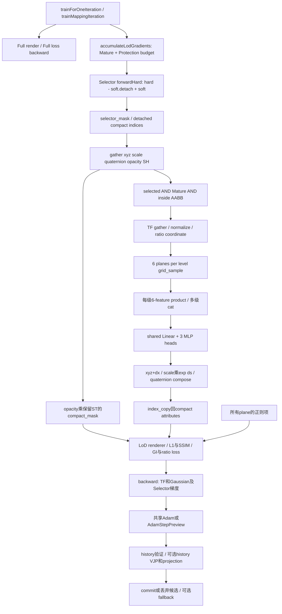

# 原始 Transform Field CUDA 审计与重写规格

审计日期：2026-10-13（Asia/Hong_Kong）。目标服务器：`172.19.163.58`，用户 `prmi`，环境 `zwj`，代码目录 `/home/prmi/zwj/mycartgs`。本轮只增加本报告和 `tests/diagnostics/original_tf_cuda_audit_20261013` 诊断材料；没有修改生产逻辑，没有实现 CUDA TF，没有 commit。密码不保存。

## 1. 版本、证据和审计边界

本地 branch `cuda-tf`，HEAD `99a9bb1f05e458617f50fabb30a910f14aaf7c9c`。开始时 `git status --short` 只有已有的 `?? build-cuda118-sm86.zip`。服务器目录并不是独立的有效 Git checkout：`git rev-parse --show-toplevel` 返回 `/home/prmi`，branch 为该上级仓库的 `master`，`git rev-parse HEAD` 失败。因此不能给服务器虚构 HEAD。本次对 TF、Mapping、ChangeDistill、Guard、DSD、配置、CMake 的 16 个文件做 SHA-256，均与本地一致；完整名单在 `inventory.json`，其验证结果见 `local_manifest.json`。服务器上其他代码/二进制的版本不能由这 16 个文件替代证明。

源码确定为原始 `HexPlaneField + TransformField`：每级六个二维 plane、逐元素乘积、多分辨率 concat、7 个 Linear、XYZ/log-scale/quaternion 三个输出 head。没有 Coarse lattice、Sparse Fine、bounded residual，也没有 tanh。附件中的相关条目是要核查的问题，不能当作当前实现的事实。

环境证据：RTX 3090 24 GiB，driver `535.230.02`，CUDA toolkit `11.8.89`，PyTorch `2.3.1+cu118`，gcc/g++ `9.4.0`，C++ ABI=0。原工程 Linux 构建缓存是 `build-cuda118-sm86-gcc9/CMakeCache.txt`，Torch_DIR 指向 `third_party/libtorch-cu118/libtorch/share/cmake/Torch`，CUDA 架构 `86`；`build-cuda118-sm86/CMakeCache.txt` 是历史 Windows 缓存，不能作为当前 Linux 构建证明。独立诊断会直接编译本轮校验的生产 TF 源文件，不使用可能过期的主程序。

证据层级：源码结论可定位到下面行号；native C++ CSV 是生产 TF 的实测；Python 分段/profiler 是对 C++ operator 顺序的诊断镜像，只有通过 native forward/全部参数梯度/input 梯度 parity 后才运行。镜像 profiler 的 CPU gap 不等于 native C++ 的 CPU gap。没有运行完整长序列 SLAM，也不把本次 TF microbenchmark 当作端到端 Mapping 加速结果。

## 2. 源文件、类和函数索引

以下路径相对于本地 `H:/AIProjects/cartgs优化更细致版/mycartgs`，服务器路径相对于 `/home/prmi/zwj/mycartgs`。行号对应上述 HEAD，诊断新增文件不影响生产行号。

| 文件/关键行 | 作用 |
|---|---|
| `include/transform_field.h:11,42` | `TransformFieldConfig`；TF API、参数组、teacher、domain 接口 |
| `src/transform_field.cpp:7,51,67,85,91,100,118` | 构造7层 Linear；forward；world-scale apply；regularization；frozen clone；log-scale apply；MLP参数顺序 |
| `include/hexplane_field.h:11,46` | 配置和坐标对真实存储顺序 |
| `src/hexplane_field.cpp:9,49,71,80,133,153,188` | plane创建、inside、AABB、resample、grid_sample、fusion、regularization |
| `include/aabb.h:5` | AABB buffer语义、normalize、inclusive contains |
| `include/quaternion_utils.h:7,13` | wxyz normalize/Hamilton product |
| `include/gaussian_transform_ops.h:18,47` | log-scale Gaussian 状态；几何 correction transport |
| `improvements/selector/gumbel_network.h:38,65,127` | Selector `forwardHard`、固定uniform历史查询、straight-through Gumbel |
| `src/gaussian_mapper.cpp:578` | TF YAML解析；`cfg/selector/fast.yaml`、`selector_config.yaml` |
| `src/gaussian_mapper.cpp:1263,1307,1428,1438` | Mapping调度、Full/LOD梯度累积、共享optimizer/Guard commit |
| `src/gaussian_mapper.cpp:1717,1773,1805,1934,2011` | TF初始化、共享Adam参数组、Guard、history evaluate、TF LR |
| `src/gaussian_mapper.cpp:2043,2086,2140,2993,3100` | geometry capture/finalize；periodic AABB；LoopClosingBA；ScaleRefinement |
| `src/gaussian_mapper.cpp:2540,2660,2797,2886` | Replay；`accumulateLodGradients`、TF筛选/apply/scatter、TF正则 |
| `src/gaussian_mapper.cpp:3816,3825` | TF model/shadow optimizer/metadata checkpoint保存 |
| `src/gaussian_model.cpp:62,66,506,678` | Gaussian scale/rotation activation；共享Adam创建；Mature mask |
| `include/gaussian_renderer.h:51`、`src/gaussian_renderer.cpp` | 所有属性用同一索引 gather，紧凑 LoD renderer及其Gaussian梯度 |
| `src/gaussian_rasterizer.cpp:207`、`include/gaussian_rasterizer.h:138` | SparseGaussianAdam另一种visibility overload；当前Mapping通过base Adam调用无参step |
| `src/change_management.cpp:170,226,285,322` | snapshot、LOCAL/GLOBAL/FIELD_DOMAIN scope；AABB resample及两个正常Adam state清除 |
| `src/change_distill.cpp:14,31,40,56,260,332` | event-local independent Adam、scope、teacher transport、3属性loss、TF训练 |
| `include/model_snapshot.h:10,33` | RNG保存/恢复；参数及buffer copy，teacher requires_grad=false |
| `src/drift_stability.cpp:190,248,567,583,631` | DSD同一TF函数；临时Adam；参数snapshot和恢复 |
| `src/constrained_adam.cpp:6,123` | `AdamStepPreview`，候选m/v/step、不写live状态、atomic transaction commit语义 |
| `src/gradient_constraint.cpp:28,72,101,160` | autograd history VJP、candidate质量检查、projection/fallback/commit |
| `src/historical_gradient_render.cpp:5,15,54,63` | history LoD调用同一个TF；候选module复制及AABB buffers |
| `src/conflict_replay.cpp`、`include/conflict_replay.h` | cancellation累积、Replay来源/队列；参数更新在Mapper完成 |
| `python/transform_field.py:27,93,123,153` | Python inference counterpart、checkpoint loader、mask identity包装 |
| `tests/transform_field_test.cpp`、`hexplane_resample_test.cpp`、`change_distill_test.cpp` | 现有TF、AABB、事件测试；本次未把历史测试通过当作新backend parity |
| `tests/gradient_guard_checkpoint_test.cpp:54`、`joint_replay_test.cpp`、`distill_recovery_test.cpp` | 真实checkpoint Guard与特殊路径测试入口 |
| `src/protection_evidence.cu:53` | 推荐复用的current stream/CUDAGuard/error-check工程模式 |
| `cuda_rasterizer/*.cu`、`src/operate_points.cu`、`src/stereo_vision.cu`、`third_party/simple-knn/*.cu` | renderer、Gaussian Adam、SSIM conv、geometry、KNN CUDA基础设施 |

## 3. 一次 Mapping 的完整数据流与梯度边界



TF人口：`nonzero(selector_mask.detach()>0)` 的compact人口中再过滤 `mature_mask` 与inclusive `insideMask`。不是全部Gaussian，也不是全部Mature；N为 `transform_count`，与 `compact_count` 和总Gaussian数不同。Protection.enabled=1且mature_only=1时，Protected（`~mature_mask`）只参与可能的budget admission/render，其TF变换为identity；不是所有Protected必然进入renderer。Protection关闭时Mature mask全true。若mature_only=0，Protected也可进入TF，不能把Protected identity硬编码到底层forward。

outside_identity=1时由调用者排除AABB外行；`TransformField::forward/applyResidual`本身不检查outside，也不读Protection/Selector mask。直接调用这些底层函数会border sample；`applyLogResidual`自己执行inside filtering。CUDA必须保留入口差异，不能在所有入口强制同一mask。

`detach_gaussian_parameters`同时控制XYZ、activated scale、activated rotation、opacity和两个SH tensor，默认fast=0；TF只收到前三个。Selector的bool/索引路径detach，不向mask判定求导，但 `compact_mask * opacity`保留ST梯度。TF不直接向Selector输出求导；两者在renderer/loss处汇合。

| LoD loss目的地 | fast默认0 | detach=1 |
|---|---|---|
| TF planes/MLP | 有；正则额外更新planes | 有 |
| Selector | 有；opacity ST + GI + ratio | 有 |
| XYZ | 有，含TF坐标导数、identity直连、Selector输入与renderer | 无 |
| raw log-scale | 有，activated scale的exp链和TF乘法链 | 无 |
| raw quaternion | 有，base normalization、composition、renderer、Selector链 | 无 |
| raw opacity | 有，sigmoid与mask乘法 | 无 |
| SH DC/rest | 有，renderer链 | 无 |

所以自定义TF backward必须提供输入XYZ、activated scale、activated quaternion梯度；不能只更新TF参数。上层仍保留Gaussian activation、gather/scatter、Selector、renderer、loss的autograd。normal loss已积累Full梯度时TF贡献必须累加，不能覆盖。N=0也不等于planes无梯度：`mature_count>0`时仍会执行TF regularization。

## 4. Six-plane 的真实表示和内存

令每级 `S_l=spatial_resolution*multires[l]`，`R=ratio_resolution`，`C=feature_dim`，`L=multires.size()`。真实顺序：`xy,xz,xe,yz,ye,ze`，坐标对 `(0,1),(0,2),(0,3),(1,2),(1,3),(2,3)`，e是elastic ratio，不是时间。每级6个tensor，总数6L。ratio维不随multires扩大。

| plane | 横坐标/width | 纵坐标/height | tensor shape |
|---|---|---|---|
| XY | normalized x / S_l | normalized y / S_l | `[1,C,S_l,S_l]` |
| XZ | normalized x / S_l | normalized z / S_l | 同上 |
| XE | normalized x / S_l | raw ratio / R | `[1,C,R,S_l]` |
| YZ | normalized y / S_l | normalized z / S_l | `[1,C,S_l,S_l]` |
| YE | normalized y / S_l | raw ratio / R | `[1,C,R,S_l]` |
| ZE | normalized z / S_l | raw ratio / R | `[1,C,R,S_l]` |

FP32，plane创建为contiguous NCHW；offset `((c*H)+v)*W+u`，stride `[C*H*W,H*W,W,1]`。checkpoint实测shape/stride在 `parameter_shapes.json`。空间plane初始化Uniform[0.1,0.5]，ratio plane初始全1；不能改变初始化或AABB扩展新区域填值规则。

`grid_sample(plane,grid [1,1,N,2], bilinear,border,align_corners=true)`输出 `[1,C,1,N]` contiguous，view `[C,N]`再transpose成 `[N,C]`，通常stride `[1,N]`、非contiguous；它不是自动复制到row-major。相乘生成的feature布局不能只凭shape假定，要允许实际stride；最终多级cat为contiguous `[N,C*L]`。

每级每channel：`f_lc=Π_{p=0..5} sample(P_lp,c)`，最终 `f=concat(f_0,...,f_(L-1))`，维度 `F=C*L`。这里不是拼6个plane、更不是pair乘积后sum。每Gaussian理论corner位置为 `4*6*L=24L`，FP32 feature loads `24LC`；边界可能角点重复、硬件缓存可能减少真实DRAM事务，理论load不是DRAM带宽测量。

## 5. ratio conditioning 和完整输入

`TransformField::forward(xyz,float ratio)`用 `torch::full({N,1},ratio,xyz.options())`生成FP32常量列。没有log/inverse ratio、embedding、positional encoding、归一化或显式clamp。四维query坐标为 `[nx,ny,nz,r]`；r直接落在XE/YE/ZE的grid_sample第二坐标。r=0.05时对应ratio像素 `(0.05+1)*(150-1)/2=78.225`，不是像素 `0.05*149`。

配置常用r={0.01,0.05,0.10,0.15}。底层接收任意float，grid有效区间[-1,1]，超出该范围通过border padding钳制到首尾ratio行，没有MLP extrapolation或额外ratio分支。所有ratio共享完全相同planes和network weights。ratio不是额外拼到MLP；其信息完全经过ratio planes进入feature。

单Gaussian查询输入 `query=[nx,ny,nz,r]`（4）；MLP实际输入 `input=[Π_p s_0p,0,...,Π_p s_0p,C-1,...,Π_p s_(L-1)p,C-1]`（CL）。fast=16，default=48。C++ ratio是float且`full`常量无梯度，生产TF没有ratio gradient输出需求；单独HexPlane接受Tensor ratio，若requires_grad=true，原autograd能产生ratio梯度，可作为底层数学parity案例。

## 6. MLP精确结构与参数量

共享 `feature_out: F→H` 无activation，其结果h被三次单独 `relu(h)`。每个head `H→H→D`，隐层后ReLU、out无activation。三个D分别3、3、4。总计7 Linear、6个out-of-place ReLU，所有层都有bias，FP32；无LayerNorm/BatchNorm、skip、Fourier/position encoding、tanh。

| 注册名 | fast W / b | default W / b | 输出activation |
|---|---|---|---|
| feature_out | `[32,16] / [32]` | `[64,48] / [64]` | 无 |
| position_hidden | `[32,32] / [32]` | `[64,64] / [64]` | ReLU |
| position_out | `[3,32] / [3]` | `[3,64] / [3]` | 无 |
| scale_hidden | `[32,32] / [32]` | `[64,64] / [64]` | ReLU |
| scale_out | `[3,32] / [3]` | `[3,64] / [3]` | 无 |
| rotation_hidden | `[32,32] / [32]` | `[64,64] / [64]` | ReLU |
| rotation_out | `[4,32] / [4]` | `[4,64] / [4]` | 无 |

Linear weight为contiguous row-major `[out,in]`，bias `[out]`，用于 `Y=X W^T+b`，不能按 `[in,out]` flatten。`mlpParameters()`顺序为上表逐层W,b；整个module注册/checkpoint的parameters顺序是grid先，然后这14个tensor。pool layout要显式记录两种顺序。

参数公式：`P_grid=C Σ_l(3S_l²+3RS_l)`；`P_mlp=FH+3H²+14H+10`。fast：12 planes，S=64/128、R150、C8、F16、H32，grid 1,182,720，MLP 4,042，总1,186,762。default：18 planes，S=64/128/256、R150、C16、F48、H64，grid 7,354,368，MLP16,266，总7,370,634。总输出10维，不能改为6维或删除rotation。

每次query产生6L个 `[N,C]` plane sample（物理 `[C,N]`）、5L个product中间feature、L个最终level feature、cat `[N,F]`、共享h `[N,H]`、三次ReLU(h) `[N,H]`、三个head preactivation/activation `[N,H]`，以及 `[N,3],[N,3],[N,4]`。normal autograd会让sample/product/activation等存活到backward；scope结束不表示CUDA内存立即可复用。coordinate cat、stack grid、feature cat、Linear output、ReLU和quaternion cat都materialize；view/select/transpose/slice一般只建view，allocator与kernel次数须以profiler为准。

## 7. 输出语义：没有bounded residual

记网络输出 `dx,ds,dq`，q采用wxyz，`I=(1,0,0,0)`，`norm(q)=q/max(sqrt(Σq_i²),1e-12)`，`⊗`是Hamilton乘法。

`xyz'=xyz+dx`，dx是world坐标增量；没有normalized displacement转换，没有AABB/resolution-dependent bound。

world-scale入口：`scale'=scale*exp(ds)`；log-scale入口：`log_scale'=log_scale+ds`。ds为log-space additive residual，没有tanh/clamp。base world-scale已经是Gaussian raw log-scale的exp。

`rotation'=norm(norm(I+dq) ⊗ q_base)`，dq是4维quaternion residual，加identity后normalize、左乘base，再normalize；不是axis-angle，不是直接相加base，不是右乘。C++applyResidual不再单独normalize q_base；上层输入来自 `getRotationActivation()`。applyLogResidual也使用相同composition。

CUDA数值语义必须保留：FP32、weight/bias布局、6-plane乘积顺序、多级顺序、ratio raw坐标、border/align_corners、identity政策、两个normalize与1e-12、exp和左乘。优化可重排并行归约但须通过误差/多步稳定性验证；不能用“看起来接近identity”替换quaternion输出。

## 8. AABB、bilinear和domain变化

`grid.aabb_min/max`为注册buffer `[3]`，detach clone，不是learnable parameter。初始在 `initializeTransformFieldIfNeeded`：选Mature XYZ min/max，center，half extent乘 `max(aabb_scale,1)`、每轴至少1e-3。fast aabb_scale=1，default1.3。periodic每1000真实mapping_iter检查，outside_count>=100触发单调扩张；LoopClosure LOCAL、ScaleRefinement GLOBAL在geometry finish后检查/transport，必要时组合FIELD_DOMAIN。

精确query公式（AABB min=a,max=b）：`n_i=2*(x_i-a_i)/(b_i-a_i)-1`。对plane坐标u,v，先得到align_corners像素 `X=(u+1)(W-1)/2`、`Y=(v+1)(H-1)/2`，border clip到 `[0,W-1],[0,H-1]`。`i0=floor(Xc),j0=floor(Yc),i1=i0+1,j1=j0+1`，非法corner贡献0（右/上边界对应权重恰为0）；可用clamp后重复角点，但forward和坐标backward必须保持边界导数。`tx=Xc-i0,ty=Yc-j0`：

`sample=(1-tx)(1-ty)P[j0,i0]+tx(1-ty)P[j0,i1]+(1-tx)ty P[j1,i0]+tx ty P[j1,i1]`。

PyTorch border clipping在像素<=0或>=size-1时坐标梯度为0，等号也属于这个条件；AABB exact boundary虽然inside=true，query坐标贡献会被border derivative截断，但xyz identity直连梯度仍存在。内部点输入到像素导数 `(W-1)/(b_i-a_i)`；e轴为 `(R-1)/2`，没有world normalization。索引/权重计算须保持FP32运算顺序，特别是归一化靠近整数/边界时；NaN与零范数需单独以现有实现作oracle，不能自行加入安全修复改变语义。

只改AABB buffer会改变plane的world-space函数。当前通过 `resampleDomain` 固定shape重采样：新plane像素linspace[-1,1]→new world→old normalize→border grid_sample；旧domain内采样old plane，新增区域空间planeUniform[0.1,0.5]、ratio plane1；`copy_`保留Parameter/TensorImpl identity，随后setAABB。resample受双线性插值/重离散化误差影响，并非严格保函数；冻结旧teacher + ChangeDistill补偿。只reset受影响planes在独立TF Adam和shared Mapping Adam中的m/v/step，不清MLP/unaffected planes。pool必须支持按tensor/plane重置。

## 9. Autograd operator清单和regularization

| operator / fast forward次数 | shape | 分配/launch/backward |
|---|---|---|
| full 1 | `[N,1]` | 分配+fill；ratio常量无grad |
| sub/mul/div/sub normalize | `[N,3]` + `[3]`extent | elementwise新tensor；坐标grad回XYZ |
| cat coordinates 1 | `[N,4]` | materialize+copy；CatBackward切grad |
| select/stack/view 12组 | `[N]→[N,2]→[1,1,N,2]` | select/view无kernel；stack分配copy；backward slice/scatter |
| grid_sampler_2d 12 | planes + grid→`[1,C,1,N]` | 每plane一次sampling；backward grid_sampler_2d_backward、atomic plane scatter和grid grad |
| view/transpose 12 | `[N,C]`非contig | view metadata；反向view |
| product 10 | `[N,C]` | 新tensor、elementwise；两支乘法梯度/累加 |
| cat level 1 | `[N,16]` | 分配copy；切grad |
| linear/addmm 7 | `[N,F/H]`及W/b | GEMM、bias、可能内部contiguous；dX/dW GEMM、db reduction |
| ReLU 6 | `[N,H]` | 新tensor，threshold_backward |
| XYZ add、scale exp/mul | `[N,3]` | 新tensor，identity/exp/mul backward |
| zeros_like + fill identity | `[N,4]` | allocation/fill；常量路径 |
| quaternion norm 2 | `[N,4]→[N,1]` | mul/sum/sqrt/clamp/div，各自kernel/grad |
| quaternion multiply 1 | slice scalar/vector,cross,cat | 多个小tensor/launch，乘积/sum/cross backward |
| caller index_select/index_copy | full→compact→TF→compact | gather/scatter/materialize；base直连和TF grad scatter累加 |
| Adam tensor traversal 26 | 12 planes+14MLP | C++逐tensorm/v更新+sqrt/div/add/addcdiv；不是一个Adam kernel |

次数是直接源码一级调用，不等于CUDA launch数：Linear可走cuBLAS内部多个kernel，copy可能融合/布局导致materialize，autograd展开产生更多operator。真实次数见profiler表，不从源码猜精确launch。

诊断autograd_graph.json保存真实operator顺序镜像在N=257时的202个节点、全部edge和saved tensor shape/stride（包括平方mean probe loss）。其中7个AddmmBackward、6个ReluBackward、12个GridSampler2DBackward、29个AccumulateGrad对应26个TF参数与3个base attribute输入；该数目不包含renderer、caller gather/scatter或regularization，不是完整Mapping图。实测plane sample及逐乘feature保持stride=[1,N]，level cat才形成连续[N,16]。镜像TF32 matmul关闭，使用FP32。

必须保留正常TF正则：空间XY/XZ/YZ每level只沿tensor dim2（height/第二坐标）二阶差分，`mean((P[j+2]-2P[j+1]+P[j])²)`；不是XY两个方向TV。ratio XE/YE/ZE同样沿height即ratio维二阶差分；ratio L1为`mean(abs(1-P))`。分别对plane/level求和，权重0.0002/0.001/0.0001，无按plane数平均。三个权重乘法不会短路底层计算；本阶段不改loss。它们处理全部plane参数，成本主要随模型大小，不随N，因此需要分离纯TF与regularized benchmark。

上式是数学表达。生产FP32实际先算一阶差分，再相邻相减，即(P[j+2]-P[j+1])-(P[j+1]-P[j])；不能未经parity把它改为一次P[j+2]-2P[j+1]+P[j]或调整plane reduction顺序，因为舍入顺序会变化。

## 10. Optimizer与事务的真实语义

TF初始化创建独立 `transform_optimizer_`：group0=14 MLP tensors，group1=6L planes；LR init0.00016/0.0016，final0.000016/0.00016，betas=(0.9,0.999)，eps=1e-15，weight_decay=0，AMSGrad=false。随后同一参数tensor挂到Gaussian共享Adam：前6组XYZ/DC/rest/opacity/scale/rotation，Selector通常group6，TF MLP通常group7、plane group8；实际索引保存在成员变量，不能写死。

正常LoD/Replay更新走共享Adam或其 `AdamStepPreview`，不调用独立 `transform_optimizer_->step()`。该独立optimizer提供param group配置、zero_grad、CD构造模板和checkpoint保存；两种optimizer state不是同一个map。`SparseGaussianAdam`继承base Adam，Gaussian成员通过base Adam类型调用无参step；visibility overload不在当前Mapping调用链，不能复用其缺少bias correction/只看group第一个tensor的kernel来更新TF。

normal schedule使用 `normal_update_clock_.tf_updates` 已commit计数：`t=clamp(tf_updates/max(lr_max_steps,1),0,1)`，`delay=clamp(delay_mult,0,1)+(1-clamp(delay_mult,0,1))*sin(pi*t/2)`，`lr=delay*exp((1-t)log(lr_init)+t log(lr_final))`。分别写独立与shared两组LR。初始化时初始options为init值，首次schedule t0变成init*0.01；不能忽略这一变化。CD/Replay/DSD不推进正常时钟。

每tensor独立int64 step，有grad才初始化state/推进；m/v是zeros_like参数，当前FP32；bias correction是每tensorstep对应的double CPU计算。无grad与全零grad不同：前者跳过、后者仍更新moments和step，LR=0时有grad也能更新state。zero_grad当前C++默认set_to_none=true（显式shared zero_grad(true)）；不强制为zeros，不发一个全pool清零来替换“未参与tensor”的语义。

与C++2.3.1/preview一致的顺序：`m=β1*m+(1-β1)g`，`v=β2*v+(1-β2)g²`，`denom=sqrt(v)/sqrt(1-β2^step)+eps`，`p_new=p+(-lr/(1-β1^step))*m/denom`。Adam而非AdamW，若future weight_decay配置非零则先`g+=wd*p`。custom kernel的FMA、pow、除法近似会造成多步偏差，首版须用FP32并对m/v/step检查。

Guard不是先改live再rollback：preview克隆旧m/v、计算step+1及proposed p；候选delta为FP32实际可表示的 `proposed-p`，candidate又由 `p+alpha*delta`生成，alpha1也保留这一步舍入。验证失败且不fallback时丢弃候选，live p/m/v/step全不变。通过/缩步/投影/fallback时写候选p和原始梯度生成的新m/v/step；不是把m/v也乘alpha、不是用投影方向重新计算Adam moments。默认cancel_fallback_enable=1、scale0.2：有限quality conflict可走fallback commit，所以日志would_cancel不必然意味着没有commit。m/v/state rollback/commit要完整原子；AABB reset与缺失state也要支持。

连续pool可行：plane和MLP至少两个逻辑LR组，最好多tensoroffset metadata+每tensorstep/has_grad/reset bit，而不是一个全局step。必须支持candidate pool、temporary CD/DSD m/v、teacher/candidate buffer和clone/copy生命周期。不能仅flatten参数而丢掉注册名、group和per-tensorstate。

## 11. ChangeDistill / DSD / Guard / Replay / checkpoint

| 路径 | TF函数/数据 | optimizer/state/commit |
|---|---|---|
| Normal Mapping | applyResidual(selected XYZ/world scale/q)；renderer loss+plane reg | shared正常Adam；Guard前1000 committed TF updates warmup，之后质量事务 |
| CD LOCAL | capture之前的corrected Mature；teacher old applyLogResidual→geometry transport；student current applyLogResidual | independentAdam，fresh m/v/step，固定MLP1.6e-5/grid1.6e-4，继承eps1e-15，weight_decay=0；全TF参数可更新 |
| CD GLOBAL | all snapshot Mature `[0,N0)`；transport global correction | 同上；只限制Gaussian训练人口，不冻结MLP/plane |
| FIELD_DOMAIN | resample affected plane + setAABB + affected正常state清除；teacher旧domain | TF scope扩大all snapshot Mature；不是只优化affected planes；无geometry时teacher不transport |
| DSD | 当前Gaussian坐标，历史reference TF teacher，同一applyLogResidual | 临时Adam默认eps1e-8（不同于CD/normal），全MLP+grid；reject/no progress恢复参数clone，临时state丢弃；正常state未改 |
| Replay | Full backward + accumulateLodGradients(detach=false)，同一mask/TF/reg | shared正常state及normal LR；preview直接finite候选commit；history quality用于诊断，不递归Guard、不新增quality veto；正常clock不推进 |
| Guard history | live TF图用于autograd::grad；候选TF frozen scratch用于NoGrad质量评估 | cloneFrozen + named_parameters copy，AABB buffer同步；reject丢弃整个事务 |
| checkpoint | module archive包含planes、14W/b、两个AABB buffers；JSON含architecture、clock、统计 | 保存独立shadow `transform_optimizer_`，不是shared正常state |

Change capture允许tail append，禁止prune/reset/reorder；新追加Gaussian不在teacher对应关系中。teacher由新module构造后tensor copy，不是Python state_dict对象；参数requires_grad=false，buffers也复制，RNG通过ScopedTorchRNG保存/恢复。candidate使用scratch module复用并copy参数和buffers；custom backend不能拿live参数指针给teacher共享。

当前TF CD没有额外TF anchor训练（`change_distill.cpp:323`明确Diagnostic only），unaffected audit只做前后评估；Selector CD可有anchors。不能擅自把Selector anchor政策套到TF，不能删ChangeDistill，也不能只更新resampled plane。CD损失：XYZ L1 / (old AABB diagonal+1e-8)，log-scale L1，rotation `mean(1-clamp(abs(dot(norm(qs),norm(qt))),0,1))`，对ratios求平均，再固定epochs/batches临时Adam。特殊路径的base state在capture/context中detach，因此生产通常不消费input gradient，但网络仍与normal共享forward。

checkpoint审计发现：`transform_optimizer.pt`由独立shadow optimizer保存，正常共享TF状态没有在此保存。这意味着文件名不能证明可恢复正常TF训练Adam。metadata有normal TF step计数也不能代替m/v/每tensorstep。PythonTF loader只加载module+state JSON，用于inference；没有找到GaussianMapper恢复TF/shared Adam训练状态的生产路径。测试中InputArchive加载不等于正式resume支持。后续CUDA接口应兼容现有inference文件，并将“保存真正normal optimizer state”作为单独明确范围，不能本轮偷偷修复。实测shadow state数量在checkpoint_optimizer.txt。

## 12. 已有CUDA工程模式与stream要求

生产/直属third-party `.cu`：`cuda_rasterizer/{rasterize_points,rasterizer_impl,forward,backward,adam,conv}.cu`、`src/{operate_points,stereo_vision,protection_evidence}.cu`、`third_party/simple-knn/{simple_knn,spatial}.cu`。本组没有独立 `.cuh` 文件，接口多用 `.h`；OpenCV/ORB第三方更多CUDA文件不是TF扩展的优先模板。

现有Tensor→C++ wrapper→`.data_ptr<T>()`→CUDA launch/raw pointer，rasterizer大量`.contiguous()`。renderer使用CUB scan/sort/block reduction、cooperative groups、FP32 atomicAdd；不是TF现成half/half2 fully fused模板。旧rasterizer存在不显式传stream的kernel/CUB调用以及同步cudaMemcpy/部分CHECK_CUDA debug同步，不能照抄成TF默认stream实现。

推荐 `src/protection_evidence.cu`：`c10::cuda::CUDAGuard(tensor.device())`、launch第4参数 `c10::cuda::getCurrentCUDAStream()`、`C10_CUDA_KERNEL_LAUNCH_CHECK()`。TF wrapper还必须TORCH_CHECK相同device、FP32、形状、stride/contiguous条件；allocations用TensorOptions对应device，scratch Tensor保活，跨stream使用record_stream/显式依赖。current stream由calling thread的LibTorch上下文确定，不能偷偷用stream0。CMake生产project为CXX CUDA、C++/CUDA17，强制CUDA11.8+sm86，新增 `.cu/.cuh`可列入主library sources并link Torch/cudart，工程可行；本轮没有修改其CMake。

## 13. 实际checkpoint、TF人口与resident memory

实际checkpoint：`/home/prmi/zwj/mycartgs/results/protection_recheck_20261012/fr3_long_office_household/3400_shutdown/ply`。总Gaussian220,084，Mature219,969，AABB inside220,079。AABB min=(-33.5780373,-5.48270035,-4.53787231)，max=(10.0524569,26.4215717,20.2628632)。architecture fast完全一致，TF normal clock400，CD TF steps0。完整state/config已保存。

| ratio | checkpoint selected人数 | selected Mature inside TF N |
|---|---:|---:|
| 0.01 | 2,133 | 2,099 |
| 0.05 | 8,525 | 8,491 |
| 0.10 | 20,798 | 20,764 |
| 0.15 | 29,277 | 29,243 |

这些是固定seed Selector inference重建的一次人口，不冒充真实Mapping随机Gumbel时间分布。benchmark使用r0.05的8,491行真实XYZ/scale/q，按行循环采样到目标N；50k出现重复XYZ，代表原场景的坐标分布但可能提高cache命中和plane gradient contention，要保留这项限制。

已有原始TF历史logs包含UltraFast每LoD step的 `tf_transformed_gaussians`；正常Protection recheck只有每1000步log且初始化前tf0。按ratio统计正N min/median/p90/max以及零样本数量见 `logged_tf_shapes.json`，结果表由实测附件补充。混合场景/调度日志的总体分布不能代表单一当前normal run；`path`和每样本iteration均保存，不丢启动零样本证据。

resident理论下限不含allocator/cache/activation/scratch：FP32 weights=4P，m/v=8P，grad=4P，两个AABB=24 bytes。fast weights4,747,048 B，normal Adam m/v9,494,096 B；p+m+v14,241,144 B（13.582 MiB），加grad18,988,192 B（18.109 MiB）。default p+m+v88,447,608 B（84.350 MiB），含grad117,930,144 B（112.467 MiB）。per-tensorstep是CPU int64小量，不是每元素step。fresh shadow Adam没有moment allocations，teacher/candidate/preview/CD临时状态按需额外加池；实际peak memory还含autograd和输入，见profiler_summary。不能只用14 MiB称总训练占用。

## 14. benchmark协议、分段计时与性能结论

诊断根目录 `tests/diagnostics/original_tf_cuda_audit_20261013`。`run.sh`是一条可复现的服务器命令入口，所有load/input读取都在计时外，GPU初始空闲；torch CPU threads=1。native由生产 `transform_field.cpp/hexplane_field.cpp/constrained_adam.cpp`重新编译，FP32、N={1000,5000,10000,20000,50000}，每模式/N warmup100、measurement500；同current stream CUDA events，末event synchronize后读取时间，同时报告CPU wall。加载不计入。

三模式：`core_adam`（applyResidual+独立确定性非零loss VJP+input/parameter backward+Adam）；`regularized_adam`（额外原始plane regularization）；`regularized_preview`（regularized+生产AdamStepPreview/candidate/commit）。preview模式不含Full Gaussian/Selector、不含historical render/projection/quality检查，不能称完整Guard耗时。loss是诊断probe，不是修改生产loss；包含base gradients，未用renderer，避开SLAM长跑。参数在诊断模型副本上连续600步更新，不改checkpoint。

诊断Adam使用固定MLP LR=0.00016、grid LR=0.0016，beta=(0.9,0.999)、eps=1e-15；每模式/N创建fresh state，不从checkpoint shadow optimizer续训，也不模拟正常LR clock。原始正则权重保持不变。native_benchmark.csv/JSON和native_samples.csv保留mean/p50/p95及全部500样本。native阶段：forward、loss_regularization、backward、zero_grad、optimizer、total、wall。zero_grad含input.grad释放。stage_benchmark.csv细分input prep（这里是TF内部normalize/ratio/cat，不是整个Selector gather）、plane query、fusion、MLP、output；本阶段没有tanh所以output_transform不应标记tanh。caller mask/nonzero/gather/scatter由源码审计与内存规格覆盖，未混入core timing。

Python每个stage包CUDA events并显式同步，query/fusion是多个小区间求和；插桩和Python调度会改变launch gap，因此stage表只用于归因，不能与native total强行加总/替代。真实典型N=8491的PyTorch profiler收集CPU/CUDA、shape、memory，预热100次后记录3次迭代的core/regularized/preview。服务器Nsight Systems 2022.4.2.1可用，另由run_nsight.sh直接采集生产C++ regularized TF，预热100次、采集10次，CUDA profiler API限定采集范围。完整实测表、top20、10k→50k比例及限制见下面“实测结果”。

## 15. Forward工作量与CUDA mapping选择

fast每Gaussian理论48 corner位置、384 float loads=1536 B，bilinear按4-weight dot约384 multiply+288 add（或者预先算weights后4乘加/channel）；6-plane fusion为5LC=80 multiply，MLP `FH+3H²+10H=512+3072+320=3904` multiply-add（约7808 FLOPs），另138 bias adds、192 ReLU比较、3exp、quaternion2norm/compose及少量XYZ/scaleelementwise。default72 corner位置、1152 FP32 loads=4608 B，fusion240 multiply，MLP16,000 multiply-add（约32kFLOPs）。以corner index/address、cache/atomic开销为额外成本，不把它们算成零。

| mapping | 优点 | 成本/判断 |
|---|---|---|
| A one thread/Gaussian | 最少通信，外层并行简单 | 全MLP串行3904 MAC/thread、寄存器多、相邻warp读相同channel不同plane像素不一定coalesced；不推荐首选 |
| B one warp/Gaussian | fast H32恰好lane分hidden neuron；plane C8可lane分channel；小N启动少 | 需要warp shuffle/权重复用；head有三个H32，W的访问/occupancy和layout必须benchmark；适合作为fast fully fused候选 |
| C multiple warps/Gaussian | H64/default可2warp；有更多reduction并行 | block共享memory/barrier和warp协作复杂；default需实测，不直接复制fast mapping |
| D GEMM+fused surrounding | cuBLAS有效大N矩阵批处理；工程风险最低 | query/fusion/output可融合，仍有几次GEMM与activation；推荐首版作为数值基线，与B比较后决策 |

fast planes占参数99.66%，Adam/regularization是全参数工作；MLP每Gaussian算力有限。这不自动证明吞吐为纯launch瓶颈，需要native scaling与profiler共同判断。不承诺一个forward kernel必然快于cuBLAS，更不承诺一个backward kernel足以完成可靠MLP dW reduction和plane atomic scatter。

## 16. 必须实现的数学backward

需要输入：上游 `g_xyz',g_scale',g_q'`，及特殊log-scale入口的 `g_log_scale'`。输出：planes dense FP32 gradients、14个W/b gradients、输入XYZ/scale/q grads（按入口/has_grad选择）、正则gradient。生产ratio/AABB没有梯度需求。无opacity/SH输出梯度，二者保留renderer原链；不能主动detachGaussian其他属性。

bilinear：对corner `dP_ab += g_sample*w_ab`（多Gaussian/channel冲突需atomicAdd或等价reduction）；

`dXc=g_sample*((1-ty)(P01-P00)+ty(P11-P10))`，`dYc=g_sample*((1-tx)(P10-P00)+tx(P11-P01))`，对所有channel求和；再乘border clip derivative、align-corners系数 `(W-1)/2` 或 `(H-1)/2`，沿空间coordinate经 `2/(b-a)`回XYZ。六个plane、各level的同轴贡献累加。ratio plane的e梯度数学存在，但float ratio常量入口通常不返回。

product fusion `df_lc/ds_lpc=Π_(q!=p)s_lqc`，用prefix/suffix或重算乘积，不能 `f/s`（plane sample可为0，division会破坏数值）。多级cat backward是slice对应L个C维块。Linear `dX=dY W`、`dW=dY^T X`、`db=Σ_N dY`；ReLU `g_in=g_out*(preactivation>0)`，零处为0。共享h接三分支，梯度必须求和，不能只取一个head。

XYZ：`g_dx=g_xyz'`、base直连 `g_xyz+=g_xyz'`，再加plane coordinate/MLP chain。world-scale：`g_ds=g_scale'*scale'`、`g_scale=g_scale'*exp(ds)`；上层rawlog-scale再乘base scale。log-scale入口 `g_ds=g_log_scale'`、`g_log_scale=g_log_scale'`。没有tanh/bound backward；添加 `1-tanh²` 会改变算法。

quaternion norm：非zero且norm>eps，`g_z=(g_y-y*dot(y,g_y))/norm`；norm<eps时数学jac为 `I/eps`，精确eps与norm=0的现有autograd行为要通过oracle覆盖（C++sqrt(sum平方)的零点梯度不可仅按数学简化）。compose z=a⊗b，wxyz product：

`w=a0*b0-a1*b1-a2*b2-a3*b3`；`x=a0*b1+a1*b0+a2*b3-a3*b2`；`y=a0*b2-a1*b3+a2*b0+a3*b1`；`z=a0*b3+a1*b2-a2*b1+a3*b0`。

对g=(gw,gx,gy,gz)：

`ga=(gw*b0+gx*b1+gy*b2+gz*b3, -gw*b1+gx*b0-gy*b3+gz*b2, -gw*b2+gx*b3+gy*b0-gz*b1, -gw*b3-gx*b2+gy*b1+gz*b0)`；

`gb=(gw*a0+gx*a1+gy*a2+gz*a3, -gw*a1+gx*a0+gy*a3-gz*a2, -gw*a2-gx*a3+gy*a0+gz*a1, -gw*a3+gx*a2-gy*a1+gz*a0)`。

先对最终normalize反传得到compose g，求ga/gb，再对 `a=norm(I+dq)`反传得到dq；gb回base q。参数梯度与被消费input梯度都必须parity；可对CD/DSD detachedbase跳过dXYZ/scale/q写回，但不能因此删normal输入梯度或Guard history VJP。

正则：每plane的二阶差分 `D_j=P_(j+2)-2P_(j+1)+P_j`，`gD=2D/numel(D)`，scatter到三行系数(1,-2,1)，乘对应weight。ratio L1 `gP=sign(P-1)/numel(P)*weight`，P=1处0。regularization是多项梯度累加，必须和sample gradient共存。

## 17. Save-for-backward与recompute规格

| 中间量 | 首版建议 | 原因 |
|---|---|---|
| normalized XYZ `[N,3]` | 重算 | 每Gaussian几次算术，原XYZ/AABB已持有 |
| 6L plane index / weights | 重算 | 每Gaussian6L组4-corner index/weight；FP32坐标顺序要与forward一致 |
| plane interpolated `[N,C]`×6L | 重算 | fast六plane*两级=12份N8，约384N B；plane参数在backward前不能变 |
| fusion `[N,F]` | 可重算，或保存一份用于dW | fast64N B；舍弃12份plane feature收益较大 |
| shared/heads preactivation | 视方案保存compact ReLU bitmask | ReLU导数只需sign，但dW需要层输入activation；可重算 |
| head activations | FP32保存首版，再benchmark重算 | fast共享与3head约4NH×4=512N B；复用避免重复GEMM |
| residual dx/ds/dq及norm | 输出变换backward可重算/保存最小数值 | ds exp/rotationnorm需精确；输出XYZ/scale/q不能唯一恢复raw dq |
| selector/TF索引map | 必须持有原forward版本 | backward不允许重新随机Selector或重新分类改变行对应 |
| 参数/AABB revision | 必须保证不变或持有snapshot | recompute不能读更新后的plane/候选/新AABB |

fast仅12份plane sample就 `12*N*8*4=384N B`（50k约18.31 MiB），若save multiply chain还要额外 `10*N*8*4=320N B`；融合之后feature只 `64N B`。重算load384 float/Gaussian与一次小MLP可减少global临时内存，但backwardplane atomic/dW仍存在。A全部保存实现简单、parity易定位；B重算节省内存/带宽但额外算力及一致性约束。推荐首版保存少数MLP activation、重算query/fusion；通过后再测fully recompute，不能未经测量删除所有activation。

## 18. 后续严格parity验收设计

首版FP32，与当前已编译C++原始TF比较，固定checkpoint/seed/mask、禁用引入差异的mixed precision；分别控制TF32策略并记录。报告绝对/相对最大值、RMS、所有不通过tensor与index，不能只报平均。建议起点：forward atol2e-6/rtol2e-5；input/MLP gradient atol2e-6/rtol2e-4；plane atomic累加先atol1e-5/rtol5e-4，并用多次旧实现重跑确定自身非确定性下限。容差是未来验收起点，不是放宽后保证正确的合同；小值处以绝对误差控制，分支边界另逐case验证。

1. 同一真实输入和随机/构造输入：XYZ、worldscale、logscale、quaternion output；head residual与每级feature也对照用于定位。
2. 明确VJP随机上游grad，逐XYZ、activated scale/base q、plane、7层W/b梯度；用tiny CPU/double有限差分验证数学公式。
3. one Adam update：参数、m/v、每tensorstep、LR组；零grad/缺grad/LR0、state未创建、eps1e-15正常/CD与1e-8 DSD分别测。
4. 连续1/10/100步固定batch与换ratio训练；检查所有参数与state、loss轨迹、Guard分支，不能只检查第一步。
5. ratio=-1,0,0.01,0.05,0.10,0.15,1及±边界邻近/>1/<-1；验证border behavior而不是假设ratio0→首行。
6. AABB中心、角、面、边，exact endpoints和nextafter内/外；分辨率2、非方形ratio plane、多个multires；坐标落整数pixel和gradient0位置。
7. outside identity与直接applyResidual border sampling分别验证；mature_only/Protection开关、emptyN、混合mask、重复scatter、Protected identity。
8. quaternion近identity、符号翻转、norm接近eps、exactzero、composition左/右区分；exp大/小数值按旧实现记录finite/nonfinite行为。
9. LOCAL/GLOBAL/FIELD_DOMAIN/组合CD：teacher冻结+RNG、oldstate transport、snapshot tail append、affectedplane resample/reset、所有TF参数可训练、temporary state与normal state分离、clock不推进。
10. Guard raw accept/shrink/project/fallback/reject：candidate FP32舍入、live p/m/v/step完整一致；autograd::grad历史VJP可调用、candidate buffer正确。
11. Replay fresh normal gradients、sharedstate commit、normal clock不推进；DSD接受/恢复parameters、临时Adam不污染normal state。
12. checkpoint旧文件strict load、model全tensor+buffer一致、selfsave/load；normalstate保存/恢复若另行补全则额外测，不虚称现有shadow文件能resume。
13. nondefault CUDA stream运行TF+异步上层操作，事件依赖验证；多device guard；无偷用defaultstream/全device synchronize。

本轮native↔诊断镜像parity只验证本轮测量镜像可信，不是未来custom CUDA已通过上述全套测试。完整验收不可省略Changedistill/rotation/输入梯度。

## 19. 最小侵入的CUDA接口建议

参数继续以注册 `torch::Tensor`存储，保持named_parameters/checkpoint/buffers、现有shape/stride和teacher copy。CUDA侧拿 `.data_ptr<float>()`、currentstream、workspace，内部不建operator/autograd图是可行方案。但全部参数requires_grad=false且完全无autograd入口不能直接接入现有系统：renderer loss的上游VJP、正常Gaussian回传和Guard `autograd::grad`仍需一座桥。

推荐薄 `torch::autograd::Function` wrapper：内部forward/backward全部custom CUDA，wrapper只接收tensor输入并保存revision/context，backward返回parameter/inputgrad给上层，内部不使用通用autograd。注册参数首版仍requires_grad=true以满足Guard历史输入筛选；可以在normal外显式gradient pool，但需额外改Guard gradient API。坚持requires_grad=false的方案必须设计TF gradient bridge/显式VJP并修改Guard仅依赖Tensor.grad和requires_grad的部分，不能声称只换forward即可兼容。Gaussian/Selector/renderer/Loss继续LibTorch，避免全工程重写。

| 建议接口 | 输入 | 返回/约束 |
|---|---|---|
| tfCudaForward | selected `[N,3]`XYZ、worldscale/logscale、`[N,4]`q、scalar r、AABB、plane/MLP tensors或pools+offsets、dtype/shape、mode/currentstream、workspace | transformed attrs或residual+context；mask包装由caller保留，emptyN支持；可指定只读candidate/teacher参数 |
| tfCudaBackward | 原context、上游三属性grad、need_input_grad/need_param_grad、gradpool/currentstream/workspace | base input grads、plane/MLP grads；+=累积，history VJP和normal.grad分离，no ratio/AABBgrad生产模式 |
| tfCudaRegularization | 全plane、原权重、context | 同一regularization scalar与grad；不改变loss，支持N0 |
| tfCudaAdamPrepare | p/grad/m/v/per-tensorstep、has_grad、两组LR、betas/eps/wd/AMSGrad、offsets、workspace/stream | proposal p/delta、候选m/v/step；不写live |
| tfCudaAdamCommit | 经Guard/Replay决定的candidate p、prepare state、revision | p/m/v/step一次提交；保持alpha/projection只改变parameterdelta的语义 |
| tfCudaDiscard / rollback | transactionhandle | 丢candidate，live未变；DSD另外需要restore parameter snapshot |
| tfCudaResetPlanes | affected mask/offset、两个normalstatepool | 仅清对应state及has_state；不改Parameteridentity |

如要继续用现有Adam/Guard首版，custombackward写Tensor.grad即可，先不做customoptimizer；这样可以较低风险完成forward/backward parity，但全param Adam launch成本仍保留。完全自持m/v的customAdam需要Adapter让Guard读candidate/梯度、处理statekeys与checkpoint接口，不能把这些hiddenstate挂在Python不受snapshot管理的对象中。

## 实测结果与复现材料

16个源码/配置SHA-256全部一致：True。native↔Python镜像的32项forward/input/parameter gradient全部通过，最大绝对差3.41e-13。15组连续训练后的参数、输出、输入/参数梯度、Adam m/v有限值检查全部通过：True（见native_validity.csv）。真实TF共有26个参数tensor、1,186,762个FP32参数。`checkpoint_optimizer.txt`确认该checkpoint shadow optimizer为`groups=2 states=0`。

### Native生产源码CUDA events

以下均为600次连续训练中的后500次，warmup100。每个单元为mean / p50 / p95（ms）。

**core_adam**

| N | forward | loss/regularization | backward | zero_grad | optimizer | total | wall |
|---:|---:|---:|---:|---:|---:|---:|---:|
| 1000 | 0.915 / 0.910 / 0.950 | 0.062 / 0.061 / 0.062 | 2.851 / 2.869 / 2.933 | 0.021 / 0.022 / 0.022 | 1.034 / 1.029 / 1.070 | 4.883 / 4.894 / 4.971 | 4.894 / 4.905 / 4.985 |
| 5000 | 0.924 / 0.916 / 0.959 | 0.061 / 0.060 / 0.062 | 2.910 / 2.891 / 2.990 | 0.021 / 0.022 / 0.022 | 1.019 / 1.013 / 1.053 | 4.936 / 4.906 / 5.044 | 4.947 / 4.917 / 5.055 |
| 10000 | 0.937 / 0.937 / 0.968 | 0.062 / 0.061 / 0.065 | 2.951 / 2.955 / 3.033 | 0.021 / 0.022 / 0.022 | 1.034 / 1.034 / 1.065 | 5.006 / 5.015 / 5.140 | 5.017 / 5.025 / 5.152 |
| 20000 | 0.968 / 0.976 / 1.007 | 0.065 / 0.066 / 0.068 | 2.928 / 2.913 / 3.026 | 0.021 / 0.022 / 0.022 | 1.058 / 1.066 / 1.095 | 5.040 / 5.053 / 5.168 | 5.051 / 5.065 / 5.179 |
| 50000 | 1.280 / 1.278 / 1.297 | 0.033 / 0.033 / 0.035 | 3.946 / 3.939 / 3.988 | 0.021 / 0.020 / 0.022 | 0.418 / 0.417 / 0.420 | 5.698 / 5.689 / 5.750 | 5.710 / 5.701 / 5.761 |

10k→50k总时间：5.006→5.698 ms，倍率1.138，增加13.8%。

**regularized_adam**

| N | forward | loss/regularization | backward | zero_grad | optimizer | total | wall |
|---:|---:|---:|---:|---:|---:|---:|---:|
| 1000 | 0.939 / 0.948 / 0.998 | 1.203 / 1.211 / 1.261 | 7.915 / 7.913 / 8.028 | 0.022 / 0.022 / 0.026 | 1.045 / 1.055 / 1.097 | 11.124 / 11.149 / 11.340 | 11.136 / 11.161 / 11.352 |
| 5000 | 0.957 / 0.965 / 1.009 | 1.212 / 1.220 / 1.267 | 8.007 / 7.985 / 8.103 | 0.021 / 0.022 / 0.022 | 1.052 / 1.060 / 1.106 | 11.249 / 11.250 / 11.438 | 11.261 / 11.261 / 11.449 |
| 10000 | 0.950 / 0.964 / 0.986 | 1.203 / 1.215 / 1.240 | 7.981 / 7.976 / 8.093 | 0.021 / 0.022 / 0.023 | 1.046 / 1.057 / 1.102 | 11.202 / 11.166 / 11.398 | 11.214 / 11.177 / 11.409 |
| 20000 | 0.948 / 0.933 / 0.987 | 1.195 / 1.182 / 1.238 | 7.946 / 7.966 / 8.088 | 0.021 / 0.022 / 0.022 | 1.035 / 1.023 / 1.079 | 11.145 / 11.134 / 11.323 | 11.156 / 11.145 / 11.335 |
| 50000 | 1.290 / 1.291 / 1.308 | 0.914 / 0.922 / 0.967 | 9.234 / 9.197 / 9.370 | 0.022 / 0.020 / 0.022 | 0.415 / 0.414 / 0.419 | 11.875 / 11.841 / 12.074 | 11.886 / 11.852 / 12.088 |

10k→50k总时间：11.202→11.875 ms，倍率1.060，增加6.0%。

**regularized_preview**

| N | forward | loss/regularization | backward | zero_grad | optimizer | total | wall |
|---:|---:|---:|---:|---:|---:|---:|---:|
| 1000 | 0.907 / 0.905 / 0.955 | 1.177 / 1.172 / 1.258 | 8.221 / 8.200 / 8.326 | 0.021 / 0.022 / 0.022 | 2.195 / 2.188 / 2.292 | 12.520 / 12.492 / 12.688 | 12.532 / 12.504 / 12.699 |
| 5000 | 0.944 / 0.931 / 1.012 | 1.187 / 1.176 / 1.240 | 8.041 / 8.002 / 8.276 | 0.023 / 0.022 / 0.023 | 2.218 / 2.197 / 2.321 | 12.412 / 12.357 / 12.660 | 12.423 / 12.369 / 12.671 |
| 10000 | 0.948 / 0.934 / 1.002 | 1.191 / 1.180 / 1.239 | 8.020 / 8.005 / 8.127 | 0.022 / 0.022 / 0.023 | 2.227 / 2.203 / 2.324 | 12.408 / 12.347 / 12.632 | 12.419 / 12.358 / 12.644 |
| 20000 | 0.953 / 0.940 / 0.997 | 1.192 / 1.180 / 1.237 | 8.226 / 8.252 / 8.382 | 0.021 / 0.022 / 0.023 | 2.224 / 2.201 / 2.306 | 12.617 / 12.590 / 12.811 | 12.629 / 12.602 / 12.823 |
| 50000 | 1.287 / 1.280 / 1.321 | 0.875 / 0.856 / 0.935 | 9.300 / 9.295 / 9.512 | 0.021 / 0.022 / 0.023 | 0.935 / 0.913 / 1.203 | 12.418 / 12.359 / 12.652 | 12.429 / 12.370 / 12.662 |

10k→50k总时间：12.408→12.418 ms，倍率1.001，增加0.1%。

### 隔离optimizer / zero_grad

上一段阶段event允许CPU继续enqueue：50k backward更长会隐藏后一阶段CPU launch gap，导致阶段optimizer计时低于1k，不能解释为Adam工作量减少。以下在阶段开始前同步，独立warmup100/measurement500，N=0表示固定TF参数池、没有Gaussian输入。zero_grad保留参考gradbuffer以隔离set_to_none控制成本，内存回收另见native流水阶段。

| 操作 | CUDA mean/p50/p95 ms | wall mean/p50/p95 ms |
|---|---:|---:|
| adam | 0.9653 / 0.9513 / 1.0578 | 0.9726 / 0.9584 / 1.0646 |
| preview | 2.1139 / 2.1053 / 2.2037 | 2.1212 / 2.1126 / 2.2112 |
| zero_grad | 0.0021 / 0.0020 / 0.0020 | 0.0149 / 0.0149 / 0.0154 |

### Nsight Systems：生产C++直接trace，N=8491

Nsight Systems 2022.4.2.1，cuda/nvtx tracing，关闭CPU sampling/context-switch tracing；预热100次后由cudaProfilerStart/Stop采集10步regularized_adam。使用runtime correlation归属NVTX阶段，不依赖Python镜像。GPU active包含该阶段kernel、D2D copy和memset的区间并集。

| 阶段 | CPU NVTX mean ms | kernel数/step | kernel active ms/step | D2D copy数/step | memset数/step | GPU span空隙范围 |
|---|---:|---:|---:|---:|---:|---:|
| zero_grad | 0.029 | 0 | 0.000 | 0 | 0 | 无device工作 |
| forward | 1.470 | 81 | 0.424 | 0 | 0 | 69.3–73.9% |
| loss | 0.100 | 7 | 0.030 | 0 | 0 | 60.7–62.9% |
| regularization | 1.709 | 93 | 0.393 | 0 | 6 | 75.3–77.0% |
| backward | 13.025 | 602 | 2.220 | 156 | 4 | 79.2–80.5% |
| optimizer | 1.883 | 208 | 0.582 | 0 | 0 | 68.3–69.1% |
| synchronize | 0.058 | 0 | 0.000 | 0 | 0 | 无device工作 |

每步991个计算kernel，其中97.0%短于10us。instrumented wall mean=18.279 ms，GPU device work区间并集mean=4.097 ms，平均span空隙77.6%；**这不是无插桩的framework百分比**。Nsight明显放大短kernel的API/dispatch成本，不能拿18.28 ms替代前面的native CUDA event结果，也不能把CPU与GPU时间相加。

10步中cudaLaunchKernel 9,910次、cudaMemcpyAsync 1,560次、cudaMemsetAsync 100次、显式末尾cudaStreamSynchronize 10次。copy均为D2D，计时内没有H2D/D2H或cudaMalloc/cudaFree；allocator的Tensor/缓存复用成本仍可能存在，不能说没有allocation overhead。原始TF内部未新增sync。完整API CPU时间和每步span在native_nsys_summary.json，原始trace为native_nsys.nsys-rep/SQLite。

native GEMM/GEMV占kernel active time的6.8%，支持优先处理正则、plane scatter、内存操作与launch链条，而非只重写MLP。C++与Python/不同LibTorch构建的regularization/backward计数略有差异（native 93/602，镜像87/612）；镜像的32项parity只验证forward及其梯度，不能把镜像trace当作native精确计数。

| 序号 | native kernel（短名，完整名见JSON） | CUDA ms（10步） |
|---:|---|---:|
| 1 | `vectorized_elementwise_kernel<(int)4, at::native::FillFunctor<float>, at::detail::Array<char *, (int)1>>(int, T2, T3)` | 5.872 |
| 2 | `grid_sampler_2d_backward_kernel<float, int>` | 4.851 |
| 3 | `vectorized_elementwise_kernel<(int)4, at::native::CUDAFunctor_add<float>, at::detail::Array<char *, (int)3>>(int, T2, T3)` | 3.915 |
| 4 | `elementwise_kernel<(int)128, (int)2, void at::native::gpu_kernel_impl_nocast<at::native::direct_copy_kernel_cuda(at::TensorIteratorBase &)::` | 2.589 |
| 5 | `vectorized_elementwise_kernel<(int)4, at::native::AUnaryFunctor<float, float, float, at::native::binary_internal::MulFunctor<float>>, at::de` | 2.053 |
| 6 | `reduce_kernel<(int)512, (int)1, at::native::ReduceOp<float, at::native::MeanOps<float, float, float, float>, unsigned int, float, (int)4>>(T` | 1.957 |
| 7 | `ampere_sgemm_32x128_tn` | 1.515 |
| 8 | `elementwise_kernel<(int)128, (int)2, void at::native::gpu_kernel_impl_nocast<at::native::BinaryFunctor<float, float, float, at::native::bina` | 1.270 |
| 9 | `vectorized_elementwise_kernel<(int)4, at::native::BinaryFunctor<float, float, float, at::native::binary_internal::MulFunctor<float>>, at::de` | 1.025 |
| 10 | `elementwise_kernel<(int)128, (int)2, void at::native::gpu_kernel_impl_nocast<at::native::CUDAFunctor_add<float>>(at::TensorIteratorBase &, c` | 0.880 |
| 11 | `vectorized_elementwise_kernel<(int)4, at::native::neg_kernel_cuda(at::TensorIteratorBase &)::[lambda() (instance 2)]::operator ()() const::[` | 0.858 |
| 12 | `vectorized_elementwise_kernel<(int)4, at::native::addcdiv_cuda_kernel(at::TensorIteratorBase &, const c10::Scalar &)::[lambda() (instance 2)` | 0.837 |
| 13 | `vectorized_elementwise_kernel<(int)4, at::native::sqrt_kernel_cuda(at::TensorIteratorBase &)::[lambda() (instance 2)]::operator ()() const::` | 0.770 |
| 14 | `grid_sampler_2d_kernel<float, int>` | 0.734 |
| 15 | `vectorized_elementwise_kernel<(int)4, at::native::addcmul_cuda_kernel(at::TensorIteratorBase &, const c10::Scalar &)::[lambda() (instance 2)` | 0.705 |
| 16 | `vectorized_elementwise_kernel<(int)4, at::native::CUDAFunctorOnSelf_add<float>, at::detail::Array<char *, (int)2>>(int, T2, T3)` | 0.687 |
| 17 | `vectorized_elementwise_kernel<(int)4, at::native::BUnaryFunctor<float, float, float, at::native::binary_internal::MulFunctor<float>>, at::de` | 0.655 |
| 18 | `elementwise_kernel<(int)128, (int)2, void at::native::gpu_kernel_impl_nocast<at::native::BUnaryFunctor<float, float, float, at::native::bina` | 0.646 |
| 19 | `ampere_sgemm_32x32_sliced1x4_nt` | 0.568 |
| 20 | `CatArrayBatchedCopy<at::native::OpaqueType<(unsigned int)4>, unsigned int, (int)2, (int)64, (int)64>(T1 *, at::native::CatArrInputTensorMeta` | 0.482 |

### Python镜像分段归因

全部stage的mean/p50/p95在stage_benchmark.csv。这里列mean ms；每个planequery/product的event分段会放大插桩成本，不能与native total求和。

| N | input prep | 12 plane queries合计 | fusion合计 | MLP | output transform |
|---:|---:|---:|---:|---:|---:|
| 1000 | 0.122 | 1.020 | 0.312 | 0.296 | 0.392 |
| 5000 | 0.124 | 1.025 | 0.310 | 0.315 | 0.397 |
| 10000 | 0.124 | 1.025 | 0.299 | 0.315 | 0.398 |
| 20000 | 0.124 | 1.024 | 0.294 | 0.347 | 0.389 |
| 50000 | 0.123 | 1.022 | 0.292 | 0.721 | 0.079 |

### Python Profiler：真实N=8491，预热100次、3次采集，以下计数均除以3

使用CUDA runtime correlation将kernel归到CPU record_function范围，避免Kineto external-ID歧义。CPU profiler/shape/memory插桩影响绝对gap；launch数和短kernel分布用于结构归因。500次性能测量见native/分段CSV，这3次trace用于补充operator/shape/memory，C++真实launch计数见上面Nsight表。

| 模式 | forward kernels | backward kernels（含probe loss） | optimizer kernels | regularization forward kernels | aten calls | empty allocation calls | <10us kernel占比 |
|---|---:|---:|---:|---:|---:|---:|---:|
| core | 81 | 243 | 208 | 0 | 1445 | 113 | 96.3% |
| regularized | 81 | 612 | 208 | 87 | 3743 | 311 | 97.1% |
| preview | 81 | 612 | 260 | 87 | 4133 | 389 | 97.2% |

计时内没有H2D/D2H；copy为D2D（mean每步core10次、regularized166次、preview270次）。2次cudaDeviceSynchronize来自diagnostic显式末尾同步/profiler收尾，不是TF内部插入的同步。CPU launch gaps明显，详见各stage GPU span与kernel active time；allocator存在大量empty调用，但本次不能量化cudaMalloc占总时间的独立比例。

| 模式 | forward GPU kernel active ms/iter | backward active ms/iter | optimizer active ms/iter | forward span空隙范围 | backward span空隙范围 | resident baseline MiB | peak allocated MiB |
|---|---:|---:|---:|---:|---:|---:|---:|
| core | 0.369 | 1.134 | 0.478 | 90.0–90.8% | 83.3–83.9% | 35.35 | 46.66 |
| regularized | 0.371 | 1.956 | 0.471 | 89.7–90.0% | 89.8–90.2% | 35.35 | 54.18 |
| preview | 0.377 | 1.979 | 0.567 | 89.7–90.0% | 89.5–90.2% | 35.35 | 54.18 |

上述空隙包括launch/CPU执行与copy等待，不能标成纯framework百分比；baseline包含模型参数、Adam、grads、真实input和诊断上下文；peak-resident更适合比较额外autograd工作区，仍不是只算TF常驻池的值。

### 最贵20个operator / kernel

regularized模式。operator按aten名称跨shape汇总self CUDA时间；kernel按实际device duration汇总。两种表不能相加，否则双重计数。完整kernel模板名、shape、次数、CPU/CUDA/memory在profiler_summary.json。

| 序号 | aten operator | self CUDA us（3步） | count（3步） |
|---:|---|---:|---:|
| 1 | `aten::copy_` | 1824.0 | 744 |
| 2 | `aten::fill_` | 1524.0 | 762 |
| 3 | `aten::grid_sampler_2d_backward` | 1406.0 | 36 |
| 4 | `aten::add_` | 905.0 | 396 |
| 5 | `aten::mul` | 710.0 | 282 |
| 6 | `aten::mean` | 608.0 | 63 |
| 7 | `aten::div` | 437.0 | 183 |
| 8 | `aten::addmm` | 417.0 | 21 |
| 9 | `aten::mul_` | 367.0 | 156 |
| 10 | `aten::mm` | 364.0 | 42 |
| 11 | `aten::sub` | 296.0 | 105 |
| 12 | `aten::sum` | 232.0 | 42 |
| 13 | `aten::addcdiv_` | 203.0 | 78 |
| 14 | `aten::neg` | 203.0 | 99 |
| 15 | `aten::grid_sampler_2d` | 200.0 | 36 |
| 16 | `aten::sqrt` | 181.0 | 84 |
| 17 | `aten::addcmul_` | 174.0 | 78 |
| 18 | `aten::add` | 144.0 | 72 |
| 19 | `aten::cat` | 142.0 | 45 |
| 20 | `aten::clamp_min` | 78.0 | 24 |

| 序号 | kernel（短名，完整名见JSON） | CUDA us（3步） |
|---:|---|---:|
| 1 | `vectorized_elementwise_kernel<4, at::native::FillFunctor<float>, at::detail::Array<char*, 1> >` | 1518 |
| 2 | `grid_sampler_2d_backward_kernel<float, int>` | 1406 |
| 3 | `vectorized_elementwise_kernel<4, at::native::CUDAFunctor_add<float>, at::detail::Array<char*, 3> >` | 911 |
| 4 | `elementwise_kernel<128, 2, at::native::gpu_kernel_impl_nocast<at::native::direct_copy_kernel_cuda` | 664 |
| 5 | `reduce_kernel<512, 1, at::native::ReduceOp<float, at::native::MeanOps<float, float, float, float>, unsigned int, float, 4> >` | 590 |
| 6 | `vectorized_elementwise_kernel<4, at::native::AUnaryFunctor<float, float, float, at::native::binary_internal::MulFunctor<float> >, at::detail` | 499 |
| 7 | `ampere_sgemm_32x128_tn` | 417 |
| 8 | `elementwise_kernel<128, 2, at::native::gpu_kernel_impl_nocast<at::native::BinaryFunctor<float, float, float, at::native::binary_internal::Mu` | 334 |
| 9 | `vectorized_elementwise_kernel<4, at::native::BinaryFunctor<float, float, float, at::native::binary_internal::MulFunctor<float> >, at::detail` | 244 |
| 10 | `elementwise_kernel<128, 2, at::native::gpu_kernel_impl_nocast<at::native::CUDAFunctor_add<float> >` | 236 |
| 11 | `vectorized_elementwise_kernel<4, at::native::addcdiv_cuda_kernel` | 203 |
| 12 | `grid_sampler_2d_kernel<float, int>` | 200 |
| 13 | `vectorized_elementwise_kernel<4, at::native::neg_kernel_cuda` | 194 |
| 14 | `vectorized_elementwise_kernel<4, at::native::sqrt_kernel_cuda` | 181 |
| 15 | `vectorized_elementwise_kernel<4, at::native::addcmul_cuda_kernel` | 174 |
| 16 | `vectorized_elementwise_kernel<4, at::native::CUDAFunctorOnSelf_add<float>, at::detail::Array<char*, 2> >` | 162 |
| 17 | `elementwise_kernel<128, 2, at::native::gpu_kernel_impl_nocast<at::native::BUnaryFunctor<float, float, float, at::native::binary_internal::Mu` | 162 |
| 18 | `ampere_sgemm_32x32_sliced1x4_nt` | 162 |
| 19 | `vectorized_elementwise_kernel<4, at::native::BUnaryFunctor<float, float, float, at::native::binary_internal::MulFunctor<float> >, at::detail` | 158 |
| 20 | `CatArrayBatchedCopy<at::native::OpaqueType<4u>, unsigned int, 2, 64, 64>` | 122 |

GEMM/GEMV kernel合计229.3 us/step，占regularized已观测kernel active time 7.2%。这不支持“MLP GEMM占主导”；内存/填零/copy、plane backward及regularization和大量launch更值得优先处理。未用Nsight Compute测DRAM/L2/occupancy，因此不能给出精确显存带宽占比。

### 真实历史输入N分布

只统计历史原始TF日志中LoD步骤的正tf_N（初始化前0另列）；来自多场景UltraFast轮转与稀疏normal日志，带调度/场景偏差。

| ratio | 正N样本数 | zero N样本数 | min | median | p90 | max |
|---:|---:|---:|---:|---:|---:|---:|
| 0.01 | 4628 | 4434 | 1 | 987.0 | 1918.2 | 6467 |
| 0.05 | 4621 | 4436 | 1 | 1069.0 | 4430.0 | 8253 |
| 0.1 | 4625 | 4430 | 1 | 1662.0 | 10340.0 | 18363 |
| 0.15 | 4621 | 4433 | 1 | 2044.0 | 15922.0 | 27969 |

### 最终性能判断

在该fast模型/realistic重复采样负载下，原始regularization使10k训练步从5.006增加到11.202 ms，额外6.197 ms，占regularized total的55.3%。这是两组诊断的差值归因，含CPU/operator/backward调度差异，不等于正则纯GPU算力成本。regularized和preview对N不敏感，纯core也远小于5倍增长；固定全plane工作和framework/launch/optimizer overhead是主要可优化方向，不能把主要收益只押在MLP FLOPs。

推荐优先顺序：保语义融合正则forward/backward与optimizer事务buffer操作；融合plane query+product/coordinate；再比较GEMM周边融合与fast H32 warp MLP。自定义backward需要plane atomic、MLP dW reduction和normal输入梯度，custom optimizer需要prepare/commit、缺失grad和per-tensorstep。

原始实现确有10k→50k时间接近不变现象，尤其包含正则/preview时；数据已分模式给出。该结果不能推导完整Mapping加速倍数，不能归因于所有GPU配置，也不支持删除rotation/ChangeDistill/regularization。

### 复现命令与交付文件

```bash
cd /home/prmi/zwj/mycartgs/tests/diagnostics/original_tf_cuda_audit_20261013
bash run.sh
bash run_nsight.sh
# 有源码/配置修改时先重新检查inventory.json与local_manifest.json
# 单独重建trace归因：
/home/prmi/anaconda3/envs/zwj/bin/python reparse_profile.py
/home/prmi/anaconda3/envs/zwj/bin/python parse_nsight.py
```

run.sh固定CUDA11.8、Torch_DIR和TORCH_CUDA_ARCH_LIST=8.6；诊断CMake适配服务器3.16.3。checkpoint/input/state/config/sourcehash、native CSV/逐样本CSV/finite检查、分段CSV、profiler trace+summary、native parity archive+JSON、autograd graph、构建log、复现脚本、曲线SVG/PNG均在同目录。没有rendered RGB。原始checkpoint不修改，native使用新模型副本。

曲线点为mean，阴影为p50–p95；完整统计见上表。


## 20. 重写范围与明确结论

1. 精确architecture：6L个FP32 NCHW plane→每级6feature product→L级concat→共享F→H Linear→三个H→H→3/3/4 head；fast12plane/F16/H32，总1,186,762参数。
2. 单Gaussian forward：world AABB normalize、raw ratio坐标、bilinear border/align_corners query、product/cat、7Linear/6ReLU、XYZ加法、scale exp乘法、identity quaternion residual两次normalize与左乘；没有tanh/bound。
3. 本负载主要瓶颈是全plane正则、Adam/preview和大量短kernel调度。10k原始正则使总时间增加6.197 ms（regularized total的55.3%）；GEMM/GEMV仅占实测kernel active time的7.2%，不支持MLP算力主导。
4. native Nsight每步991个kernel、97.0%短于10us；forward span空隙69–74%、backward79–80%，整步平均77.6%。这些已经包含device copy/memset，却仍受Nsight/driver插桩影响，不能标为无插桩纯framework百分比。Python profiler会进一步放大gap。缺少Nsight Compute和端到端Mapping测量，不给DRAM效率或完整工程加速的虚假估计。
5. Six-plane query+fusion适合fused CUDA：消除12/18次grid_sample中间feature、多次product/cat；必须保留border derivative、非连续布局和plane atomic gradient。
6. fast H32适合warp级MLP候选，default H64需多warp或GEMM。建议先保留GEMM建立数值基线，再测fully fused；当前证据不足以断言后者更快。
7. backward内部可全部自定义CUDA，但normal input gradient、Guard VJP和renderer loss链要求thin autograd/显式VJP桥。单独设requires_grad=false并取消桥接不兼容现有调用链。
8. optimizer可CUDA化：保留两个LR逻辑组、per-tensor step/has_grad、normal/CD/DSD状态隔离、prepare/commit事务；不能用单个无条件原地update替代。
9. 重写复杂点：ChangeDistill teacher/domain transport/resample，Guard projection/fallback/candidate舍入，Replay共享state与独立clock，checkpoint shadow optimizer没有真实shared state，以及Gaussian属性梯度。保留Parameter identity和snapshot生命周期。
10. kernel族：可选mask/gather；query+product+normalize；MLP/GEMM+ReLU；output compose/scatter；output VJP；MLP activation/input/dW/db reductions；query coordinate/plane atomic backward；全plane正则/reduction；Adam prepare；candidate/commit/reset。
11. 推荐按以上kernel族逐步融合。首版GEMM+周边融合验证FP32 parity，backward拆dW reduction与plane scatter，optimizer拆prepare/commit。理想的单forward、单backward、单optimizer三kernel忽略了全局reduction和事务。
12. 可消除：[N,4]坐标、每plane grid、12/18份sample、5L份product、3次重复共享ReLU物理tensor、多份quaternion norm/cross小tensor。输出attribute、注册参数、必要grad和candidate保留。
13. 实测优先顺序：保语义融合正则forward/backward及Adam/preview事务buffer操作；融合plane query+product/coordinate；优化MLP/输出周边并比较warp MLP。不得删正则、rotation、ChangeDistill换取速度。
14. 存在10k→50k耗时接近不变现象：core +13.8%，regularized +6.0%，preview +0.1%。全plane工作量固定，CPU enqueue可与GPU执行重叠；阶段Adam时间下降不表示Adam工作量减少。不能由此推导完整Mapping加速倍数。
15. 第4–19节及parameter_shapes.json、inventory/config、CSV、profiler、parity、autograd graph给出shape/layout、梯度、state及接口规格。后续仍须实现并验证边界、Adam多步、Guard/CD/Replay与checkpoint parity；本轮没有CUDA TF实现、生产改动或commit。
