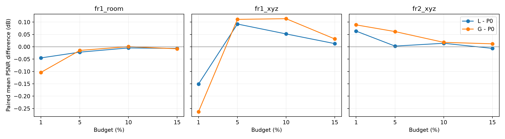

# Progressive Internal-Node Representative Utility Audit

## 结论

**INTERNAL REP HYPOTHESIS：PARTIAL。建议 KEEP C。**

internal representative identity确实影响部分失败case，但现有证据不足以将其认定为Progressive跨scene不稳定的主要原因。S全删internal在12/12 case降低PSNR；L保留root预算、在同subtree内替换后，fr1_xyz 5/10%和fr2_xyz 1%恢复明显，fr2_xyz 5/10%仅小幅恢复；两个原本成功的1% case反而下降。不能把“C低rank”直接解释为真实渲染utility低。

| 问题 | 回答 |
| --- | --- |
| Q1 | 见按scene/ratio/depth的survival表 |
| Q2 | MIXED |
| Q3 | NO |
| Q4 | MIXED |
| Q5 | BOTH：identity有局部证据，remaining region/unlock/ordering未被排除；尚不能确定主因 |
| Q6 | KEEP C |

Q3的NO指Skip Internal没有恢复任何失败case；Q4的MIXED表示L在五个重点失败case均正向，但幅度、paired-view证据不同，且成功case出现反向证据。BOTH不是证明两者贡献相等，而是identity有局部干预证据、region/unlock/后续ordering仍无法排除。

## 1. 研究假设、冻结协议与边界

本轮仅诊断P0实际emit的internal代表是否不适合最终渲染。不调用d50x32；target-2048、原h搜索、origin=(0,0,0)、3rep/node、Q<0.80 split、L3、scalar-radius κ、candidate=valid AND observed、maturity=1、Raw贡献/Bank、Master/TF、renderer与四指标实现均冻结。没有新训练、GI贡献重渲染、Bank更新或参数搜索。HEAD=`3cfccc4a92c8e1ec6c3d491dac1c9efbf151daeb`，branch=`redundancy-aware-si`；production tracked源码和index未改动。

预注册SHA256：`dc4354f3dec06b4e82ba0115d8d4e0a5c14e525da934e2dec08d97ba237c89b3`。规则在baseline和新diagnostic render之前写入，结束时与三个scene保存的SHA再次核对；没有新增dB阈值。实验目录保留20261019批次名，本轮交付日期为2026-10-20。

| scene | checkpoint | candidate N | Bank/eval | K 1/5/10/15% |
| --- | --- | --- | --- | --- |
| fr1_room | 16900_shutdown | 50330 | 69/161 | 503/2517/5033/7550 |
| fr1_xyz | 9900_shutdown | 23643 | 18/54 | 236/1182/2364/3546 |
| fr2_xyz | 37900_shutdown | 43059 | 14/39 | 431/2153/4306/6459 |

评价视角为参与过原SLAM的fixed non-Bank archived evaluation views，不称unseen或独立novel-view测试。XYZ使用指定TUM_RGBD数据；旧Bank归档的scene文本标签过期，沿用已冻结的实际keyframe IDs和相机/GT路径。所有arm使用同一requested-ratio TF consumer。

### 冻结SHA

| scene | 输入 | SHA256 |
| --- | --- | --- |
| fr1_room | master | 73f23088aab5c39c9864cf3a0b0fb1fab6384ae162bc848dadeefec5f0b1c4bb |
| fr1_room | tf | a01c7b908dee8a9fd29603babe49fb5a2c99e8e0010072d8ef13b85429cfa4bd |
| fr1_room | cameras | 90e74ad824dddcdd2a740d004082d747f170ce912aaaff07e99f6c1c9e5caabf |
| fr1_room | hierarchy输入 | e54e055fd9be3a211ba87cf6997fd088960659ff3f415d2affeebc7636d09a55 |
| fr1_xyz | master | a8abd19e63cc3079d4efd07947856e7d8e1f5e959e17142b62aa659b0faebb10 |
| fr1_xyz | tf | bba18765352bced0e8359a5bae8501e7293cb4f907e7760a01e12b5b2f4f0384 |
| fr1_xyz | cameras | 684882bed264ddfc1dfdaca74eab0168f9b7d255e120e3d18aa2d3cdfb5fc074 |
| fr1_xyz | hierarchy输入 | 9518c1b79e2bd00f499fcbb81244c7a82be9cc10c3f0610ed745695a99a67fac |
| fr2_xyz | master | f2a83521139547736804bf5be56e334c11ee51ec0dd5f3741f5c5116a83b9ac8 |
| fr2_xyz | tf | 050069eb1a664db8a77ccb0d15e0e0fb86add45162df3e55c14deb6a8eef9eca |
| fr2_xyz | cameras | e145e03f8c787663df2a17418240c8262696ffab6beb19e50ac0639d0c98057e |
| fr2_xyz | hierarchy输入 | e782809b8e6395ef2357ee58745ffc1763f76f3cf540d875daca5b5bd78bbada |

全部consumed原始数据/GT和历史ranking/tree/质量artifact SHA通过；15个隔离runtime库SHA与历史一致，实际worker maps指向本轮runtime。完整路径/哈希见各scene `prior_checks.json`、`setup_checks.json`及`artifact_manifest.json`。

## 2. Baseline reproduction gate

三个scene均重建A/B/C/P0完整ranking；C binary和tree逐字一致；P0完整order与emit-time priority exact一致；same-K与selected rows exact。重新真实渲染所有baseline ratio/view，PSNR/SSIM/LPIPS/photo的逐view及aggregate最大差全部为0。全部通过后才渲染S/L/G。Master/TF tensor在worker结束前再次验证未变。

| scene | baseline真实render次数 | 逐view最大差 | aggregate最大差 | ranking/tree |
| --- | --- | --- | --- | --- |
| fr1_room | 2576 | 0 / 0 / 0 / 0 | 0 / 0 / 0 / 0 | EXACT |
| fr1_xyz | 864 | 0 / 0 / 0 / 0 | 0 / 0 / 0 / 0 | EXACT |
| fr2_xyz | 624 | 0 / 0 / 0 / 0 | 0 / 0 / 0 / 0 | EXACT |

## 3. Arms与identity语义

- A：Raw SI descending，B：原Fixed h8 geometry-only marginal，C：final-leaf Delta + independent residual descending。
- P0：原F2 active-frontier，node最多3个新coarse reps，继承ancestor coverage，排除已emit row，leaf继续independent residual。
- S：从P0完整顺序稳定过滤全部INTERNAL_REP，其余相对顺序exact保持，再取前K。S是完整non-internal ranking，非完整candidate permutation。
- L：每ratio从P0 TopK开始，按原P0 rank，仅替换不在C TopK的internal row；从其同一node.members/subtree选择当前未selected、从未用作proxy的最高C rank row；否则留原。允许已经移除且未曾用作proxy的row在后续重新成为proxy，遵循顺序更新selected状态。
- G：删除P0 TopK中不在C TopK的internal rows，按缺失C global rank refill。它不是GT oracle，也不是数学保证的渲染质量上界。

S按同一完整过滤顺序取nested prefixes；L/G是用户规定的ratio-specific集合，不主张nested。L/G不接Teacher，不构造成production Progressive。

**重要源码事实：P0会在ancestor coverage条件下重新greedy选代表。** inventory中的local Delta/r1-r3是P0实际ranking-time值，不一定等于结构阶段empty-cover provisional reps。`matches_structural_provisional_ID`记录实际row是否属于该node原结构3rep。因此本轮严格检验“split internal node的实际输出”，不能假设每个P0 row与原provisional ID逐字相同。

| scene | depth | 完整P0 internal数 | 属于原结构3rep的row数 |
| --- | --- | --- | --- |
| fr1_room | L1 | 1407 | 1407 |
| fr1_room | L2 | 1646 | 1120 |
| fr1_xyz | L1 | 1047 | 1047 |
| fr1_xyz | L2 | 1119 | 757 |
| fr2_xyz | L1 | 1092 | 1092 |
| fr2_xyz | L2 | 1688 | 1126 |

## 4. Internal reps最终存活情况（Q1）

下表分母为该budget中P0实际emit的internal reps，分子为其中同budget也进入C的数量。L3没有internal nodes。

| scene | ratio | K | 存活/内部总数 | 存活率 | L1 | L2 | L3 | C最终rep | C最终residual |
| --- | --- | --- | --- | --- | --- | --- | --- | --- | --- |
| fr1_room | 1% | 503 | 225/282 | 79.79% | 195/248 | 30/34 | 0/0 | 266 | 16 |
| fr1_room | 5% | 2517 | 1060/1167 | 90.83% | 664/743 | 396/424 | 0/0 | 1110 | 57 |
| fr1_room | 10% | 5033 | 1777/1886 | 94.22% | 1013/1079 | 764/807 | 0/0 | 1796 | 90 |
| fr1_room | 15% | 7550 | 2235/2350 | 95.11% | 1152/1217 | 1083/1133 | 0/0 | 2239 | 111 |
| fr1_xyz | 1% | 236 | 37/50 | 74.00% | 37/50 | 0/0 | 0/0 | 48 | 2 |
| fr1_xyz | 5% | 1182 | 355/426 | 83.33% | 316/381 | 39/45 | 0/0 | 404 | 22 |
| fr1_xyz | 10% | 2364 | 766/856 | 89.49% | 560/618 | 206/238 | 0/0 | 816 | 40 |
| fr1_xyz | 15% | 3546 | 1116/1231 | 90.66% | 698/767 | 418/464 | 0/0 | 1174 | 57 |
| fr2_xyz | 1% | 431 | 132/176 | 75.00% | 125/166 | 7/10 | 0/0 | 164 | 12 |
| fr2_xyz | 5% | 2153 | 810/888 | 91.22% | 480/524 | 330/364 | 0/0 | 854 | 34 |
| fr2_xyz | 10% | 4306 | 1365/1443 | 94.59% | 671/711 | 694/732 | 0/0 | 1381 | 62 |
| fr2_xyz | 15% | 6459 | 1741/1824 | 95.45% | 792/827 | 949/997 | 0/0 | 1743 | 81 |

成功的两个1% case存活率分别79.79%和74.00%，失败的fr2_xyz 1%为75.00%，没有清楚分离。高budget失败case的存活率反而可超过89%/94%；不能仅用C overlap解释质量方向。

## 5. Internal C/Raw/B rank分布（Q2）

rank percentile=1-based rank/N，越小越靠前。只统计P0 TopK的internal reps；完整mean/median/p10/p90与按depth/r1r2r3细分见CSV。

| scene | ratio | C mean | C median | C p90 | Raw median | B median |
| --- | --- | --- | --- | --- | --- | --- |
| fr1_room | 1% | 2.67% | 0.62% | 2.68% | 1.77% | 0.71% |
| fr1_room | 5% | 4.35% | 2.54% | 4.96% | 4.20% | 2.87% |
| fr1_room | 10% | 6.12% | 4.26% | 9.33% | 7.45% | 4.77% |
| fr1_room | 15% | 7.74% | 5.61% | 13.41% | 9.77% | 6.14% |
| fr1_xyz | 1% | 2.45% | 0.79% | 6.17% | 1.64% | 0.76% |
| fr1_xyz | 5% | 6.25% | 3.17% | 7.77% | 4.87% | 3.29% |
| fr1_xyz | 10% | 8.24% | 5.70% | 10.06% | 8.37% | 6.06% |
| fr1_xyz | 15% | 10.00% | 8.05% | 14.87% | 11.91% | 8.37% |
| fr2_xyz | 1% | 3.02% | 0.68% | 2.38% | 1.36% | 0.99% |
| fr2_xyz | 5% | 3.84% | 2.68% | 4.93% | 4.37% | 3.45% |
| fr2_xyz | 10% | 5.72% | 4.32% | 9.15% | 6.74% | 5.29% |
| fr2_xyz | 15% | 7.31% | 5.63% | 13.35% | 8.51% | 6.82% |

Q2=MIXED。fr2_xyz 1%的C median为0.684%，介于两个成功1% case的0.618%/0.789%之间；并非失败internal reps普遍rank明显更低。跨ratio必须考虑budget本身变化，不能直接比较1%与10%的绝对percentile后推断低utility。

## 6. 主质量表

PSNR/SSIM越高越好；LPIPS/photo越低越好。photo沿用production .8 L1 + .2(1−production fast_ssim)，评价SSIM沿用原TorchMetrics实现。

### PSNR

| scene | ratio | A | B | C | P0 | S | L | G |
| --- | --- | --- | --- | --- | --- | --- | --- | --- |
| fr1_room | 1% | 12.988268 | 13.882451 | 13.834515 | 13.938402 | 12.046875 | 13.893390 | 13.834515 |
| fr1_room | 5% | 16.653142 | 16.980360 | 17.046943 | 17.048579 | 15.449695 | 17.026951 | 17.033953 |
| fr1_room | 10% | 17.680354 | 17.802212 | 17.760086 | 17.780563 | 16.651702 | 17.776002 | 17.781292 |
| fr1_room | 15% | 18.054710 | 18.225545 | 18.180123 | 18.219173 | 17.280258 | 18.212696 | 18.211054 |
| fr1_xyz | 1% | 13.020670 | 14.584813 | 14.206011 | 14.456831 | 13.733162 | 14.305926 | 14.193741 |
| fr1_xyz | 5% | 17.814622 | 18.777373 | 18.822068 | 18.707482 | 16.852880 | 18.799714 | 18.818567 |
| fr1_xyz | 10% | 19.812102 | 20.261198 | 20.301973 | 20.182299 | 18.126740 | 20.234462 | 20.296180 |
| fr1_xyz | 15% | 20.890139 | 20.817547 | 20.900224 | 20.859292 | 18.953798 | 20.872248 | 20.891175 |
| fr2_xyz | 1% | 16.234008 | 16.329698 | 16.726775 | 16.636306 | 15.226659 | 16.699896 | 16.725137 |
| fr2_xyz | 5% | 19.883452 | 20.254137 | 20.232834 | 20.175046 | 18.313634 | 20.177916 | 20.236746 |
| fr2_xyz | 10% | 21.238710 | 21.032306 | 21.065654 | 21.024125 | 19.256946 | 21.038395 | 21.042181 |
| fr2_xyz | 15% | 21.479951 | 21.452410 | 21.406546 | 21.434978 | 19.769514 | 21.428667 | 21.447081 |

### SSIM

| scene | ratio | A | B | C | P0 | S | L | G |
| --- | --- | --- | --- | --- | --- | --- | --- | --- |
| fr1_room | 1% | 0.552427 | 0.562086 | 0.561118 | 0.561671 | 0.529775 | 0.561757 | 0.561118 |
| fr1_room | 5% | 0.616889 | 0.618974 | 0.619452 | 0.619184 | 0.588560 | 0.619085 | 0.619569 |
| fr1_room | 10% | 0.640308 | 0.637135 | 0.637632 | 0.637775 | 0.610468 | 0.637695 | 0.638101 |
| fr1_room | 15% | 0.649803 | 0.648584 | 0.648521 | 0.649051 | 0.624224 | 0.648928 | 0.649051 |
| fr1_xyz | 1% | 0.569450 | 0.582761 | 0.584646 | 0.584532 | 0.573246 | 0.584357 | 0.584460 |
| fr1_xyz | 5% | 0.656955 | 0.670624 | 0.671249 | 0.669681 | 0.640366 | 0.670306 | 0.671082 |
| fr1_xyz | 10% | 0.705598 | 0.706185 | 0.707379 | 0.706284 | 0.672879 | 0.706714 | 0.707349 |
| fr1_xyz | 15% | 0.725542 | 0.723764 | 0.724697 | 0.724299 | 0.692112 | 0.724433 | 0.724542 |
| fr2_xyz | 1% | 0.591295 | 0.589100 | 0.593566 | 0.591907 | 0.567641 | 0.593220 | 0.593320 |
| fr2_xyz | 5% | 0.657687 | 0.665472 | 0.665330 | 0.663740 | 0.630839 | 0.664326 | 0.665064 |
| fr2_xyz | 10% | 0.699281 | 0.695580 | 0.695924 | 0.696008 | 0.653803 | 0.695951 | 0.696278 |
| fr2_xyz | 15% | 0.711983 | 0.709923 | 0.709145 | 0.709547 | 0.669958 | 0.709420 | 0.709852 |

### LPIPS

| scene | ratio | A | B | C | P0 | S | L | G |
| --- | --- | --- | --- | --- | --- | --- | --- | --- |
| fr1_room | 1% | 0.752445 | 0.736327 | 0.738927 | 0.739092 | 0.774894 | 0.739872 | 0.738927 |
| fr1_room | 5% | 0.648476 | 0.630773 | 0.631498 | 0.632291 | 0.642497 | 0.631645 | 0.632644 |
| fr1_room | 10% | 0.599721 | 0.576634 | 0.576373 | 0.574194 | 0.581613 | 0.574508 | 0.574728 |
| fr1_room | 15% | 0.571317 | 0.542243 | 0.544375 | 0.542950 | 0.548874 | 0.543310 | 0.543477 |
| fr1_xyz | 1% | 0.704868 | 0.663592 | 0.669723 | 0.667035 | 0.683516 | 0.668567 | 0.669750 |
| fr1_xyz | 5% | 0.545347 | 0.490062 | 0.491978 | 0.490596 | 0.523364 | 0.489262 | 0.492351 |
| fr1_xyz | 10% | 0.442491 | 0.402928 | 0.405309 | 0.404914 | 0.425439 | 0.404404 | 0.406191 |
| fr1_xyz | 15% | 0.391351 | 0.361789 | 0.362828 | 0.360197 | 0.373189 | 0.360935 | 0.363147 |
| fr2_xyz | 1% | 0.722452 | 0.670712 | 0.669190 | 0.669760 | 0.725686 | 0.658462 | 0.669054 |
| fr2_xyz | 5% | 0.506864 | 0.469105 | 0.461077 | 0.462943 | 0.492454 | 0.463275 | 0.464033 |
| fr2_xyz | 10% | 0.406361 | 0.385843 | 0.378207 | 0.377872 | 0.408579 | 0.376851 | 0.378736 |
| fr2_xyz | 15% | 0.363814 | 0.343629 | 0.345040 | 0.343565 | 0.365547 | 0.343301 | 0.344223 |

### PHOTO

| scene | ratio | A | B | C | P0 | S | L | G |
| --- | --- | --- | --- | --- | --- | --- | --- | --- |
| fr1_room | 1% | 0.219589 | 0.203461 | 0.204326 | 0.203464 | 0.245106 | 0.203585 | 0.204326 |
| fr1_room | 5% | 0.153112 | 0.150699 | 0.150241 | 0.150243 | 0.173403 | 0.150412 | 0.150284 |
| fr1_room | 10% | 0.137312 | 0.138246 | 0.138309 | 0.138138 | 0.154821 | 0.138195 | 0.138023 |
| fr1_room | 15% | 0.131872 | 0.131947 | 0.132179 | 0.131801 | 0.145828 | 0.131865 | 0.131820 |
| fr1_xyz | 1% | 0.197714 | 0.178564 | 0.179248 | 0.177929 | 0.187357 | 0.179191 | 0.179489 |
| fr1_xyz | 5% | 0.126302 | 0.119236 | 0.118568 | 0.119321 | 0.137409 | 0.118861 | 0.118657 |
| fr1_xyz | 10% | 0.103354 | 0.102742 | 0.102281 | 0.102968 | 0.120239 | 0.102671 | 0.102282 |
| fr1_xyz | 15% | 0.095069 | 0.096261 | 0.095808 | 0.096021 | 0.111461 | 0.095959 | 0.095859 |
| fr2_xyz | 1% | 0.159823 | 0.160234 | 0.156128 | 0.157493 | 0.177523 | 0.156323 | 0.156169 |
| fr2_xyz | 5% | 0.114430 | 0.111829 | 0.111950 | 0.112541 | 0.129853 | 0.112387 | 0.111921 |
| fr2_xyz | 10% | 0.099144 | 0.100980 | 0.101006 | 0.101117 | 0.119775 | 0.101061 | 0.100941 |
| fr2_xyz | 15% | 0.095278 | 0.096358 | 0.096823 | 0.096693 | 0.113744 | 0.096736 | 0.096552 |

## 7. 核心因果差值

| scene | ratio | P0−C | S−P0 | L−P0 | G−P0 | L−C |
| --- | --- | --- | --- | --- | --- | --- |
| fr1_room | 1% | +0.103887 | -1.891527 | -0.045012 | -0.103887 | +0.058875 |
| fr1_room | 5% | +0.001637 | -1.598884 | -0.021628 | -0.014626 | -0.019991 |
| fr1_room | 10% | +0.020477 | -1.128861 | -0.004561 | +0.000729 | +0.015916 |
| fr1_room | 15% | +0.039050 | -0.938915 | -0.006478 | -0.008119 | +0.032572 |
| fr1_xyz | 1% | +0.250820 | -0.723668 | -0.150905 | -0.263089 | +0.099915 |
| fr1_xyz | 5% | -0.114585 | -1.854602 | +0.092232 | +0.111085 | -0.022354 |
| fr1_xyz | 10% | -0.119675 | -2.055559 | +0.052164 | +0.113882 | -0.067511 |
| fr1_xyz | 15% | -0.040932 | -1.905493 | +0.012956 | +0.031884 | -0.027976 |
| fr2_xyz | 1% | -0.090470 | -1.409647 | +0.063590 | +0.088832 | -0.026880 |
| fr2_xyz | 5% | -0.057788 | -1.861412 | +0.002870 | +0.061700 | -0.054919 |
| fr2_xyz | 10% | -0.041529 | -1.767180 | +0.014270 | +0.018056 | -0.027259 |
| fr2_xyz | 15% | +0.028432 | -1.665464 | -0.006311 | +0.012102 | +0.022121 |

S在12/12 case退化，幅度为−0.724至−2.056 dB。它删除了同时被C选择的大量有效internal rows，不能解释成“所有parent reps都有害”。L只定向替换P0-only internal，构成更接近identity干预的证据。

重点失败case中，L恢复原P0−C损失的约：fr1_xyz 5%=80.49%、10%=43.59%；fr2_xyz 1%=70.29%、5%=4.97%、10%=34.36%。该比例只是对本次PSNR差值的描述，不是线性可加的utility估计。L仍未在这些case超过C。两个成功1% case分别损失0.0450与0.1509 dB，说明C的ranking不是final rendering utility oracle。

G在失败case通常更接近C，尤其fr2_xyz 5%比L恢复更多；这提示同subtree限制下剩余budget/ordering仍有影响，但不能据此证明具体unlock timing规则错误。

### 四指标差值

| scene | ratio | 比较 | ΔPSNR | ΔSSIM | ΔLPIPS | Δphoto |
| --- | --- | --- | --- | --- | --- | --- |
| fr1_room | 1% | S−P0 | -1.891527 | -0.031896 | +0.035803 | +0.041642 |
| fr1_room | 1% | L−P0 | -0.045012 | +0.000086 | +0.000780 | +0.000121 |
| fr1_room | 1% | G−P0 | -0.103887 | -0.000553 | -0.000165 | +0.000862 |
| fr1_room | 1% | L−C | +0.058875 | +0.000639 | +0.000945 | -0.000741 |
| fr1_room | 5% | S−P0 | -1.598884 | -0.030624 | +0.010206 | +0.023160 |
| fr1_room | 5% | L−P0 | -0.021628 | -0.000099 | -0.000646 | +0.000169 |
| fr1_room | 5% | G−P0 | -0.014626 | +0.000385 | +0.000353 | +0.000041 |
| fr1_room | 5% | L−C | -0.019991 | -0.000367 | +0.000146 | +0.000172 |
| fr1_room | 10% | S−P0 | -1.128861 | -0.027307 | +0.007419 | +0.016684 |
| fr1_room | 10% | L−P0 | -0.004561 | -0.000080 | +0.000314 | +0.000057 |
| fr1_room | 10% | G−P0 | +0.000729 | +0.000326 | +0.000534 | -0.000114 |
| fr1_room | 10% | L−C | +0.015916 | +0.000064 | -0.001865 | -0.000114 |
| fr1_room | 15% | S−P0 | -0.938915 | -0.024827 | +0.005924 | +0.014027 |
| fr1_room | 15% | L−P0 | -0.006478 | -0.000123 | +0.000360 | +0.000065 |
| fr1_room | 15% | G−P0 | -0.008119 | -0.000000 | +0.000527 | +0.000019 |
| fr1_room | 15% | L−C | +0.032572 | +0.000407 | -0.001065 | -0.000313 |
| fr1_xyz | 1% | S−P0 | -0.723668 | -0.011286 | +0.016481 | +0.009427 |
| fr1_xyz | 1% | L−P0 | -0.150905 | -0.000175 | +0.001532 | +0.001262 |
| fr1_xyz | 1% | G−P0 | -0.263089 | -0.000072 | +0.002716 | +0.001560 |
| fr1_xyz | 1% | L−C | +0.099915 | -0.000288 | -0.001156 | -0.000057 |
| fr1_xyz | 5% | S−P0 | -1.854602 | -0.029314 | +0.032768 | +0.018088 |
| fr1_xyz | 5% | L−P0 | +0.092232 | +0.000625 | -0.001334 | -0.000460 |
| fr1_xyz | 5% | G−P0 | +0.111085 | +0.001401 | +0.001755 | -0.000664 |
| fr1_xyz | 5% | L−C | -0.022354 | -0.000943 | -0.002716 | +0.000293 |
| fr1_xyz | 10% | S−P0 | -2.055559 | -0.033405 | +0.020525 | +0.017271 |
| fr1_xyz | 10% | L−P0 | +0.052164 | +0.000430 | -0.000510 | -0.000297 |
| fr1_xyz | 10% | G−P0 | +0.113882 | +0.001065 | +0.001277 | -0.000686 |
| fr1_xyz | 10% | L−C | -0.067511 | -0.000664 | -0.000905 | +0.000390 |
| fr1_xyz | 15% | S−P0 | -1.905493 | -0.032187 | +0.012992 | +0.015440 |
| fr1_xyz | 15% | L−P0 | +0.012956 | +0.000134 | +0.000738 | -0.000062 |
| fr1_xyz | 15% | G−P0 | +0.031884 | +0.000243 | +0.002951 | -0.000162 |
| fr1_xyz | 15% | L−C | -0.027976 | -0.000265 | -0.001893 | +0.000151 |
| fr2_xyz | 1% | S−P0 | -1.409647 | -0.024266 | +0.055925 | +0.020030 |
| fr2_xyz | 1% | L−P0 | +0.063590 | +0.001314 | -0.011299 | -0.001171 |
| fr2_xyz | 1% | G−P0 | +0.088832 | +0.001413 | -0.000707 | -0.001324 |
| fr2_xyz | 1% | L−C | -0.026880 | -0.000346 | -0.010728 | +0.000195 |
| fr2_xyz | 5% | S−P0 | -1.861412 | -0.032901 | +0.029512 | +0.017312 |
| fr2_xyz | 5% | L−P0 | +0.002870 | +0.000585 | +0.000332 | -0.000155 |
| fr2_xyz | 5% | G−P0 | +0.061700 | +0.001324 | +0.001090 | -0.000620 |
| fr2_xyz | 5% | L−C | -0.054919 | -0.001005 | +0.002198 | +0.000436 |
| fr2_xyz | 10% | S−P0 | -1.767180 | -0.042205 | +0.030707 | +0.018658 |
| fr2_xyz | 10% | L−P0 | +0.014270 | -0.000057 | -0.001021 | -0.000057 |
| fr2_xyz | 10% | G−P0 | +0.018056 | +0.000271 | +0.000864 | -0.000176 |
| fr2_xyz | 10% | L−C | -0.027259 | +0.000027 | -0.001357 | +0.000055 |
| fr2_xyz | 15% | S−P0 | -1.665464 | -0.039589 | +0.021982 | +0.017050 |
| fr2_xyz | 15% | L−P0 | -0.006311 | -0.000127 | -0.000264 | +0.000043 |
| fr2_xyz | 15% | G−P0 | +0.012102 | +0.000305 | +0.000658 | -0.000142 |
| fr2_xyz | 15% | L−C | +0.022121 | +0.000275 | -0.001738 | -0.000087 |

## 8. Paired per-view

以下为PSNR；四项metric完整分布均在`paired_statistics.csv`。LPIPS/photo的improved fraction按下降定义，delta仍为arm−baseline的原符号。视角来自同一序列且相关，未将view数量当作独立scene统计显著性。

| scene | ratio | 比较 | mean | median | p10 | p90 | 改善视角比例 |
| --- | --- | --- | --- | --- | --- | --- | --- |
| fr1_room | 1% | S−P0 | -1.891527 | -1.485266 | -4.296956 | -0.196901 | 7.45% |
| fr1_room | 1% | L−P0 | -0.045012 | -0.039431 | -0.367916 | +0.231886 | 35.40% |
| fr1_room | 1% | G−P0 | -0.103887 | -0.092944 | -0.400724 | +0.233522 | 29.19% |
| fr1_room | 5% | S−P0 | -1.598884 | -1.461309 | -3.039139 | -0.384840 | 2.48% |
| fr1_room | 5% | L−P0 | -0.021628 | -0.024063 | -0.112608 | +0.058531 | 37.89% |
| fr1_room | 5% | G−P0 | -0.014626 | -0.008421 | -0.123580 | +0.088896 | 46.58% |
| fr1_room | 10% | S−P0 | -1.128861 | -0.966059 | -2.049224 | -0.273601 | 3.11% |
| fr1_room | 10% | L−P0 | -0.004561 | -0.007982 | -0.037146 | +0.028228 | 39.13% |
| fr1_room | 10% | G−P0 | +0.000729 | -0.004087 | -0.048937 | +0.051979 | 46.58% |
| fr1_room | 15% | S−P0 | -0.938915 | -0.801079 | -1.726866 | -0.309237 | 4.97% |
| fr1_room | 15% | L−P0 | -0.006478 | -0.006273 | -0.039387 | +0.024967 | 37.89% |
| fr1_room | 15% | G−P0 | -0.008119 | -0.008224 | -0.037445 | +0.024855 | 37.27% |
| fr1_xyz | 1% | S−P0 | -0.723668 | -0.723304 | -0.953289 | -0.445242 | 0.00% |
| fr1_xyz | 1% | L−P0 | -0.150905 | -0.165984 | -0.306810 | -0.001623 | 9.26% |
| fr1_xyz | 1% | G−P0 | -0.263089 | -0.249962 | -0.460296 | -0.108046 | 3.70% |
| fr1_xyz | 5% | S−P0 | -1.854602 | -2.055949 | -2.604802 | -0.899312 | 0.00% |
| fr1_xyz | 5% | L−P0 | +0.092232 | +0.057144 | +0.015251 | +0.221926 | 98.15% |
| fr1_xyz | 5% | G−P0 | +0.111085 | +0.094785 | +0.047870 | +0.209718 | 98.15% |
| fr1_xyz | 10% | S−P0 | -2.055559 | -2.190837 | -2.756659 | -0.989510 | 0.00% |
| fr1_xyz | 10% | L−P0 | +0.052164 | +0.045904 | -0.009401 | +0.127064 | 85.19% |
| fr1_xyz | 10% | G−P0 | +0.113882 | +0.113535 | +0.060244 | +0.164077 | 96.30% |
| fr1_xyz | 15% | S−P0 | -1.905493 | -2.002547 | -2.546058 | -1.040995 | 0.00% |
| fr1_xyz | 15% | L−P0 | +0.012956 | +0.015338 | -0.023774 | +0.047085 | 64.81% |
| fr1_xyz | 15% | G−P0 | +0.031884 | +0.031217 | -0.005362 | +0.068797 | 87.04% |
| fr2_xyz | 1% | S−P0 | -1.409647 | -1.546950 | -2.194354 | -0.410062 | 0.00% |
| fr2_xyz | 1% | L−P0 | +0.063590 | +0.063092 | +0.015412 | +0.115573 | 94.87% |
| fr2_xyz | 1% | G−P0 | +0.088832 | +0.067984 | -0.003453 | +0.232685 | 89.74% |
| fr2_xyz | 5% | S−P0 | -1.861412 | -1.835888 | -2.642204 | -1.073648 | 0.00% |
| fr2_xyz | 5% | L−P0 | +0.002870 | +0.008074 | -0.050937 | +0.031052 | 58.97% |
| fr2_xyz | 5% | G−P0 | +0.061700 | +0.064297 | -0.023352 | +0.143706 | 84.62% |
| fr2_xyz | 10% | S−P0 | -1.767180 | -1.836922 | -2.495141 | -0.902722 | 0.00% |
| fr2_xyz | 10% | L−P0 | +0.014270 | +0.004385 | -0.029593 | +0.072483 | 61.54% |
| fr2_xyz | 10% | G−P0 | +0.018056 | +0.009676 | -0.027671 | +0.073753 | 64.10% |
| fr2_xyz | 15% | S−P0 | -1.665464 | -1.725931 | -2.422130 | -0.813164 | 0.00% |
| fr2_xyz | 15% | L−P0 | -0.006311 | -0.004601 | -0.024078 | +0.010885 | 35.90% |
| fr2_xyz | 15% | G−P0 | +0.012102 | +0.013968 | -0.024869 | +0.048855 | 61.54% |

fr1_xyz的L 5%/10%改善视角占98.15%/85.19%；fr2_xyz 1%占94.87%，是较一致的identity改善证据。fr2_xyz 5%/10%仅58.97%/61.54%，恢复较弱。两个成功1% case的L改善视角仅35.40%/9.26%，构成明确反向证据。

## 9. Symmetric difference来源

| scene | ratio | P0 only | C only | internal only | internal占P0 only | final rep only | residual only |
| --- | --- | --- | --- | --- | --- | --- | --- |
| fr1_room | 1% | 57 | 57 | 57 | 100.00% | 0 | 0 |
| fr1_room | 5% | 171 | 171 | 107 | 62.57% | 59 | 5 |
| fr1_room | 10% | 259 | 259 | 109 | 42.08% | 138 | 12 |
| fr1_room | 15% | 375 | 375 | 115 | 30.67% | 219 | 41 |
| fr1_xyz | 1% | 14 | 14 | 13 | 92.86% | 1 | 0 |
| fr1_xyz | 5% | 86 | 86 | 71 | 82.56% | 13 | 2 |
| fr1_xyz | 10% | 142 | 142 | 90 | 63.38% | 46 | 6 |
| fr1_xyz | 15% | 192 | 192 | 115 | 59.90% | 66 | 11 |
| fr2_xyz | 1% | 47 | 47 | 44 | 93.62% | 2 | 1 |
| fr2_xyz | 5% | 134 | 134 | 78 | 58.21% | 48 | 8 |
| fr2_xyz | 10% | 200 | 200 | 78 | 39.00% | 96 | 26 |
| fr2_xyz | 15% | 305 | 305 | 83 | 27.21% | 155 | 67 |

这区分了“internal identity变化”和“全部ranking变化”。P0-only还可包含final reps/residual；仅修internal无法保证恢复整个C ranking。

## 10. Split-node Q与r1/r2/r3

Q来自冻结结构阶段；实际emit Delta来自P0条件greedy，二者语义不同。Q bins只作诊断，不改变split。额外真实渲染L_Q0..3，每次只替换相应固定Q区间的bad internal，报告的是joint subset effect，不能相加分解成每row贡献。

| scene | ratio | Q bin | internal N | 替换数 | C存活率 | 仅该bin L−P0 PSNR |
| --- | --- | --- | --- | --- | --- | --- |
| fr1_room | 1% | <.25 | 16 | 7 | 56.25% | +0.013861 |
| fr1_room | 1% | .25–.50 | 97 | 26 | 73.20% | -0.034190 |
| fr1_room | 1% | .50–.65 | 79 | 13 | 83.54% | -0.005029 |
| fr1_room | 1% | .65–.80 | 90 | 11 | 87.78% | -0.013529 |
| fr1_room | 5% | <.25 | 19 | 1 | 94.74% | -0.001497 |
| fr1_room | 5% | .25–.50 | 318 | 29 | 90.88% | -0.003228 |
| fr1_room | 5% | .50–.65 | 408 | 44 | 89.22% | -0.003026 |
| fr1_room | 5% | .65–.80 | 422 | 33 | 92.18% | -0.014133 |
| fr1_room | 10% | <.25 | 31 | 0 | 100.00% | +0.000000 |
| fr1_room | 10% | .25–.50 | 507 | 35 | 93.10% | -0.005541 |
| fr1_room | 10% | .50–.65 | 622 | 44 | 92.93% | -0.006559 |
| fr1_room | 10% | .65–.80 | 726 | 30 | 95.87% | +0.008719 |
| fr1_room | 15% | <.25 | 36 | 0 | 100.00% | +0.000000 |
| fr1_room | 15% | .25–.50 | 578 | 26 | 95.50% | -0.008378 |
| fr1_room | 15% | .50–.65 | 773 | 46 | 94.05% | -0.000241 |
| fr1_room | 15% | .65–.80 | 963 | 43 | 95.53% | +0.002175 |
| fr1_xyz | 1% | <.25 | 0 | 0 | — | +0.000000 |
| fr1_xyz | 1% | .25–.50 | 2 | 2 | 0.00% | -0.195957 |
| fr1_xyz | 1% | .50–.65 | 17 | 4 | 76.47% | +0.006680 |
| fr1_xyz | 1% | .65–.80 | 31 | 7 | 77.42% | +0.048721 |
| fr1_xyz | 5% | <.25 | 9 | 1 | 88.89% | -0.006520 |
| fr1_xyz | 5% | .25–.50 | 74 | 16 | 78.38% | +0.036059 |
| fr1_xyz | 5% | .50–.65 | 135 | 19 | 85.93% | -0.005003 |
| fr1_xyz | 5% | .65–.80 | 208 | 35 | 83.17% | +0.072432 |
| fr1_xyz | 10% | <.25 | 12 | 3 | 75.00% | +0.001731 |
| fr1_xyz | 10% | .25–.50 | 170 | 18 | 89.41% | +0.028986 |
| fr1_xyz | 10% | .50–.65 | 268 | 28 | 89.55% | -0.021123 |
| fr1_xyz | 10% | .65–.80 | 406 | 41 | 89.90% | +0.042333 |
| fr1_xyz | 15% | <.25 | 30 | 2 | 93.33% | +0.001195 |
| fr1_xyz | 15% | .25–.50 | 249 | 26 | 89.56% | +0.005440 |
| fr1_xyz | 15% | .50–.65 | 378 | 35 | 90.74% | +0.008685 |
| fr1_xyz | 15% | .65–.80 | 574 | 52 | 90.94% | +0.006057 |
| fr2_xyz | 1% | <.25 | 1 | 1 | 0.00% | +0.004471 |
| fr2_xyz | 1% | .25–.50 | 65 | 18 | 72.31% | -0.026191 |
| fr2_xyz | 1% | .50–.65 | 45 | 9 | 80.00% | -0.001303 |
| fr2_xyz | 1% | .65–.80 | 65 | 16 | 75.38% | +0.079264 |
| fr2_xyz | 5% | <.25 | 33 | 1 | 96.97% | +0.000173 |
| fr2_xyz | 5% | .25–.50 | 326 | 27 | 91.72% | +0.006410 |
| fr2_xyz | 5% | .50–.65 | 224 | 20 | 91.07% | -0.006572 |
| fr2_xyz | 5% | .65–.80 | 305 | 30 | 90.16% | -0.001468 |
| fr2_xyz | 10% | <.25 | 65 | 3 | 95.38% | -0.004995 |
| fr2_xyz | 10% | .25–.50 | 535 | 33 | 93.83% | +0.001928 |
| fr2_xyz | 10% | .50–.65 | 386 | 20 | 94.82% | +0.002910 |
| fr2_xyz | 10% | .65–.80 | 457 | 22 | 95.19% | +0.019884 |
| fr2_xyz | 15% | <.25 | 78 | 2 | 97.44% | -0.000099 |
| fr2_xyz | 15% | .25–.50 | 660 | 31 | 95.30% | +0.003610 |
| fr2_xyz | 15% | .50–.65 | 487 | 24 | 95.07% | -0.009743 |
| fr2_xyz | 15% | .65–.80 | 599 | 26 | 95.66% | +0.005460 |

Q越低不必然意味着每个parent代表越差；低Q衡量的是最多3rep的总体覆盖能力不足。例如fr1_xyz 1%仅替换Q=.25–.50的两个row就下降0.195957 dB；fr2_xyz 1%的主要正向效果反而来自Q=.65–.80组（+0.079264 dB）。这不支持“低Q parent普遍更不适合渲染”的单调解释。各bin干预不相加，也不据此设计新threshold。

| scene | ratio | rep位置 | N | C存活率 | C median | Q median |
| --- | --- | --- | --- | --- | --- | --- |
| fr1_room | 1% | r1 | 160 | 84.38% | 0.50% | 0.601101 |
| fr1_room | 1% | r2 | 81 | 77.78% | 0.66% | 0.522806 |
| fr1_room | 1% | r3 | 41 | 65.85% | 0.83% | 0.448214 |
| fr1_room | 5% | r1 | 513 | 91.03% | 2.17% | 0.608504 |
| fr1_room | 5% | r2 | 377 | 91.78% | 2.68% | 0.599495 |
| fr1_room | 5% | r3 | 277 | 89.17% | 2.89% | 0.586908 |
| fr1_room | 10% | r1 | 746 | 94.77% | 3.51% | 0.617729 |
| fr1_room | 10% | r2 | 610 | 93.93% | 4.25% | 0.606662 |
| fr1_room | 10% | r3 | 530 | 93.77% | 5.33% | 0.597359 |
| fr1_room | 15% | r1 | 867 | 96.19% | 4.44% | 0.625712 |
| fr1_room | 15% | r2 | 784 | 95.15% | 5.65% | 0.618426 |
| fr1_room | 15% | r3 | 699 | 93.71% | 6.77% | 0.604682 |
| fr1_xyz | 1% | r1 | 42 | 73.81% | 0.81% | 0.704738 |
| fr1_xyz | 1% | r2 | 6 | 66.67% | 0.75% | 0.720364 |
| fr1_xyz | 1% | r3 | 2 | 100.00% | 0.72% | 0.634971 |
| fr1_xyz | 5% | r1 | 210 | 82.38% | 2.85% | 0.655067 |
| fr1_xyz | 5% | r2 | 135 | 81.48% | 3.33% | 0.643559 |
| fr1_xyz | 5% | r3 | 81 | 88.89% | 3.22% | 0.631001 |
| fr1_xyz | 10% | r1 | 379 | 88.13% | 5.54% | 0.648411 |
| fr1_xyz | 10% | r2 | 273 | 89.38% | 5.62% | 0.641272 |
| fr1_xyz | 10% | r3 | 204 | 92.16% | 5.86% | 0.626562 |
| fr1_xyz | 15% | r1 | 504 | 91.07% | 7.47% | 0.641519 |
| fr1_xyz | 15% | r2 | 402 | 89.80% | 8.30% | 0.637662 |
| fr1_xyz | 15% | r3 | 325 | 91.08% | 8.73% | 0.625993 |
| fr2_xyz | 1% | r1 | 91 | 72.53% | 0.69% | 0.590230 |
| fr2_xyz | 1% | r2 | 54 | 77.78% | 0.66% | 0.576042 |
| fr2_xyz | 1% | r3 | 31 | 77.42% | 0.71% | 0.590230 |
| fr2_xyz | 5% | r1 | 383 | 90.34% | 2.52% | 0.569201 |
| fr2_xyz | 5% | r2 | 279 | 90.32% | 2.84% | 0.559847 |
| fr2_xyz | 5% | r3 | 226 | 93.81% | 2.79% | 0.555979 |
| fr2_xyz | 10% | r1 | 568 | 94.01% | 3.87% | 0.561087 |
| fr2_xyz | 10% | r2 | 474 | 95.15% | 4.55% | 0.551969 |
| fr2_xyz | 10% | r3 | 401 | 94.76% | 4.73% | 0.528031 |
| fr2_xyz | 15% | r1 | 695 | 94.68% | 4.98% | 0.574330 |
| fr2_xyz | 15% | r2 | 598 | 95.32% | 5.71% | 0.559669 |
| fr2_xyz | 15% | r3 | 531 | 96.61% | 6.32% | 0.537067 |

r1不表现为跨scene始终比r2/r3可靠：例如fr2_xyz 1%的r1 C存活率72.53%，低于r2/r3的77.78%/77.42%；fr1_xyz 5%的r3存活率88.89%，高于r1/r2。不能据此自动改成unlock_after_1或_2。

## 11. Same-region与空间覆盖

**L在全部12个case中，每个root的selected count与P0 exact相同。** 每次替换严格留在原internal subtree；没有换root或改变K。因此重点失败case的L改善不能归因于在root之间重新分配预算。

L允许在同subtree内改变final leaf身份，hit leaves/leaf mass可以变化；所以该干预不能隔离subtree内部的全部细粒度spatial allocation。root预算exact不等于每个final leaf预算exact。

| scene | ratio | arm | hit roots | hit leaves | root Raw mass | leaf Raw mass | root预算=P0 |
| --- | --- | --- | --- | --- | --- | --- | --- |
| fr1_room | 1% | C | 331 | 459 | 73.70% | 54.59% | False |
| fr1_room | 1% | P0 | 333 | 461 | 74.44% | 53.61% | True |
| fr1_room | 1% | S | 388 | 422 | 50.81% | 37.75% | False |
| fr1_room | 1% | L | 333 | 461 | 74.44% | 54.38% | True |
| fr1_room | 1% | G | 331 | 459 | 73.70% | 54.59% | False |
| fr1_room | 5% | C | 882 | 1669 | 95.58% | 88.15% | False |
| fr1_room | 5% | P0 | 896 | 1638 | 95.92% | 87.37% | True |
| fr1_room | 5% | S | 942 | 1448 | 92.23% | 75.35% | False |
| fr1_room | 5% | L | 896 | 1647 | 95.92% | 87.57% | True |
| fr1_room | 5% | G | 883 | 1633 | 95.55% | 87.68% | False |
| fr1_room | 10% | C | 1201 | 2668 | 98.93% | 95.91% | False |
| fr1_room | 10% | P0 | 1208 | 2631 | 98.98% | 95.52% | True |
| fr1_room | 10% | S | 1260 | 2365 | 97.75% | 88.07% | False |
| fr1_room | 10% | L | 1208 | 2632 | 98.98% | 95.45% | True |
| fr1_room | 10% | G | 1204 | 2623 | 98.93% | 95.67% | False |
| fr1_room | 15% | C | 1367 | 3355 | 99.54% | 98.24% | False |
| fr1_room | 15% | P0 | 1373 | 3330 | 99.55% | 98.08% | True |
| fr1_room | 15% | S | 1424 | 2989 | 99.01% | 92.91% | False |
| fr1_room | 15% | L | 1373 | 3338 | 99.55% | 98.02% | True |
| fr1_room | 15% | G | 1371 | 3322 | 99.54% | 98.15% | False |
| fr1_xyz | 1% | C | 206 | 215 | 61.79% | 55.63% | False |
| fr1_xyz | 1% | P0 | 210 | 216 | 62.55% | 55.50% | True |
| fr1_xyz | 1% | S | 207 | 207 | 51.13% | 50.68% | False |
| fr1_xyz | 1% | L | 210 | 216 | 62.55% | 55.44% | True |
| fr1_xyz | 1% | G | 207 | 215 | 61.88% | 55.62% | False |
| fr1_xyz | 5% | C | 665 | 910 | 91.92% | 85.15% | False |
| fr1_xyz | 5% | P0 | 680 | 894 | 92.45% | 84.23% | True |
| fr1_xyz | 5% | S | 740 | 823 | 83.73% | 74.21% | False |
| fr1_xyz | 5% | L | 680 | 906 | 92.45% | 84.63% | True |
| fr1_xyz | 5% | G | 672 | 908 | 92.03% | 85.07% | False |
| fr1_xyz | 10% | C | 978 | 1559 | 97.08% | 92.95% | False |
| fr1_xyz | 10% | P0 | 1000 | 1543 | 97.31% | 92.44% | True |
| fr1_xyz | 10% | S | 1087 | 1429 | 94.26% | 84.57% | False |
| fr1_xyz | 10% | L | 1000 | 1549 | 97.31% | 92.64% | True |
| fr1_xyz | 10% | G | 992 | 1544 | 97.14% | 92.78% | False |
| fr1_xyz | 15% | C | 1181 | 2131 | 98.63% | 96.21% | False |
| fr1_xyz | 15% | P0 | 1201 | 2120 | 98.74% | 96.00% | True |
| fr1_xyz | 15% | S | 1330 | 1949 | 97.89% | 89.52% | False |
| fr1_xyz | 15% | L | 1201 | 2123 | 98.74% | 96.03% | True |
| fr1_xyz | 15% | G | 1196 | 2112 | 98.68% | 96.09% | False |
| fr2_xyz | 1% | C | 258 | 349 | 79.32% | 67.57% | False |
| fr2_xyz | 1% | P0 | 269 | 351 | 81.26% | 67.00% | True |
| fr2_xyz | 1% | S | 309 | 337 | 66.51% | 56.67% | False |
| fr2_xyz | 1% | L | 269 | 350 | 81.26% | 67.12% | True |
| fr2_xyz | 1% | G | 258 | 346 | 79.32% | 67.41% | False |
| fr2_xyz | 5% | C | 735 | 1374 | 97.29% | 91.86% | False |
| fr2_xyz | 5% | P0 | 747 | 1360 | 97.47% | 91.35% | True |
| fr2_xyz | 5% | S | 817 | 1244 | 94.65% | 83.90% | False |
| fr2_xyz | 5% | L | 747 | 1370 | 97.47% | 91.50% | True |
| fr2_xyz | 5% | G | 743 | 1360 | 97.34% | 91.67% | False |
| fr2_xyz | 10% | C | 1023 | 2169 | 99.24% | 96.97% | False |
| fr2_xyz | 10% | P0 | 1031 | 2159 | 99.29% | 96.77% | True |
| fr2_xyz | 10% | S | 1066 | 1932 | 98.11% | 91.63% | False |
| fr2_xyz | 10% | L | 1031 | 2158 | 99.29% | 96.81% | True |
| fr2_xyz | 10% | G | 1026 | 2145 | 99.24% | 96.82% | False |
| fr2_xyz | 15% | C | 1171 | 2747 | 99.63% | 98.56% | False |
| fr2_xyz | 15% | P0 | 1183 | 2736 | 99.65% | 98.46% | True |
| fr2_xyz | 15% | S | 1220 | 2449 | 99.25% | 94.58% | False |
| fr2_xyz | 15% | L | 1183 | 2734 | 99.65% | 98.48% | True |
| fr2_xyz | 15% | G | 1178 | 2712 | 99.64% | 98.48% | False |

所有逐root计数见`root_budget_distribution.csv`；L replacement完整行级trace包含original rank/node/Q、proxy C rank/Raw/final leaf、same-subtree与C TopK标志。

## 12. Correctness与执行证据

- Baseline full ranking、C binary/tree、P0 priority、selected sets，以及四指标per-view/aggregate均exact。
- S为P0稳定filter，non-internal relative order exact；全部S剩余数量足够Kmax。
- L/G每ratio same-K、无重复、全部来自同candidate；L构造两次selected set与trace exact。
- L逐次断言same subtree，所有case的replacement_failed=0，逐root预算分布与P0 exact。
- G严格按C rank refill；独立实现再次验证。
- `independent_check.py`不用construct或质量/GT，通过冻结final-leaf path prefix独立重建descendant sets，逐step复核L最优可用proxy、trace与最终集合；12/12 case通过。
- 补充synthetic覆盖same-subtree proxy、无unused descendant保留原row、G rank refill、same-K/unique与repeat determinism。
- construct阶段不读取GT、图像、render或质量CSV；replacement只读C排序/树结构。质量是在固定集合生成后评价。
- 原metric/worker/progressive/fixed-marginal模块逐字复用，runtime SHA与实际maps校验通过，结束前Master/TF tensors未变。

| scene | S剩余N | 完整P0 internal N | L替换数 1/5/10/15% | 真实render总次数 |
| --- | --- | --- | --- | --- |
| fr1_room | 47277 | 3053 | 57/107/109/115 | 7084 |
| fr1_xyz | 21477 | 2166 | 13/71/90/115 | 2376 |
| fr2_xyz | 40279 | 2780 | 44/78/78/83 | 1716 |

共11176次真实render：A/B/C/P0 baseline 4064次，主诊断S/L/G 3048次，固定Q-bin probes 4064次。未重渲染Bank contribution，未训练。性能不参与判定，本轮没有优化实现。

## 13. 因果解释、已知限制与停止结论

1. **identity有局部因果证据**：L保持root预算并限制同subtree，在fr1_xyz 5/10%与fr2_xyz 1%恢复一部分质量；不能再把这些变化单纯归因于L1比例。
2. **internal不等于无效点**：S全部退化；多数internal本身也在C TopK，且L在两个成功1% case反向。Q<.8只表示总体3rep容量不足，并不证明r1/r2/r3各自无价值。
3. **C rank不是渲染oracle**：L选更高C rank的proxy仍可能比原row差；G也会损害成功case。“bad_internal_candidates”只是用户规定的diagnostic集合名，不是已证实的坏点标签。
4. **remaining scheduling/ordering不能排除**：L并未恢复全部失败差距，部分case的G比L好；region内leaf分配、ancestor-conditioned选择、unlock后的ordering仍耦合。本轮不能量化它们各自的独立贡献。
5. **不支持主因断言**：依据多scene、多ratio、paired views，最终只能PARTIAL；不能认定“重新输出parent provisional reps”是Progressive不稳定的主要/唯一原因。
6. 数据来自三个冻结TUM final maps和既有归档views；不等于online/production验证。S/L/G为机制诊断，L/G不满足单一nested ranking，不可直接接percentile Teacher。

下一步：**KEEP C**。若继续研究Progressive，需要同时保留identity与region/unlock/ordering两条机制解释；本轮不设计nested reps、不改unlock count、不调Q/grid/lambda、不自动发起下一轮。没有stage、commit或push。

