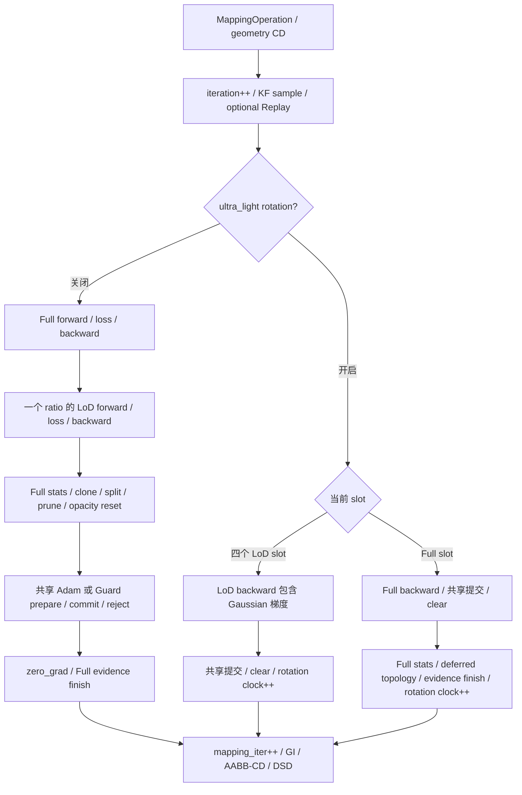
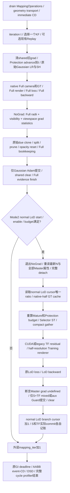

# UltraLight Mode 2 代码审计与下一阶段实现规格

审计日期：2026-10-14（Asia/Hong_Kong）。本轮只生成本文，不实现 Mode 2、不修改生产调度、不运行完整 TUM 序列。

审计对象：`H:\AIProjects\cartgs优化更细致版\mycartgs`，分支 `cuda-tf`，HEAD `e9e9a1737817b9b571dfdf64d83b6c9fae5f2ad1`，并包含审计开始时的工作区配置。`cfg/selector/fast.yaml` 已有用户修改；本文读取该工作区版本，未覆盖它。运行中的程序究竟加载哪份配置、远端是否与本地一致，本轮没有验证。

原始基线：Git commit `547c9055f52529dd920cdb3e4211d8e1c0ee68e3`；同时核对 `H:\AIProjects\cartgs优化更细致版\reference\cartgs-original-unpacked\cartgs-main`。两者的 `src/gaussian_mapper.cpp` blob 均为 `86e2824b60a008361a6c681814609426ea2e8f4d`，因此下面引用的原始 mapper 行号有可复核的基线。标为“原始”的路径均属于这个 reference checkout，其余路径均相对 `mycartgs`。

证据分级：下面的调用顺序、条件、参数归属属于当前源码确认；性能影响属于机制推断；测试章节属于下一阶段验收设计，尚未执行 CUDA 验收。历史 ultra-light 文档曾描述“每 20 步增强”，该说明已不符合当前源码。

## 核心结论与必须明确的规格边界

1. 当前 `Training.ultra_light_enabled: 1` 开启的是五 slot 轮转：`0.01 → 0.05 → 0.10 → 0.15 → Full`。一轮只执行 Full 或 LoD；LoD 强制允许 Gaussian 梯度。`Training.ultra_light_interval` 仅保留读取和导出，调度已忽略。
2. 非轮转模式则是 `Full backward → LoD backward → topology → shared Adam commit`。两种模式均不满足“本轮 Full 已提交后，LoD 只训练 Selector/TF”。
3. 推荐复用同一个 Mapping Adam 的 state、现有 CUDA mixed adapter，以及完整属性 detach，执行两个互不重叠的阶段提交。无需拆出新的正常训练 Adam，更不能调用现有辅助 `selector_optimizer_`/`transform_optimizer_` 来代替共享正常 optimizer。
4. 原始 CaRtGS 是 **statistics/topology 在 Gaussian optimizer step 之前**。clone/split/prune 会替换六组参数而不搬运当前 `.grad`，即使没有实际新增/删除点也可能如此。严格原始 parity 与“topology 轮每组仍完成一次有效 Full 参数更新”存在实质冲突，不能通过调换两行代码同时满足。
5. 本文推荐第一版优先原始 parity：`Full backward → Full statistics → 原始 topology/reset/bookkeeping → Gaussian step/clear → Full evidence finish → 最新 detached LoD → auxiliary step`。若产品要求 topology 轮也必须有效 Full 更新，须选择 `statistics → Gaussian step → topology`，并明确其为有意修正原始行为；不能再声称严格原始 parity。第七、十八节给出两者的验收区别。
6. 半分辨率已有成熟调用方式：同一个 KF/FoV/projection，renderer 接收独立 H/W；GT 复用 `ResizedImageCache` 的 bilinear、`align_corners(false)`。无需复制 Camera 或手动缩放 `intr_`。

## 一、当前 Mapping iteration 的真实执行顺序

### 1.1 外层和正常 iteration 入口

| 顺序 | 函数 / 当前源码位置 | 实际行为 |
|---|---|---|
| 0 | `GaussianMapper::run`，`src/gaussian_mapper.cpp:1001–1023` | 检查停止/Mapping cap；处理 Atlas 中所有 MappingOperation、可选 KF cull，然后调用一次训练 |
| 1 | `trainForOneIteration`，`:1182–1195` | 轮转在线结束/预算预检查；开启 profiler；`iteration_ += 1` |
| 2 | `useOneRandomSlidingWindowKeyframe`，`:1196–1203`、`:3251–3312` | 获取 KF；更新使用次数、减少 remaining use；无 KF 则撤回 iteration |
| 3 | `trainForOneIteration`，`:1205–1251` | 检查在线 shutdown、forced-tail 边界；forced-tail 第一次清残留梯度；预算超限警告 |
| 4 | `shouldRunSelectorReplay` / `processConflictReplay`，`:1253–1258`、`:1589–1596`、`:1695–1719` | Replay 在本轮正常 Full/LoD 前执行；`enhanced` 当前恒为 true |
| 5 | `trainMappingIteration`，`:1268` | 本轮正常训练主体，见下面 |
| 6 | `trainForOneIteration`，`:1269` | 主体返回后 `mapping_iter_ += 1`，不按 backward/optimizer 次数增加 |
| 7 | `:1273–1281` | 按真实 Mapping deadline 刷新 GI，额外渲染属于维护，不属于正常 Full 更新 |
| 8 | `evaluateDynamicAABB`，`:1283–1287`、`:2150–2215` | 周期 AABB 检查；必要时 domain resample 和 ChangeDistill |
| 9 | `evaluateDriftStability`，`:1289–1293`、`:2218` 起 | DSD probe / 独立恢复训练；配置关闭则不执行 |
| 10 | `:1295–1309` | 结束完整 Mapping profiler、GI 统计，清 cycle 起点 |

`combineMappingOperations`（`:2957–3158`）在主体之前处理 LocalMappingBA 新 KF/点、LoopClosingBA geometry transport、ScaleRefinement；LoopClosingBA 和 ScaleRefinement 经 `captureGeometryChange → finishGeometryChange` 即时触发 Change event/CD。普通 densify 的 append/prune callbacks 负责 topology/GI 对齐，不自动被当作一次几何 CD 事件。

### 1.2 `trainMappingIteration` 内部

| 阶段 | 源码位置 | 关键事实 |
|---|---|---|
| slot | `:1316–1319` | `rotation = ultrafast_rotation_.enabled`；`full_step = !rotation || rotation.full()` |
| Full/源图分辨率 | `:1336–1353` | 可以消费 GausPyramid level；非 pyramid 使用 original RGB/native H/W；`mask` 只读取，未用于 loss |
| lock / SH / GI bank | `:1355–1368` | 同一 `mutex_render_` 覆盖整个主体；按 `iteration_ % 1000` 提升 SH |
| 清梯度 | `:1369–1375` | 轮转每步 shared `zero_grad(true)`；Full slot 另清辅助参数 grad；非轮转通常依赖上一步提交后的清零 |
| Protection clock | `:1377–1378` | `protection_.advance(mapping_iter_ + 1)`，一次，不按 step 次数计 |
| Gaussian LR | `:1381–1387` | 普通用 `iteration_`；Guard 开启用 `iteration_ - rejected_updates`；其他四类 LR 从配置赋值 |
| Full forward | `GaussianRenderer::render`，`:1400–1408` | 只有 `full_step` 为真执行；无 Selector、无 TF、未 detach |
| Full visibility evidence begin | `:1419` | 记录 Full global visibility indices 为 pending transaction |
| Full loss/backward | `:1420–1428` | L1 或 smooth L1 + DSSIM + 可选 opacity regularization；立即 backward |
| normal LoD forward/backward | `accumulateLodGradients`，`:1431–1437`、`:2673–2926` | 非轮转可在 Full 后进入；轮转只在非 Full slot 进入；函数本身不 step |
| optimizer decision | commit lambda，`:1443–1473` | 预算检查，调用 `stepWithHistoricalGuard`；然后清 shared grad；Selector/TF clock 在这里记账 |
| 轮转提前提交 | `:1474–1476` | 轮转在 densify 前调用 commit lambda，防止 topology 替换丢失梯度 |
| Full loss / KF bookkeeping | `:1477–1486` | 只有 Full 写 `kfs_loss_`、EMA、当前 KF 渲染记录 |
| statistics | `:1500–1510` | 仅 Full、且 densify window 内：max radius + Full viewspace grad accumulation |
| densify / clone / split / prune | `:1512–1526`；`src/gaussian_model.cpp:869–889` | 先 clone，再 split（含父点 prune），再 opacity/size prune；轮转用 deferred deadline，非轮转用原始 modulo |
| opacity reset | `:1528–1532` | Full-only；轮转 deferred，非轮转原始 modulo/white-background 条件 |
| report / export / loop flag | `:1540–1552` | Full report；非轮转 export 位于 commit 之前；清 `loop_closure_iteration_` |
| 非轮转提交 | `:1555` | 非轮转直到此处才 commit，因此 Full/LoD 梯度在一次提交中合并 |
| Full evidence finish | `:1556–1557` | topology 已 remap pending indices 后，按 `gaussian_committed` 更新 evidence |
| 轮转 ratio clock | `:1579–1580` | `UltrafastRotation::complete` 推进一次 slot；不要求 Guard accept |

LoD 内部准确顺序：Mature mask/indices（`:2695–2702`）→ Protection population/budget（`:2706–2712`）→ TF lazy init / shared groups / auxiliary clear / TF LR（`:2714–2719`）→ 属性读取或 detach（`:2722–2738`）→ Selector ST（`:2741–2752`）→ GI teacher（`:2755–2772`）→ Protection admission 与 ST 合并（`:2775–2779`）→ ratio/GI loss → compact gather（`:2796–2807`）→ TF residual（`:2810–2837`）→ LoD H/W 与 GT cache（`:2845–2858`）→ renderer（`:2863–2865`）→ optional elastic visibility metadata（`:2869–2880`）→ photo/ratio/GI/TF regularization loss（`:2882–2900`）→ backward（`:2907–2909`）。

### 1.3 当前 flow 图及六个直接答案



- 非轮转：Full 和 LoD 顺序 backward，在同一个 optimizer step 前累积；LoD 看的是 Full update 前 Gaussian。
- 轮转：两支互斥，LoD 看的是先前已提交的 map，不是“本轮 Full 更新后”的 map。
- Gaussian 真正 step 的入口为 commit lambda → `stepWithHistoricalGuard` → mixed Adam 或 Guard transaction；不是 `accumulateLodGradients`。
- Selector 和 TF 正常训练与 Gaussian 一起在该共享提交提交；辅助 optimizer instance 在正常路径只负责 grad clear / LR / 配置模板。
- densify/prune：原始、当前非轮转在 step 前；当前轮转在 step 后。
- Mode 2 LoD 插入点：**本轮原始 Full 的 statistics/topology/bookkeeping、Gaussian commit/clear、`finishFullMapping` 全部完成后，`mapping_iter_++` 前**。不能保留 `:1433` 的提前 LoD；不能直接插在 `:1428` 后。

## 二、“恢复原始 CaRtGS Full Mapping”的具体含义

原始入口和训练主体见 reference `src/gaussian_mapper.cpp:621–764`；原始 outer online/tail loop 在 `:510–537`。原始根本没有 Selector/TF 正常训练、Guard、Replay/CD/DSD。

| 项目 | 原始 CaRtGS | 当前非轮转 FlexGS 接入 | 当前 ultra-light 轮转 |
|---|---|---|---|
| 正常 Full render | 每个有效 KF iteration 一次 | 每步一次 | 每五 slot 一次，第五个才 Full |
| Full resolution | native，或已有 GausPyramid 配置选定 level | 同原始选择器 | 同选择器；不是强制 native |
| Full loss/backward | 每步一次 | 每步一次，随后加 LoD backward | 仅 Full slot；LoD slot 无 Full loss |
| Gaussian step 调用 | 每个有预算 iteration 一次，位于 topology 后 | 一次共享 step/Guard，包含两种 loss | 一次共享 step/Guard；Full 与 LoD 都可更新 Gaussian |
| Full loss | `(1-λ) L1 + λ(1-SSIM) + opacity_reg·mean(abs(sigmoid(opacity)))`；可替换 smooth L1 | 组成保留 | Full slot 组成保留 |
| densify/prune | `iteration > from` 且 modulo due 且 window 内 | 原始条件与次序 | due 先 pending，直到 Full slot 执行 |
| densify statistics | 每个 window 内 Full backward 更新 | 同上，独立 Full RenderPackage | 只在 Full slot 更新，采样次数约缩至 1/5 |
| clone/split/prune | before-step，使用当时参数 | before-step，增加 metadata/GI callbacks | after-step，使用 Full 已更新参数 |
| opacity reset | window 内原始 modulo/white-background 分支，before-step | 保留 | Full-only deferred、after-step |
| Full KF loss / adaptive sampling | 每步写 Full loss | 每步写 Full loss | 只有 Full slot写，其余 KF loss 更陈旧；空 loss 额外保护条件 |
| KF sampling | shuffled sliding window + remaining uses + `auto_distribute` | 保留主体 | 每 slot 仍消耗一个 KF use，不是同 KF 完成五 slot |
| mapping cycle | 每外层循环调用一次训练 | 正常训练前可附加 Replay，末尾 GI/AABB/DSD | 同样附加维护，每正常循环只有一个 slot |
| long tail | shutdown 后至少 `0.8 × densifyInterval`，并满足 modulo phase / keep_training | 保留默认；可选 forced-tail / finite normal cap | shutdown 即停止，强制尾优化不生效 |
| XYZ LR | `exponLrFunc(iteration_)` | Guard 开启时扣 rejected；否则原始 | 每 slot 衰减，即使该 slot没有 Full loss |
| SH clock | 每 `iteration % 1000` 提升 | 保留 | 按 slot 数而不是 Full backward 数提升 |

原始本身支持 pyramid，因此“Full 恢复原始”与“无条件 Full resolution”只能在 `GausPyramid.do: 0` 基线下同时成立。当前 TUM mapper 配置 `cfg/gaussian_mapper/RGB-D/TUM/tum_rgbd.yaml:36` 为 0；Mode 2 仍应明确 Full 使用 native original，不消费 pyramid level。如果要验收原始 `GausPyramid.do: 1` 的行为，必须另列为不追求完全 parity 的配置。

Mode 2 需要恢复/分离的具体调度点：

1. `trainMappingIteration:1316–1319`：Mode 2 不用五 slot 的 `full()` 决定 Full；Full 每轮必走，LoD 是后置附加阶段。
2. `:1336–1353`：Mode 2 Full 强制 native H/W + original RGB；不能把 pyramid source 再乘 0.5 得到 quarter LoD。
3. `:1431–1437`：撤掉 Mode 2 的 commit 前 LoD，改在 Full 完成边界调用。
4. `:1474–1476`、`:1491–1532`、`:1555`：不复用 Mode 1 提前提交和 deferred topology；按选定的原始 parity 顺序恢复原 modulo/reset。
5. `run:1003–1073`、`trainForOneIteration:1183–1265`、`normalMappingLimit:1644`、`hasNormalOptimizationBudget:1649`：Mode 2 不继承 Mode 1 online-only/禁 tail 条件。保留原始 default stopping；forced-tail、finite normal cap 继续是显式独立配置。
6. LR 和 SH：Full 使用真实 `iteration_`，LoD step 不再减速/加速 Gaussian LR clock；LoD reject 不计入 Gaussian `rejected_updates`。
7. 每轮 Full 更新 `kfs_loss_`/EMA，原 KF sampler只调用一次；LoD 复用本轮 KF，不能再消耗 KF use。
8. Full-only parity fixture 关闭 Guard、Replay、GI训练/维护、CD、DSD、forced-tail、finite mapping target 等附加影响，并固定输入/调度/RNG。生产 Mode 2 保留这些模块的独立配置和现有语义，不用“恢复 Full”作为删除模块的理由。

`ultra_light_enabled` 还影响 ratio 强制重写（`:517–520`）、Selector 必须启用的校验（`:101–102`）、COLMAP 禁止（`:1096–1097`）、gradient detach override（`:1436`）、topology deferred tasks、report/export计数（`:1608`、`:3774`、`:3844–3846`）和 sampler 空 loss 防护（`:3271–3272`）。仅改 `full_step=true` 无法准确实现 Mode 2。

## 三、optimizer 参数组、state 与 step

### 3.1 正常 Mapping 的参数归属

`GaussianModel::trainingSetup` 在 `src/gaussian_model.cpp:496–535` 创建 `SparseGaussianAdam`，但 `include/gaussian_model.h:207` 保存为 `shared_ptr<torch::optim::Adam>`。正常无参数 `step()` 走普通 LibTorch Adam；不是 `SparseGaussianAdam::step(visibility,N)`。后者在 `src/gaussian_rasterizer.cpp:207–237` 假设每组第一个 tensor 为 Gaussian-shaped，不能用于 Selector/TF 混合组。

| group | 参数 | 正常 LR；当前 TUM/fast 数值 | scheduler / state / step clock |
|---|---|---|---|
| 0 | `xyz_` `[N,3]` | `position_lr_init × spatial_lr_scale`；`1.6e-4 × scale → 1.6e-6 × scale` | Gaussian exponential schedule，max_steps=30000；每参数 Adam state |
| 1 | `features_dc_` `[N,1,3]` | `feature_lr=0.0025` | 常数，每参数 state |
| 2 | `features_rest_` `[N,(D+1)^2-1,3]` | `feature_lr/20=0.000125` | 常数；inactive SH 分量可为零梯度，但 tensor state仍按有定义 grad推进 |
| 3 | opacity logits `opacity_` `[N,1]` | `opacity_lr=0.05` | 常数；resetOpacity 清 moments、保留 step |
| 4 | log-scale `scaling_` `[N,3]` | `scaling_lr=0.005` | 常数 |
| 5 | raw quaternion `rotation_` `[N,4]` | `rotation_lr=0.001` | 常数 |
| S，通常 6 | Selector全部 embedding与soft-net weights/bias | `Selector.learning_rate=0.001` | 常数；正常 step 只由 shared optimizer提交 |
| Tm，通常 7 | TF 7 个 Linear 的 weight/bias，共 14 tensor | MLP nominal init/final `1.6e-4/1.6e-5` | `normal_update_clock_.tf_updates` 驱动 delay×exponential；初次有效 LR为 `1.6e-6` |
| Tg，通常 8 | TF HexPlane参数，当前 multires=[1,2]，每层6 plane，共12 tensor | grid nominal init/final `0.0016/0.00016` | 同上；初次有效 LR为 `1.6e-5` |
| 无 | AABB min/max、Protection、GI、exist_since、radii、densify accum、elastic supervision | 不在 Adam 中 | buffer/metadata，非训练参数 |

组索引应使用 `shared_*_group_index_`，不能假设总是 6/7/8。Gaussian六组固定，Selector/TF lazy attach 可改变后续组出现时间。附件入口 `ensureSharedMappingOptimizer` 在 `src/gaussian_mapper.cpp:1778–1807`；TF MLP/plane组成见 `src/transform_field.cpp:145–154`、`src/hexplane_field.cpp:25–44`。

正常共享各组继承 Gaussian Adam options：`eps=1e-15`，默认 betas `(0.9,0.999)`、weight_decay=0、AMSGrad=false。每个参数有独立 `step, exp_avg, exp_avg_sq`，无统一 Adam 全局 step。clone/prune搬运 Gaussian moments和step，但不搬当前 grad（model `:608–775`）。

XYZ scheduler在 model `:1336–1351`，`lr_delay_steps_` 构造为0（`:28–49`），当前 trainingSetup没有设置它，因此 Gaussian `position_lr_delay_mult` 并不单独形成当前正常 warmup。TF 则确实使用 delay sin-ramp，见 mapper `:2021–2049`，不能混淆两者。

### 3.2 三个 optimizer instance 与 CUDA adapter 的区别

- `gaussians_->optimizer_`：Gaussian + 正常 Selector + 正常 TF 的真正 state owner和正常提交者。
- `selector_optimizer_`：constructor `:157–162` 建立的另一个 Adam，引用同一 Selector参数；正常 LoD用它 clear grad，CD用它作为 options模板。不是正常 Selector state owner。
- `transform_optimizer_`：TF init `:1754–1762` 建立的另一个 Adam，同一TF参数、MLP/grid两组；正常 LoD用它 clear/LR，CD用作模板。

**CUDA TF Adam 不独立于 shared Mapping Adam。** `tfCudaAdamMixedStep`（`src/transform_field_cuda_optimizer.cpp:99–115`）临时把指定TF组 `.grad` 设为 undefined，调用普通 `optimizer.step()` 更新 Gaussian/Selector，恢复TF grad后对同一 optimizer/state调用 `tfCudaAdamDirect`。TF kernel独立，state仍共享容器。

Guard使用 `AdamStepPreview`（`src/constrained_adam.cpp:6–68`）和 CUDA prepare/validate/commit（CUDA optimizer `:74–97`、`:116–141`）。prepare不修改 live参数/state，commit才写；discard或reject不推进参数step。historical backward使用 `autograd::grad`，不会写 normal `.grad`（`src/gradient_constraint.cpp:166–177`）。

### 3.3 selective step 能力与推荐

没有通用 `step(groups=...)`；已有两种足够的能力：普通 Adam跳过 undefined grad，CUDA direct可显式列出TF group。LibTorch v2.3.1官方 `adam.cpp:80–111` 确认在 state初始化/step++前检查 `!p.grad().defined()`；官方 `optimizer.h:145` 确认 `zero_grad` 默认 `set_to_none=true`。源码链接：

- <https://github.com/pytorch/pytorch/blob/v2.3.1/torch/csrc/api/src/optim/adam.cpp#L80>
- <https://github.com/pytorch/pytorch/blob/v2.3.1/torch/csrc/api/include/torch/optim/optimizer.h#L145>

目标机器最终需核对实际 LibTorch版本；本轮核对的是仓库 adapter所对应的2.3.1语义，未加载目标 binary。

| 方案 | 优点 | 代价 / 风险 | 建议 |
|---|---|---|---|
| 拆 Gaussian / auxiliary 正常 optimizer | 所有权显式 | 正常state迁移、Replay joint transaction、CD domain-state invalidation、checkpoint接口都要协调；现有辅助optimizer不能直接替代 | 第一版不推荐 |
| 新增泛用 selective-group Adam | 显式屏蔽 | 新API/状态路径；重复现有 undefined-grad机制；需要Guard/CUDA同步支持 | 暂无必要 |
| 保留shared Adam + 两阶段undefined-grad隔离 + mixed adapter | state/Replay/CD接线保持；Gaussian原始六组无需改 | 必须明确清梯度和阶段clock，不能复用当前joint记账wrapper | **推荐最小侵入方案** |

两次“逻辑提交”是必要的，两个 optimizer instance不是必要的。Full阶段仅Gaussian组grad有定义，S/TF undefined；LoD阶段Gaussian六组必须全部undefined，S/TF有grad的参数才提交。不能用 `grad.zero_()` 或 LR=0代替屏蔽：旧moment仍可推动参数，且有定义grad即推进state；CUDA direct和Adam preview同样如此。

Full提交后第二次提交安全的条件：Gaussian state不再推进；S/TF不在Full推进；Gaussian LR每iteration只赋值一次；TF LR只按实际 normal TF提交计数；`mapping_iter_`和`iteration_`只由外层一次推进。`selector_step_`与ratio cursor分开，不能因Full和LoD调用同一wrapper而各增一次。

当前 `stepWithHistoricalGuard` **不能原样调用两次**：其 `normal_update_clock_.record(false,...)` 会让LoD reject减少Gaussian LR clock；返回值又以Gaussian组是否变化判断成功（`:1938–1941`），aux-only成功可能返回false。Mode 2需阶段级提交结果 `{gaussian_changed, selector_committed, tf_committed, rejected}`，Full走原始普通Adam，LoD复用mixed/Guard底层但使用独立auxiliary记账。不得从Aux commit返回值推进Full Protection evidence。

## 四、LoD loss 对 Master Gaussian 的全部梯度路径

当前Master六个raw tensor创建时均 `requires_grad=true`（`src/gaussian_model.cpp:172–189`）。激活：scale=`exp(log-scale)`，rotation=`normalize(raw quaternion)`，opacity=`sigmoid(logit)`（`:62–78`）。

| Master属性 | renderer路径 | Selector路径 | TF路径 | 当前未detach是否写Master `.grad` | Mode 2切断点 |
|---|---|---|---|---|---|
| XYZ | means3D；也影响SH方向 | position embedding → logits → photo/ratio/GI | plane query位置梯度 + residual输出的identity input梯度 | 是，直接及间接路径 | 在任何Selector/TF/gather前detach XYZ |
| log-scale | exp后scale → covariance/raster backward | scale embedding使用activated scale | output乘法input梯度；TF residual query本身只依赖XYZ/ratio | 是，回传到raw log-scale | activated scaling完整detach，或raw detach后exp |
| raw quaternion | normalize → covariance/raster backward | rotation embedding | output quaternion composition input梯度 | 是 | activated rotation完整detach，或raw detach后normalize |
| opacity logit | sigmoid后opacity × ST mask → alpha compositing | 不作为network input；ST与其乘积产生S梯度 | 无 | 是 | opacity activation先detach，再乘**未detach ST mask** |
| SH DC | RGB/sh方向渲染 | 无 | 无 | 是 | `features_dc_.detach()` |
| SH rest | active SH渲染，未激活阶数梯度可为0 | 无 | 无 | 是，是否非零由active degree决定 | `features_rest_.detach()` |
| covariance/colors_precomp | 由scale/rotation/XYZ/SH派生 | 无新参数 | residual属性可进入派生 | 派生链可通Master | 完全由detached/TF输出输入构造，不能回读Master |
| screenspace/viewspace | 每次renderer创建独立requires-grad leaf | 无 | 无 | 产生独立renderer leaf grad，不是Master参数 | 保持训练模式，隔离LoD RenderPackage |
| visibility/radii/GI计数 | 离散统计；visibility来自 `radii>0` | teacher/budget视为常量 | 无 | 非Master可微参数路径 | 不把LoD统计写入Master densification/GI证据 |
| birth/optimized/KF/exist_since/last elastic等 | 不参加参数训练 | 影响non-differentiableadmission/监督范围 | 无 | 不在Adam，无参数grad | 保留metadata边界 |

renderer backward显式返回means3D/means2D/opacity/scales/rotations/DC/SH梯度（`src/gaussian_rasterizer.cpp:102–116`）。Tensor renderer从`GaussianRenderInput`构造covariance和SH colors（`src/gaussian_renderer.cpp:119–161`），没有必要再次读取`GaussianModel`。

最安全边界已有：mapper `:2722–2738`，完整detached `GaussianRenderInput`，之后再Selector、compact gather、TF和renderer。Mode 2 normal调用强制 `detach_gaussian_parameters=true`，忽略旧配置中的false；不能改Replay的调用参数。只detach TF XYZ无法阻止SH/opacity/direct scale/rotation，以及Selector ratio/GI损失回传Master。

也不能仅在renderer入口detach：Selector和TF前面已经建图，ratio/GI/TF相关loss仍可能沿输入返回Master。不能在TF之后对transformed XYZ/scale/rotation整体detach，那会把TF参数路径也截断。

目标为 `∂L_lod/∂MasterGaussian = 0`。Master本身仍requires-grad供Full训练；Mode 2只是建立读值用的detached view，不全局toggle Master requires-grad、不更换Master参数。

## 五、Selector ST gradient 必须保留

网络见 `improvements/selector/gumbel_network.h:15–48`、`:106–138`：XYZ、rotation、scale和ratio各自embedding，拼接后2类logits。`forwardHard`返回keep类的hard Gumbel ST sample：

```text
soft = softmax((logits + GumbelNoise)/temperature)
hard_ST = one_hot(argmax(soft)) - soft.detach() + soft
selector_hard_mask = scatter_mature(hard_ST.keep)
selector_mask = protection_admitted_float + (1-protection_admitted_float)*selector_hard_mask
indices = nonzero(selector_mask.detach() > 0)
compact_opacity = detached_master_opacity[indices] * selector_mask[indices]
compact_renderer → L_photo → compact_opacity → hard_ST → Selector weights
```

`hard_selected`、scatter后的`selector_hard_mask`、合并后的`selector_mask`、gather后的`compact_mask`都保留ST图。`indices`必须离散detach；不能把`compact_mask`换成ones。关键乘法位于mapper `:2804–2807`，已经有专门注释。

Master全部detach后，Selector weights仍requires-grad，network输入作为常量不影响weights学习；detached opacity作为常量系数也保留S梯度。Protected行没有Selector photo监督；未选中行不进入compact photometric梯度，但keep probability的ratio loss和全局GI监督仍可给相应Mature行监督。这是当前算法，不应借Mode 2改变。

风险点：detach整个`selector_mask`/selected render input的opacity；对整个LoD包使用NoGradGuard；或调用Inference renderer。三者都会切断必要的训练路径。当前Full后半段在NoGradGuard中，因此后置LoD必须退出该scope或显式 `AutoGradMode(true)`。

下一阶段最小实验分两层：

1. Tensor-level检查完整detach、ST opacity乘法、gather/index_copy；可复用现有 `tests/compact_lod_test.cpp:94–147` 的已有gradientRouting覆盖，但其synthetic residual/surrogate不是CUDA TF/renderer端到端证明。
2. 生产函数端到端fixture：actual GumbelNetwork + actual CUDA TF + actual rasterizer；固定seed、Mature可见各向异性Gaussian、非平凡RGB目标、至少一个选中且in-AABB Mature行。Full后clear，再LoD；断言Master各组grad undefined，S grad norm>0，TF plane和MLP grad norm>0；aux commit后S/TF值变、Master/raw Adam state不变。

为证明photo ST路径而不被ratio/GI损失掩盖，应另做一次photo-only测试：ratio/GI/TF regularization weights置0，保证selected Mature mask的photometric梯度非零。完整版loss测试再恢复正常权重。rotation/scale head需各自非退化测试，不能只检验总TF norm。

## 六、TF输入 detach 的方案选择

TF实现 `src/transform_field.cpp:54–99`：query(detached XYZ, ratio, planes) → MLP residual → XYZ加法、scale乘exp、quaternion乘积与normalize。CUDA autograd wrapper `src/transform_field_cuda.cpp:6–57` 返回输入/参数梯度；query backward的XYZ梯度在 `src/transform_field_cuda.cu:147–161`；output backward在 `src/transform_field_cuda_neural.cu:265` 起。

| 方案 | 结果 / 风险 | 建议 |
|---|---|---|
| A 只在TF入口detach | TF输入Master路径可切断，但renderer和Selector的Master路径未覆盖 | 单独使用不足 |
| B CUDA no-input-grad flag | 可减少input-grad计算，但新增backend分支、测试矩阵；不解决非TF路径 | 非第一版必要条件 |
| C LoD入口构造完整detached attributes，再调用现有TF | 同时切断Master所有路径；不改TF数学、保留residual参数梯度 | **推荐** |
| C并在TF调用点重复detach base inputs | 可强化断言，但重复且容易误detach residual outputs | 可用断言替代重复操作 |

detached base + learnable residual仍形成可微transformed attributes；renderer返回的XYZ/scale/rotation梯度继续沿residual进入MLP、planes。rotation head与scale head均继续训练。TF residual output与`index_copy`结果必须保留图。CUDA backend当前可能仍计算并返回不被autograd消费的输入梯度，这是额外成本，不是Master stop-gradient失败；第一版无需改变backend。

Selector在TF前计算并通过opacity ST路径训练；将base geometry detach不会把S路径切断。AABB是register_buffer且detach clone（`src/hexplane_field.cpp:20–21`），不会作为Master的旁路。

## 七、Full提交、topology与LoD的严格先后关系

### 7.1 原始顺序与用户示意顺序的冲突

原始 `Full backward → statistics → densifyAndPrune/reset → optimizer.step` 是事实。model中的 `densificationPostfix`（原始`:623–665`，当前`:694–743`）与`prunePoints`重新创建参数；不转移旧grad。`densifyAndPrune`无条件调用clone、split、最终prune，空append和全保留prune也可能更换tensor。所以“原始每轮step调用一次”不等于“原始每轮Gaussian tensor实际更新一次”。

| 次序选择 | 保留内容 | 差异 | 推荐 |
|---|---|---|---|
| P：stats → 原始topology/reset → Gaussian step → LoD | 原始Full调度、拓扑参数来源、grad丢弃行为、Full-only固定schedule parity | topology轮可能无有效Gaussian更新；Protection不能把空step记为优化 | 默认采用，满足严格原始语义优先 |
| U：stats → Gaussian step → topology/reset → LoD | 每轮有效Full更新；LoD读取提交并拓扑后的map | clone/prune基于更新后参数，拓扑数量/随机采样/opacity和Adam state时点均可能改变 | 若强制要求所有topology轮有效更新，需明确选择；不得标为严格P parity |

这不是将topology推迟到LoD之后的理由。**两种选择都应把topology和Full evidence结算放在LoD之前**，LoD才适配当前最新map。本文后续默认P，U作为明确的实现决策边界保留。

### 7.2 新indices与state对齐

1. Full后不复用pre-topology的`xyz`/Mature/indices/RenderInput。重新读取 `gaussians_->getXYZ()`和其他属性，按新N重新构造Mature/Protection budget，重新Selector选点和compact indices。
2. `GaussianModel::densificationPostfix:765–781`同步Protection、last elastic、GI；`prunePoints:662–675`同步survivor metadata/GI。Protection pending Full visibility会按survivor cumsum remap（`include/gaussian_protection.h:60–72`）。
3. clone/split子点birth是当前Protection Mapping clock，optimized_count=0，继承父unique KF support但不继承优化次数；全新点无KF support（同header`:47–58`）。新点不因为本轮Full可见而自动得到Full优化证据。
4. Selector是逐行network，没有N绑定的embedding table；ratio embedding按N expand（Gumbel header`:110–115`）。只需输入新tensor行数，网络参数无需resize。
5. TF是空间/ratio function，planes/MLP不与Gaussian行一一绑定，可直接复用。outside_identity继续生效；新几何超出AABB只会暂时identity，周期AABB/CD按原入口处理。
6. `topology_version_`/`correspondence_version_`和GI callbacks必须仍即时执行，不能延迟到LoD后。否则compact indices、teacher label与Adam preview的tensor identity都可能失配。
7. 无源码证据要求topology bookkeeping放到LoD后。原始KF use已在采样时减少；Full kfs_loss/EMA/report/loop flag的原有顺序应保留，LoD不能覆盖Full loss。

精确插入边界是mapper `:1555–1557` 之后、外层 `:1269` 之前；需退出当前 `:1441` NoGradGuard作用域再构造LoD图。继续持有同一个`mutex_render_`，确保没有在两个阶段之间插入新的map mutation。不要在这个lock内调用会再次获取同一lock的`evaluateDynamicAABB`/`finishGeometryChange`。

## 八、Protection evidence 的更新来源

当前Protection不是早期仅age/seen-count规则。来源和定义见 `include/gaussian_protection.h:22–160`、`include/elastic_budget.h:38–76`。

| 证据 / state | 定义 | 更新时点 | Mode 2语义 |
|---|---|---|---|
| birth | 创建时 `mapping_iteration` | reset/append；clone/split也重新birth | topology即时同步，不用旧exist_since替代 |
| age | `max(mapping_iteration - birth_iter,0)` | 正常主体入口 `advance(mapping_iter_+1)` | 每有效Mapping一次；Full/LoD各step不重复advance |
| optimized_count | visible surviving row的成功Full优化累计，int32饱和 | `beginFullMapping(Full visibility)` → `finishFullMapping(committed,KF)` | 只允许本轮真实Full参数提交证据；LoD/Replay/CD/DSD不增加 |
| unique_keyframe_count | 支持KF id去重计数，最多unique_keyframe_ready | 同一个Full finish transaction | 只取Full global visibility；重复KF不增加；clone/split继承support |
| maturity | `min(age/age_ready, opt/optimization_ready, unique/unique_ready)`，各confidence截断[0,1] | classify按当前metadata计算 | Full finish后重算供LoD |
| need | `1-maturity` | 同上 | 保留weighted Bernoulli算法 |
| WARMUP | age < age_ready | clock advance / classify | 不增加辅助clock |
| UNDER_OBSERVED | age≥ready、未mature、age<stale_age | clock/evidence分类 | 保留 |
| STALE | age≥stale_age但未mature | clock/evidence分类 | 是“老但证据不足”；并非最后优化时间超时 |
| MATURE | age、optimized_count、unique KF三个阈值都满足 | clock/evidence分类 | 优先级高于STALE；mature不因age大而变stale |
| transition counters | warmup→under-observed/mature、under-observed→mature/stale、stale→mature | `advance`与`finishFullMapping` | 保留原计数时点，不因两个commit重复触发 |
| cached_uniform | 每Gaussian缓存admission随机数 | reset/append/prune | topology同步；不是每LoD重新采样 |
| last_elastic_supervised_iter | LoD可见行监督时间 | `updateElasticSupervision`，model`:682–691`；mapper`:2878–2880` | 可由LoD/成功Replay更新，但不等于Master optimized_count |

Protection budget当前为：`K_total=r·N`，`D=sum(need)`，`Bp=min(D,max_budget_fraction·K_total)`；未mature行按`need·Bp/D`与cached uniform比较入选；剩余Mature预算按实际admitted数补足。不是“所有Protected都无条件保留”，不是按Selector score Top-K。Mode 2不改变这些公式。

直接回答：

1. LoD backward本身不调用Full evidence begin/finish；当前轮转LoD slot不会增加optimized_count，即使LoD真的改变Master。非轮转只有一个Full transaction，联合commit成功后增加一次，无法区分这次commit究竟包含多少Full/LoD贡献。
2. 当前非轮转commit lambda令 `has_gaussian_gradient = !rotation`（mapper`:1446`），Guard关闭时即使topology已把Gaussian grads全部丢弃，也可把`gaussian_committed`记为true并增加evidence。这是当前记账的静态局限。Mode 2应明确用Full阶段实际可提交Gaussian组判定，不能以调用了一次Adam或aux commit成功充当Full优化证据。
3. 只用Full visibility更新unique KF。LoD受ratio/Protection/half-resolution影响，不能证明Master以该KF完成Full优化。Replay虽可改变Master，当前也不打开Full transaction；为保持Replay语义不附加新evidence。
4. age继续真实Mapping clock；`advance(t)`幂等但不应依赖重复调用掩盖设计错误。Replay/CD/DSD没有额外Mapping clock。
5. Full topology remap及finish evidence后，LoD重新调用`getSelectorMatureMask()`；不能复用Full前mask。刚跨阈值的survivor应在同轮LoD成为Mature；新clone/split仍为新身份。

如果采用严格P顺序，topology轮Full无有效参数step时evidence不增，是准确证据，不影响Gaussian原始parity；如果采用U顺序，先成功Full优化的旧survivors按remap增加，新子点不增加。

## 九、ratio clock 的当前实现与 Mode 2建议

### 9.1 当前clock

| 路径 | ratio来源 | 推进事件 | reject / 特殊事件行为 |
|---|---|---|---|
| 当前Mode 1轮转 | `UltrafastRotation::phase = step % 5`，四LoD+Full | 每次主体末尾 `complete` | Guard reject、无Mature、TF未ready也推进slot；Replay/CD/DSD自身不调用complete |
| 当前非轮转normal LoD | `selector_step_ % selector_target_ratios_.size()`，mapper`:1435` | commit lambda中`has_selector_update`为真则++ | `has_selector_update`来自`lod.trained = mature_count>0`，不是accept；Guard reject仍可能++；无Mature不推进 |
| 当前轮转Selector count | `selector_step_`不负责slot选择 | 仅判断selector_committed则++ | 可与rotation slot数不同 |
| Replay | `replay_ratio_cursor_++ % ratios.size()`，`:2587` | Replay通过training availability检查后取ratio即推进 | 与normal ratio独立；后续nonfinite/candidate失败也可能消耗Replay ratio |
| CD | 每batch遍历context.ratios，`change_distill.cpp:221–229`、`:344–348` | event-local训练，不写normal cursor | 可一次训练多个ratio |
| DSD | 每triggered ratio独立恢复，`drift_stability.cpp:322–336` | event-local训练，不写normal cursor | 可一次训练多个ratio |
| Guard memory objective | `gradient_ratio_cursor_`，mapper`:1915–1923` | historical objective采样 | 可能多个ratio，但不是normal LoD训练cursor |

正常训练主体每Mapping至多调用一次`accumulateLodGradients`，因此normal LoD只训练一个ratio；完整外层Mapping cycle可能另执行Replay和CD/DSD，也可能评估多个Guard ratio，不能将这些诊断/特殊训练误算为normal ratio。

topology不直接推进ratio。Mode 1包含Full slot会在结束时推进五slot时钟；不能把这个时钟直接搬到Mode 2的四ratio序列。

### 9.2 推荐clock：正常LoD branch执行次数

采用独立 `normal_lod_branch_count`，从0开始：`ratios[count % ratios.size()]`。默认序列保持 `[0.01,0.05,0.10,0.15]`，不含Full slot。

| 绑定方式 | 优点 | 当前系统中的问题 |
|---|---|---|
| `mapping_iter_ % 4` | 无新cursor | start前跳过、预算跳过或Selector关闭也影响phase，第一次LoD ratio取决于Mapping数；不等于每执行一次轮换 |
| 成功normal auxiliary commit | 每ratio有效训练次数较均衡 | Guard reject可锁住一个困难ratio；zero/nonfinite/no-Mature导致phase停滞；与用户“每执行一次”不同 |
| 正常LoD branch实际执行次数 | 每次进入正常LoD只训练一个ratio并轮换；不绑定Full/TF初始化 | 需明确attempt与commit区别，单独统计commit | **推荐，符合用户倾向** |

具体契约：

- start/Selector/预算等preflight未通过，未进入normal LoD forward，不推进。
- 进入正常LoD计算后，在该branch最终结束处恰好推进一次；成功、Guard reject、有限loss但没有可更新aux参数均推进。
- 若已进入forward后发现nonfinite，记录失败并清grad，同样算一次已执行attempt；不要在同iteration自动换ratio重跑。异常中止整个程序无须承诺持久化推进。
- 未mature但执行了现有Protected-only branch，也属于已执行attempt；不能用现有`lod.trained`直接当作新cursor增量条件。
- Full、topology、GI refresh、Replay、CD、DSD、Guard历史objective均不直接推进此cursor。
- `selector_step_`继续表示实际normal Selector提交计数；TF normal update clock继续表示正常TF实际提交；三个clock不能互相替代。

## 十、half-resolution Camera / RGB / depth / mask

### 10.1 已有helper索引

| helper / 入口 | 文件及行号 | 是否推荐复用 |
|---|---|---|
| arbitrary-size tensor renderer | `src/gaussian_renderer.cpp:68–109` | **是**：同KF、独立H/W，FoV和projection无需重建 |
| immutable GT resize缓存 | `include/resized_image_cache.h:13–24`；KF持有于`include/gaussian_keyframe.h:95` | **是**：bilinear、align_corners(false)，按source TensorImpl和H/W缓存 |
| normal LoD现有缩放调用 | mapper`:2845–2865` | **是**：但Mode 2 source必须native，且tail不能自动恢复全分辨率 |
| pyramid尺寸 | mapper`:249–256`、`:391–396` | 存在，但Mode 2不应消费Full训练level或把已缩图再次减半 |
| pyramid GT resize | mapper`:943–970`、`:3214–3234` | OpenCV/GPU resize，默认linear；可复用已完全匹配native-half尺寸的图，第一版优先GT cache以统一约定 |
| undistort/remap/mask | `include/camera.h:65–97`；mapper`:268–275` | native图已undistort，LoD不再undistort第二次 |
| input RGB-D缩放 | `examples/tum_rgbd.cpp:166–170` | 是Tracking输入imageScale，不是LoD相机API；不要改动 |
| Camera intrinsics保存 | `include/camera.h:111`；mapper`:259–266`；keyframe`:71–81` | `[fx,fy,cx,cy]`，KF转换成float `intr_` |

### 10.2 pixel convention与principal point

`GaussianKeyframe::setCameraParams`从fx/fy和native H/W推FoV（`src/gaussian_keyframe.cpp:78–81`）。`getProjectionMatrix:168–187`生成左右/上下对称projection；stored cx/cy不参与这个render投影。`computeTransformTensors:109–129`把view/projection相乘，位姿变更时更新。

CUDA `ndc2Pix`（`cuda_rasterizer/auxiliary.h:33–34`）为：

```text
u = ((ndc_x + 1) * W - 1) / 2
v = ((ndc_y + 1) * H - 1) / 2
```

`forward.cu:326`以整数`pix.x/pix.y`作为像素中心。effective render principal point是`((W-1)/2,(H-1)/2)`，不一定等于存储K的cx/cy。CUDA focal为`W/(2 tan(FoVx/2))`、`H/(2 tan(FoVy/2))`（`rasterizer_impl.cu:386–387`）。

保留FoV/projection、改W/H时投影精确满足：

```text
sx = W_lod / W_full; sy = H_lod / H_full
u_lod = (u_full + 0.5) * sx - 0.5
v_lod = (v_full + 0.5) * sy - 0.5
```

这与`interpolate(..., align_corners(false))`的取样坐标一致。若要显式维护pixel-center K，公式应是`fx'=sx fx`、`cx'=(cx+0.5)sx-0.5`，fy/cy同理；偶数尺寸减半即`(cx+0.5)/2-0.5`。但**当前renderer没有使用该K principal point，第一版不要新建/改K来修正既存偏心误差**，应保持原renderer几何。

例如W=640，effective cx=319.5，半宽320时cx'=159.5；直接cx/2得到159.75，差0.25 pixel。本轮用even/odd尺寸和多个NDC点做数值代数检查，两条公式最大误差`5.684341886080802e-14`；这是pixel convention检查，非GPU渲染验收。

### 10.3 推荐规格与其他输入

- `H_lod=max(1,floor(H_native * scale))`、`W_lod=max(1,floor(W_native * scale))`；默认scale=0.5。奇数尺寸使用实际H'/H和W'/W，不强行假设各自精确0.5。不要求16整倍数。
- GT从**本轮KF原始native RGB**取，通常已在GPU；`resized_image_cache_.get(original,H_lod,W_lod)`。cache保留source ownership防TensorImpl地址复用；不可每步clone原图造成cache miss。
- Full/LoD沿用同一KF最新位姿。无需half-resolution Camera copy/cache；GT缓存已足够。缓存projection copy反而需要在BA/loop correction后失效。
- 当前normal Full/LoD loss只用RGB。depth只在输入Tracking及其他几何流程使用，未加入这里的LoD loss。第一版不resize depth、更不改变深度数值/单位。未来若增加depth loss需单独定义有效值加权或nearest resize，不能插值无效0深度。
- 当前`mask`读取后未进入Full/LoD loss，normal LoD没有validity map。第一版不顺带加入mask loss；若以后加入，软undistort coverage可linear，bool validity需nearest或明确覆盖聚合，并改mean分母为有效像素数。
- CUDA arbitrary H/W有运行时tile ceil与边界检查；`rasterizer_impl.cu:397–399`，`forward.cu`像素边界逻辑。next-stage还需覆盖奇数/非tile整倍数和很小H/W测试，不能凭静态支持声称所有尺寸已验收。
- half resolution改变tile/binning allocation：training `ImageState`按H×W分配（`rasterizer_impl.cu:274–292`、`:427–429`）；tile数约1/4，binning依赖Gaussian实际tile overlap，不固定1/4；GeometryState按P分配，TF/Selector参数与N不因图像变小而缩减。sample/bucket buffer也受实际贡献关系影响。

现有缩放在在线时用`selector_lod_render_scale_`，SLAM结束后强制1（mapper`:2847`）。Mode 2要求半分辨率的正常LoD，包括保留下来的tail正常Mapping；应仅在Mode 2 normal调用点设定明确source/target尺寸，**不能全局改这个helper导致Replay/Guard/CD/DSD分辨率被改变**。

## 十一、half-resolution LoD loss 的尺度

当前normal LoD（mapper`:2882–2900`）：

```text
L_photo = (1-lambda_dssim)*L1_or_smoothL1 + lambda_dssim*(1-SSIM)
L_lod = render_weight*L_photo + ratio_weight*L_ratio
      + gi_weight*optional_ratio_weight*L_GI + L_TF_regularization
L_ratio = abs(sum(keep_probability_mature)-target_mature)/max(1,target_total)
```

| 项 | reduction | 半分辨率影响 |
|---|---|---|
| L1 | abs.mean，`include/loss_utils.h:31–34` | 平均RGB像素误差；不因像素减少而自动变为1/4 |
| smooth L1 | mean，`:37–44` | 同上 |
| fast SSIM | fused SSIM map.mean，`:193–198` | 平均；fixed pixel window覆盖更大的原图空间尺度 |
| GI loss | supervised subset L1 mean，mapper`:2787–2791` | 不按像素数计；保留 |
| ratio loss | count差 / target_total | 与resolution无直接关系，保留 |
| TF regularization | planes的smooth/L1约束，`transform_field.cpp:102–108` | 参数空间，与image H/W无直接关系，保留 |
| MSE | 不在normal LoD训练loss中；Guard quality使用mean MSE | 不是新增Mode 2 loss |
| depth / normal / error-map loss | 此normal LoD路径没有 | 不引入 |

SSIM CUDA kernel为固定11×11支持（`cuda_rasterizer/conv.cu`固定offset到±5）；half image的11 pixel对应原图约22 pixel，边界窗口占比也会变。分辨率降低和GT滤波会改变可见高频、loss数值及梯度分布，因此“loss量级不按1/4缩小”不代表loss完全相同，也不代表每个参数梯度norm相同。

**第一版只改LoD分辨率、完全保留loss weights和SSIM window，数学上合理；不乘4、不除4。**这是一种更粗尺度的photometric目标，正是降分辨率带来的训练变化。以后若要保持SSIM物理窗口或使用antialias/area interpolation，应作为独立消融，不能与Mode 2调度混在首次parity验收中。

## 十二、zero_grad与gradient lifecycle

当前清零位置：轮转开头shared clear（mapper`:1371`）；Full slot辅助clear（`:1372–1375`）；LoD函数内部S clear、TF clear（`:2716–2719`）；正常commit后shared `zero_grad(true)`（`:1472`）；Replay入口/RAII出口clear（`:2561–2565`）；tail首次clear（`:1230–1233`）。

LibTorch2.3.1不带参数的`zero_grad()`默认也设undefined；Mode 2仍应显式写`true`以突出必要契约。清grad作用于同一Tensor的grad handle，因此辅助optimizer的clear会清shared所引用参数的grad，但不会清shared的moments/step。

正常有预算commit后，当前Full Gaussian `.grad`不残留，Full viewspace leaf grad仍在独立RenderPackage中。无预算时commit lambda直接return，非轮转可留下Gaussian grad并继续累积，这是当前警告明确指出的行为（`:1236–1248`）。Mode 2不能拿这些陈旧grad做aux step。

### 推荐安全生命周期（P顺序）

```text
入口：shared.zero_grad(true)                    // Full前清Gaussian/S/TF残留
Full forward / Full backward
NoGrad：读取Full viewspace_points.grad，累积Full stats
NoGrad：原始topology/reset/report/bookkeeping   // 会替换Gaussian parameter和grad
NoGrad：仅Gaussian阶段step（S/TF grad必须undefined）
NoGrad：shared.zero_grad(true)
NoGrad：finishFullMapping(实际Full提交证据, KF)
离开NoGrad；读取当前Gaussian，构建detached LoD view
LoD forward / loss / backward                  // 不retain Full graph
断言Gaussian六组grad仍undefined
NoGrad：mixed adapter或aux-only Guard提交S/TF
NoGrad：shared.zero_grad(true)                 // accept/reject/noop统一clear
ratio branch count++                           // 仅此一个正常LoD attempt
外层mapping_iter++一次
```

如果没有Full预算：保留既有cap/停止契约，不执行正常Mode 2 LoD commit；不能用“附加LoD”延长Gaussian预算或再次推进Mapping。若保留现有非轮转超cap forward行为，必须将其统计为no-commit并在阶段退出清残留，不能当作Mode 2成功Full更新。

LoD前必须clear Gaussian残留。否则即使LoD完全detach，第二次Adam仍会用Full grad再更新Gaussian，测试也会错误把旧grad当作LoD grad。Full backward和Full step之间不能调用会清Gaussian梯度的shared LoD zero_grad。

`addDensificationStats`消费的是Full renderer leaf `.grad`，不是Gaussian `.grad`；accumulated stats保存在model。shared zero_grad不负责清renderer leaf，但应在任何LoD阶段开始前完成stats消费和topology，以免引用pre-topology行数，或误把LoD局部leaf/radii用于Master statistics。两个branch各自建图，完全无需`retain_graph=true`。

## 十三、densify/prune/statistics 对Full数据的依赖

| 输入 / buffer | 来源 | 消费点 / 用法 |
|---|---|---|
| `render_pkg.viewspace_points.grad()[:,0:2]` | Full renderer backward | model`:892–903`累积XY norm到`xyz_gradient_accum_`，对应visibility的denom+1 |
| `render_pkg.visibility_indices` | Full `radii>0` global rows | radius stats、densify denom、Full Protection pending evidence |
| `render_pkg.radii` | Full preprocess/project covariance | mapper`:1503–1506`可见行更新`max_radii2D_` |
| `xyz_gradient_accum_ / denom_` | 历次Full backward累积 | model`:873–876`作为clone/split梯度条件；NaN除法值设0 |
| activated scale及scene extent | 当前Master参数 | clone小点 / split大点分界；最终world size prune |
| opacity | 当前Master sigmoid opacity | 最终min-opacity prune；不是Full backward的opacity `.grad` |
| covariance / XYZ / quaternion / SH | 当前Master参数 | 创建clone/split子点；split使用随机samples与covariance |
| `max_radii2D_` | 历次Full radius | screen-size prune；但append helper当前重置该buffer，精确继承既有行为 |
| photometric error / MSE map | 此densification未读取 | 不能声称按LoD/full误差map直接densify |
| Full opacity regularizer | Full loss | 影响opacity grad；不直接提供screenspace gradient |

clone/split/reset/prune具体顺序见model`:794–904`。append当前清整个radius/accum/denom，prune用同survivor mask裁切；这属于原始调度及当前生命周期，Mode 2不顺带“改进”。

当前LoD已有独立`selected_render_pkg`，local indices/radii/viewspace；函数注释在mapper`:2869–2874`明确不写Full densification。Full与LoD backward共享Master参数grad时会相加，但**不会自动污染Full独立viewspace leaf `.grad`**；当前stats稀疏来自Full cadence，而不是所有LoD viewspace混进了stats。

Mode 2必须隔离：

- Full与LoD RenderPackage / autograd ctx / geomBuffer、binningBuffer、imgBuffer、sampleBuffer的所有权；renderer按每次forward保存，不用后一次覆盖前一次。
- Full global visibility vs LoD compact-local visibility；LoD只能经新`compact_to_global`映射写elastic supervision metadata，不能进Master max_radii、denom、xyz_gradient_accum或Full evidence。
- Full GI contribution采集保留；LoD renderer继续`collect_importance=false`，不将half-resolution/ratio可见性写回Full GI teacher source。
- Protection Full transaction只开始/finish一次，LoD backward没有begin/finish。
- 所有stats在Full完成区消费；LoD以后不再“补一次Full stats”，防止denom多加一次。

## 十四、ChangeDistill、Replay、DSD 与Mode 2

| 模块 | 当前Gaussian / S / TF语义 | optimizer / clocks | Mode 2处理 |
|---|---|---|---|
| CD | 当前geometry显式detach；teacher snapshot/frozen；student S概率蒸馏、TF position/scale/rotation运输蒸馏；可遍历多个ratio | event-local独立Adam，由辅助options模板创建；CUDA TF直接kernel；不推进normal Mapping/S/TF/ratio clock | 保持，几何/AABB改变仍允许更新TF |
| Replay | actual **joint Full+LoD**；LoD硬编码detach=false，Master/Gaussian、S/TF均可能更新 | normal shared Adam state经preview/candidate/commit更新；`replay_*`计数独立，normal clocks不增 | 保持joint语义，不把Mode 2 detach传播到这里 |
| DSD | immutable detached Master geometry / photo metadata；按历史drift/quality恢复S/TF，可能rollback/EMA reference；Master不训练 | event-localmodule Adam、可多ratio；normal clock不增 | 保持，当前fast/canonical enable=0 |

CD证据：mapper`:2125–2138`设置current.detach和各optimizer引用；`src/change_distill.cpp:134–144`、`:207–244`、`:333–363`。CD的固定LR与normal schedule无关，且强制weight_decay=0（`:15–28`）。domain resample还会清受影响plane的normal auxiliary和shared state（`src/change_management.cpp:318–331`），这是已有语义，即使normal TF clock不增，特定plane Adam step/state也可能重置。

Replay证据：mapper`:2555–2670`：Full native render/backward → `accumulateLodGradients(..., false, false)` → `AdamStepPreview` → finite/quality诊断 → commit；无Master densify stats、无Full Protection transaction。quality诊断不新增Guard质量veto。normal TF LR会读取当前normal TF clock但Replay不推进它；shared per-parameter Adam step仍会因Replay成功而推进，不能误认为二者等同。

DSD证据：mapper`:2218–2279`冻结inputs并在在线quality probe使用0.5 scale；`src/drift_stability.cpp:248–257`、`:325–341`、`:380–381`。当前fast `DriftStability.enable: 0`，canonical同为0；仅据配置文件确认，未检查外部运行状态。

无需向CD/Replay/DSD加`mode2` flag。Mode 2 detach、resolution、ratio消费、正常stage clocks在normal Mapping调用点隔离。若抽取resolution参数或stage提交helper，旧Replay调用必须传旧语义，不依赖新的全局默认值。保留CD即时触发、Replay现有前置位置、DSD末尾periodic deadline。

Guard当前fast配置关闭（`cfg/selector/fast.yaml:119`），入口仍存在。Mode 2 Full要保持原CaRtGS提交，不应被joint Guard veto/shrink；Mode 2 LoD如继续支持Guard，只准备S/TF有定义grad的候选并独立aux记账，保留现有历史验证算法。第一版验收使用Guard=0；若尚未实现stage-aware Guard，就应显式拒绝不支持的Mode2+Guard组合，不能悄悄沿用joint wrapper。Replay/CD/DSD原配置开关和算法均不因此改变。

## 十五、Mapping clock、在线调度与成本

当前Mapping没有接收输入timestamp deadline，也没有“每帧最多K个Mapping cycles”的限制。`run:1001–1035`是独立线程：drain MappingOperations → 一次KF训练 → 检查shutdown/cap → repeat；即使没有新MappingOperation也可继续用已有KF训练。

`examples/tum_rgbd.cpp:117–121`启动训练线程，`:176`执行Tracking，`:187–194`按数据timestamp差额sleep；序列结束`:198–200`调用shutdown并join。Atlas用mutex保护MappingOperation queue（`third_party/ORB-SLAM3/include/Atlas.h:264–293`；`third_party/ORB-SLAM3/src/Atlas.cc:374–388`）。队列包含LocalMappingBA/LoopClosingBA等操作，不是“每张输入RGB帧都在GaussianMapper frame queue等待”的模型。

Mode 2没有必要修改Tracking输入、KF queue结构、Atlas queue、外层loop或每帧配额。新增LoD延长单次Mapping的GPU/host占用，可能使两次drain之间间隔变长、MappingOperation排队更多、KF/geometry纠正处理延迟增加；也可能因共享GPU/CPU/锁而间接影响Tracking/LocalMapping运行时。具体幅度需target profiler，不可仅凭“TF CUDA已经快”推断为零。

停止语义需要将Mode 1在线-only条件限定为Mode 1；Mode 2走默认CaRtGS tail/keep_training，显式forced-tail和finite normal Mapping cap仍按配置生效。这是从Mode 1恢复Full所需的loop条件分离，不是引入新的实时scheduler。

固定M个有效normal Mapping时：当前Mode 1 normal Full render约`floor(M/5)`，Mode 2为M；Full stats/KF loss刷新也从Full slot恢复每轮。Gaussian整体commit数当前可能仍为M，因为LoD slot更新Gaussian；Mode 2改变的是Full监督频率及LoD stop-gradient，不能说“当前Gaussian总共只step了M/5次”。strict-P还需要区分topology导致的无效Gaussian step。

固定在线wall time时，Mode 2每cycle需要`Full_native + LoD_half + auxiliary_commit`，cycles可能减少，所以Full总count不保证恢复到另一个程序/机器的原始CaRtGS wall-time count。Full每cycle的保证是确定的，在线总cycles是性能结果。默认tail可补一部分训练，但不是按时间自动补齐Full count；有budget/shutdown约束时不得用隐式延长训练掩盖这个差异。

| 成本项 | half-resolution预期影响 |
|---|---|
| Selector | 输入仍是全部Mature Gaussian，不按H/W变小；基本不降低 |
| Protection/GI teacher | 基于N/Mature的classification/budget/teacher，基本不降低 |
| TF plane query / MLP / residual | 被选中和in-domain的Gaussian数决定，ratio不变时通常不变 |
| raster preprocess / SH / covariance | 同compact P，主体仍需每Gaussian执行；不是1/4 |
| tile overlap / binning / sort | 投影footprint变小，可能减少overlap，但非线性且有minimum radius/filter |
| pixel blending / image buffers | 像素约1/4，通常主要受益 |
| L1 / SSIM与image backward | 像素约1/4，通常受益；fixed overhead仍在 |
| renderer backward | 像素贡献减少，但仍有Gaussian preprocess-backward，不能一概说1/4 |
| Gaussian Adam | Full每轮恢复，Master P与属性数决定；LoD阶段必须不执行这些组 |
| TF/S Adam | 参数数相同，half-res不直接减小optimizer成本 |

### profiler建议（不跑长序列）

下一阶段在固定map/KF短fixture上，warmup后计时约20–100个iterations，分别记录Full render/loss/backward/stats/topology/Gaussian step、Selector/Protection/TF、LoD render/loss/backward/S+TF step、完整cycle mean/p95。随后才做短在线片段统计normal Full count、KF/operation queue深度和Tracking mean/p95，不用长序列先试。

优先复用 `include/mapping_profiler.h:15–23` 的host wall+采样CUDA events；它不每轮同步（`:41–71`、`:150–166`）。Mode 1的`UltrafastTrainingTimer`会多次`cudaDeviceSynchronize`（`include/ultrafast_training_timer.h:27–57`），不能把它直接复制到Mode 2并拿改变了同步成本的cycles作公平比较。原始mapper也曾在backward后显式sync（原始`:697`），当前非轮转已无该显式sync；Full-only数学/调度parity与wall-time性能parity应分开评价。

**两次commit不能共用一个采样CUDA Stage并假装计得了两次GPU总时长。** 当前Profiler每stage每cycle仅一对event，第二次`startStage(Optimizer)`会覆盖第一对记录，host时间相加但CUDA sample只保留最后一次（`:119–148`）。Mode 2至少为GaussianOptimizer、LodOptimizer使用两个不同stage，或用独立短benchmark events；不顺带重构现有所有stage。

## 十六、配置接口建议

当前parser使用OpenCV FileStorage的扁平带点key（mapper`:480–486`），`saveSelectorConfig:4003–4054`手写同一YAML格式。应在这里解析和导出effective mode，不新增第二套嵌套key/别名loss/epoch。

| 方案 | 优点 | 问题 | 建议 |
|---|---|---|---|
| `Training.ultra_light_mode: 0/1/2`，旧enabled作fallback | 一个互斥mode，旧配置不改仍保留当前行为 | 要把当前所有`ultrafast_rotation_.enabled`条件限定mode1；明确新旧key优先级 | **推荐** |
| 旧enabled + 新`ultra_light_mode2_enabled` | parser改动少 | 两bool可同时为1，每个call site都要解释优先级，难导出effective mode | 不推荐 |
| 将旧enabled值2当Mode2 | 无新key | 当前任意非零都解释为mode1，旧bool语义被破坏 | 不使用 |

建议契约：

```yaml
%YAML:1.0
Training.ultra_light_mode: 2
Selector.enabled: 1
Selector.target_ratios: [0.01, 0.05, 0.10, 0.15]
Selector.lod_render_scale: 0.5
TransformField.enable: 1
TransformField.start_iter: 3000
# 其余Selector / TF / Protection / CD / Replay / DSD keys沿用
```

- mode=0：当前non-ultra-light路径，仍可能Full+LoD联合训练；**不把它重命名成“纯原始CaRtGS”**。纯Full baseline另通过关闭aux模块配置实现。
- mode=1：当前五slot online-only逻辑原样保留；继续忽略legacy interval，并保留当前固定ratios行为。
- mode=2：每正常iteration完整Full完成后执行至多一次detached normal LoD，默认scale=0.5。
- 缺少mode：沿用当前`ultra_light_enabled != 0 → mode1`，否则mode0。显式mode存在时以mode为准，并日志记录旧enabled不再控制该次运行。mode只接受0/1/2。
- Mode 1要求Selector=1的校验只应用mode1；mode2允许Selector=0作为Full-only验收开关，不需要另加`mode2_lod_enabled`。
- downscale factor复用已有`Selector.lod_render_scale`：factor2即scale0.5；不同时增加factor和scale两个别名。Mode2在key缺失时默认0.5，显式配置值按现有(0,1]验证，factor1可用于resolution消融。
- ratio cycle复用已有`Selector.target_ratios`；默认四ratio。在mode2若显式提供无效/空列表应报错，不能悄悄过滤成旧默认；mode0/1旧parser行为不顺带改变。
- LoD start condition复用TF start_iter规则，见下一节；不另加重复warmup键。
- “是否每Mapping执行一次LoD”采用固定契约：mode2且Selector启用、start/budget满足即每轮一次；Selector=0关闭。没有实际需求时不增加interval参数；否则会重新变成另一个cadence模式。
- `Selector.detach_gaussian_parameters`在mode0保留原意，在mode1保留当前override；mode2 normal强制true并打印effective值。Replay仍显式false。
- `Training.ultra_light_interval`保持旧读取/导出兼容，但mode2不消费它。
- mode2导出必须记录effective mode/normal LoD branch count、S/TF actual commit数；不能复用五slotbalance断言或把所有Full render+LoD render数等同Mapping数。

旧二进制无法理解mode2；配置字段兼容仅指新parser可读取旧配置，不保证旧binary正确运行新mode。建议新导出包含mode；legacy enabled仅表达是否是mode1，避免另一个旧程序将mode2误视为旧五slot模式。

现有 `savePly`会保存TF module及`transform_optimizer_`（mapper`:3829–3835`），后者不是正常shared state owner。当前导出不是完整正常训练resume checkpoint；不能声称新增mode2 JSON cursor就实现了resume。下一阶段先保证可审计的mode/计数导出，不将完整checkpoint重构混入此任务。

## 十七、LoD start 条件

用户语义明确是**在线正常Mapping iteration内部**：本轮Full完成 → 本轮LoD；不是SLAM结束后的offline训练阶段。默认CaRtGS tail如果继续调用normal Mapping，也按同一Mode2契约处理，不把LoD移动成post-training。

当前行为：Selector在constructor初始化，无独立`start_iter`或scheduler warmup；只在Mature行训练。TF lazy初始化条件为mapper`:1723–1727`：TF enabled、Selector存在、`mapping_iter_ >= max(0,start_iter)`，另要求至少一个Mature XYZ（`:1739–1740`）。在TF ready前，当前LoD仍可训练Selector并直接渲染未变形属性。

注意off-by-one：当前正常主体执行期间，`mapping_iter_`仍是**已完成**次数；外层`:1269`才加1。因此start_iter=3000时，最快是第3001个正常iteration内初始化TF，不是第3000个。Protection此时advance到3001。

推荐Mode 2第一版：

1. TF启用时，normal LoD整个branch在已完成`mapping_iter_ >= TransformField.start_iter`后才允许进入；继续使用现有TF threshold。此前Full仍每步执行，LoD完全跳过，不消费ratio、不推进S/TF state。
2. 这是Mode2的**调度选择**，与当前“Selector立即、TF延迟”不同，应明确记录；不改变Selector网络/损失或TF数学算法。mode0/1保留其现有Selector提前训练。
3. 到阈值后的normal LoD每Mapping最多一次；保持第一个ratio从0.01开始。TF init仍检查Mature存在；如果临时无Mature，保留现有Protected-only/无aux-gradient行为，不伪造TF update。ratio按实际branch attempt推进。
4. TF关闭时，Selector-only消融不应被一个关闭模块的start_iter永久阻塞：LoD start视为0，仍每轮detached Selector LoD。Selector关闭则完全Full-only。
5. 不把Guard的`GradientConstraint.tf_warmup_steps`当作LoD启动条件；它是**成功normal TF更新数**门槛，不是Mapping warmup。CD/Replay/DSD不帮助完成这项normal warmup。

若用户下一阶段明确希望Selector在3000前仍训练，可采用已有语义：LoD立即启用、TF到阈值后加入。这也是可行方案，优势是完全保留当前Selector warmup，代价是增加early LoD成本且不符合“start前完全跳过LoD”推荐；无需新参数即可修改Mode2调用点选择。第一版本文采用前述整体LoD warmup方案。

## 十八、Mode 2 Full-only parity基线与验收

必须先声明parity对象：原始reference/Git baseline、相同native分辨率配置、相同initial map/固定KF输入、相同schedule。`mode=0`加Selector开关并不自动成为纯原始baseline，其他auxiliary和forced-tail必须隔离。

两组fixture：

- A：原始CaRtGS Full主体，TUM mapper配置但固定输入，不启动实时ORB-SLAM；`GausPyramid.do=0`。
- B：Mode2，`Selector.enabled=0`，TF/CD/Replay/DSD/GI相关模块关闭，Guard=0，`force_tail=0`，`max_mapping_iterations=0`；用相同Gaussian数据与scheduler注入。

| 比较指标 | 断言 / 解释 |
|---|---|
| normal Full render count | 每个有效iteration恰好1，辅助diagnostic render单独计 |
| Gaussian optimizer invocation count | 按原始budget条件相同；不得混入aux commit |
| Gaussian per-parameter Adam step delta | 每组逐轮比较，包含topology replacement与opacity reset的跳过；call count不能替代 |
| Full backward count | 每有效normal Full iteration1次 |
| stats update count、denom/accum/max_radii | window内每Full一次，buffer逐轮匹配 |
| densify / prune / clone / split / opacity reset count | scheduler触发一致；实际新增/删除行数另比，不把一次densify日志当真实prune删除 |
| Gaussian total / row attrs / state | 无拓扑轮可bitwise或严格数值比较；拓扑轮固定随机seed与sample顺序 |
| KF sampling / uses / Full loss / EMA | 注入固定KF顺序，kfs_used/remaininguses/Full loss更新一致 |
| Mapping cycles / iteration clocks | 固定schedule相同，空KF撤回/预算边界相同；actual realtime cycles不要求相等 |
| Full loss / Full PSNR | 同iteration、同resolution和GT对齐；CUDA非确定归约按预先定义容差，但不能宽容调度错位 |
| Mapping mean / p95 | 同machine/build/profile/IO开关，短fixture记录开销比；性能值不要求数学相等 |

固定schedule覆盖：initial KF有效/无KF、普通iteration、SH=1000边界、densify_from strict大于、densify modulo、densify_until有限/-1、empty clone、split、prune survivor remap、opacity reset、white-background reset、iteration cap=`limit-1/limit`、legacy tail modulo。可用现有tests中的小map/KF构造方式，不用在线SLAM确定性作为回避理由。

**topology parity必须包含一次“没有任何点满足clone/split/prune条件”的densify due iteration。**原始helper仍可能换六组tensor并失去grad；这正是常见“count一样但实际state更新不一样”的边界。P顺序必须复现；U顺序则记录为有意差异，不能同时断言原始state/full-loss轨迹完全一致。

Full-only消融下不触发normal ratio、S/TF state；实际Full LoD都开启后，额外RNG消耗可能影响未来split采样，因此正式跨多iterationFull trajectory比较还应使用fixture保存/恢复Full随机状态或注入split samples。Full-only本身不存在LoD随机消耗。

短在线检验只用于验证queue/shutdown/tail接线、统计count和性能分布；ORB-SLAM/KF时序不同会改变map和FullPSNR，不能要求逐bit相同。不得仅凭最终Gaussian total或PSNR相近认定调度parity。

## 十九、detach正确性与回归测试设计

本节是设计，未添加测试代码。建议 `tests/ultralight_mode2_mapping_test.cpp` 放生产函数fixture；可复用 `tests/ultrafast_mapping_test.cpp:51–105` 的小Gaussian/KF初始化，但断言必须走Mode2真实调用点。

### 19.1 test fixture与两阶段采样边界

用至少数十个可见Gaussian保证Mature/Protected混合和selected Mature存在：非球形scale、非恒等quaternion、active SH≥1、非平凡DC/rest、offset RGB target；固定CPU/CUDA seeds。TF小plane分辨率便于测试，backend分别legacy/cuda；Guard先关闭。避免通过所有Gaussian全Protected、empty selection、黑背景或全零residual制造伪通过。

提供观察点：Full backward后、Full stats/topology后、Full commit/clear后、LoD backward后、aux commit后；不要只在最终shared zero_grad之后检查grad，否则“曾错误写grad后被清掉”也会通过。

### 19.2 必测项

| 测试 | 断言 | 失败说明 |
|---|---|---|
| T1 Full有效更新，无topology | Full Gaussian总grad norm>0；设计可辨属性各组非零；Full后参数变、对应Adam step+1；S/TF没有state推进 | Full调度/组隔离错误 |
| T2 LoD全属性stop-gradient | Full后clear；LoD backward后XYZ、raw scaling、raw rotation、opacity、SH DC/rest `.grad`全部undefined，且Master leaf hook不收到LoD梯度 | 某项漏detach或读取Master旁路 |
| T3 不新增到已有grad | 独立helper测试给Master grad预置sentinel，LoD backward前后完全相同；然后清sentinel，不能携带它进入真实aux step | 区分“没有新增梯度”和“最终grad被清了” |
| T4 Gaussian Adam冻结 | LoD提交前后每组state presence、step、exp_avg、exp_avg_sq完全相同；S/TF已产生历史moment的情况下仍通过 | 第二次commit错误用旧/零Gaussian grad |
| T5 S ST photo-only | ratio/GI/reg=0，actual renderer photo loss回传S norm>0、weights变化 | ST mask被detach/ones替换，或进入NoGrad/Inference |
| T6 TF photo-only | transformed Mature行存在；TF plane和MLP norm>0；position、scale、rotation heads分别有非零可辨梯度并更新 | base或residual detach点错误/退化fixture |
| T7 TF正常state/clock | TF正常成功aux commit时参与参数Adam step推进，normal TF clock一次；Full-only/拒绝/特殊训练不推进normal TF clock | clock或实际state归属混淆 |
| T8 Master bitwise不变 | **Full/topology完成后**clone六类raw tensors；LoD backward+commit后形状/值逐bit不变，tensor identity不替换；比较版本计数可辅助定位inplace | LoD写Master或错误optimizer更新 |
| T9 resolution | even640×480→320×240，odd641×479→320×239；output `[3,H',W']`、GT匹配、NDC中心点关系正确；small/non-tile-aligned尺寸 | 尺寸/坐标/SSIM边界错误 |
| T10 ratio | 正常8次attempt只走两遍四ratio；每iteration至多1个normal branch；start前/disabled/budget跳过不消费 | 与Mapping/Selectorcommit混绑 |
| T11 reject/noop | aux Guard成功/SHRINK/CANCEL/NOOP分别记账；已执行attempt均消耗一次ratio，Gaussian state/LR clock不变，grad均clear | 原jointwrapper错误复用 |
| T12 特殊事件 | 显式插入一次Replay、CD、DSD（测试中启用）；normal_lod_branch_count和normalS/TF clocks不增；Replay仍能更新Master，CD/DSD不能 | Mode2flag泄漏到特殊模块 |
| T13 topology | clone/split/prune后N、Protection/GI都对齐，LoD读取最新attrs；indices在新N内，删除行不出现，新点无错误Fullopt evidence | 缓存pre-topology view/indices |
| T14 Full统计隔离 | LoD前后xyz_gradient_accum、denom、max_radii2D、Full evidence不变；只允许elastic supervision等约定metadata变 | LoD统计混入Master |
| T15 zero-grad/旧moment | 前一事件故意残留S/TF grad，Full不能更新它们；前一Full残留grad测试验证aux前clear；定义为0的grad与undefined对照能揭示state漂移 | 清grad契约不足 |
| T16 warmup/cap | start=0/3000、TFdisabled、Selectordisabled、noMature、emptymap、finitebudget、tail分别记录Full/LoD/clock | off-by-one/停止调度误用 |
| T17 configs | 缺mode旧enabled0/1维持；显式mode0/1/2、冲突key优先级、invalidmode/ratio、导出后再parse一致 | 兼容性或静默降级 |
| T18 mode0/1回归 | 现有ultrafast、compact、Protection、joint replay、CD/DSD CUDA/legacy tests仍通过 | 修改越界 |

“grad norm>0”仅在上述有可辨目标和实际selected/transformed Gaussian的fixture中要求，不要求所有自然线上iteration均有非零gradient。plane regularization可产生TF梯度但不能替代photo-only head测试；Mature全空时Selector/TF跳过是合法边界。

如果CPU环境无renderer，可做真实S/legacy TF tensor图测试，但必须标记只验证局部autograd。最终Mode2验收需在目标CUDA11.8/sm86/实际LibTorch build执行T1–T18相关测试；静态grep、surrogate backward或保存后的PLY比较均不足以证明detach correctness。

## 二十、推荐最终调度图与实现契约

默认采用P（严格原始Full顺序）版本；U只替换图中的Full内部commit/topology次序，其他边界相同。



逐轮不可违反的契约：

1. `iteration_`每有效normal KF训练入口加一次，空KF撤回；KF只采样/消费一次，LoD复用它。
2. Full native render/backward一次，Full loss独立写Full KF loss/EMA，LoD不覆盖。
3. 原始统计window、topology modulo、opacity reset及其生命周期不被ratio/TF时钟节流。
4. Full正常Adam预算条件保留；Full commit时S/TF grad必须undefined；Full阶段不调用joint Guard veto。
5. Full统计/topology/提交/evidence全部完成后才读取LoD view；同一render mutex覆盖两阶段，期间不处理新geometry mutation。
6. 六类Master attribute全部detach；派生covariance/color只从该view/TF输出构造；保留Selector ST opacity乘法和TF所有residual图。
7. LoD用native-derived半H/W、同KF FoV/projection，原loss weights不变，renderer必须Training。
8. LoD阶段Master参数和Adam state完全冻结；S/TF仅有定义grad参数提交一次，拒绝/noop均清grad。
9. normal ratio按branch attempt恰好+1；normal S/TF计数按实际提交；LoD拒绝不影响Gaussian LR或Full evidence。
10. 外层`mapping_iter_`在整个正常主体完成后只+1；Replay/CD/DSD的现有特殊训练和各自clock保持。
11. metadata/GI append/prune callbacks即时对齐；LoD statistics不进入Master densify/Protection。
12. end/shutdown/tail/cap条件区分Mode1和Mode2；Mode2不是offline后训练，也不隐式增加新deadline scheduler。

实现时可把Full完成区和后置LoD的scope明确分开；没有必要为了这次变化抽象整个训练系统。Mode0/1保留当前调用点和joint提交路径，Mode2在normal入口走上述独立阶段。

## 二十一、最终问题结论与下一阶段修改清单

| 问题 | 明确结论 |
|---|---|
| 1 当前Full/LoD/optimizer顺序？ | 非轮转：Full backward→LoD backward→Full stats/topology→shared提交。轮转：四次LoD-only提交、一次Full-only提交；轮转Full提交在stats/topology之前。 |
| 2 ultra-light为何减少Master Full更新？ | 五slot只一slot提供Full loss；四LoD slot替代Full，normal Gaussian仍可能step；Full stats、KF loss与topology也Full-only/deferred；shutdown取消tail。 |
| 3 恢复原始Full每步需要改哪些点？ | mode条件、Full必走/native图、移除Mode2五slot与deferredtopology、原始modulo/reset/order、Full KF loss更新、Gaussian LR/SH真实clock、online-only/tail/cap分离；非只改render条件。 |
| 4 LoD插入精确位置？ | 当前非轮转`:1555` Gaussian提交/clear及`:1556–1557` evidence finish后，外层`:1269` mapping++前；退出NoGrad后、仍在同一render lock中。 |
| 5 怎样完全stop-gradient？ | normal Mode2调用强制完整六类attributes detach，位于Selector/TF/gather之前；派生inputs也从detachedview构造，不用Master旁路。 |
| 6 同时保留S/TF梯度？ | 保留Gumbel ST mask、scatter/gather和opacity乘法；TF只detachbase不detachresidual/output；LoD启用autograd和Training renderer。 |
| 7 是否两个独立optimizer step？ | 需要两次阶段提交，不需要两个state-owner实例；每阶段提交的参数集合互不重叠。 |
| 8 最小侵入结构？ | shared Adam + 显式undefined-grad隔离 + 现有CUDA mixed/preview底层；阶段result/clock分开。辅助optimizer不替代normalstate。 |
| 9 哪些Protection只由Full推进？ | optimized_count、unique KF/support及其ready transition来自成功normal Full visibility transaction；age只按normalMapping一次；LoD只写elastic supervision。 |
| 10 怎么隔离stats/topology？ | Full RenderPackage独立；LoD local visibility只映射到elasticmetadata；max_radii/grad accum/denom/FullGI/Fullevidence均只消费Full。 |
| 11 ratio绑定什么？ | 实际执行normal Mode2 LoD branch attempt，成功/拒绝/noop均一次；preflight skip和Replay/CD/DSD不推进；与actual S/TF commits独立。 |
| 12 safest half-camera？ | 同KF FoV/projection，renderer传半H/W，GT用ResizedImageCache bilinear align_corners(false)；无需改K/复制Camera；几何满足half-pixel公式。 |
| 13 CD/Replay/DSD要改吗？ | 不改算法和特殊语义、不加mode2flag；尤其Replay仍joint Master/S/TF更新。仅normal调用点的detach/尺寸/clock隔离。 |
| 14 Full-only怎么验原始？ | 固定map/KF/clock/RNG、native baseline、aux关闭；逐轮比render/step/实际Adamstate/stats/topology/KF/bookkeeping，短片段另记录PSNR和mean/p95。必须覆盖topology换tensor丢grad的原始边界。 |
| 15 修改文件/函数/风险？ | 见下表；最大规格风险为P-vs-U topology顺序，其次grad生命周期、jointGuard记账与scope、停止条件和配置兼容。 |

### 下一阶段最小修改清单（本轮均未修改）

| 文件 / 函数 | 必要工作 | 风险 |
|---|---|---|
| `src/gaussian_mapper.cpp`：constructor / readSelectorConfigFromFile / saveSelectorConfig | enum mode、legacy fallback、Mode2 defaults/effective配置；mode1-onlySelector校验，允许Mode2Full-only | 中：旧配置和CLI override兼容 |
| 同文件：`run` / `trainForOneIteration` / normalMappingLimit / hasNormalOptimizationBudget / trainColmap | mode1-only online-stop/cap/tail与Mode2分开；明确COLMAP Mode2是否允许，在normalbody层不把在线-only禁令泄漏 | 高：意外改变训练结束或超cap行为 |
| 同文件：`trainMappingIteration` | native Full每轮、原始Full完整完成区、后置LoD、scope/lock、Fullstat/evidence与两阶段result | 高：P/U选择、NoGrad边界、double-step、行数变化 |
| 同文件：`accumulateLodGradients` normal调用及尺寸输入 | Mode2强制detach、explicit native-half target；保留旧Replay调用的false和旧resolution策略 | 高：ST/TF图断开、Replay误detach、quarter-resolution |
| 同文件：`stepWithHistoricalGuard`或独立stage wrapper | 复用底层mixed/Guard，Full/Auxresult和counter分离；不能原wrapper调用两次 | 高：auxreject修改Gaussian LR；成功aux被返回false误判 |
| `include/gaussian_mapper.h` | effective mode、新normal LoD branch cursor、阶段提交result/必要尺寸参数；不建立新Gaussian clock | 中：默认值/导出/接口适配 |
| `include/gradient_constraint_clock.h`（仅若承载新记账） | Gaussian rejected clock与auxreject分离，保持mode0/1和特殊模块原意 | 高：LR/TFwarmup被重复推进 |
| `include/mapping_profiler.h` | 至少分开Full/Auxoptimizer采样stage，记录真实completecycle；不要用五slot统计断言Mode2 | 中：重复event覆盖/改变同步策略 |
| `cfg/selector/selector_config.yaml`、`fast.yaml` | 下一阶段经实现批准后给mode说明/示例；保留现有keys，不能覆盖用户未提交fast修改 | 低到中：配置意外启用新模式 |
| `tests/ultralight_mode2_mapping_test.cpp`及`CMakeLists.txt` | 真实stage fixture、Full-only/parity/detach/topology/clock/resolution/特殊模块回归验收 | 高：只查最终grad或surrogate制造假通过 |
| `src/gaussian_model.cpp` / `include/gaussian_protection.h` | 默认不修改现有算法；仅实现P/U明确决策或必要stage证据检测时触及；优先用已有callbacks与pending remap | 高：改变原始topology/优化证据；不借机修其他逻辑 |
| `src/gaussian_renderer.cpp` / `include/resized_image_cache.h` | 当前接口已足够，预计无需生产改动 | 低：若修改需验证pixel convention和oldcallsite |
| `src/transform_field*.cpp/.cu` / `hexplane_field.cpp` | 无需修改TF数学/backend/optimizerkernel | 不纳入第一版scope |
| `src/change_distill.cpp` / `src/change_management.cpp` / `src/drift_stability.cpp` / `trainJointReplay` | 不新增Mode2开关、不改训练语义；回归测试现有接口/state引用 | 通过normal调用点隔离控制风险 |

### 本轮实际验证与交付边界

- 已完成当前源码静态调用链、所有normaloptimizer组/step路径、Master梯度路径、Protection/topology同步、各clock、camera/resize/rasterizerpixel约定和特殊模块审计。
- 已用Git blob对照确认原始mapper reference与baseline一致；所有主要结论基于当前文件，未用历史方案推断。
- 已核对LibTorch2.3.1官方Adam undefined-grad/state推进与zero_grad默认语义。
- 已运行小型pixel-coordinate代数检查，包含even/oddH/W；误差为double浮点舍入量级。
- 文档校验通过：21项审计章节及核心结论齐全，代码围栏成对，45处完整文件/行号引用均存在且未越界；`git diff --check`通过。交付前的tracked diff及status与审计入口快照完全相同，已有用户修改保持不变。
- 本机当前`python`找不到torch，PATH无nvcc/nvidia-smi；本地`build-cuda118-sm86`只有CMake目录/cache，不是本轮可直接执行的验收套件。因此未声称CPU autograd或CUDA TF/renderer端到端已测试，也未运行新测试/benchmark/长序列。
- 本轮产物只有本文；下一阶段实现前必须把P/U topology语义选定写入验收契约，再在目标CUDA机器编译并执行轻量stage测试。
