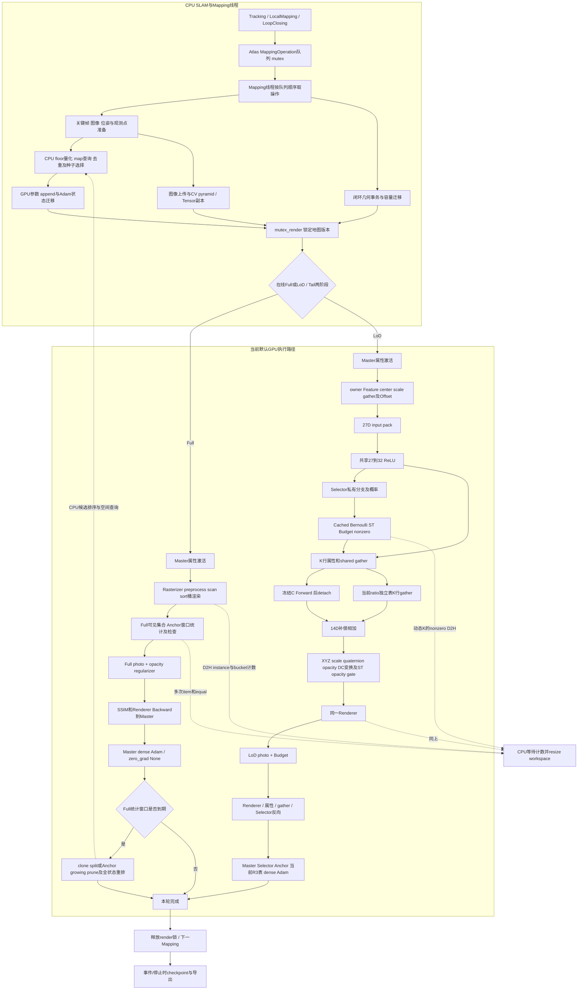

# Anchor / Selector / R3 性能架构审计

日期：2026-10-22，Asia/Hong_Kong。审计版本：`4269d7e3bad6cf5af7e1df1763634b61e98e0b51`。

本轮只新增 `tests/diagnostics/anchor_selector_r3_performance_20261022/` 下的隔离工具与报告。生产源码、Loss、配置、MLP、采样器、地图结构、优化器超参数均未修改；未 stage、commit、push。

## 1. 结论与证据等级

1. **R3 已集成生产 C++/LibTorch 和 Python 推理**。当前不是尚待接入的离线原型。四张独立 `[N,14]` 参数表、Gaussian UID、运行时 Adam 迁移、append/clone/split/prune/reorder 和几何修正均已实现。
2. **checkpoint 的参数保存与精确续训必须区分**：Selector archive 保存四张表、Gaussian UID 和 Anchor 状态；JSON 输出部分 Adam step，但当前 `savePly()` 没有序列化完整 Master/Selector Adam moments。不能声称已支持从普通导出包精确恢复整个训练状态。本轮 fixture 另外保存了实际更新前后的参数、梯度、moments 和 step。
3. **R3 gather 不是当前首要热点**。固定真实地图的 5% 分支中，它仅有 2 次 launch；整个 LoD 重放约 418 次。dense Adam 为 112 次，Backward 为 182 次，选后属性变换为 34 次。优先级应落在 Optimizer、属性变换/梯度链、选择压缩同步及 Renderer 工作区，而不是先写 GPU hash 或单独优化 R3 lookup。
4. **Renderer/Loss 不能忽略**。5% 的 Nsight 记录中，已有 CUDA 的 SSIM backward 单 kernel 约 0.80ms，是该次 Backward 的大项；Renderer forward 还存在 prefix-sum 后 D2H 计数和动态工作区。
5. **当前不适合直接多 Stream 并行训练**。Master、Encoder、Anchor Feature 和 Adam 状态共享写；Rasterizer/SSIM 中存在不显式传 stream 的 kernel/CUB 调用。必须先建立 stream 正确性，保留同步边界，不能直接并行四次 backward/step。
6. **绝对速度与可实现加速比仍未确定**。RTX3090 有另一任务持续使用 GPU。以下为真实共享负载下测量，不是独占 GPU 验收基线；本轮没有实现优化候选，不能承诺某个 CUDA 方案能加速多少倍。

证据状态：

| 项目 | 状态 | 依据/限制 |
| --- | --- | --- |
| 生产调用链、配置、默认 R3 与训练梯度边界 | TESTED + 源码审计 | 当前 HEAD、原配置、真实 SLAM 和原生重放 |
| Full / 四档 LoD / 拓扑事件 / 实际 ratio 轮转 | TESTED | 两次 trace、一次无 trace 真实 SLAM |
| 固定真实 checkpoint Forward/Backward/Adam | TESTED | 两次原生重放，六组 Master 梯度强制断言 |
| Native launch / memcpy / runtime / queue timeline | TESTED | Nsight Systems SQLite，正式计时与 profiler 分开 |
| 生产SLAM整进程CUDA时间线 | TESTED，子段归属有限 | 从进程启动采集正常退出；初始化/Online/Tail/shutdown未逐段NVTX分离 |
| Anchor/R3 生命周期 | TESTED | 当前构建的 private compensation 和 variable mapping 回归 |
| 固定梯度 Adam 数学一致性 | TESTED | 62 个 fixture 更新检查 |
| 整个训练步在统一 FP32 容差内重复 | PARTIALLY VERIFIED | 一个 Scale 分量因微小梯度/moment差异超过统一容差，见第13节 |
| 独占 GPU 性能基线、稳定加速收益 | BLOCKED | 另一个 GPU 进程持续运行；未中断别人的任务 |
| GPU 带宽/SM occupancy/访存效率归因 | NOT MEASURED | 未取得 Nsight Compute 硬件计数器；不能由耗时推断已带宽饱和 |
| CUDA 优化、生产并行化和算法替换 | NOT IMPLEMENTED | 本轮边界，保留生产结构 |

## 2. 当前真实架构与历史实验边界

生产配置：`cfg/selector/selector_config.yaml`；地图配置：`cfg/gaussian_mapper/RGB-D/TUM/tum_rgbd.yaml`。

| 内容 | 当前真实值 |
| --- | --- |
| 地图 | Variable Anchor，每有效 Anchor 1～10 个显式 Gaussian；不是固定十点 |
| 层级 | `h0=0.1`，L0/L1/L2，固定世界原点，粗细层共存；初始观测插入循环为 `level<kMaxLevel`，即 L0/L1，L2 由 growing 产生 |
| 空间身份 | `(level,key)` 查询桶 + 稳定 block UID；几何迁移允许碰撞桶 |
| Feature | 每 Anchor 一张16D共享特征；当前 ratio feature 表关闭 |
| 输入 | Feature16 + Offset3 + activated Scale3 + SH DC3 + activated Opacity1 + log(ratio)1 = 27 |
| 共享浅层 | Linear27→32 + ReLU，得到 `h` |
| Backend | `legacy`表示LibTorch GPU逐算子/cuBLAS路径；旧四路Selector CUDA layout不能直接用于当前27D Anchor输入 |
| Selection私有分支 | Linear32→32 + ReLU + Linear32→2 + temperature divide + softmax取keep |
| 原 Compensation | `C`: Linear32→32 + ReLU + Linear32→14；R3 模式冻结，输出 detach |
| R3 | 四张独立 FP32 `[N,14]` leaf：`delta=stopgrad(C(h))+b_k[ids]` |
| 选择 | Cached uniform Bernoulli：`uniform < p`；ST为 `hard+(p-p.detach())` |
| 候选 | 固定 maturity=1；slot deactivation已开启，按现有 inactive/当前opacity规则mask；预算分母仍是存储人口N |
| Budget | `abs(sum(p)-r*N)/max(1,r*N)`，权重0.01 |
| Photo | `.8*L1+.2*(1-fast_ssim)`；Full另外沿用 opacity regularizer 0.001 |
| TF / GI / SI / ChangeDistill | 关闭；不能把历史 HexPlane 热点当作本轮热点 |
| 调度 | mode1：在线1%/5%/10%/15%/Full轮转；Tail为每轮Full后一个联合LoD；`serial_full_lod=0` |
| LoD分辨率 | 在线配置 `lod_render_scale=0.5`；Tail native；当前GausPyramid训练关闭 |
| 生长/删除 | Gaussian回合 clone/split填充容量，Anchor回合梯度growing；质量pruning仅整Anchor；split父点删除属于替换生命周期 |
| 停止 | `max_mapping_iterations=0`，原自然停止；本轮没有改为10000 |

`makeEmbedding()` 名义上为27→32→32，但共享缓存位于第一层 ReLU 后，而不是两层后。分支边界必须按 `forwardSelectionFeatures()` 实际代码理解。

原生固定基线为上一轮真实在线 `fr1_xyz/R3 seed2026/7465_shutdown/ply`：**15,891 Gaussian、6,121 Anchor、15,891 唯一 Gaussian UID**。所有有效 Anchor 都有1～10成员，没有将历史空节点计入有效人口。

@@LAYERS@@

@@MEMBERS@@

Gaussian split 已沿 `densifyVariableMembers()` 和 legacy `densifyAndSplit()` 检查：使用 `getScalingRotationActivation()` 的 `L=R diag(exp(log_scale))` 作用于标准随机扰动，保留 `abs(sample)>3→0` 规则；不是未乘 scale 的旋转扰动。Variable路径每split净增1，瞬时两子点与父点移除处于同一无图事务。

历史 `R3_matched` 仍只是 `tests/anchor_selector/compensation_root_cause_20261022/matched_oracle.py` 的受控训练协议：每个Bank视图依次算四档photo，各除以4，累计真实梯度后一次 SparseAdam step，`eps=1e-8`、每表clock=cycle。**生产没有采用这套聚合/稀疏优化策略**。生产每次当前ratio执行原joint step；共享base Adam为`eps=1e-15`，非当前ratio表grad=None不推进时钟。

本轮没有混用旧13,919/5,177地图与当前15,891/6,121地图的耗时、质量或Adam状态。

## 3. CPU/GPU 完整执行DAG与串行边界



图表示数据依赖，不表示两个分支当前并行。**Tail真实顺序**是Full Backward→Full Master step→Full拓扑→重新读取状态→LoD Forward/Backward→joint step；两阶段仍持同一个render mutex。不能跨这个Full step重用旧Gaussian属性或旧Encoder输出。

CPU的mutex不是CUDA Event。当前代码依赖默认stream及现有阻塞API的可见性；未来多stream修改必须补上device读写依赖，不能只调整CPU锁。

## 4. 真实调用链、Tensor布局、分配和同步

除注明外，数值Tensor为CUDA FP32，Gaussian/Anchor索引为CUDA int64，key/level/UID为int64，mask为bool。Scalar ratio控制分支来自CPU float/double；当前normal训练没有Python调用。

| 节点 | 真实文件/函数 | 输入→输出与位置 | 分配/拷贝/同步/可并行条件 |
| --- | --- | --- | --- |
| SLAM事件 | `third_party/ORB-SLAM3/src/LocalMapping.cc:179`、`LoopClosing.cc:1084`→`Atlas.cc:374` | CPU MappingOperation值/图像/位姿/点队列 | 队列mutex；不得重排消费顺序 |
| 初始地图 | `src/gaussian_mapper.cpp:1087 run` | 锁Map取得SLAM点/KF→CPU scene缓存 | map更新锁，图像和点上传；初始生长不计入每步常态 |
| 事件消费 | `gaussian_mapper.cpp:3604 combineMappingOperations` | LocalBA/LoopBA/Sim3→KF/新增点/几何事务 | 事件内部可CPU重，但修改Gaussian时持render锁 |
| KF图像 | `gaussian_mapper.cpp:3810 handleNewKeyframe`、`include/tensor_utils.h:42/109` | CPU CV图像→GPU CHW FP32；CV GpuMat→Tensor | `clone().to(device)`、CV upload、GPU clone/permute/contiguous；未见pinned非阻塞预取管线 |
| Anchor观测 | `explicit_anchor_blocks.h:50 observeBlocks`→`variable_anchor_blocks.h:16 insertVariableBlocks` | GPU观测→CPU FP64点、CPU分组→新增CUDA成员 | GPU→CPU、map/set循环、<=10选种与局部scale计算、CPU→GPU、cat全量扩展 |
| Mapping | `gaussian_mapper.cpp:1410 trainForOneIteration`→`:1524 trainMappingIteration` | KF、地图、iteration→当前Full/LoD | KF采样在CPU；训练持render mutex；每步LR读取与组更新 |
| 激活 | `gaussian_model.cpp:64`附近三个activation函数 | log_scale[N,3]、rotation[N,4]、opacity_logits[N,1]→activated | exp/sigmoid/normalize分开kernel和临时Tensor |
| Owner查询 | `anchor_bank.h:323 inputs` | owner[N]、feature[A,16]、center[A,3]、s[A,1]、XYZ[N,3]→Feature[N,16]/Offset[N,3] | GPU index_select×3、减法、除法；日常Forward不访问CPU空间map |
| Input pack | `gumbel_network.h:329 anchorInputs`及`gaussianAttributes` | Feature16/Offset3/Scale3/DC3/Opacity1/logr1→[N,27] | 属性cat、full/log、最终cat；新临时allocation；不含camera |
| Encoder | `gumbel_network.h:87 forwardSelectionFeatures` | [N,27]×W[32,27]→h[N,32] | ATen Linear→cuBLAS、ReLU；h缓存供选后C使用 |
| Selection | 同上 | h[N,32]→hidden[N,32]→logits[N,2]→p[N] | FP32 GEMM、ReLU、温度除法、softmax；p为select视图，可stride=2 |
| 选择/预算 | `selector_handoff.h:16`；`gaussian_mapper.cpp:3341/3402` | p[N]/cached_u[N]→STmask[N]、Budget[]、ids[K] | 比较/转型/加减/reduce/nonzero；动态K导致D2H同步 |
| 所选属性 | `gaussian_renderer.h:54 indexSelect` | Master SoA六张表→K行SoA | 六次gather；Backward为各源行scatter；ids保持row升序 |
| 共享C | `gumbel_network.h:109 compensationResidual` | h[ids,K,32]→[K,14] | 2 GEMM+ReLU、gather；当前虽然C冻结，输入h带梯度仍先建图后detach |
| R3 | `gaussian_compensation_bank.h:34 forward` | ids[K]、CPU ratio、四表[N,14]→[K,14] | 训练档一表gather；插值档两表gather与线性和；主表不复制到CPU |
| 变换 | `gumbel_network.h:121`；`gaussian_mapper.cpp:3419` | base K行 + delta[K,14]→K行render attrs | 多次slice/normalize/multiply/exp/sigmoid/cat；Forward34launch，VJP大量小操作 |
| Rasterizer包装 | `gaussian_renderer.cpp:76`→`gaussian_rasterizer.cpp:25` | K行SoA、camera→image[3,H,W]/radii[K]/viewspace[K,3] | contiguous视需要复制；viewspace zero/retain_grad；Training可见索引nonzero |
| Rasterizer CUDA | `cuda_rasterizer/rasterize_points.cu:55`→`rasterizer_impl.cu:390` | points→geometry/image/binning/sample byte buffers | 按P/tile实例/bucket动态resize；CUB scan/radix sort；多次D2H计数 |
| Loss | `gaussian_mapper.cpp:1654/3514`、`loss_utils.h:168` | image/GT→L1/SSIM/Budget/Full opacity reg | 图像级算子和reduce；fast_ssim已有自定义CUDA；原Loss保留 |
| Backward | `gaussian_rasterizer.cpp:64`、`cuda_rasterizer/backward.cu:850`、`conv.cu:1002` | dimage→Master/表/selector/feature gradients | CUDA Renderer、SSIM、ATen自动求导；scatter/index_add有atomic/顺序差异 |
| Adam | `gaussian_mapper.cpp:2313 ensureSharedMappingOptimizer`→`stepWithHistoricalGuard` | 活跃params/grad/m/v/step→更新 | 当前cuda-group空，`tfCudaAdamMixedStep`退base `optimizer.step()`；逐param dense ATen Adam |
| Full统计 | `gaussian_model.cpp:155 addAnchorPruningStats` | Full visible ids、owner、opacity→Anchor访问和slot窗口 | 每次调用assertBlocks；FP64 opacity累积；若Anchor任一成员可见，使用其全体成员正opacity |
| Gaussian拓扑 | `gaussian_model.cpp:1159/1208` | Full梯度窗口→容量内clone/split→prune父行 | CPU stable_sort、GPU cat/gather、参数对象替换及moments迁移、emptyCache |
| Anchor拓扑 | `explicit_anchor_blocks.h:67 growBlocks`、`gaussian_model.cpp:223 anchorPruningMask` | Full梯度→同层/细层新Anchor；访问/opacity→整组prune | 多个D2H、CPU key查询、特征max/zero、全量重排 |
| 几何事务 | `gaussian_mapper.cpp:2582`起、`gaussian_model.cpp:631/660`、`variable_anchor_blocks.h:127` | correction indices/Sim3→XYZ/Anchor迁移/R3 transport | 同层目标容量；Feature按接受成员加权；满10丢弃；相关moments重置，受render锁保护 |
| 导出 | `gaussian_mapper.cpp:4405 savePly`、`python/selector.py:380`、`python/renderer.py:40` | 参数/UID/metadata→archive/PLY；推理紧凑输入 | native checkpoint低频CPU序列化；Python补偿先clone全人口属性再compact，有冗余复制 |

实际Tensor shape、dtype、device、stride在 `evidence/native1/native_metadata.json` 的 `layouts` 中逐分支保存。基准输入27、shared32、所选属性通常row-major连续；SH DC `[N,1,3]` 可squeeze视图；probability的stride不能假定为1。权重存储为 `[out,in]`，如`[32,27]`，不能按GEMM名字颠倒布局。

临时Tensor不等于每次都`cudaMalloc`：ATen caching allocator会复用块。Nsight当前稳态scope未证明每次有device malloc；报告只认定源码存在新Tensor/resize请求及事件emptyCache，绝不把allocation请求次数当cudaMalloc实测次数。

## 5. Anchor高频与Topology低频审计

**高频Forward**只有GPU owner查表、Feature gather、center/scale gather和Offset；XYZ是几何唯一真实状态。Gaussian每次更新后Offset应重新计算。owner和空间桶可在拓扑epoch内缓存，Feature值与XYZ/Scale等每次step可能变化，不能跨训练step缓存旧输入/旧h。

**空间桶**为CPU `std::map<NodeKey,vector<row>>`。`rebuildBlockLookup()`把key/level搬到CPU后遍历所有Anchor。观察点先转换CPU FP64以floor量化，负坐标与边界需保持；新Anchor成员来自不同真实观察，最多10个。Variable成员存储为owner[N]+member_counts[A]，并非`[A,10]`连续block；按Anchor并行需要CSR/分段索引或atomic，不能假定 `row/10`。

**完整性检查并非纯CPU常数检查**：`assertBlocks()`检查owner范围、bincount/容量1..10、层级、中心finite与尺度正值，多处`.all().item<bool>()`和`torch::equal`读回结果。它被每次Full窗口统计调用。保留全部检查的可行优化是GPU合并校验/一个错误flag，一次必要读取；本轮未删除检查，也不建议直接降低检查频率来宣称等价加速。

**Full统计**维护Anchor访问、opacity和slot窗口，使用与生产相同分母；是no_grad，但包含FP64累加、bool/index_add和大量临时量。可以融合访问flag生成、owner归约、slot累加和校验，仍需保护异常与FP64语义。

**事件窗口**：每500 iteration在Full安全边界处理待执行任务，Gaussian/Anchor回合交替。Gaussian候选当前全量D2H并stable_sort，tie按row；split按净增1分配容量。Anchor回合复用Full屏幕梯度，首次L0有效梯度q90确定tau0，`alpha=2`；不把LoD已选点当完整growing证据。

每次Topology事件的真实`densify`scope（包含该事件的Full梯度统计及拓扑）：

@@EVENTS@@

独立真实布局的原生原语重放：

@@TOPO@@

`noop_prune_rebuild`保留全部成员，仍产生owner/count/alive/remap与CPU桶重建；证明存在增量/无变化快路机会，但不是测得了完整真实prune加速。Topology事件约33～35ms，相比常态统计约1ms，主要影响尾部延迟；不能把所有Anchor管理逻辑都当每Mapping热点。

建议先补Topology事务内各子段NVTX与一次索引重排，再决定是否GPU化CPU stable_sort、量化、unique、分段容量或Feature max。GPU hash不是第一批任务：日常Selector根本不查CPU hash，且必须支持稳定UID、同层碰撞桶和确定性容量接收顺序。

## 6. Selector / 小MLP / Gather与Backward

全人口N执行Encoder与Selection分支；只有实际所选K行执行C及R3补偿。不存在为每个Gaussian存16D独立大特征。Feature反向沿owner的 `index_select` 聚合到 `[A,16]`，可能atomic累积；属性输入还将Selector/Budget梯度传到Master XYZ、Scale、DC、Opacity。Rotation不在27D输入中，但在所选Renderer中接收梯度。

实际shape：第一GEMM为 `[N,27]@[27,32]`；Selection后续为 `[N,32]@[32,32]`、`[N,32]@[32,2]`；C为 `[K,32]@[32,32]`、`[K,32]@[32,14]`。本图N=15,891，K为156/799/1,582/2,368。小宽度且K很小时，启动和中间量可能重要；这不证明自定义GEMM优于cuBLAS。

| 机会 | 可行性/约束 | 下一轮建议 |
| --- | --- | --- |
| 输入生成+第一层 | 可融合owner查表、offset/attr pack；把pack直接与GEMM融合需处理不规则Feature读取 | 先pack kernel+现有GEMM，保留cuBLAS对照 |
| Linear+bias+ReLU | 已有GEMM kernel可能含bias epilogue，不能重复计算“未融合bias” | 用实际trace和cuBLASLt候选验证；CPU提交数也要测 |
| logits+概率 | 两类softmax可等价用差值sigmoid，但可能改变FP32边界与选集 | 不直接替换；若做候选需严格Cached边界验证 |
| ST/Budget/indices | reduction+stable scan可降低launch；K是当前Tensor分配和Renderer host P的依赖 | 明确保留必要count读取，先减少重复nonzero，不承诺整条异步 |
| K行gather+C | 可融合gather与K行网络读取，收益受K和GEMM实现影响 | 当前C末层精确0，先评价NoGrad/有条件常零快路，兼容非零C |
| K行gather+R3+属性 | 数据流紧密，约6+2+34个Forward launches | 优先开发融合属性decode，随后再合并输入gather |
| MLP Backward | 当前GEMM梯度及ReLU/gather可融合部分 | 后于属性VJP/Adam；共享Feature scatter不能丢失重复owner梯度 |
| Anchor梯度聚合 | 可按owner分段或warp归约 | 分段预处理要按拓扑失效；并发/atomic的误差单独门控 |
| warp/shared/vector load | 32宽适合warp，14D行56字节并非每行16B对齐 | 不能对任意行无条件float4；按实际stride/alignment选择读取 |

共享MLP同一LoD已经复用了第一层h，没有在C中重算Encoder。跨ratio训练每次先step再下一ratio，Master/Feature/网络已变；因此不能把不同训练step的h视为同一个可缓存结果。固定snapshot推理可共享owner与ratio无关输入，甚至分解第一层`W_x x + W_r log(r)`，但ReLU后仍依赖ratio，且分解会改变浮点归约顺序，需要parity。

Renderer预处理可共享相机常量和原始属性输入的只读引用；R3补偿后的XYZ、Scale、Rotation、Opacity、DC随ratio变化，投影、可见性、协方差、SH到RGB及tile排序不能直接当公共结果复用。多ratio的可复用输入不等于可复用完整Rasterizer preprocess。

## 7. R3专项：现状、存储、Optimizer和生命周期

14D原始语义没有改变：

```text
delta = detach(C(h[ids])) + residual_ratio[ids]
XYZ' = XYZ + delta[0:3]
Scale' = exp(log_scale) * exp(delta[3:6])
q_delta = normalize([1,0,0,0] + delta[6:10])
Rotation' = normalize(q_delta * normalize(base_quaternion))
Opacity' = sigmoid(base_opacity_logit + delta[10])
SH_DC' = SH_DC + delta[11:14]
Renderer opacity = ST_mask_selected * Opacity'
```

当前 `applyCompensationResidual()`还构造log_scale+delta；Mapping实际scale输出沿activated scale乘exp(delta)路径使用。优化不能把两个路径的Master梯度或未使用输出混淆。

**Forward**：生产保留四个独立leaf `[N,14]` 最适合现有生命周期与独立clock。`[4,N,14]`一个大leaf若直接交给普通Adam，会把四档clock绑定；只有自定义per-ratio state/step才能等价。按ratio紧凑K表或ID稀疏hash能节省部分存储，但当前集合随训练/地图变化，需额外UID映射与历史moment语义，暂无优先收益证据。当前gather本身已很小。

**Backward**：index_select产生当前整张 `[N,14]` dense grad，未选行本次梯度为零；并非只K行存储grad。其他ratio表grad=None。若某未选行曾有moment，dense Adam仍衰减moment并可能移动该行。改SparseAdam只更新本次indices会改变训练，不是本轮允许的性能等价替换。

**Adam**：`GaussianModel::optimizer_`类型是base `shared_ptr<torch::optim::Adam>`；对象虽叫`SparseGaussianAdam`，其visible overload是 `step(visibility,N)`。默认joint实际调用无参base step；不能凭类名认定已经使用稀疏CUDA optimizer。`tfCudaAdamMixedStep()`在本路径groups为空时调用base step，TF优化kernel没有接管R3。继承defaults eps1e-15；每个param仅grad defined时推进clock。拟优化multi-tensor dense Adam必须保留这些行为。

**内存核算**（不是GPU峰值测量）：R=4时参数=224N bytes，m/v=448N，当前表dense grad=56N，总728N bytes。N=15,891时约3.39MiB参数+6.79MiB moments+0.85MiB当前grad≈11.03MiB，另有UID约0.12MiB；A=6,121的16D Feature约0.37MiB参数+0.75MiB moments。Renderer缓存、Master、image、autograd和context不在这些数字内。100K下同样R3项约69.43MiB。

**Append/clone/split/prune/reorder**：`GaussianCompensationBank::resize`分别使用value_rows/state_rows：新观测零残差；clone/split复制父value但分配新UID，新行moments零；prune/reorder沿相同keep顺序迁移参数、m/v、UID和optimizer alias，保留已有step。不能仅保存值而忘记更新注册parameter和Adam TensorImpl键。

**几何修正**：XYZ残差随Sim3线性部分变换，quaternion补偿做共轭；受影响行对角Adam moments清零，其他行和表clock保留。Local迁移改变Anchor owner/接收Feature，Gaussian私有UID仍跟Gaussian走；容量满的移动成员删除，其R3行同步prune。

**checkpoint**：Selector archive已含参数和buffer，native/Python推理可加载、插值。生产未保存完整Master/Selector优化器；只有JSON step摘要并不足以精确续训。TF另存optimizer文件不代表R3已经有同样能力。本轮fixture弥补了后续Kernel parity输入，不改变生产保存策略。

**未见ratio**：当前代码明确使用原始ratio线性插值两张14D表：`(1-t)*b_lo+t*b_hi`，端点外clamp；属于已存在的生产推理语义。四训练档质量证据不能证明任意ratio质量，>15%端点补偿尤其不是受训练支持的外推。不能为性能静默改为最近邻/R2；当前插值系数不是log-ratio插值。

**导出**：生产native保存参数为低频整体序列化。Python `compensated_attributes()`先clone全N的XYZ/scale/rotation/logits/DC，再把K行写回，随后`prepare_render_data()`再compact；可新建K行直接准备路径，减少全人口复制，但必须保持同ids/K/属性/SHdegree与未见ratio插值，当前未实现。

## 8. 真实性能Profiling：方法与原始数据

环境：Linux RTX3090 24GB，driver535.230.02；生产LibTorch2.3.1 CUDA11.8 ABI1，Python Torch2.3.1+cu118 ABI0分别运行；Nsight Systems2022.4.2。Windows本地没有可用`nvidia-smi`，真实GPU测试在现有服务器进行。服务器源码无Git，用本地HEAD和逐文件SHA manifest核对，未把另一目录的构建当成当前版本。

**共享GPU限制**：采样始终能看到另一Python训练进程，约1.29GiB显存，GPU总体占用约60%左右；没有终止它。SM clock/power/apps/时间戳记录在`online_runs.json`和`native_gpu_samples.json`。因此mean/尾延迟包含外部调度，Nsight目标进程kernel时长也可能受资源争用。以下数字可用于当前条件的开销定位和launch计数，不足以验收稳定加速比。

三层数据不能混为同一占比：

- 真实SLAM：原C++程序/原配置/自然停止；现有MappingProfiler每19轮采样CUDA Events，异步query，trace输出每Mapping host wall；另跑一次无CSV trace。stage有嵌套。
- 原生冻结重放：真实15,891点checkpoint和真实Bank中间相机，640×480；Full与四档LoD固定实际Cached集合；两次重复，每case10次warmup，60次计时，fixture那次排除；CUDA Events＋末尾同步wall。此处不含SLAM、图像加载、Anchor Full统计、完整Topology、TF关闭后的历史统计代码。
- Nsight：同一原生重放单独进程，另一次profiling，每case只取warmup及fixture之后3次。按CPU launch correlationId归属NVTX stage，再连接GPU kernel/memcpy；排除fixture大量D2H。Profiler数据不是正式延迟样本。

原生重放本身也有逐scope NVTX/CUDA Event记录和事件对象管理开销；目前未做空计时器扣除或完全无分段标记的匹配重放。因此它是带诊断标记的固定状态耗时基线，不能当作裸生产代码的最小延迟。纯kernel计数和原始生产Mapping trace提供独立证据。

首次隔离重放发现PLY loader默认requires_grad=False，漏掉Master梯度；这批结果已作废。最终版本显式恢复六组Master leaf，新增每组grad defined断言，重新计时、重建Nsight与fixture。最终数据的Adam为112而非错误基线的64launch；交付的数据均来自修正后重放。

### 8.1 真实完整Mapping

@@ONLINE_TABLE@@

进程总wall包括SLAM、初始化、训练、shutdown渲染和保存，不是纯Mapping总时间。异步SLAM在相同seed下的实际Mapping数也变化。无trace运行不能与trace运行直接相减得到CSV开销，因为更新次数、Tail长度、拓扑轨迹和外部GPU调度不同；本轮未测得严格匹配的Profiler开销百分比。

trace1整体host构成：

@@SHARES@@

LOD父scope内部：

@@LOD_SUB@@

两张表不能全部相加。LOD包含Selector、render、loss、backward及其他准备/统计；Full pruning统计和若干item/LR/调度等落在未单独标记部分。host scope可能在同步处承受之前排队GPU工作的等待，不能将host占比解释为GPU kernel占比。逐scope mean/median/p95/p99、非零调用统计、post3000四ratio分组都在`online_statistics.csv`。

实际多ratio训练循环就是原在线五槽轮转；trace1在线4,010步、四LoD各802次、Full802次，随后400次Tail Full+LoD。trace2在线3,965步，Tail435步。没有引入四ratio累计一次step的离线新协议，也没有把四档同时跑以减少训练次数。当前单图/多ratio推理缓存另作为未来机会。

### 8.2 固定真实地图的原生训练计算重放

@@NATIVE_TABLE@@

正式重放每次前恢复相同参数值，Cached集合与K逐case断言一致；Adam使用生产base Adam公式/epsilon和配置初始LR，fresh state经warmup，moments在重放中真实推进。**这不是恢复7465步时的完整Adam状态或LR时钟**；不能用它替代精确续训实验。它用于固定形状、参数/梯度函数和launch路径测量。不同ratio case没有被当成并行训练。

本重放全部640×480，而生产在线LoD为320×240；所以表内LoD更慢或相对Full的比例不能直接套到在线Mapping。在线每step的高频检查和历史statistics又不全部在重放里。两种测量相互补充，不相互替代。

5%原生重放分解，时间单位ms：

@@STAGES@@

Event span包含CPU提交空隙、GPU等待和外部调度；Nsight kernel纯时间只来自另一次profiler运行。禁止把两列差值直接叫“CPU开销”或把不同进程统计拼成精确守恒式。5%下本次kernel合计约4.65ms，418 launches；Backward包含SSIM和Renderer，不只是MLP。

### 8.3 CPU/GPU copy、同步和分配

- 5% compact scope在Nsight中出现`cudaMemcpyAsync`及`cudaStreamSynchronize`：动态nonzero输出计数返回CPU是同步边界。
- Renderer forward有阻塞`cudaMemcpy`、ATen可见索引nonzero的异步copy+stream synchronize。`rasterizer_impl.cu:441`取tile instance数，`:522`取bucket总数，极小实例还在`:481`读取首key；不能把只传4字节理解成成本只有4字节带宽。
- 对应本次5% scope，compact的memcpy API wall约0.572ms，Renderer阻塞memcpy API wall约0.552ms；包含待完成工作的等待，非独占负载下更明显，不是链路纯传输时间。
- `cpu_gpu_timeline.csv`逐事件保存CPU API起止、GPU起止、queue delay、bytes、stream、correlationId；`cuda_api_statistics.csv`保存API聚合。queue delay是该事件在launch API结束之后到GPU开始的间隔，不能单凭它区分同进程排队和外部抢占。
- Full每次统计还有多次校验结果读取；真实事件中多次CPU/GPU来回、cat/gather及`emptyCache()`可能改变分配/同步成本。尚未取得这些子段的逐launch完整在线Nsight归属，不能报告伪造的完整Mapping launch总数。

### 8.4 扩展规模与显存

以下是Python ATen算子压力测试：复制真实行/owner构造10K/50K/100K，目标为synthetic proxy，并非真实渲染、真实选点或在线训练；只有15,891的行来源人口与当前真实地图相同。每档30次CUDA Event，5%示例：

@@STRESS@@

这里只能说明输入pack/MLP/私有表dense梯度等算子随N增长的表现；峰值allocated来自Python allocator，不包含完整在线Renderer/Adam。不同规模复用同一进程，reserved显存有历史缓存，不能把reserved差异当净增成本。真实native进程显存仅有0.5秒采样，属于峰值下界；本轮未获得native allocator精确峰值，也未测试真实50K/100K地图。

### 8.5 补充：真实生产SLAM整进程Nsight

@@ONLINE_PROFILE@@

此次使用原`bin/tum_rgbd`、原配置和自然停止，从进程启动连续捕获CUPTI/OSRT；没有为Profiler降低R3起始步或强制Mapping10000。源码未加生产NVTX，因此整进程kernel/CPU API可查，不能逐条自动标成Full/某ratio/Topology。初始化与shutdown渲染也在捕获范围内，禁止把总launch除以Mapping步数宣称纯Mapping launches/步。

首个延迟22秒才开始采集的尝试在约Mapping1500后以139退出，未产出可用完整轨迹，已排除统计；根因尚未定位，不能证明是生产算法错误或全部归因于Profiler。改用从进程启动采集后的完整运行正常退出。失败日志和最终命令均保留，不将失败运行混入正式时间/质量结果。

补充原始文件位于`tests/diagnostics/anchor_selector_r3_performance_20261022/evidence_online/`：`.nsys-rep`、SQLite、完整压缩`online_cpu_gpu_timeline.csv.gz`、整进程kernel/API统计、命令/训练日志与manifest。根目录两个时间线/launch CSV另外附入带明确scope的整进程摘要/抽样；完整事件请读gzip/SQLite。

## 9. CPU/GPU并行、Stream、Graph与缓存

| 路径 | 能共享/重叠什么 | 依赖与正确性风险 | 推荐等级 |
| --- | --- | --- | --- |
| Keyframe加载→当前Mapping | CPU图像准备、pinned H2D可与GPU计算重叠 | 保持KF顺序，上传完成event后消费，buffer不可提前回收；CV默认stream需核对 | P1，优先于并行训练 |
| CPU Anchor候选计划→GPU训练 | 只读快照上的CPU量化/候选排序 | 训练会改XYZ/梯度/owner；需snapshot版本、stale-plan拒绝与原语义相同提交时点 | P1，先测snapshot成本 |
| 不同ratio推理 | 固定Master、owner、Feature和基础属性可复用；各输出独立 | Renderer default stream需改成显式当前stream后才能安全并行；显存/SM争用可能不划算 | P1缓存优先，多stream后置 |
| 不同ratio训练 | 基础常量可有限复用 | Master/Encoder/Feature梯度及Adam共享写；合并梯度/延迟step会改当前顺序与clock | 不直接并行，P2 |
| Full与LoD | 相机/GT可共享 | 在线是不同槽；Tail Full先step和拓扑，LoD必须读新Master，不能同时执行 | 保持串行依赖 |
| 双Buffer/版本化snapshot | 导出、Viewer、CPU只读计划可用一致快照 | 必须复制所有关联参数/owner/UID/表；生命周期原子发布，带宽/显存成本 | P1按需求验证 |
| CUDA Graph | 固定N的MLP、dense Adam子图 | 动态K、D2H计数、allocator resize、topology替换Tensor地址阻止整图直接捕获 | P1先局部，epoch/bucket失效管理 |
| 預分配workspace | Renderer和scan scratch容量可复用 | Backward仍使用该次Forward上下文，不得下一render覆盖；多在途render需池化 | P0/P1 |

当前共享对象包括Mapping线程中的Gaussian六组参数、Selector及其Anchor/R3子模块、优化器param groups/moments、KF相机Tensor与scene集合。SLAM通过Atlas CPU队列交付观测与几何操作，不直接提供一个已经版本化的GPU Gaussian快照。`mMutexMappingOperations`、Map update mutex、`mutex_render_`、settings/status锁各有不同作用，不能互相代替。

Rasterizer `FORWARD/BACKWARD`和SSIM kernel写法含`<<<grid,block>>>`，CUB也没有在这一调用链显式传LibTorch current stream。现有默认路径能运行不代表非默认stream正确。未来首先要做两stream隔离输出/梯度测试，再串接event。不要移除既有mutex、cudaMemcpy同步或将optimizer step放入另一个未等待的stream。

CUDA Graph的实际切入点为固定地址、固定shape、无host判定的局部计算。若为Graph改用固定最大K填充，仍必须证明Renderer与梯度对padding完全等价；不能以“多渲染零opacity点”擅自改变当前紧凑选择路径。

## 10. 瓶颈排序与证据强度

`performance_hotspots.csv`同时包含真实在线host占比与原生微段的Event/kernel/launch统计，明确scope，NA表示未测。`optimization_opportunities.csv`列出20项候选，全部`implemented=False`。

**P0，适合下一轮先做等价候选**：

1. dense multi-tensor Adam：LoD112、Full48 launches；既影响Master也影响Anchor/R3/网络。保留全人口moment与gradNone skip。
2. K行14D属性decode与VJP：Forward34 launches，反向许多小Tensor，紧接gather/R3，可先独立融合再考虑串接。
3. Anchor完整性检查＋Full窗口统计：每Full触发校验同步；真实`assertBlocks`约0.5ms，合并检查/统计不能删除检查。
4. N行Anchor/Offset/attrs输入pack：lookup5+pack4 launches，重用owner/中心/尺度，确保Feature/Master反向。
5. Cached ST/Budget/stable compaction：18 launches与dynamic-K同步；不要改变随机法则和K。

**同样重要但已经CUDA化的P0/P1**：Renderer计数/工作区同步和SSIM backward。本轮SSIM单kernel约0.80ms，不能为了关注MLP而忽略。先获取独占GPU/NCU，再判断共享内存、halo重复读取、occupancy、L2/DRAM流量，禁止直接把它归因为带宽不足。

**P1**：Topology重排统一事务、避免无变化CPU桶重建、cuBLASLt epilogue、冻结C NoGrad、Keyframe预取、固定snapshot多ratio推理、局部Graph。真实Topology事件虽然少，但33～35ms需要作为p95/p99实时性问题独立追踪。

**P2**：把所有空间hash迁到GPU、直接SparseAdam、直接四ratio多stream训练、对很小的R3 gather单独写kernel。它们要么改变语义，要么缺少收益证据，要么风险明显高于现有热点。

不提供虚构加速倍数：每项最多能消除其当前scope的一部分，受Renderer/SSIM/同步/Amdahl约束。表中当前耗时不是候选未来收益。

## 11. 最值得首先CUDA化的5个模块

这里“CUDA化”指将现有ATen算子串实现为等价专用kernel，不是说现有Tensor计算在CPU。

| 顺序 | 模块与优先原因 | 输入→输出 | 影响的Backward/Optimizer | 验证 |
| --- | --- | --- | --- | --- |
| 1 | dense multi-tensor Adam：112 launches，覆盖人口大 | 每叶param/grad/m/v/options/step→原位参数/m/v | 六Master组、Anchor、Encoder/Selector、活跃R3；非活跃表skip | 固定grad/moment fixture，eps1e-15，clock和未选行动量，重复step |
| 2 | 14D属性decode＋VJP：34 Forward launches | K行XYZ/scale/q/logit/DC、delta、ST→Renderer attrs | Master、delta整表scatter、mask；normalize/exp/quaternion | 原始参数、Forward/梯度、零范数/极值及同K图像 |
| 3 | Full Anchor统计＋完整性校验：每Full多次同步 | owner/counts/level/center/s/visible/opacity→窗口/错误flag | no_grad；只能改计算实现，不能改prune窗口 | exact owner/count/visits与删除mask、FP64累加容差、异常fixture |
| 4 | Anchor-aware input pack＋VJP：9 launches及N行临时量 | owner+A16/center/s+XYZ/Scale/DC/opacity/r→N27 | 共享Feature owner聚合、Master XYZ/Scale/DC/Opacity | stride、重复owner、几何后中心/尺度、Finite/长尾Offset |
| 5 | Cached Bernoulli ST/Budget/稳定压缩 | p/u/ratio/N→STmask、Budget、ids/K | dp_photo仅选中行gate，dp_budget全N | 选择/K精确、u==p、K0/全选、abs零点、stable顺序 |

完整接口、stream、缓存生命周期和分阶段拆分见 `cuda_kernel_candidates.md`。训练中绝不以少算ratio、减少N/K或删除检查换速度。

## 12. 最值得首先融合或并行的5条执行路径

| 顺序 | 路径 | 减少的开销 | 依赖/验证 |
| --- | --- | --- | --- |
| 1 | selected属性gather→R3 gather/add→属性decode→Renderer输入 | K行重复读取、6+2+34 launches中的可融合部分及临时Tensor | 第一版先独立decode；再合并gather；保留Master/R3/ST梯度、SH DC/rest布局与相同ids |
| 2 | 所有活跃叶的dense Adam elementwise链 | 112次逐参数小kernel、临时sqrt/div张量 | 不跨训练step聚合；维护每叶step/eps/weight_decay/gradNone，固定梯度验收 |
| 3 | Anchor lookup/Offset/attrs/logr→input27→GEMM epilogue | 输入N行cat/gather及ReLU提交 | 优先pack+现有GEMM；不要预设融合GEMM获益；同N/K/梯度比较 |
| 4 | Full可见Anchor标记→校验→opacity/slot归约 | 多次CPU scalar round-trip和重复owner扫描 | 全部检查保留，一个flag读取，访问分母和FP64统计不变 |
| 5 | 下一KF的CPU准备/Pinned上传→当前Mapping计算 | CPU图像准备和H2D暴露延迟 | 预取队列保持顺序，用CUDA Event交付；不并行写Gaussian/Anchor；评估完整在线延迟与轨迹 |

第五条是有条件的任务流水线，其收益还需独占GPU下CPU/H2D子段计时，证据强度低于前四条的launch定位。四ratio训练并行不在首批推荐中。

## 13. Parity fixture、容差与本次发现

`evidence/native1/*_parity.pt`共5组：Full、1/5/10/15%。每组含完整六组Master、网络/Anchor/R3参数值、Gaussian UID、owner、cached uniform、ratio、K/indices、Input27/h/p/mask、补偿与变换后属性、相机矩阵、GT/render/radii/loss、所有定义的梯度、Adam更新前后m/v/step与参数。`anchor_input_buffers.pt`补充原checkpoint的Anchor offset_scales、keys、UID、成员数及其他buffer；`native_metadata.json`给出映射名、shape、device和stride。

两次原生重放共789项比较；Forward/梯度/moments与身份/集合检查通过基准门控，62组固定状态Adam公式校验通过。精确项为owner、UID、uniform、selected ids、K与mask；FP32预设`atol=2e-5, rtol=2e-4`，网络纯Forward还用了更严格的`atol=1e-7, rtol=1e-6`与生产函数对照。

**不能称整个end-to-end全部allclose**：`fixture_verification.json`保留`end_to_end_allclose=false`。5%的Master log_scale row9484,column2，在两次重放后一个分量相差`0.0007710457`；该组梯度最大差约`1.19e-6`，该元素梯度约`-7.31e-10/-8.09e-10`，moments约`1e-9/1e-17`。两次各自的固定状态Adam更新均满足原公式。Renderer含非确定性atomic，极小量差异可被eps1e-15的累积更新放大。当前记录支持“微小梯度/累积moment差异与Adam敏感性”，没有证明硬件级全部差异只有某一个atomic来源。

后续必须分两层验收：固定相同输入梯度和m/v时Adam严格数值parity；完整渲染训练步与baseline-repeat的非确定性包络比较并检查图像/短程训练。不得把本次放大现象变成任意提高统一容差的理由，更不得改epsilon来让优化更容易通过。

已有private/variable原生回归本轮重新运行通过：零初始化、inactive ratio梯度隔离、Feature/Encoder路由、append/clone/split、prune/reorder、UID、Adam、几何transport、teacher及checkpoint参数roundtrip。测试日志单独交付，不把它们当真实地图长程质量证明。

未来CUDA的fixture协议、边界用例、失效条件和验收矩阵详见 `parity_benchmark_plan.md`。本轮未实现候选，所以不能报告“优化后PSNR无下降”或“优化加速已验收”。

## 14. 复现入口、产物与未测项目

本地工具目录：`tests/diagnostics/anchor_selector_r3_performance_20261022/`。远程隔离目录：`/home/prmi/zwj/anchor-selector-r3-performance-20261022/`。生产源/构建复用上一轮精确SHA副本，不覆盖原项目与旧模型。

```bash
# 远程，已有正确构建与数据；生产配置不修改。
/home/prmi/anaconda3/envs/zwj/bin/python build_native.py
/home/prmi/anaconda3/envs/zwj/bin/python run_native.py
/home/prmi/anaconda3/envs/zwj/bin/python stress_and_verify.py
/home/prmi/anaconda3/envs/zwj/bin/python fixture_details.py

# 新隔离输出目录下复现真实在线，run_online.py显式拒绝覆盖已存在run目录。
# 每次复跑先修改本脚本的隔离ROOT名称，而非覆盖旧实验。
/home/prmi/anaconda3/envs/zwj/bin/python run_online.py

# Nsight命令由run_native.py完整保存/构造：
/usr/local/cuda-11.8/bin/nsys profile --trace=cuda,nvtx,osrt \
  --sample=none --cpuctxsw=none --force-overwrite=true -o native_profile \
  ./native_benchmark <checkpoint/ply> <fr1_xyz_dataset> <output> 4
```

本地重算：`python -X utf8 tests/diagnostics/anchor_selector_r3_performance_20261022/analyze.py`，随后运行`make_outputs.py`。完整编译flags/link命令在`evidence/build_commands.json`。Python Torch ABI0与LibTorch ABI1不要在同一进程混载。

交付的核心机器文件：

- `performance_hotspots.csv`：模块、源码、频率、规模、host/Event/kernel、launch、同步/分配、Backward/风险/优先级；未实测字段写NA。
- `kernel_launch_breakdown.csv`：Nsight实际kernel名、scope、次数、mean/median/p95/p99、纯执行时间。
- `cpu_gpu_timeline.csv`：逐CUDA kernel/memcpy/memset、CPU API与GPU时间轴、queue delay、bytes、stream/correlationId。
- `optimization_opportunities.csv`：候选的证据、语义约束、接口、复杂度、验证、当前均未实现。
- `cuda_kernel_candidates.md`、`parity_benchmark_plan.md`：下一轮可直接拆任务的接口与门控。
- 本目录下`online_statistics.csv`、`native_statistics.csv`、`nsight_stage_statistics.csv`、`cuda_api_statistics.csv`及原始CSV/SQLite/Nsys。

未测/限制必须保留：独占GPU正式速度、候选加速比、NCU硬件计数器、完整在线Nsight逐模块launch归属、生产native精确allocator峰值、真实50K/100K地图、loop closure长事件性能、精确checkpoint续训、异步流正确性、Profiler无扰动严格匹配实验。整生产进程时间线已经取得，但其全部kernel不能自动归属到各Mapping子段。已有源码审计和复现入口不等于这些项目已经完成实测。

## 15. 分阶段路线图

1. **冻结环境与验收基线**：可独占时重跑本套fixture/计时，记录GPU clock/power、后台进程与源码SHA；加入tiny-gradient Adam、空选择、跨ratio插值及非默认stream测试。不要从当前共享负载数字承诺加速比。
2. **第一批低耦合候选**：multi-tensor dense Adam、独立14D decode/VJP、input pack/VJP。各自保留原ATen对照，逐个通过固定输入Forward/Backward/Adam和same-K图像门控；不一次替换整个网络。
3. **降低host同步和尾延迟**：Anchor检查/窗口统计合并、stable compaction count、Renderer workspace容量池；Topology统一索引迁移。异常检查、window语义、uid/moment映射必须保持。
4. **小MLP与Loss专项**：先cuBLASLt/epilogue微基准，再考虑手写warp kernel；对SSIM用NCU确认控制约束，保持原Loss。只接受在真实N/K与完整Mapping上稳定获益的实现。
5. **异步与批处理**：先stream-aware正确性与图像预取，再固定snapshot推理缓存/Graph子图；训练四ratio顺序和step仍保留。只有明确数据依赖、资源余量和质量parity后才研究更深流水线。

下一轮的首项建议是 **保持dense语义的multi-tensor Adam**，而不是SparseAdam替换；第二项为 **K行14D属性decode及反向融合**。两者有清楚的launch证据、独立输入输出与可复用fixture，不必重新大范围阅读项目即可启动。
