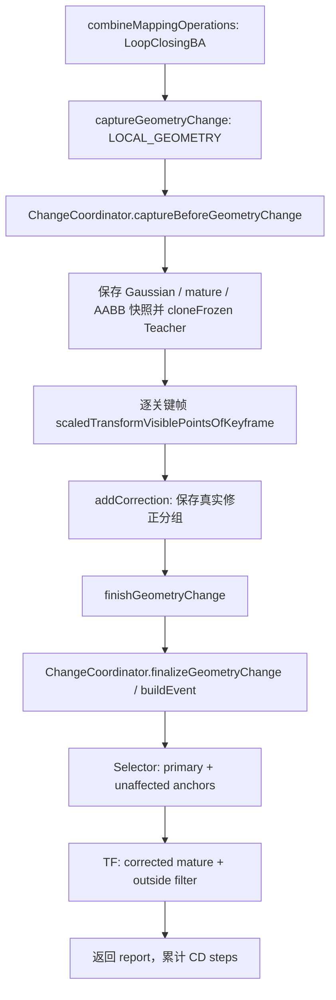
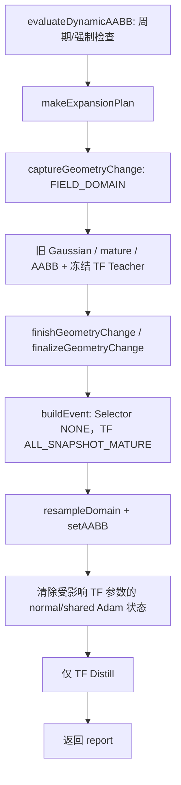
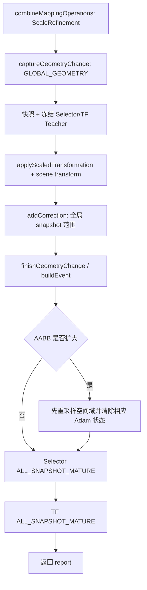

## 审计边界与版本

本轮遵循 **OBSERVE FIRST / OPTIMIZE LATER**。生产 `src/`、`include/`、配置、loss、精度、训练点集和网络结构未由本轮修改。新增文件全部位于本审计目录，及根目录最终报告。独立 benchmark 的 branch、batch、ratio、epoch 变化只用于指定的 scaling 实验。

主要事件是上一轮保存的真实 `events_supplement/local_loop/event_6207_1`，没有重新运行 SLAM。输入为完整 85,653 个 Gaussian，成熟点 44,889，corrected mature 29,687，未修正成熟点 15,202，TF 域内 29,683、域外跳过 4，correction groups **144**。事件无 AABB 扩张。来源为真实 Loop Closure 的补充捕获运行；其 mapper 阈值为 rotation=0.1、translation=0.01，不把它表述为原宽阈值必然触发的事件。

本地工作树已含用户的独立 epoch 改动。`ChangeDistill.selector_epochs`、`tf_epochs` 未设置时分别回退到 `ChangeDistill.epochs`。本轮两份正式 YAML 都未显式设置这两个覆盖项。`raw/current_configs.json` 保存实际读取值，`raw/source_manifest.json` 保存冻结文件 SHA-256；`raw/working_tree_before.diff` 是任务开始时已有改动。

与上一轮保存的源码按统一换行比较，网络、cache、transform、CUDA 实现均一致；相关差异集中在 CD epoch 接口及 mapper 读写/集成。逐文件结果和 CD diff 见 `raw/previous_source_comparison.json`、`raw/previous_vs_current_cd.diff`。原始字节哈希因 Windows CRLF 与 Linux LF 不同，不能直接用字节差异推断算法发生变化。

| 配置/事件 | Selector backend | TF backend | TF C / levels / hidden | batch | Selector epochs | TF epochs |
|---|---|---|---|---:|---:|---:|
| 本地 fast.yaml | cuda | cuda | 8 / [1,2] / 32 | 8192 | 5 | 5 |
| 本地 selector_config.yaml | cuda | legacy | 16 / [1,2,4] / 64 | 8192 | 1 | 1 |
| 主 benchmark：LC 6207 | cuda | cuda | 8 / [1,2] / 32 | scaling 指定值 | 独立测试 | 独立测试 |

因此，本报告的实测数字不代表默认 YAML 中更大 legacy TF 的性能。两条计算路径均做静态审计，但未将不同网络的时间混合。

## 1. 从事件到 optimizer 的实际调用链

行号对应 `source/` 内冻结的本地文件；报告根目录中的源码引用如发生后续编辑，应以此冻结副本为准。CPU/GPU 表示实际工作归属，所有 LibTorch/CUDA 操作均由 CPU 发起。

### 1.1 Local Loop Closure



### 1.2 AABB-only



### 1.3 Global geometry



普通 LocalMappingBA 不是此处的事件入口。仅有 “Loop Closure Detected” 日志不足以触发 CD；需至少一个真实 correction group 或 AABB 变化。允许 append；新增点不属于 `[0,N0)` 快照；prune/reset/reorder 被 correspondence version 断言拒绝。

| 文件 / 函数 / 行号 | 输入 → 输出 | CPU/GPU | 新分配 | 同步风险 | 循环及次数 |
|---|---|---|---|---|---|
| src/gaussian_mapper.cpp / combineMappingOperations / 3345 | MappingOperation、关键帧 pose → Gaussian corrections | CPU pose + GPU 属性变换 | mask、修正 indices、变换结果 | pose/阈值部分 CPU；CUDA→标量见具体实现 | 每次 operation；Local 按关联 KF |
| src/gaussian_mapper.cpp / captureGeometryChange / 2368 | XYZ[N,3]、scale[N,3]、q[N,4]、maturity[N] → ChangeCapture | CPU 编排 + GPU | mature mask、属性 clone、Teacher | mature_mask.any().item；TF clone 的 AABB .cpu | EVENT-ONCE；Teacher 按参数循环 |
| src/change_management.cpp / captureBeforeGeometryChange / 170 | mature mask、GaussianAttrState、AABB、版本 → old_state、mature_indices | GPU | N×10 FP32、N bool、M int64、AABB | nonzero 动态输出；一致性检查部分同步 | EVENT-ONCE |
| improvements/selector/gumbel_network.h / cloneFrozen / 113 | 18 个参数 → 冻结网络 | CPU 初始化 + GPU copy | 完整 Teacher 参数 | CPU→GPU 参数初始化/copy | EVENT-ONCE，18 参数 tensor |
| src/transform_field.cpp / cloneFrozen / 141 | 26/32 个参数及 AABB → 冻结 TF | CPU 初始化 + GPU copy | planes、MLP、buffers | aabbMin/Max.cpu，构造检查 .item | EVENT-ONCE；fast 为 26 参数 tensor |
| src/change_management.cpp / addCorrection / 193 | indices[K]、matrix[4,4]、quaternion[4] → CorrectionGroup | CPU 容器 + GPU | indices/变换 clone | indices>=0 的 .all().item | 每有效修正组；本事件 144 |
| src/gaussian_mapper.cpp / finishGeometryChange / 2413 | capture + current Gaussian → context、report | CPU + GPU | AABB 检查/计划 | render mutex；域检查可能 .item | EVENT-ONCE |
| src/change_management.cpp / buildEvent / 226 | groups + mature + config → correction_group_id[N]、scope | CPU + GPU | full[N] int64、索引/排序临时量 | 每组重叠/重复检查 .item | 144 组；AABB 可附带扩张 |
| src/change_management.cpp / finalizeGeometryChange / 285 | event/capture/context → CD report | CPU | 对象、计时范围 | 无快照/无变化时提前返回 | EVENT-ONCE |
| src/hexplane_field.cpp / resampleDomain / 98 | 新旧 AABB、affected planes → 原 Parameter 原位更新 | GPU | linspace、grid、sample、initialized、where | AABB 检查与 equal；不换 Parameter 身份 | 仅域变化；levels×affected planes |
| src/change_management.cpp / finalizeGeometryChange / 322 | affected parameters → normal/shared Adam state 清除 | CPU 容器 | state 释放 | allocator 行为取决于 stream | 每受影响参数；仅 AABB |
| src/change_distill.cpp / execute / 136 | event/capture/context → 两分支报告 | CPU + GPU | 详见下表 | 多处 .item/nonzero | Selector 全部 epochs 完成后才执行 TF |
| src/gaussian_mapper.cpp / finishGeometryChange / 2462 左右 | report → CD step 累计、change_version | CPU | 少量对象 | DSD 若启用会刷新引用；默认关闭 | EVENT-ONCE |

### 1.4 Selector：训练与评估并非同一 batch 逻辑

文件为 `src/change_distill.cpp`，网络入口为 `improvements/selector/gumbel_network.h:96`。

| 步骤 / 函数 / 行号 | 输入 → 输出 tensor | 设备及分配 | 同步 | 频率与本事件次数 |
|---|---|---|---|---|
| scopeIndices / 31、execute 148 | mature[N] & group_id>=0 → primary[P] | GPU mask + nonzero，新 tensor | nonzero 动态形状同步 | EVENT-ONCE，P=29687 |
| unaffected / 169 左右 | mature & group_id==-1 → U[15202] | GPU mask + indices | nonzero | EVENT-ONCE |
| sampleAnchors / 125 | U、P → anchors[A] | CPU shuffle；GPU permutation + gather | .to(device) 默认阻塞 | 初始一次，之后每 epoch 一次；总 E 次 |
| FrozenTeacherTargetCache 构造 | N → ready[N] bool，各 ratio 一个 | GPU zeros | 通常异步 | EVENT-ONCE ×R |
| evaluate / 176–190 | primary/固定 audit anchors → CPU mean loss | 普通 slice batches；R 循环 | 每 batch×ratio 的 .item<double> | pre 一次，每 epoch 后一次 |
| selectorLoss / 64 | current.select(indices) → XYZ[B,3]、scale[B,3]、q[B,4] | 每调用 3 个 GPU gather；scale.exp 再分配 | gather 通常异步 | 每 batch、每 ratio、primary/anchor 各一次 |
| ratio creation / 69 | CPU float ratio → GPU full[B,1] | 新 FP32 tensor | kernel fill，无显式 H2D tensor copy | 每 selectorLoss 一次 |
| cache.get / header 15 | indices → missing、Teacher probability[B] | ready gather、布尔筛选、target gather | 即使 cache hit 仍 nonzero/动态索引 | 所有训练/评估调用 |
| teacher probability / 73 | old XYZ/q/exp(scale)、ratio → p_teacher[B] | 冻结网络、NoGrad、GPU | 无显式 .item；cache miss 会动态筛选 | 本事件总 24 次网络调用，之后命中 |
| student forwardProbability / 76 | corrected XYZ/q/exp(scale)、ratio → p_student[B] | CUDA network + ATen softmax | 通常异步 | E×32 次训练 + (E+1)×24 次评估 |
| L1 / 78 | p_student[B]−p_teacher[B] → scalar | GPU sub、abs、mean，新 tensor | 无直接同步 | 每 selectorLoss 一次 |
| stratumBatch / 83、222 | shuffled primary/anchors → 分层 views + CPU weight | slice 为 view，不复制数据 | 无 | 每训练 batch 两次 |
| ratio 累积 / 225 | 4 ratio 的主项/anchor loss → total scalar | 多个标量加乘，形成单一 graph | 无 | 每训练 batch；R=4 |
| finite / positive check / 234 | total → CPU bool/double | GPU reduction + D2H scalar | **每 batch 两次显式 .item** | 2×4E |
| backward / 236 | 单一 total → 18 参数 gradients | CUDA custom backward + ATen autograd | host 调度；不会为每 ratio 单独调用 backward | 4E 次，总图含每个 ratio 和 anchors |
| Adam / 238 | 所有参数/grad → 更新参数及 m/v | CUDA backend 调 tfCudaAdamDirect；legacy 调 Adam::step | CPU options/state + GPU kernel | 4E；首步分配 state |
| zero_grad / 221、250 | grad handles → 清理 | LibTorch 默认语义，未改变 | 可能涉及 allocator；不是手写同步 | 4E+1 |

训练 anchors 的数量为 `min(floor(P*ratio), U, max_count)`，本事件 `min(29687,15202,32768)=15202`。因此每次抽样遍历全部未修正成熟点，只改变顺序；固定的第一组 audit anchors 用于 epoch 间可比评估。不能把 anchors 当成单独的 optimizer step。

### 1.5 TF：Teacher、transport、cache、Student

| 步骤 / 文件函数行号 | 输入 → 输出 tensor | 设备及分配 | 同步 | 频率 |
|---|---|---|---|---|
| scopeIndices / change_distill.cpp:149 | corrected mature → ids[29687] | GPU mask/nonzero | 动态输出 | EVENT-ONCE |
| outside_identity / 272 | current XYZ[29687,3] → inside mask → ids[29683] | gather、比较、all、布尔筛选 | nonzero/布尔索引动态形状 | EVENT-ONCE；后续网络内部还会重复检查 |
| old AABB diagonal / 279 | old extent[3] → norm scalar → double | GPU sub/norm | `.item<double>()` D2H | EVENT-ONCE |
| cache 初始化 / 281 | N → R 个 ready[N]，首次 miss 后 values[N,10] | GPU | 通常异步，miss indices 有同步 | EVENT-ONCE ×R |
| teacher applyLogResidual / 287 | old_state.select(missing)、ratio → 旧弹性 XYZ/log-scale/q | GPU insideMask/nonzero + gather + TF forward + output + index_copy | 网络内部 nonzero | cache miss；本事件 20 次 |
| transportTarget / 39 | 旧弹性结果、missing ids、group_id、144 groups → 新坐标系 target | GPU ids gather；每组 nonzero；非空组 transform 与 3 次 index_copy | **每组 nonzero；组内若为空仍需判定形状** | 20 次，累计 20×144=2880 组检查 |
| target pack / 289 | target xyz[B,3]/scale[B,3]/q[B,4] → packed[B,10] | GPU cat；cache index_copy_ 写入 | 通常异步 | 20 次 miss，已 transport 后才缓存 |
| target gather / cache header | ids[B] → packed[B,10] → 3 个 slice view | gather 新 tensor；slices 非 contiguous | missing 筛选仍存在 | 每一次 errors() |
| student applyLogResidual / 293 | current.select(batch)、ratio → student attributes | 每 ratio 重复 gather、insideMask、nonzero、网络、index_copy | nonzero | 训练 16E 次，评估 16(E+1)+8 次 |
| tfErrors / 55 | student、target → 三个 scalar | normalize(qs/qt)、XYZ abs mean/diagonal、scale abs mean、1−abs(dot) mean | 构造不提取 scalar | 每 errors()，训练保留 graph |
| evaluate / 295–309 | ids、R → CPU 3-component means | 每 batch×ratio 构造全部三个 loss | **每次三个 .item<double>()** | primary pre+每 epoch post；untouched pre/post |
| audit / 331 | unaffected mature → inside → shuffle → 最多 B 点 | GPU filter、CPU shuffle、H2D permutation | nonzero/.to | EVENT-ONCE；8192 点，仅诊断不训练 |
| shuffle / 345 | tf_indices → shuffled indices | CPU std::shuffle + H2D + GPU gather | .to 默认阻塞 | EPOCH-ONCE |
| batch / 348 | shuffled indices → slice[B] | view | 无 | ceil(29683/B) / epoch |
| ratio loss 累积 / 350 | R×3 losses → scalar total/R | GPU 标量 graph | 无 | BATCH-ONCE，串行 R forwards |
| finite/positive / 355 | scalar → bool/double | D2H | 每 batch 两次 .item | 2×4E |
| backward / 357 | 一次 total.backward → TF 参数梯度 | OutputFunction、NeuralFunction、QueryFunction、ATen | 详见 operator/kernel 实测 | 4E；不是每 ratio 单独 backward() |
| Adam / 359 | 14 MLP+12 plane 参数/grad → 参数+m/v | CUDA fused Adam；26 参数 tensor | CPU state/options，GPU kernel | 4E；首步建 state |
| zero_grad / 347、369 | 临时 Adam grads → 清理 | LibTorch | 无显式同步 | 4E+1 |

TF 位置误差按旧 AABB 对角线归一化；scale 使用 **log-scale L1**；rotation 为两个归一化 wxyz quaternion 的 `mean(1−abs(dot).clamp(0,1))`。CD 不调用 TF regularizationLoss，不包含渲染 loss、maturity weighting 或额外 TF anchors training。未修正集的 pre/post evaluation 属于正式现有路径，本轮完整保留。

## 2. epochs、batch、ratio 与实际工作量

训练 ratios 为 `[0.01,0.05,0.10,0.15]`；CD 内部 pre/post/audit evaluation 使用完全相同 ratios。上一轮外部质量评估另含 `0.025`，它不属于 CD 训练或本轮计时路径。

设 `P=29687`、`A=15202`、`F=29683`、`B=8192`、`R=4`：

```text
Selector batches/epoch = ceil(max(P,A)/B) = 4
Selector primary batch sizes = [7421,7422,7422,7422]
Selector anchor batch sizes  = [3800,3801,3800,3801]
Selector optimizer steps/epoch = 4（非零 loss 时；runner 对实际计数做断言）

TF batches/epoch = ceil(F/B) = 4
TF batch sizes = [8192,8192,8192,5107]
TF optimizer steps/epoch = 4
```

**一个 optimizer step 包含所有 ratio 的串行 forward/loss 累积，然后一次 total.backward 和一次 Adam。** 每个 ratio 具有独立网络 graph；一次全图 backward 会分别执行这些网络的 backward 节点。把 optimizer step 数乘 R 是错误的。

| 单分支 epochs E | 1 | 2 | 5 | 10 | 20 |
|---|---:|---:|---:|---:|---:|
| Selector optimizer steps | 4 | 8 | 20 | 40 | 80 |
| TF optimizer steps | 4 | 8 | 20 | 40 | 80 |
| Selector 训练 Student forward calls | 32 | 64 | 160 | 320 | 640 |
| Selector 全部 Student forward calls（含正式审计） | 80 | 136 | 304 | 584 | 1144 |
| TF 训练 Student forward calls | 16 | 32 | 80 | 160 | 320 |
| TF 全部 Student forward calls（含正式审计） | 56 | 88 | 184 | 344 | 664 |

Selector 每个 ratio：训练 forward `8E`、训练网络 backward `8E`、评估 forward `6(E+1)`；Teacher 总计 6 次/ratio。TF 每个 ratio：训练 forward/backward 各 `4E`、评估 forward `4(E+1)+2`；Teacher 总计 5 次/ratio。Teacher 的缓存命中不代表 get() 免费，仍有 mask/index/target gather。

不同 microbenchmark batch 的 optimizer steps 会按生产公式变化；这是 batch scaling 指定的实验变量，不宣称跨 batch 具有同一训练轨迹。只有固定 batch/ratio/epochs 的重复运行要求 step 数完全相同。训练样本总暴露为 Selector `(P+A)*E*R`、TF `F*E*R`；表中 samples/s 使用此分子，并注明分母包含正式 pre/post 审计和固定成本。

## 3. 网络结构、shape、FLOPs 与布局

### 3.1 Selector forwardProbability

实际路径为 `forwardProbability → logitsFor → selector_cuda::network(CublasStrict, DirectFinalRelu) → logits/tau → softmax(-1) → select(1,1)`。CD 输入已归一化 quaternion 和 `exp(log_scale)`；本路径没有位置 positional encoding、maturity feature、batch normalization、dropout 或 Gumbel 随机采样。

| 输入/阶段 | shape（典型 B=8192） | 层/activation | FP32 大小/布局 |
|---|---|---|---|
| position | [8192,3] | 原始 world XYZ | contiguous，stride [3,1] |
| rotation | [8192,4] | normalized wxyz | contiguous，stride [4,1] |
| scale | [8192,3] | exp(log_scale) | contiguous，stride [3,1] |
| ratio | [8192,1] | full 的原始 ratio；CD 不是 [1,1] 快捷输入 | contiguous，stride [1,1] |
| 四个独立 embedding 第一层 | 各 [8192,32] | Linear(d,32)+ReLU；d=3/4/3/1 | 每项 1 MiB |
| 四个 embedding 第二层 | 各 [8192,32] | Linear(32,32)+ReLU | 每项 1 MiB |
| packed feature | [8192,128] | packFeatures；legacy 为 cat | 4 MiB，stride [128,1] |
| logits | [8192,2] | Linear(128,2) | 64 KiB，stride [2,1] |
| probability | [8192] | softmax 后 select 第1类 | 通常 stride [2]，非 contiguous |

参数总数 **4,962**，18 个参数 tensor，约 19.38 KiB。单样本 Linear forward FLOPs 约 `2*(11*32+4*32*32+128*2)=9408`，B=8192 时约 **77.07 MFLOPs**，不含 bias、ReLU、softmax 与 tensor 操作。CUDA forward 会分配八个 B×32 activations、B×128 packed、B×2 logits，合计约 **12.06 MiB**；这不是峰值显存，因为 backward 保存、softmax、多个 ratio/strata 的图还会叠加。

当前 C++ custom autograd 保存第一层 activations，以及 packed feature 的第二层 view，避免部分重复保存；第二层 view 为 stride [128,1]。CUDA forward 和 backward 的输入都调用 contiguous()；输入已 contiguous 时不复制，不能只按函数名计算实际 copy 次数。

实测Selector probability为stride [2]、pointer mod256=4；主要gather输入与packed workspace为256-byte对齐。TF target log-scale/rotation是stride [10,1]，pointer mod256分别为12/24。这些非连续view确实存在，不把它们当作dense [B,3]/[B,4]传入后续假想kernel。

网络参数很小，但 B=8192 的 forward 不是零计算。是否由 launch/orchestration 主导，必须结合本轮 kernel busy time、CPU wall、tiny kernel、forward/backward 分解判断，不能只从 4,962 参数得出结论。

### 3.2 TF fast 模型

`applyLogResidual → insideMask/nonzero/gather → forward → tf_cuda::query → tf_cuda::neural → tf_cuda::output(log_scale=true) → 三次 index_copy`。

| 阶段 | shape | dtype/device | 布局/依赖 |
|---|---|---|---|
| Gaussian XYZ/log-scale/q | [B,3]/[B,3]/[B,4] | FP32 CUDA | gathered contiguous |
| normalized XYZ | 逻辑 [B,3] | FP32 CUDA | CUDA query kernel 内计算，不单独分配该 tensor |
| ratio | [B,1] | FP32 CUDA | 每次 forward 新 full |
| L0 spatial xy/xz/yz | 各 [1,8,64,64] | FP32 CUDA parameters | contiguous，stride [32768,4096,64,1] |
| L0 ratio xe/ye/ze | 各 [1,8,150,64] | FP32 CUDA parameters | contiguous，stride [76800,9600,64,1] |
| L1 spatial | 各 [1,8,128,128] | FP32 CUDA | stride [131072,16384,128,1] |
| L1 ratio planes | 各 [1,8,150,128] | FP32 CUDA | stride [153600,19200,128,1] |
| 六平面相乘后的两层 feature concatenate | [B,16] | FP32 CUDA | queryKernel 一次写出 contiguous，stride [16,1] |
| feature_out | [B,32] | FP32 CUDA | Linear(16,32)；三 head 共用该输出的 ReLU |
| 三个 hidden | 各 [B,32] | FP32 CUDA | 各 Linear(32,32)+ReLU |
| XYZ/log-scale/rotation raw head | [B,3]/[B,3]/[B,4] | FP32 CUDA | Linear(32,3/3/4) |
| 输出属性 | [B,3]/[B,3]/[B,4] | FP32 CUDA | XYZ 加残差；log-scale 加残差；quaternion compose+normalize |
| packed Teacher target | [B,10] | FP32 CUDA、NoGrad | contiguous stride [10,1] |
| target 的 xyz/scale/q slice | [B,3]/[B,3]/[B,4] | FP32 CUDA、NoGrad | stride [10,1]，非 contiguous view |

HexPlane 参数 **1,182,720**；MLP **4,042**；总计 **1,186,762**，26 参数 tensor（12 planes+14 MLP），约 **4.53 MiB**。MLP Linear forward 约 `2*(16*32+3*32*32+10*32)=7808 FLOPs/sample`，B=8192 时约 **63.96 MFLOPs**。

单次 query 的逻辑读取约 `B*16*6*4` 个 FP32 plane corners，B=8192 时约 12 MiB；这不是 DRAM 流量实测，因为存在 L1/L2 缓存与复用。queryGradKernel 会重新进行插值并对每个角点 atomicAdd；同时生成不一定被上游需要的 XYZ/ratio gradient。不能据此直接宣布 bandwidth-bound 或 atomic-bound。

当前 forward 对 `F=16,H=32,N<=10000` 使用 **Warp32 MLP**；更大的 batch 使用 **cuBLAS**。所以 16384/32768 batch scaling 跨越现有 dispatch 边界，不能把曲线变化全部解释为 batch 占用率。

legacy TF 使用 `HexPlaneField::forward → 六个 grid_sample/level → 逐平面相乘 → cat → LibTorch Linear`。fast 两层为 12 次 grid_sample/forward；默认三层为18次。samplePlane 输出是 transpose view [B,C]，典型 stride [1,B]；最后 cat 的结果为 [B,F]。默认网络 F=48,H=64、总参数约 **7,370,634**，单样本 MLP forward 约32,000 FLOPs。它未被本事件的 CUDA timing 代表。

### 3.3 CUDA kernel 入口

| 模块 | 文件/位置 | 主要 kernel/底层调用 | 是否属于本事件 |
|---|---|---|---|
| Selector forward | src/selector_cuda.cu:235 | cuBLASLt GEMM、ReLU epilogue、packFeatures；ratio 分支 linear | 是，CublasStrict |
| Selector backward | src/selector_cuda.cu:282 | directFinal<true>、reluVjp、sumBias、cuBLAS GEMM | 是，DirectFinalRelu |
| Selector batched weight 候选 | 同文件 batchedGemm | CPU pointer array→GPU，cublasSgemmBatched | 当前 strategy 不走；不能算活跃 H2D |
| TF query | src/transform_field_cuda.cu:87/97 | queryKernel、queryGradKernel | 是；本事件不调用 aten grid_sampler |
| TF MLP | src/transform_field_cuda_neural.cu:53/190/242 | warpMlpKernel；backward cuBLAS、biasGradKernel、reluGradKernel、sharedGradKernel | 是 |
| TF output | 同文件:95/168 | outputKernel、outputGradKernel | 是 |
| Adam | src/transform_field_cuda_optimizer.cu:16 | adamKernel，最多32参数 tensor一组 | 是；Selector18、TF26，通常各一步一个 kernel |
| TF regularization | src/transform_field_cuda_regularization.cu | regularization kernels | CD 没有调用 |

## 4. 跨 ratio 的数据依赖与重复工作

Selector 三个空间属性 embedding 与 ratio 无关；time embedding 与 ratio 有关，最后拼接后线性输出。当前 CD 给每个 ratio 传入 [B,1] full，导致相同 Gaussian 的 XYZ/q/scale gather、scale.exp、三个 embedding 在四个 ratio 中重复。数学上可将 ratio 维展为 [B,R,D] 或 [B*R,D] 后 batch forward；但简单展平不会自动消除空间 embedding 重算，还会扩大激活图。复用 shared embedding 会改变 autograd 累加次序，strict final GEMM 的 tie/numerical 验收需要保留；本轮不实现。

TF 的 xy/xz/yz 采样与 ratio 无关；xe/ye/ze 采样依赖 ratio，ratio 从 **grid sampling 阶段** 就参与，而非仅在最后 MLP。每层 feature 是六平面逐元素乘积。因此无法保持当前模型而简单替换为 “1×完整 HexPlane sampling + 4×cheap heads”。可调查共享 normalized XYZ、spatial-plane samples/其乘积，再进行四组 ratio-plane sampling 与原 MLP；需正确汇总 spatial plane 的梯度，且全局 geometry/epoch 更新后不能复用过期 features。Student 参数每个 optimizer step 改变，跨 step 缓存已学习 features 不等价。

TF CUDA query 内连 normalized XYZ 也会按输出 feature channel 重算；这属于实际 kernel 数据依赖，不是一个可直接复用的外部 tensor。Teacher 冻结，event 内缓存其最终输出有效；Student features 不可当作 event 常量。

TF 的第四个坐标直接使用原始 ratio（0.01/0.05/0.10/0.15），代码没有再对它做 `2r−1` 映射。空间 XYZ 才按AABB归一化到[-1,1]；不能把两者的encoding混为一谈。

## 5. CPU↔GPU、标量提取与分配审计

完整静态扫描见 `raw/source_sync_allocation_scan.csv`，其中也包含未激活候选；下表仅列活跃 CD 路径。

| 文件/行号 | 操作 | Frequency | Sync/Copy 风险 |
|---|---|---|---|
| change_distill.cpp:116–121 | std::vector + iota + std::shuffle + CPU tensor.to(device) | Selector corrected E次、anchors E次；TF train E次+audit一次 | CPU O(N)；每次 permutation H2D，默认 blocking |
| change_distill.cpp:183 | loss.item<double>() | Selector 24(E+1) 次 | D2H scalar / CUDA同步 |
| change_distill.cpp:234–235 | isfinite(total).item、total.item | Selector 8E次；TF同样8E次 | 每训练 batch 两次同步 |
| change_distill.cpp:279 | old AABB norm.item | EVENT-ONCE | D2H scalar |
| change_distill.cpp:303 | 三项 loss.item | TF 48E+72次 | 频繁同步；评估开销不能当成 backward |
| change_distill.cpp:44 | 每 correction group 的 nonzero | 20×144次 | 动态输出大小需回到 host；cache 固定生成成本 |
| frozen_teacher_target_cache.h:15 | missing=indices.index(~ready.index_select) | 每次 selectorLoss/errors | cache hit 仍动态形状筛选/同步 |
| transform_field.cpp:153 | nonzero(insideMask) | 每次 Teacher/Student TF apply | 本轮外部已过滤，内部仍执行 |
| transform_field.cpp:144 | aabbMin/Max.cpu | EVENT-ONCE / Teacher clone | 两次小 D2H + CPU 构造、H2D 参数初始化 |
| model_snapshot.h:copyFrozenModule | 参数/缓冲 copy_ | EVENT-ONCE，按参数数 | 同设备 D2D；初始化阶段还含 H2D |
| change_management.cpp:241–246 | all().item 的重叠/重复检测 | 每 correction group | EVENT-ONCE；与 execute 内 transport 分开 |
| CUDA .cu 的 data_ptr | 获取 CUDA pointer | kernel/GEMM 调度 | 本身不复制、不提取 tensor 内容到CPU |
| C++ sizes/numel/stride | host 读取 tensor metadata | 所有循环 | 本身通常不发 CUDA 同步；动态结果形成之前可能已同步 |

没有发现 CD 活跃训练 loop 把全部 Gaussian `.cpu()` 后再传回 GPU；实际 H2D 主要是 permutation 与 Teacher 构造，D2H 主要是 scalar 与动态 shape。不得将 `data_ptr` 或 `std::vector<Tensor>` 本身计为设备复制。

| 操作/对象 | shape / 估算量 | 频率 | 固定性与复用信息（仅观察） |
|---|---|---|---|
| GaussianAttrState::select | B×(3+3+4) FP32，即40B bytes | 每 ratio/stratum Student；Teacher miss | batch内跨ratio内容相同，但当前反复 gather |
| scale.exp | [B,3] FP32，12B bytes | Selector 每次 forwardProbability 输入 | Gaussian detached且event内固定；只依赖 row ids |
| ratio full | [B,1] FP32，4B bytes | 每 forward | 每ratio值固定；B可能不同 |
| Selector activations/packed | 8×[B,32]+[B,128]+[B,2] | 每 forward | shape受strata/尾batch影响；训练graph生命周期跨ratio |
| ready maps | 4×[85653] bool =342,612 bytes/branch | EVENT-ONCE | event常量布局；ready内容变化 |
| Selector cache values | 4×[85653] FP32 ≈1.31MiB | 每ratio首次miss分配 | event内只填一次，未用row保持未初始化 |
| TF cache values | 4×[85653,10] FP32 ≈13.07MiB | 每ratio首次miss分配 | transport后的最终target；event内有效 |
| TF packed gather | [B,10] FP32，40B bytes | 每 errors() | cache命中仍复制本batchtarget |
| TF transport | 每非空group的局部gather + transform + 3次 out-of-place index_copy | Teacher miss内144组检查 | 每次 index_copy 拷贝当前整batch目标；未在训练epoch重算 |
| TF query output | [B,16] FP32，64B bytes | 每 TF forward | 当前CUDA直接写contiguous |
| TF query backward plane grads | 共1,182,720 FP32 ≈4.51MiB zeros | 每个 ratio 的 Query backward | 4ratio×4batch=16份/epoch，约72.19MiB清零流量，未计allocator/grad累加 |
| TF query backward dx/dr | [B,3]及[B,1] | 每个 Query backward | custom函数即使Gaussian/ratio不需梯度也计算；详见autograd审计 |
| 独立 Adam m/v | 参数大小×2 | 每事件首个step分配 | 每次事件均全新状态；后续step复用 |

这里估算的是逻辑分配/写入量，不是 DRAM counter，也不是峰值同时驻留。allocator 的 memory trace 与 peak allocated/reserved 另外保留。

代表epoch的Kineto计数：Selector `index_select=618、nonzero=82、cat=0`；TF `index_select=4528、nonzero=3016、cat=1268`。两个分支均没有记录到实际materializing `aten::contiguous`；源码中的contiguous调用在这些输入上通常返回原tensor。各有3次clone来自harness的Gaussian不变性检查，位于计时范围外，但raw Kineto trace仍保留；不能把这3次当成CD循环分配。其D2D copies也不应作为生产数据传输热点。原始计数见 `raw/layout_operator_counts.json`。

## 6. Teacher cache 与 autograd

两个分支都使用 `FrozenTeacherTargetCache`：每 ratio 一个 cache，ready[N] bool，按首次出现的 Gaussian row 惰性生成并写入 GPU values。NoGradGuard 内计算并 detach。Selector values 为 [N] probability；TF values 为 [N,10]，存储 **Teacher TF evaluation + geometry transport 之后**的 xyz/log-scale/q。

LC 6207 的 Selector primary 与 anchors 在第一次 evaluate 中已全部覆盖，因此 24 次非空 miss 发生在 baseline。TF 的 primary baseline 为4 batch×4ratio=16次 miss，untouched audit为1 batch×4ratio=4次 miss，合计20次。后续 epoch 的 cache lookup 不重算 Teacher。固定 audit anchors 与 TF audit 集在本事件保持不变；Selector后续训练 anchors重新抽样，但本事件所有未修正成熟点已全被缓存。

不能把 “cache event-local” 理解为只调用一次 cache.get：Selector E=5 有304次 get，TF有184次；每次仍做 ready gather、missing筛选、target gather。TF transport的144组循环只发生在20次miss内，但即便audit点全部未修正，也仍检查全部144组。

缓存正确避免了Teacher网络/transport逐epoch重算，但仍有固定内容的重复处理：`tfErrors`每次重新normalize已冻结target quaternion；Selector每次重新gather/exp固定Gaussian log-scale；TF每次forward重新检查外部已过滤点的inside mask；target cache hit仍形成missing indices。它们具有event内可复用的数据依赖，但本轮没有改变缓存内容或执行位置。

| 对象 | requires_grad / graph 归属 | 检查结论 |
|---|---|---|
| old/current Gaussian xyz、log-scale、q | false，grad_fn none | capture clone、context.detach；runner断言值未变 |
| indices/masks | false，整数/bool | 不加入可微图 |
| AABB buffers、geometry transforms | false | clone/detach；transport NoGrad |
| Teacher parameters与target | false | cloneFrozen + cache NoGrad；不保留Teacher训练图 |
| Student网络参数 | true | CD只更新这些参数 |
| Student probability/residual/output | 训练时true，pre/post评估时false | metadata按 GradMode 分别保存，避免把第一次NoGrad评估误当训练 |
| CUDA custom forward内部 scratch | 常显示requires_grad=false | custom autograd手工save/backward；不能据此判定训练无梯度 |

还存在“输入不需要梯度，但 custom backward 仍计算”的工作：Selector `selector_cuda::backward` 无条件产生四组输入梯度；TF queryBackward 无条件分配/计算 XYZ 与 ratio 梯度；outputBackward 也分配输入属性梯度。Autograd 最终可丢弃不需要的返回值，但 kernel 内这些计算已发生。此处是 future optimization 信息，未改变返回梯度或数值路径。

## 7. Adam、Graph/Fusion 与精度边界

临时 Adam 仅复制 normal 参数组 options/参数引用，不复制 normal state；CD固定学习率，weight_decay=0。Selector18参数tensor/4,962元素；TF26参数tensor/1,186,762元素。首步为每个有gradient的参数创建 m/v，state entry分别18/26，step保存在CPU state；m/v tensor数分别36/52。零梯度清理与optimizer.step的实测时间分开报告。

| 方向 | Selector | TF |
|---|---|---|
| CUDA Graph compatibility | 当前完整loop不兼容直接capture | 当前完整loop不兼容直接capture |
| 固定参数集 | 是，18 tensors | 是，26 tensors；AABB migration仅在训练前 |
| shape障碍 | stratified batch大小7421/7422、anchor3800/3801；其它batch配置更多形状 | [8192,8192,8192,5107]；inside/nonzero仍动态 |
| 控制流障碍 | .item控制finite/positive；cache miss；CPU shuffle；首步Adamstate | 相同；另外144组transport、inside筛选、Teacher cache |
| ratio loop | 固定R，理论上可展开；当前仍串行 | 固定R，grid sampling已ratio-dependent |
| 随机/地址 | CPU std::mt19937 shuffle、动态gather/allocator | 同左；planes grad每次重新分配 |
| torch.compile | 原生LibTorch C++路径不能直接套Python torch.compile；自定义Function需额外集成 | 同左；动态索引与scalar同步亦会分段 |
| 可观察的fusion候选 | gather/exp、ratio feature复用、loss/标量编排 | cache lookup/transport/索引、loss/quat链、query grad编排 |

固定参数集、固定ratio数不等于整个loop可capture；需要先处理动态结果、host scalar控制、随机排列、尾batch、buffer/state地址及stream生命周期。本轮没有CUDA Graph、compile或fusion实现。

数值 tensor 当前为FP32；indices为int64、mask为bool。Selector/TF dedicated CUDA backend 显式要求CUDA FP32，不能仅打开autocast就变成FP16/BF16。MLP GEMM理论上具备低精度/TF32 Tensor Core适配空间，但当前strict GEMM/pedantic math与Warp32路径不构成Tensor Core利用证明。TF query插值、atomic梯度累加、quaternion normalize/compose、abs(dot)接近1、position按AABB归一化、TF Adam eps=1e-15均需独立数值验证。BF16/FP16/TF32只是可行性调查项；本轮没有开启。

## 8. 计时口径与重复实验约束

生产 `elapsedMs()` 为 `steady_clock::now-start`，分支 timer没有显式CUDA Event或cudaDeviceSynchronize。大量 `.item()` 和动态索引会使它经常间接等待GPU，但它仍是CPU wall，不是单独GPU时间，且不包含外部Teacher clone、capture或协调器前置工作。

本轮 native benchmark 在测量前清空先前CUDA工作，使用同一当前stream的CUDA Events包围 finalize，结束等待end event，同时记录CPU wall。另测snapshot/Teacher preparation。**CUDA Event elapsed是stream上两事件之间的跨度，包含CPU来不及enqueue导致的GPU空闲；它不等于所有kernel运行时间之和。** 真正kernel busy time从Kineto/Nsight trace汇总，不将嵌套scope的inclusive时间重复相加。

细粒度mode1仅记录开始/结束events，在整个run结束后统一读取；没有在每个组件后加同步。mode2用于Kineto，mode3用于Nsight/NVTX，不与Kineto同时占用CUPTI。插桩会增加host/kernel launch开销，因此总性能曲线取mode0，组件表取mode1并报告其相对扰动。

CPU scope遇到同步时，可能等待的是更早已enqueue的GPU工作。例如cache missing筛选的CPU wall会承担前一网络/backward尚未完成的等待；CUDA begin事件却排在那些工作之后。因此“cache CPU时间大、该scope CUDA span小”不能直接证明cache kernel很慢。反向地，backward的CPU enqueue结束时GPU可能仍在执行。kernel归因表用于区分这些排队效应。

每个case先记录cold CD run，然后2次独立1epoch warmup，最后10次测量。每一次都从同一冻结Teacher克隆完整Student并验证初始参数相等，重新创建normal Adam与全新ChangeDistillManager，重建capture和event-local cache；warmup更新的模型不进入后续计时。Gaussian保持全部N，ratio/loss/epochs按该case完整执行，实际step数断言通过才接受。

这里cold指“新进程的首个CD事件”，不包含文件读取、CUDA context创建、网络反序列化。输入I/O不在计时内。渲染专用图像tensor不进入训练常驻集，因此GPU总驻留量不能与上一轮持有整个render archive的peak直接对照。

显存指标来自C10 caching allocator，区分allocated/reserved与CD additional allocated，不等于nvidia-smi设备总占用。peak allocated包含本harness常驻的输入、Teacher、Student与三份Gaussian校验副本；additional allocated从重放前的allocator基线计算。raw runtime逐项保留，不能把harness总peak当成生产地图总显存。

Selector固定sampler seed=0；独立TF固定为上一轮paired runner使用的 `0 XOR 0x54465f5041495245`，隔离不同Selector epochs对TF RNG的影响。此控制位于benchmark输入，不修改生产随机数流程。TF atomic累加可能存在微小非逐bit确定性；参数差异检查与数值容差单独列出。

服务器GPU的其它实验不被暂停或终止。正式case前要求连续三次没有其它compute进程；运行时每250ms保存进程列表，发现其它compute进程即标记污染并拒绝使用。cold/warm run原始值、stdout、CUDA跨度、显存、step、输入/源码哈希全部保留。

## 9. 后续优化设计需要遵守的约束

后续方案应保持全部Gaussian、四个ratio、原始loss/权重、实际step与epoch、outside_identity、transport定义、unaffected anchors、pre/post审计与独立Adam语义。batch scaling只用于识别瓶颈，不能据其速度曲线直接建议更改正式训练batch；batch改变本身会改变优化轨迹。

本轮可支持按“固定成本 / 每epoch成本 / backward / gather / optimizer”提出局部优化假设，并通过原始trace验证。不能仅凭GPU util瞬时值、网络参数量、理论读写量或两点epoch拟合宣布memory-bound/compute-bound；没有硬件counter的结论明确标为 inconclusive。
