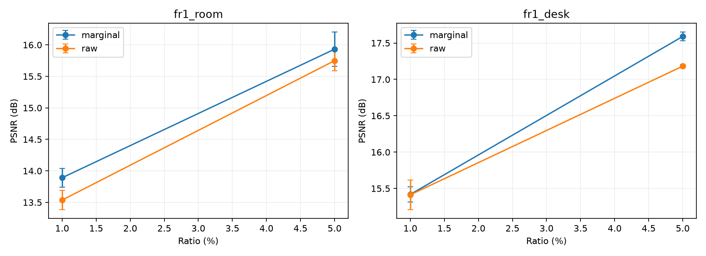
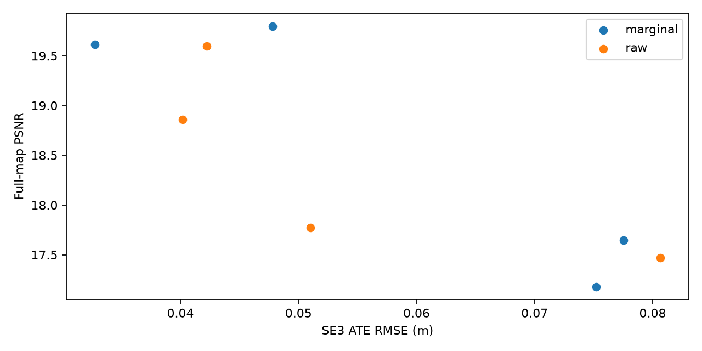
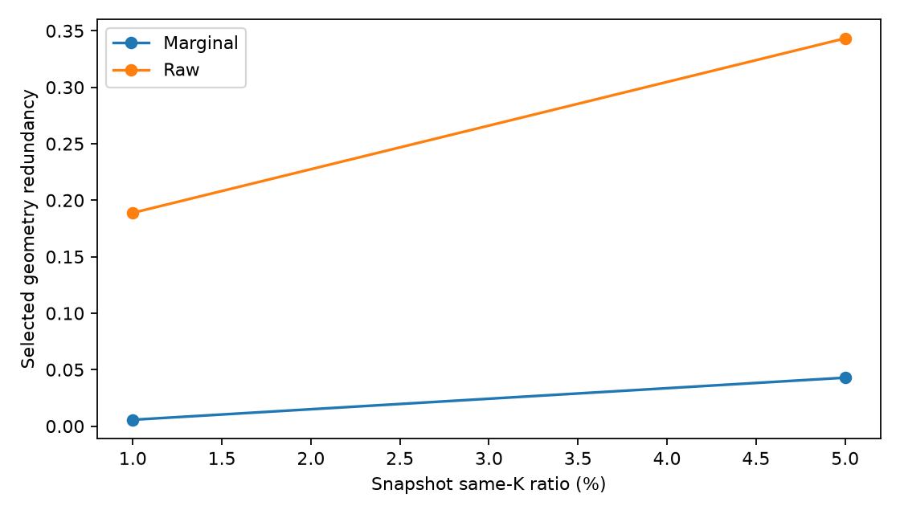

# Geometry-only Marginal SI在线报告

预注册门控结果：**Online GO（受限证据）**。**全面production-ready尚未通过，Raw仍为默认。**

fr1_room production LoD的两seed平均ΔPSNR：1% +0.3540dB，5% +0.1825dB。收益不是每个seed/ratio均为正。尤其seed2027：Full PSNR −0.5917dB，ATE 0.05103→0.07520m（+47.36%）；两seed平均Full ΔPSNR约−0.2071dB，ATE平均增加约0.01052m。这些实际回退不能被“预注册稳定回退门控未触发”解释为不存在风险。n=2不足以判断该ATE差异是方法因果还是异步SLAM波动。

fr1_room的平均Mapping增加约3.6%，但full-refresh p95为252–283ms，最大297.5ms，显著高于Raw约97–105ms的p95。未发现跨seed一致的tracking-tail延迟恶化，仍不能据此证明不存在refresh stall。因此本轮支持“offline机制与exact实现有效，online低预算有正向信号”，不支持直接把新mode作为稳健默认。以下预注册门槛保留原样，不在看到结果后改门槛或调参。

预注册门控结果（判断跨seed的稳定退化，不是逐run无损保证）：

```json
{
  "stable_quality_regression": false,
  "visible_low_ratio_gain": true,
  "full_map_regression": false,
  "systematic_ATE_regression": false,
  "snapshot_redundancy_reduced": true,
  "performance_problem": false,
  "tracking_tail_warning": false
}
```

本轮为真实TUM RGB-D全序列SLAM，不是frozen map模拟：fr1_room 1352帧、16900 Mapping，fr1_desk 573帧、7400 Mapping；每scene两seed2026/2027，Raw/Marginal配对，总8个终点模型。另有独立fr1_room Raw-teacher Shadow run，16个1000–16000 refresh的完整ranking/gains exact一致，覆盖early/middle/late。Shadow未将新teacher用于loss，已用teacher trace检查。

固定的是normal Mapping预算和原始调度规则。异步SLAM结束时刻会改变online/tail分配；mode1尾部每个Mapping含Full+native LoD，因此实际Gaussian/Selector/TF optimizer commits不保证逐次相同。下面完整披露，不能把它写成strict same-optimizer-update实验：

| scene | seed | arm | N | online_mapping | tail_mapping | gaussian_updates | selector_commits | TF_commits |
|---|---|---|---|---|---|---|---|---|
| fr1_room | 2026 | raw | 50739 | 7547 | 9353 | 26253 | 15391 | 12991 |
| fr1_room | 2026 | marginal | 56753 | 7383 | 9517 | 26417 | 15424 | 13024 |
| fr1_room | 2027 | marginal | 54297 | 7303 | 9597 | 26497 | 15440 | 13040 |
| fr1_room | 2027 | raw | 53697 | 7712 | 9188 | 26088 | 15358 | 12958 |
| fr1_desk | 2026 | raw | 24049 | 4568 | 2832 | 10232 | 6487 | 4087 |
| fr1_desk | 2026 | marginal | 26403 | 4437 | 2963 | 10363 | 6513 | 4113 |
| fr1_desk | 2027 | marginal | 25526 | 4455 | 2945 | 10345 | 6509 | 4109 |
| fr1_desk | 2027 | raw | 33290 | 4091 | 3309 | 10709 | 6582 | 4182 |

最终使用用户指定的本地项目源码（服务器同步），默认原width32 Selector，两arm相同。保留production Selector/TF后端、LR/loss、maturity/protection、ChangeDistill、densification、Bank和frame_importance。GI mode是算法变量；诊断和seed入口两arm相同且默认关闭。相同seed不能消除ORB/SLAM异步非确定性，n=2不做统计显著性声明。

Raw每次bank增量正常更新；Marginal只在既有full refresh重建。h在首个full refresh初始化，之后本map固定。每snapshot文件都保存同锁内xyz/activated radius/Raw I、source row和h，CSV记录GI/topology版本，append/prune/reset测试与online assertions防止row错位；geometry cache在refresh结束释放，不在移动地图上复用旧matrix。两次refresh之间使用历史published teacher是有意staleness，不声称membership实时跟随xyz。h与当前d50关系在online_mechanism.csv逐refresh记录，不能偷偷每次改变h。

质量使用每scene四个模型共有GT帧中等距128个frame，列表在全部模型完成、读取质量之前冻结；ATE使用所有关联pose、SE3无scale correction。Primary production selection继续使用各模型自己的cached_uniform与production maturity；actual K可不同。Secondary same-K按每scene四模型最小N确定统一K，按production probability Top-K，仅为诊断。Full渲染Master不套LoD TF，LoD按原requested ratio应用TF。

## Primary production LoD质量

| scene | seed | ratio | Raw PSNR | Marginal PSNR | ΔPSNR | ΔSSIM | ΔLPIPS | Raw K | Marginal K |
|---|---|---|---|---|---|---|---|---|---|
| fr1_desk | 2026 | 1% | 15.2686 | 15.3457 | +0.0771 | -0.0017 | +0.0005 | 251 | 251 |
| fr1_desk | 2026 | 5% | 17.1999 | 17.5486 | +0.3487 | +0.0040 | -0.0059 | 1029 | 934 |
| fr1_desk | 2027 | 1% | 15.5585 | 15.4914 | -0.0672 | -0.0050 | +0.0037 | 305 | 249 |
| fr1_desk | 2027 | 5% | 17.1643 | 17.6324 | +0.4681 | +0.0051 | -0.0058 | 1400 | 1045 |
| fr1_room | 2026 | 1% | 13.4290 | 13.9970 | +0.5680 | +0.0070 | -0.0206 | 459 | 515 |
| fr1_room | 2026 | 5% | 15.6346 | 16.1230 | +0.4884 | +0.0084 | -0.0229 | 2242 | 2426 |
| fr1_room | 2027 | 1% | 13.6456 | 13.7856 | +0.1400 | +0.0052 | -0.0161 | 453 | 460 |
| fr1_room | 2027 | 5% | 15.8637 | 15.7403 | -0.1234 | -0.0007 | -0.0081 | 2316 | 2390 |



## Full与ATE

| scene | seed | Raw Full PSNR | Marginal Full PSNR | ΔPSNR | Raw ATE(m) | Marginal ATE(m) |
|---|---|---|---|---|---|---|
| fr1_desk | 2026 | 19.6003 | 19.6118 | +0.0115 | 0.04224 | 0.03273 |
| fr1_desk | 2027 | 18.8576 | 19.7978 | +0.9402 | 0.04019 | 0.04780 |
| fr1_room | 2026 | 17.4688 | 17.6463 | +0.1775 | 0.08067 | 0.07755 |
| fr1_room | 2027 | 17.7712 | 17.1795 | -0.5917 | 0.05103 | 0.07520 |



same-K、Full-relative LoD gap、逐viewPSNR/SSIM/LPIPS、selected counts均随原始结果提供，不能把budget/maturity/pose差异伪装成pure ranking因果。

## 性能与机制

| scene | seed | Mapping overhead | 普通step overhead | Marginal刷新摊销 | refresh p95 Raw/New(ms) | New refresh max(ms) |
|---|---|---|---|---|---|---|
| fr1_desk | 2026 | +2.08% | +1.96% | 0.51% | 41.59/106.19 | 116.30 |
| fr1_desk | 2027 | -10.93% | -11.16% | 0.43% | 74.05/105.65 | 115.85 |
| fr1_room | 2026 | +3.42% | +1.71% | 0.78% | 104.85/252.47 | 282.99 |
| fr1_room | 2027 | +3.82% | +2.99% | 0.83% | 97.13/283.31 | 297.52 |

上表refresh为Raw SGI render+Marginal wrapper的连续计时和；outer render-lock等待及整个boundary GI阶段另见FullRefreshBoundaryGIIncludingLock统计。TrackingTime.txt全部原始frame都纳入本报告tracking分布；旧Python evaluator摘要的tracking均值会截去末尾3条，本报告不使用它作为tracking主值。



在线机制逐full refresh统计candidate N、occupied cells、occupancy mean/median/max、same-K、redundancy、>0.9duplicate pairs、important mass coverage、dense-cell budget share和Jaccard，见online_mechanism.csv。teacher positive/supervised/weight、compatibility mature、TF ready、zero maturity见online_teacher.csv。当前production使用continuous maturity，没有独立binary protected population，不能把TF未ready点全部称为protected。

以下为各snapshot的macro平均，是同一snapshot内Raw-vs-Marginal teacher ranking对照，不是已训练Selector mask的冗余测量：

| ranking | ratio | mean redundancy | pairs>0.9 | important mass coverage | dense-cell budget share |
|---|---|---|---|---|---|
| Marginal | 1% | 0.0057 | 0.01 | 67.53% | 16.49% |
| Marginal | 5% | 0.0429 | 7.55 | 96.30% | 22.27% |
| Raw | 1% | 0.1888 | 43.65 | 61.55% | 9.97% |
| Raw | 5% | 0.3433 | 482.09 | 92.32% | 21.65% |

两档整体mean redundancy约下降90.9%。dense-cell budget share并未下降，1%还增加：Marginal不是density penalty，而是优先用少量代表覆盖重要mass；不能把该结果解释成“dense区域预算一律减少”。

## 最终25问

1–3. IsoOnly完整ranking和四档quality exact复现；pairwise redundancy不再读取view vector，Raw Streaming GI仍使用原Bank views。

4–7. Reference最慢为candidate rescore；Python完整median=1209.342ms，Optimized15%=50.889ms、完整=77.958ms；总speedup见性能报告。

8. largest20cell逐项前后耗时与评价次数见largest_20_cells.csv，不以单个best case代表全部。

9–12. 离线lazy15%仅展开7550个selected代表，CELF评分次数减少64.00%；online为保留动态percentile语义仍完整展开每个snapshot的候选N，不把7550当online展开数。peak memory/allocations有独立记录；完整顺序、四档selected rows、复渲染质量及5次重复全部exact。

13–15. fr1_room 1/5%与fr1_desk逐seed结果如下表；同时给same-K reference，不用四档平均覆盖低预算。

16–17. 对每次真实snapshot的same-K机制统计中，100.00%的state冗余下降；这是teacher ranking，不是Selector已完全学会该ranking的证明。在线最终收益按真实render表判定。

18–19. Full-map与SE3 ATE逐seed列出；不能将estimated pose不同造成的render差异全部归因于GI。

20–22. 平均/普通step overhead、full refresh p95/max和tracking分布均保留。独立日志不能逐事件证明tracking stall因果；检查了跨seed的tail latency变化和GI association wait计数。

23–24. exact剩余成本见stage与occupancy分桶；不因offline收益自动进入Approx Sparse Neighbor。

25. 预注册统计门控：Online GO，属于受限online证据；全面production-ready尚未通过。单seed的Full/ATE回退与refresh尖峰必须保留，不能据平均收益直接默认上线。

## 解释边界与停止

若离线redundancy下降但online质量不升，优先归类为online benefit weak/NO-GO；不能倒推离线Marginal数学无效。teacher学习、snapshot staleness、h初始化尺度和SLAM pose/地图差异仍可能影响online结果。本轮没有为挽救结果调整h、refresh cadence、loss、LR、网络或sampling。

生产模式保留Raw开关，默认仍是Raw。仅验证fresh-start连续sequence；checkpoint/resume下保存与恢复固定h和published marginal state未覆盖，本轮不声称全面production-ready。没有进入Sparse Approx、self-refinement、view/covariance、CUDA优化或下一轮算法设计。未commit、未push，报告完成后停止。
