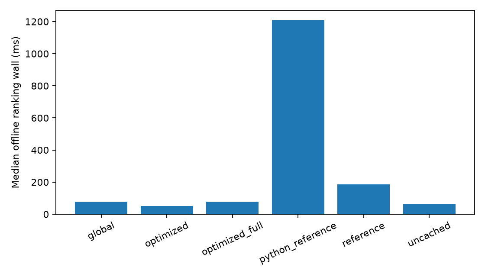
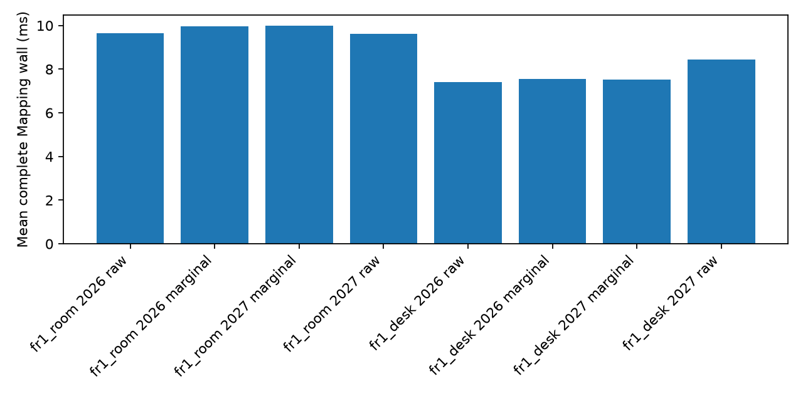

# Geometry Marginal性能报告

结论：exact实现通过完整ranking和质量gate；没有CUDA kernel、approximate neighbors或score quantization。

## 隔离CPU微测（同输入、5次）

| 实现 | 中位ms | 最小ms | 最大ms |
|---|---|---|---|
| global | 78.890 | 78.515 | 79.502 |
| optimized | 50.889 | 50.549 | 51.666 |
| optimized_full | 77.958 | 77.670 | 78.161 |
| python_reference | 1209.342 | 1205.561 | 1214.471 |
| reference | 184.526 | 183.434 | 185.828 |
| uncached | 61.888 | 61.600 | 63.043 |

Python Reference→15% Optimized Exact：23.76×；Python Reference→production完整发布：15.51×。请勿把语言更换的总收益当成CELF单独收益。

同C++ arithmetic/control：Full brute→lazy global 15%为2.34×；lazy global→CELF 15%为1.55×；uncached CELF→cached CELF 15%为1.22×。无cache control是独立benchmark-only header，未进入production，selected rows同样exact。

Reference首次profile：1.255s，其中rescore728ms、similarity181ms，瓶颈为重复candidate评分。CPU FP64执行，offline GPU time=0、kernel launch=0、CPU↔GPU copy/sync=0。输入读取不包含在核心ranking计时里，CLI输出IO不包含在native核心计时里。

15%只选择7550/50330个代表，所有cell仍需初始化第一个head以建立全局竞争；CELF相比相同global expansion减少64.00%次真实gain评估。完整CELF相比native完整brute减少85.79%次评估。各mode总评估数：{'reference': 1005440, 'global': 224409, 'optimized': 80798, 'optimized_full': 142897, 'uncached': 80798}。

缓存pair数1859890，bytes=14879120（14.19MiB），只限同cell，无全scene NxN。所有评分查询来自该snapshot dense cache，缓存命中率100%；初始化geometry构造不计为命中。最大的cell occupancy250。8个occupancy桶见occupancy_bucket_profile.csv，最大20cell逐项耗时见largest_20_cells.csv，未用全局平均掩盖dense cell。

| cell | n | Python_reference_ms | reference_total_ms | reference_evaluations | reference_selected | global_total_ms | global_evaluations | global_selected | optimized_total_ms | optimized_evaluations | optimized_selected | optimized_full_total_ms | optimized_full_evaluations | optimized_full_selected |
|---|---|---|---|---|---|---|---|---|---|---|---|---|---|---|
| 4037.0 | 250.0 | 31.4735 | 10.5913 | 31625.0 | 250.0 | 2.9208 | 4347.0 | 17.0 | 1.2344 | 385.0 | 17.0 | 1.5639 | 827.0 | 250.0 |
| 3881.0 | 229.0 | 29.0164 | 8.234 | 26564.0 | 229.0 | 2.267 | 3544.0 | 15.0 | 1.0428 | 391.0 | 15.0 | 1.2698 | 770.0 | 229.0 |
| 3889.0 | 209.0 | 22.4383 | 6.3108 | 22154.0 | 209.0 | 1.7292 | 3030.0 | 14.0 | 0.8047 | 341.0 | 14.0 | 1.0068 | 701.0 | 209.0 |
| 4192.0 | 192.0 | 18.4763 | 5.1074 | 18720.0 | 192.0 | 1.9436 | 4163.0 | 22.0 | 0.7559 | 394.0 | 22.0 | 0.915 | 704.0 | 192.0 |
| 3366.0 | 181.0 | 16.0944 | 4.3753 | 16652.0 | 181.0 | 1.0919 | 1420.0 | 7.0 | 0.6522 | 225.0 | 7.0 | 0.827 | 531.0 | 181.0 |
| 4181.0 | 180.0 | 15.6783 | 4.3104 | 16470.0 | 180.0 | 1.3114 | 2262.0 | 12.0 | 0.6947 | 259.0 | 12.0 | 0.8131 | 576.0 | 180.0 |
| 3513.0 | 171.0 | 13.7285 | 3.7266 | 14877.0 | 171.0 | 1.1739 | 2303.0 | 13.0 | 0.5188 | 246.0 | 13.0 | 0.6576 | 540.0 | 171.0 |
| 3885.0 | 155.0 | 9.872 | 2.8186 | 12245.0 | 155.0 | 0.6528 | 1064.0 | 6.0 | 0.4084 | 219.0 | 6.0 | 0.5817 | 501.0 | 155.0 |
| 3758.0 | 149.0 | 9.7123 | 2.6946 | 11324.0 | 149.0 | 0.6221 | 735.0 | 4.0 | 0.4558 | 160.0 | 4.0 | 0.5234 | 386.0 | 149.0 |
| 3761.0 | 148.0 | 8.6496 | 2.5027 | 11174.0 | 148.0 | 0.6468 | 1156.0 | 7.0 | 0.3771 | 230.0 | 7.0 | 0.5126 | 514.0 | 148.0 |
| 3892.0 | 148.0 | 8.7613 | 2.6075 | 11174.0 | 148.0 | 0.8964 | 1710.0 | 11.0 | 0.448 | 231.0 | 11.0 | 0.5637 | 476.0 | 148.0 |
| 3899.0 | 145.0 | 8.0151 | 2.3808 | 10730.0 | 145.0 | 0.7289 | 1405.0 | 9.0 | 0.4303 | 213.0 | 9.0 | 0.5256 | 444.0 | 145.0 |
| 3504.0 | 144.0 | 7.9099 | 2.5282 | 10584.0 | 144.0 | 0.7842 | 1260.0 | 8.0 | 0.4266 | 178.0 | 8.0 | 0.5157 | 379.0 | 144.0 |
| 3636.0 | 142.0 | 8.916 | 2.2612 | 10295.0 | 142.0 | 0.5987 | 837.0 | 5.0 | 0.3929 | 186.0 | 5.0 | 0.4844 | 408.0 | 142.0 |
| 3617.0 | 131.0 | 6.9513 | 1.9128 | 8777.0 | 131.0 | 0.683 | 1265.0 | 9.0 | 0.3612 | 186.0 | 9.0 | 0.4426 | 389.0 | 131.0 |
| 3055.0 | 128.0 | 6.6745 | 1.7226 | 8384.0 | 128.0 | 0.4862 | 875.0 | 6.0 | 0.3196 | 189.0 | 6.0 | 0.4012 | 379.0 | 128.0 |
| 4045.0 | 128.0 | 5.9056 | 1.6761 | 8384.0 | 128.0 | 0.4961 | 1116.0 | 8.0 | 0.2783 | 265.0 | 8.0 | 0.3918 | 532.0 | 128.0 |
| 3506.0 | 126.0 | 6.3692 | 1.6626 | 8127.0 | 126.0 | 0.4454 | 741.0 | 5.0 | 0.2812 | 143.0 | 5.0 | 0.364 | 349.0 | 126.0 |
| 1746.0 | 125.0 | 5.8526 | 1.582 | 8000.0 | 125.0 | 0.7789 | 2310.0 | 19.0 | 0.3207 | 284.0 | 19.0 | 0.3767 | 420.0 | 125.0 |
| 4032.0 | 125.0 | 6.0902 | 1.7258 | 8000.0 | 125.0 | 0.6715 | 1434.0 | 11.0 | 0.34 | 174.0 | 11.0 | 0.4235 | 365.0 | 125.0 |

CPU process-time、peak RSS见final_offline_profiles.json；Python tracemalloc单独运行，traced peak=7.73MiB。Python live allocation snapshot差值不等于累计分配次数；已标明估算的NumPy allocation-site计数。Native allocator用独立LD_PRELOAD libmemusage测量，原始malloc/realloc/free总数和peak heap见native_allocations_*.log/native_allocation_profiles.json，不把其instrumentation开销混入speedup。Python/NumPy runtime的RSS不能与独立native RSS直接视为算法节省量；Linux进程high-water RSS也可能包含launcher/fork历史，实际native heap对照如下。

| 实现 | malloc calls | 累计分配bytes | peak heap bytes |
|---|---|---|---|
| optimized | 71459 | 29964995 | 24867648 |
| optimized_full | 71465 | 31800048 | 25785152 |
| reference | 71468 | 36387523 | 27358016 |

优化后没有末尾全局sort，所以production merge_ms字段为0；这不代表global heap免费。heap push/pop、容器分配和未归类host逻辑体现在ranking total减去已测cell/grid阶段的residual，单独保存于online_stage_profile.csv，不将其伪装为直接测得的纯heap耗时。

独立timer-only profile测得15% global heap push/pop合计约1.486ms；只用于阶段归因，不混入speedup样本。Reference追加只读计时将membership单列，最终grid=33.716ms、membership=108.861ms、global merge=6.034ms，见final_python_reference_profile.json。

## 在线成本（真实端到端）

| scene | seed | Mapping overhead | 普通step overhead | Marginal刷新摊销 | refresh p95 Raw/New(ms) | New refresh max(ms) |
|---|---|---|---|---|---|---|
| fr1_desk | 2026 | +2.08% | +1.96% | 0.51% | 41.59/106.19 | 116.30 |
| fr1_desk | 2027 | -10.93% | -11.16% | 0.43% | 74.05/105.65 | 115.85 |
| fr1_room | 2026 | +3.42% | +1.71% | 0.78% | 104.85/252.47 | 282.99 |
| fr1_room | 2027 | +3.82% | +2.99% | 0.83% | 97.13/283.31 | 297.52 |

online_stage_profile.csv包含完整Mapping/普通step/online-tail、SGI增量、full refresh、grid、membership、similarity、初始化、CELF rescore、coverage、完整ranking、teacher、Selector forward、LoD joint backward、render/TF的count/mean/median/p90/p95/p99/max。MappingProfiler给host-wall和既有sampled CUDA摘要，不把host launch gap当GPU kernel time。LoD backward是同一autograd图的Selector+TF/Gaussian联合反向，不能宣称已单独测出Selector kernel backward时间。

CPU/GPU utilization、peak RAM/VRAM及原生Torch allocator peak见online_resource_usage.csv。GPU和RAM按1Hz采样可能漏过短峰；原生CUDA allocator峰值完整保留。首个Raw run退出时monitor遇到/proc无VmRSS，保留已完成模型和全部Mapping trace，不重训；该run资源样本缺失且退出码未捕获，不能把缺失量写成0。其余run正常采样。所有计时来自同一instrumented配置；Raw也付出只读snapshot复制/导出成本，因此另报告new wrapper总时间/Mapping steps作为刷新专属摊销（包含diagnostic IO，不包括append/prune hook成本，不能当严格总开销上界）。

fr1_room完整Mapping从Raw约9.62ms/step增至约9.97ms/step，增加约0.35ms/step；其中Marginal refresh wrapper摊销约0.076–0.079ms/step。其余差值含地图规模和online/tail分配差异，不全归因于ranker。

是否需要ApproxSparseNeighbors：本轮不进入。先依据以上exact端到端开销和质量决定；不能把语言/CPU微测通过等同production-ready。
